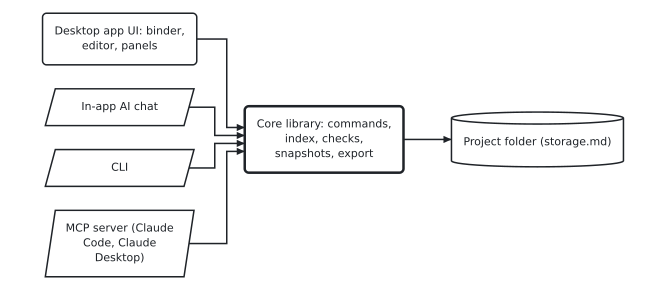

# Libreto — app type (draft 0)

Topic 4 of the Libreto design agenda. Status: **for discussion**; nothing here is built yet.
Builds on `storage.md` (writer core first, modules, non-technical users) and requirements §2 G, K, P.

## 1. What the app must be

- A desktop app installed like any other, on Linux first, then Windows and macOS with the same project folders (R-4, P-1). Works offline, no account (R-66).
- Feels like a word processor (P-5): binder, editor, full view, comments panel, export.
- One **command layer** that does every change (rename, move chapter, add comment, create character…). The UI, the CLI, the MCP server and the in-app AI chat all call it, so anything a person can do, the AI can do, and the other way round (R-48, R-102).

## 2. Shape

 <!-- drawspec-render -->

<details><summary>Diagram source</summary>

```drawspec
{"version": 1, "kind": "flow", "title": "One core, four ways in",
 "nodes": [{"id": "ui", "text": "Desktop app UI: binder, editor, panels", "role": "step"},
           {"id": "chat", "text": "In-app AI chat", "role": "io"},
           {"id": "cli", "text": "CLI", "role": "io"},
           {"id": "mcp", "text": "MCP server (Claude Code, Claude Desktop)", "role": "io"},
           {"id": "core", "text": "Core library: commands, index, checks, snapshots, export", "role": "emphasis"},
           {"id": "files", "text": "Project folder (storage.md)", "role": "store"}],
 "edges": [{"from": "ui", "to": "core"}, {"from": "chat", "to": "core"}, {"from": "cli", "to": "core"},
           {"from": "mcp", "to": "core"}, {"from": "core", "to": "files"}]}
```

</details>

The core is a library with no UI. The CLI and MCP server are thin wrappers around it, usable without the app open (R-48).

## 3. Technology options

| | A. Electron + TypeScript | B. Tauri (Rust) + TypeScript UI | C. Qt (C++ or Python) |
|---|---|---|---|
| Rich-text editor | Best available (ProseMirror/TipTap, used by many writing apps) | Same web editors | Weaker; long-document editing is hard |
| One language for core, CLI, MCP, UI | Yes (TypeScript) | No: core in Rust or split | Yes, but no web editor ecosystem |
| Download size / memory | Large (~100 MB) | Small (~10 MB) | Medium |
| Linux, Windows, macOS | Yes | Yes (webview differences per OS) | Yes |
| AI SDKs (Claude Agent SDK, MCP) | First-class in TypeScript | Via a TypeScript sidecar | Python SDK, if Python |

**Decided (Ivan, 2026-11-04): A.** The editor is the heart of a writer's tool and the web editors are far ahead; one language keeps the core, CLI and MCP server identical. Size is the price; Tauri stays possible later because the UI would be the same web code.

## 4. The editor

- ProseMirror-based (TipTap), editing Markdown underneath: paragraphs, headings, emphasis, lists, quotes, links, `@mentions`.
- Full view: the chapters of the binder (or a selection) shown and edited as one continuous text; edits go back to each chapter's file.
- Comments as side notes anchored to a paragraph and quote (storage §6); AI suggestions shown as suggested changes to accept or reject one by one.
- Modules add their own views next to the text: timeline, map, graph (Game), screenplay-style dialogue editor (Game).

**An adaptive workspace.** Like Adobe's workspaces, the screen arranges itself for the task: *Write* (binder + text), *Plan* (cards, timeline, characters), *Review* (text + comments + AI proposals), and the Game module adds *Puzzles* (graph + scene). Each is only a preset: any view can open in the left or right panel at any time, and a new module just registers new views, so nothing closes doors later. Design rule (Ivan): usefulness first, clear and simple views, everything where you expect it, minimal noise, good readability.

## 5. AI inside the app (R-102)

**How the AI changes things.** The AI acts only through the command layer, never by writing files. Every change arrives as a **proposal**, shown much more clearly than Word's revisions:

- A one-line plain summary first: "Rename *Rosa* to *Rosario*: 14 mentions in 6 chapters, 2 notes, 1 character card".
- Then each place as **before | after side by side**, whole paragraphs, the changed words highlighted; no strike-through soup mixed into the text.
- A list of all affected places to jump through; accept or reject each one, or all at once. Nothing changes until accepted, and accepting takes a snapshot first, so it can always be undone.

**Skills**: Libreto ships task guides (rename, reorder and check, plan characters, fair-puzzle review…) and the project's own `context/` files (style, tone, rules, R-50) are given to the AI every time.

**Using the writer's Claude subscription, not an API key.** Checked 2026-11-04 in the Claude Agent SDK documentation: *"Unless previously approved, Anthropic does not allow third party developers to offer claude.ai login or rate limits for their products, including agents built on the Claude Agent SDK."* So a "Sign in with Claude" button inside Libreto needs Anthropic's approval. Plan:

1. **v1: connect Claude to Libreto.** A "Connect Claude" button registers Libreto's MCP server in the writer's Claude Desktop (or Claude Code) in one click. The writer chats in Claude Desktop with their own subscription; Claude works through Libreto's commands, and the proposals appear in Libreto's Review workspace as above. This is allowed today and uses no API key.
2. **Optional in-app chat with an API key**, for those who want everything in one window and accept pay-per-use.
3. **Ask Anthropic for approval** of in-app sign-in (through their sales/partners contact) once Libreto is usable; if granted, the in-app chat signs in through a browser window, as Ivan wants.

Without any of these, the app works fully, just without the AI. The same MCP tools let Claude Code work on a project with the app closed (R-48).

## 6. Decisions and open questions

Decided (Ivan, 2026-11-04):

1. Electron + TypeScript (§3).
2. Adaptive workspace with presets and free panels (§4).
3. AI changes shown as plain summary + side-by-side before/after, accepted one by one (§5).
4. The writer's subscription is preferred over API keys; nacho-viewer is not a model, only the clean visual result is.

Open:

1. **AI path for v1** (§5): start with "Connect Claude" (Claude Desktop beside Libreto, subscription, allowed now), while asking Anthropic for in-app sign-in? Proposal: yes.
