# Libreto — Specification

> Reviewed copy of `libreto-screens-d5-v1-2026-11-11-0006-reader.html` with the notes of `review-notes-d5-2026-11-13.md`: the document as it was annotated, with 73 notes by the owner under the sections they are about (exported 2026-11-13 · 73 notes). The HTML file is the annotatable version; open it in a browser to read the notes beside the text.

## Preamble & scope

**Revision**: 1

Status: **for annotation.** One document, in the order a writer who has never seen Libreto would meet things. Before each screen, a short paragraph says how you get there, what it is for and what it lets you do; then the picture. Not a guide and not a specification. The pictures are in `concepts-d4/`; the review page puts a note field under each one.

Draft 5 answers the notes on draft 4 (screens 1 to 8 so far) and keeps draft 4's answers to the draft 3 notes. What changed, and why, is at the end, with the open questions.

## Libreto in one minute

Libreto is a writing app for books. Its window is a **page in the middle**, with two columns that can open beside it and never move it: on the **left**, a list of what you are working on (the chapters; in Research, your material); on the **right**, the **Reference panel**, which shows one thing at a time: a person, a place, a research topic. Along the top, five **modes** name the job you are doing: **Write, Plan, Research, Review, Book**. Choosing one dresses the same window for that job; it never takes you somewhere you cannot come back from with one key.

The AI has **one door**: the round **Ask** button at the bottom right of the window, or `Ctrl+K`. The same box finds a chapter, looks up a name, runs a command ("export PDF") and asks a question about the book; when the question needs the AI, the box becomes a conversation. The AI can do anything you can do in Libreto, but it never changes your text, your chapters or your cards without a button you click first. When no AI is connected, the button is gray and the box still finds, looks up and runs commands.

Six rules hold everywhere:

1. **The page never moves.** Columns open in the margins; the text stays centered.
2. **One family of marks.** Red, blue and green underlines on the exact characters; small icons in the right gutter at the exact line; the same icons count in the chapter list, in the Review list and in the Highlights menu.
3. **One way back.** `Esc` closes whatever just opened and returns the cursor to the text; `Back` (`Alt+←`) returns from any jump, across modes too; `Ctrl+Shift+H` hides both columns and brings them back.
4. **Nothing replaces your words unasked.** Fixes while you type are small, green and undoable; everything else arrives as a proposal with buttons.
5. **Keys that exist on every keyboard.** Letters, digits, F-keys and Enter with `Ctrl`, `Shift` and `Alt`; no brackets, slashes or backslashes.
6. **One Undo, one notice.** Everything that changes the text, yours or Libreto's, is one list: `Ctrl+Z`, the Undo on a notice and the ✗ on a card are the same step. A notice is a card at the bottom of the page, never on a timer, and a line in History.

| Mode | Left | Center | Right | What it is for |
| --- | --- | --- | --- | --- |
| Write | chapters (optional) | the text | Reference (optional) | writing; the default |
| Plan | none | cards, the whole window | the clicked card's detail, beside it | seeing and reordering scenes |
| Research | your library: the Codex (what the book says) above your topics (what you gather) | a topic or a Codex entry, large | what it links to | gathering and sorting material |
| Review | chapters with counts and filters | the text, margin open | notes beside their lines | the second pass |
| Book | page thumbnails | spreads | layout settings | printing and exporting |

History, Compare, Statistics and Help are not modes: they open **over** the window as a sheet with "Back to the text" at the top left, and `Esc` closes them.

> [!NOTE]
> **Review note** · Libreto in one minute
>
> I'm not yet convinced about Codex and Research in the same place. I'll see later how you did it.
> Research could be something like "A list of ways in which a time travel could fail". That is not a character or a place, they are just concepts and they are not directly stored in the Codex. Maybe we need a Codex navigator and a Research as two different things. Not sure yet, I don't know how Codex will actually be.

## S01 · Start

When Libreto opens with no book, it asks for the least it can: a title, what kind of text it is, and where to keep it. The **kind of text** is a row of plain choices (Novel · Novel without parts · Short story · Play · Essay · Plain text) and each one is only a set of names for up to three structure levels: a novel has parts, chapters and scenes; a play has acts and scenes; a short story has scenes; plain text has none. Those names are then used everywhere (the left list, the Insert menu, the Plan lanes, the printed book), and a book can gain or lose a level later from the Insert menu, so the choice is a start, not a cage.

Under the location there is no sentence to parse anymore. A label, **"Will be stored in"**, and under it the **full path on one line**, growing as you type the title; characters a folder cannot hold are dropped from the folder name as you type (the title keeps them). The line under that is always there: one folder per book, inside it the text as plain Markdown files, one per chapter, readable in any editor without Libreto; notes, research and history in their own subfolders. "Documents/Libreto" is the default (on a Spanish system it reads "Documentos/Libreto"); "Change…" picks another place and the path updates.

Each book gets a **cover tile**: a colored square with the title's initial by default, a picture if you drop one, or a small sketch from the AI when one is connected ("Sketch a cover" under the tile). The tile shows here, in the recent books, and on the Book mode's title page until a real cover replaces it. Recent books open with one click; "Import a Word file" turns a manuscript's headings into chapters.

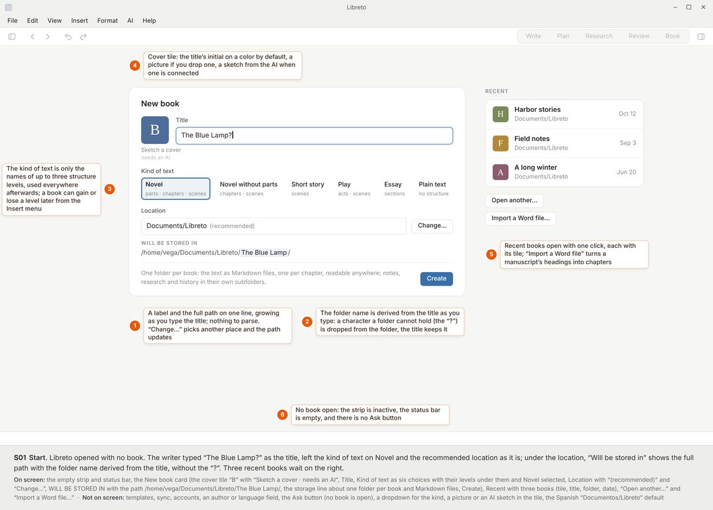

> [!NOTE]
> **Review note** · S01 · Start
>
> Cover: It should not be called cover, because we could add (and should) a cover design. Unless you are meaning just that. What I'd like here is, for example, having the ability to select from a set of predefined generic images or just a color chosen by the user.
> About Novel and Novel without parts, I don't like it. If the user can create or just not create parts, that should be enough, so only Novel with the three. In that sense, Short story would also be included there without any change. The rest can make sense, although for a Play (I understand it includes a movie script, for example), we don't have yet the tools (characters line with the dialog below it), that can be work for later. When you say sections for an essay, does it include subsections and sub-subsections? And Plain text that does not use anything, could also be included in the same as Novel without using them. Or what is really the difference? The automatic scene creation? Chapter detection? We must think of it. I understand the difference between a novel-short story-simple text and a script or essay, but we should not block user's creativity because we want it one way. We need not to force the user to use our tooling at all.
> Ok with the rest: page structure, open recent projects and other ones...
> I don't like the "New book" title: what if someone are not writing a book? Maybe project is better.
> And about Word, we must see how a Word document can be ported to our system. Maybe we need AI magic here, because everyone uses Word as they like.

## S02 · Write, the first minute

A new book opens on its first chapter in Write mode, both columns closed. The heading reads "Chapter 1" in gray: a placeholder, since a numbered chapter needs no title, and typing replaces it. The top strip has the left toggle, Back, Forward, Undo and Redo, then **where you are** (chapter › scene, each a menu of its siblings) with all the room it needs, and at the right end the five **modes** as a pill, next to the right toggle. The pill is the same width everywhere, so the eye learns its place; the breadcrumb grows and shrinks beside it, and on a narrow laptop with a large font it is the breadcrumb that gives way, never the modes. The status bar shows the style at the cursor (in its own look), the words, the page this would be in the printed book, and how many small fixes Libreto made; **every item that opens a menu looks like it does**, with a soft background and a small ▾. The round **Ask** button at the bottom right is the AI's door; its tooltip says `Ctrl+K`.

The marks are the thing to look at. Three underline colors, always on the exact characters: **red** dotted for a word Libreto does not know and cannot fix alone, **blue** dotted for grammar or punctuation it proposes, **green** dotted for a change it already made. The rule for what gets done without asking is short: **Libreto changes by itself only what has one possible answer and does not touch meaning**: a word that is not a word with exactly one correction one slip away ("teh", "recieved", a doubled letter, a missing apostrophe), a space before a comma, a double space, straight quotes to curly. Two possible answers ("quite" or "quiet" are both words), agreement ("the letters was"), anything longer than a word: proposed, in blue. When a fix happens, the red underline fades to green in under half a second and the icon appears in the gutter; the text never moves. In the right gutter, **one icon per line**, with a small count when a line holds several.

**Hovering any mark**, or resting the cursor inside it and pressing `Ctrl+.`, opens the same small card everywhere: a title that says what happened ("Fixed · typo", "Proposed · grammar"), **Was** and **Now**, and two buttons, ✓ and ✗ (`Enter` and `Delete` while the card is open; `Esc` closes it). `F8` and `Shift+F8` jump to the next and previous mark. A grammar proposal is **one underline under the whole affected text**, never two underlines for one problem. One word carries one underline: red before blue (spelling is settled before grammar is judged), blue before green (an open proposal shows over a done fix); the gutter icon still counts both.

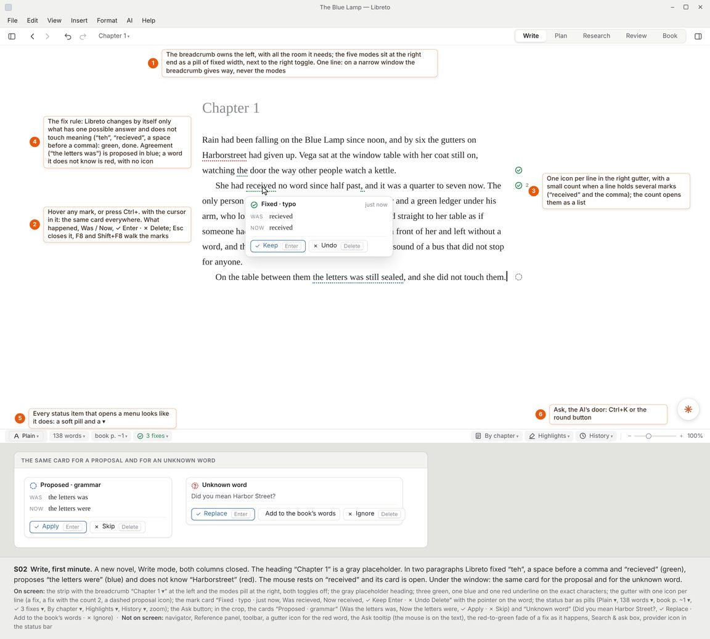

> [!NOTE]
> **Review note** · S02 · Write, the first minute
>
> About "WAS" and "NOW", we should make sure the difference is correctly seen. For example, with italics or another color:
> the letters _was_
> the letters _were_
> Don't play too much with italics and bolds, because the text could have emphasized or bolded words, better by color, since our tools don't allow (I think) to put text in color. (Look at this later with styles).
> Add a keyboard shortcut to "Add to book's words" (again, better "project"?).
> When you show "Enter" and "Delete", does it mean it will be seen like that or just when hovering? I prefer hovering, but I also understand basic users won't think about hovering... Let's think about that too.

> [!NOTE]
> **Review note** on _“A new book opens on its first chapter in Write mode, both columns closed. The heading r…”_
>
> We must think again if "Chapter 1" should even appear, with what I just told you.
> One idea: should modes look more like tabs in the project? Would it make the whole job easier to understand? As if you are working on one part but you have the rest. Or that could look that base content may differ between tabs? At least, separate the modes a little from the right panel toggle.
> I'd like to see an example of a style other than Plain in the status bar.

> [!NOTE]
> **Review note** on _“The marks are the thing to look at. Three underline colors, always on the exact charact…”_
>
> We must show spaces somehow if the user wrote two of them and we deleted one. When the user wants to check it, we can't just show that "  " was replaced by " ", because nothing will be seen.
> About underlining, I don't like mixing them. I think red, blue and green should each have its own height to be painted, so they don't overlap.
> Shouldn't red underlines have their own mark at the gutter?
> Or maybe in write mode we shouldn't even show the marks on the gutter and keep it for Review mode, and just underlines here?
> Then, when hovering one underline, beside Accept and Reject buttons could there be something that redirects to Review mode, in case the writer is wishing to do it right now.
> Next and Previous buttons should also be there (with hovering F8 and Shift-F8).
> Keys must be everywhere for advanced users to work quickly, without using the mouse.
> By the way, when moving between modes, should we keep the current cursor place or each mode has its own point where the user was working?

> [!NOTE]
> **Review note** on _“Hovering any mark, or resting the cursor inside it and pressing Ctrl+., opens the same …”_
>
> What I just told you, let's make all errors be shown. Same color ones may overlap, if that can happen (maybe by bolding common parts), but different colors at different heights (close to each other). When only one underline present, it will be at the right top place, they don't have a predefined height to be shown given the color.
> How to make the user know about the Ctrl+. shortcut?

## S03 · The marks, up close

Not a moment in the app: the family of marks at twice the size, so the rules can be checked once. Underlines: red = unknown word, blue = proposed, green = done by Libreto; a **dashed gray** underline or rule = structure Libreto proposes but has not made (a detected chapter heading, a detected scene break). Nothing exists until you keep it: a proposed heading stays an ordinary paragraph, and only "Keep" styles it as a heading and starts the chapter file at the next save. Gutter icons at the exact line: an amber **note**, a blue **task**, a green **fix**, a dashed gray **proposal**; one icon per line, with a count when a line holds several. **Clicking a count** opens the stack as a list card: one row per mark, Was → Now, ✓ and ✗, `Enter` walking down the rows. Red marks have no gutter icon: they are the one mark you fix by typing, and their card offers the candidates ("Did you mean…") and "Add to the book's words", which makes a Codex entry. In Review they do appear, as a **Spelling** filter and in the walker.

The same icons, with numbers, count notes and tasks beside each chapter on the left, label the filter chips in Review, and sit beside the checkboxes of the Highlights menu. Review filters by **people, not roles**: You · Marta · AI. Names come from sharing (you name the reader when you send a copy, and the notes that come back carry that name), Word comments bring their author, and anything unnamed is "A reader", renameable; the AI never guesses who someone is. The rule to remember: **dotted green is done, dashed gray is proposed, icons in the gutter are things to look at, and every one of them opens the same card.**

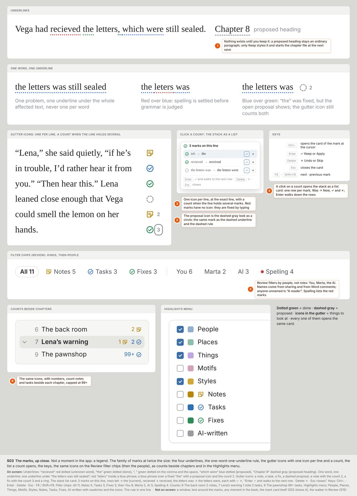

> [!NOTE]
> **Review note** · S03 · The marks, up close
>
> What is the circled 3? Does it mean there are too many icons and numbers? We must have it on mind: what if a line takes too much space?
> When zooming in and out, these line icons are updated?
> When clicking on a badge + number, it shows a small list of items stacked. What if the text doesn't fit? Can they be extended?
> About keyboard shortcuts: do you think we could have a shortcuts icon at some pages where keyboard options are not clear? I mean, same as other apps have a question mark to get contextual help, maybe a small icon could open a dialog like the one you showed as "KEYS". Only if this can be helpful everywhere. It should be shown at every screen where it can make sense, always contextual. Or even a global one for all the app.
> How filters in review work? I mean, if something is in Marta but also in Tasks?
> Again, about tasks, we need to define what tasks are compared to other fixings.
> Where do filters appear in Review mode? I'm not sure about that.

> [!NOTE]
> **Review note** on _“Not a moment in the app: the family of marks at twice the size, so the rules can be che…”_
>
> If nothing exists until accepted, how do these change survive to app restart?
> Colors and specifically gray proposals are confusing to me: For me, we have three things:
> - Red underline: unknown word (it should also have a red badge to the right)
> - Blue underline: A grammar issue (it should also have a blue badge to the right)
> - Green underline: Applied fix (I don't understand if it is already applied with what you just said)
> Then, we have gray for proposals. Aren't the rest also proposals? What's the difference with a gray issue and the rest?
> And then, what are blue tasks?
> I'd like it to be clearer: You can show or not show underlines in write mode. Those are the three I mentioned. Then, in review mode, you'll see the gutter badges (and also underlines). But we need to make colors consistent in all the app. I don't know how tasks are different from the rest of things to fix, but maybe we need another color. Review mode should be used to see all lines with ANY type of issues that haven't been fixed in write mode (because the writer didn't want it or because underlines were disabled) and fix them in batch (in a very quick and continuous mode that allows to accept, reject or edit a text very easily and go back to next correction). So, in write and review mode, the Highlights menu should mean different things and have different icons: underlines for write and badges for review. At this point we should ask ourselves if we actually need a review mode. I think it is good to have it, but then we must think how not to overlap functions between both modes. Underlying for write and badges + workflow for review sounds almost good.
> Please, think of all cases and tell me if I'm overlooking something. Highlights menu should be something like usual "View" menu.
> Oh, by the way, what about hiding the menus like Claude Desktop app does? I can't paste it here, but it is an icon like three lines that shows regular menus so they are not taking vertical space. Don't know how it works on macOS, though. It's to the left of the left panel toggle.
> So a word added to the project is also part of the Codex?

> [!NOTE]
> **Review note** on _“The same icons, with numbers, count notes and tasks beside each chapter on the left, la…”_
>
> Again, filling the chapter list with badges should only be part of Review.
> About people, how are they stored in the project? How do we export for someone and import from them? I mean, who asks it? I understand if AI does that work, then it's easy, but anything AI can do, the user should be also able to do it with menus, modes and/or keys.
> About this, we must think of the app to be used by humans alone or by humans and AI. AI can enhance the app experience, but not everyone will be able to have it or pay for it. At this point, it is not clear which things can be done without AI, being Codex my main concern. We should have it specified somewhere (maybe not in screenshots doc but in the real spec): is it possible to use libreto without AI at all? How different is experience with each mode?
> Oh, and we should give the user easy ways to configure AI, maybe the first time they open the app or regularly with some notice at the top right or center bottom or wherever it fits better. Maybe we need to create a notification system, consistent in all the app.
> How to rename "A reader"?
> About "... starts the chapter file at the next save", what is next save? Isn't it continuous?
> Icons: check boxes look as if they were already fixed. Let's use specific icons for each.

## S04 · Coming back

Libreto reopens exactly as you left it: same mode, same chapter, same columns, the cursor where it was. No dialog asks what you want to do. Instead a **notice card** at the bottom of the page says where things stand: when you last wrote, what is waiting (cards not placed, clippings in the Inbox, notes to review), with a button for each. It is on no timer: it stays until you type or click elsewhere, and then **slides into the Ask button**, so you see where it went. From then on, "Where you left off" is the first item in Ask's clock menu, the top suggestion in an empty Ask box, and the first row in History; nothing seen late is lost. The card can be turned off in Settings.

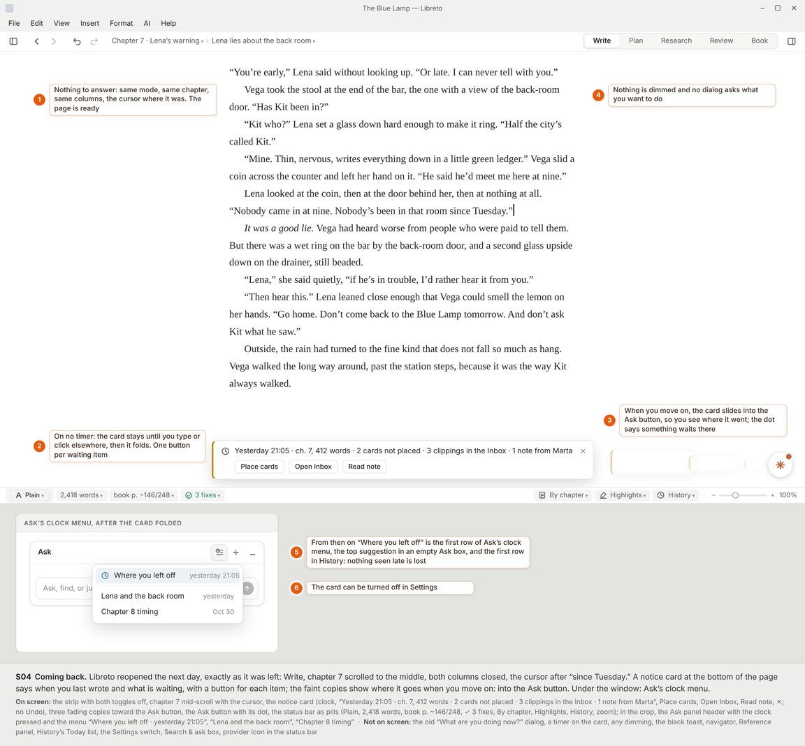

> [!NOTE]
> **Review note** · S04 · Coming back
>
> Hmm... Ok, we'll need to test it to see if it works as expected. The clock button is not easy to find or see. But if you keep a dot in the Ask button and maybe in History menu too, that should be enough. Well, not on both... Hmm again.
> About the notification, let's think about a notification system for all the app, so notices always appear at the same place. Or even an icon somewhere for not reviewed things. Like Windows notification area, but discreet, not overloaded with things that are not useful, etc. Maybe to the right of the right panel toggle? Same as we could put the menus as an icon at the left of the left panel toggle. I don't like moving panels icons far from the side...
> About notification cards, although they can have the X, maybe a "Done" or "Understood" or similar button would make clearer the user's intention to dismiss it. Or even something that says "You can always check 'History'", where it should be the right place to store it, not in Ask.

## S05 · Chapters, on the left

Open the left column with the icon at the top left or `Ctrl+Shift+L`. It lists the structure levels by the names your kind of text gave them: parts, chapters and scenes for a novel. Scenes are indented under their chapter with a thin guide line and lighter text, **no bullets**, so nothing on this list looks like a mark. Beside each chapter, the same gutter icons count the notes and tasks waiting there, capped at 99+ (the exact number is a hover away; word counts live on the Plan cards, in Statistics and in the same tooltip). One click peeks at a chapter without leaving your place; a double click goes there; `Back` returns. The filter box at the top matches **titles and text**, so "lena" shows every chapter where she appears, with a count, and the matched letters in a title are highlighted. Nothing finer is offered here: Find (`Ctrl+F`) and Ask do the rest.

Every row has a right-click menu for its level. A **chapter**: New chapter before / after, New part before / after, Rename, Remove the chapter mark (the text joins the previous chapter), Delete chapter…. A **scene**: Rename, Start a new chapter here, Remove the scene break, Delete scene…. A **part**: New part before / after, Rename, Remove the part mark (its chapters stay). Removing a mark never deletes text, asks nothing, and has Undo; deleting does ask, in words that mean something: "Delete the scene 'Vega asks about Kit'? 1,300 words, about 5 pages, go to History." Cutting text from one chapter and pasting it into another is allowed, scene break lines included, and nothing interrupts the paste; if the AI later finds the timeline broken, that is a task in the margin, not a dialog.

**"+ New chapter"** at the bottom adds one after the current chapter, with the cursor in its heading and a notice that says where it went. The same from the Insert menu, from `Ctrl+Enter` (the text after the cursor becomes the new chapter's first paragraph), or by typing "Chapter 8" on its own line. **Dragging a row does not move it**: a small sign under the pointer says "Moving happens in Plan", the Plan mode lights up in the strip while the rest dims, and clicking the sign opens Plan with that chapter's card selected. Structure can grow later: adding the first part puts every chapter in "Part One", and removing the part level keeps the chapters. **Front matter** is the first row of the list, with a title page, a dedication and an epigraph as styles inside it, printed only if filled; **Back matter** closes the list the same way.

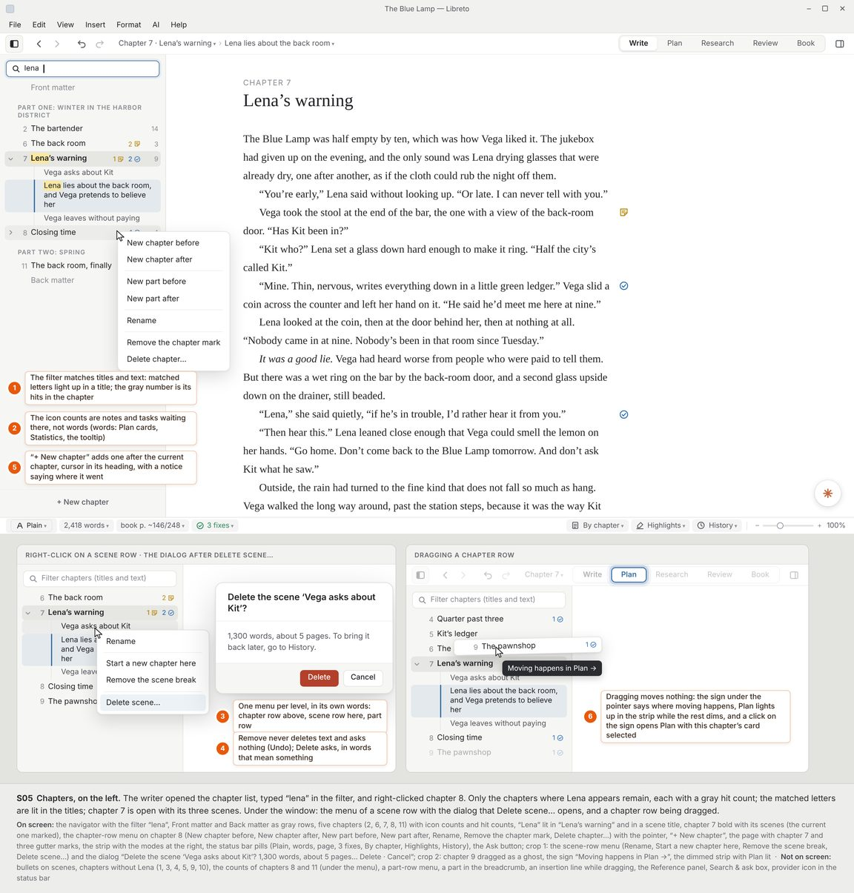

> [!NOTE]
> **Review note** · S05 · Chapters, on the left
>
> When dragging, a "forbidden" sign or similar should be shown next to the cursor.
> When filtering, if text is in a scene, must we show the chapter before in the left panel? And the part? I see chapters but not parts here.
> How will History be? Some kind of GitHub? I'll see it later, I guess.

> [!NOTE]
> **Review note** on _“Open the left column with the icon at the top left or Ctrl+Shift+L. It lists the struct…”_
>
> About peeking, I hope it is clear enough: one click shows a summary card or whatever and two clicks take you there. But also the card title must be a link for those who clicked once and wanted to go there.

> [!NOTE]
> **Review note** on _“"+ New chapter" at the bottom adds one after the current chapter, with the cursor in it…”_
>
> I think inserting and deleting structure items is not quite clear. If I right click on a scene in the left panel and I click on "Add a new part before", will it add it before current part or right before the scene, breaking a chapter and other scenes and leaving a scene out of a chapter? I think second is expected, although it can be confusing.
> About noticing moving happens in Plan, I'd like that Plan mode button is really seen, so make sure you dim or darken the rest of the screen enough without being too intrusive. Or make "Plan" highlight twice or something similar. Of course, anything we do like highlighting things in the UI, showing notifications or errors (like "Moving happens in Plan"), timings must be consistent in all the app, I mean reusing code and putting things the same way, at the same places, etc.
> How is front matter info filled? A dialog? Or just like regular text with "Dedicatory" and "Front quote" styles? (Those styles should be up the list when in Front matter). How to tell we are in Front matter section? Is it created by default? Is it in the right-click menu? It must be identified by Libreto like something different to be treated different. It will have its own options that we can improve in later specs, given different text needs. For example, to present the book to a contest, maybe you need to use a pseudonym or what they sometimes call a "lema" instead of the writer or the title or both... We'll need some research to fill that gap.
> Same for Back matter. Maybe even a summary of the book to be printed, author biography... Not sure if all this must be here or not, but it must be possible to add or remove it in Book mode.
> Maybe a simple "+" that allows to add a front matter or back matter or other meta info? But should we keep the "New chapter" button? Let's rethink it again. We must be able to do all this, with the fewest clicks and in an easy to understand way.
> I'm thinking again about what to show in Write mode and in Review mode. No one will go to Review if there's nothing that tells them that there are things to review, but also I don't want to fill Write mode with notes, badges and colors. Only underlines, that should be disabled when needed. In Review mode, disabling things must not be encouraged, it's the place to fix things, so marking them as Accepted or Rejected or "Don't bother me with this" should be the way to use Review mode. But anyway, maybe someone only wants to fix typos, so disabling Highlights must be also possible. I just don't want a writer forgets there are more tools to review things in case they disable them.

## S06 · Scene breaks, typed and detected

A line that holds only a repeated symbol (`***`, `* * *`, `---`, `~`, a single `*` or `-`, any length) becomes a scene break, drawn as a soft gray rule, with a notice ("Scene break · Undo") for the time you meant the character itself. On disk it is a `***` line in the chapter's Markdown file. When the time or place jumps without a break, Libreto proposes one with a **dashed** rule and a dashed icon in the gutter, and the card is the usual one: "Proposed · scene break", Keep or Not a scene. A detected chapter heading looks the same way. The chapter list shows detected scenes in lighter text until they are kept, named by the AI when one is connected (and marked so) and by their first words in gray when not.

A scene break is a block like a paragraph: a click selects it with the same selection color, it is copied, cut and pasted as its `***` line, `Backspace` or `Delete` removes it, and right-click offers "Remove scene break" and "Name this scene…". Insert ▸ Scene break (`Ctrl+Shift+Enter`) puts one at the cursor, in the middle of a sentence if that is where the cursor is, and Undo joins the halves again.

Removing a break merges two scenes, the row fades out of the list and a notice says "Scene break removed · Undo". **Notices are one thing in the whole app**: a card at the bottom center of the page, never on a timer, folding away when you move on, and each one is a line in History's Today list with its Undo. **Undo is one list**: everything that changes the text, yours or Libreto's, goes on it, and the Undo on a notice, the ✗ on a card and `Ctrl+Z` are the same step. Tips use the same card: when Libreto sees you retype what a fix changed, or delete a detected break by hand twice, it offers one tip a day at most ("Undo a fix with Ctrl+Z or the ✗ on its card · Show me · Not this one again"); the tips are a fixed list of recognizable habits, need no AI, live in Help ▸ Tips, and have a switch in Settings.

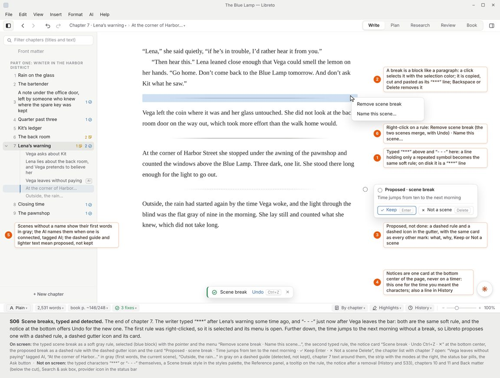

> [!NOTE]
> **Review note** · S06 · Scene breaks, typed and detected
>
> Proposed scene break card should show a proposed title? It's not obvious, because if it is added just when "Next day, ..." is detected, it's too soon to give it a scene title. So when these things happen? Are they reviewed over time? Can the user ask not to have named scenes? Then, how are scenes named in the left panel? Oh, I see... Let's show slightly different look for titled and untitled scenes.

> [!NOTE]
> **Review note** on _“A line that holds only a repeated symbol (***, * * *, ---, ~, a single * or -, any leng…”_
>
> Is MD format enough for everything we must show? And for notes, fixes, corrections...?
> How often Libreto reads text and proposes things? At each character the user types? Each new paragraph? Every x minutes? How to make it balanced enough so the writer does not feel the system is bothering? How to make it token-efficient? Only scripts for most of things and AI just at some points? Scripts can enable AI if they detect something?
> About adding a new scene automatically, it should be like fixing a typo, so maybe it should be underlined in green? Or I don't know, it is your gray thing, if I'm not wrong. We need to make it very clear. What is each type of issue, how to show and fix them... Also, timing when hovering is very important.

> [!NOTE]
> **Review note** on _“Removing a break merges two scenes, the row fades out of the list and a notice says "Sc…”_
>
> I don't get the non-timer, but folding away when you move on. How and when they disappear?
> How do our History and undo history relate?

## S07 · Styles

A style says **what** a piece of text is (a thought, a letter, a sign on a door, a chapter heading), not how it looks. The look is chosen later, per book, in Book; on the page every style still shows a plain working look so you can see it: a thought is italic, a sign is small caps. A **chapter** is a container, the file on disk; its **heading** is the chapter's first line in the Chapter heading style, and a chapter without one shows its number in gray, in Write and as the divider in the whole-book view. That is also why applying "Chapter heading" to a paragraph in the middle of a chapter **starts a new chapter there**, with a notice and Undo: a heading is where a chapter begins.

The chip at the bottom left always shows the style at the cursor, written in that style's look. Click it, press `Ctrl+T`, or right-click ▸ "Style as" for the palette: the style names in the ordinary interface font, each with a short sample in its own look at the right, so the list reads as a list and the looks stay visible; a filter box on top, "+ New style…" at the bottom (a name and what it is based on). With the cursor in a paragraph and no selection, a paragraph style takes the whole paragraph, a text style (Emphasis, Thought, Foreign) takes the word under the cursor or, at the end of a word, what you type next. Every menu in Libreto, this one included, walks with the arrows and `Enter`, and typing filters it; icons appear in menus only where the same icon exists elsewhere in the app, so the menu teaches the icon. A scene break is not a style but structure: it lives in Insert, in the right-click menu next to "New chapter here", and under `Ctrl+Shift+Enter`.

When something is wrong by Libreto's own rules (a forty-word heading, two headings in a row), it becomes a task in the margin without any AI; "AI: review this chapter" adds the AI's findings the same way, as tasks, chapter by chapter in the background with a line in the status bar ("Reviewing 7 of 11 · Stop"), and the Review list counts them as they arrive.

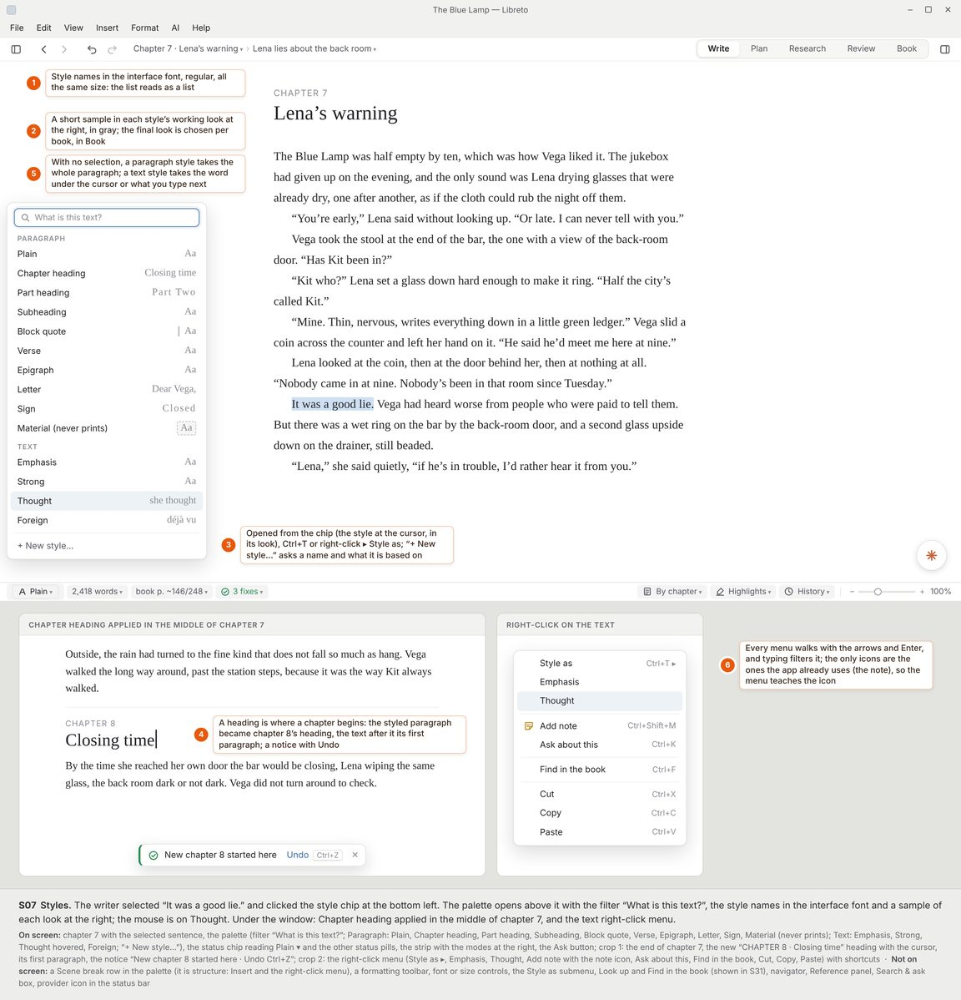

> [!NOTE]
> **Review note** · S07 · Styles
>
> Strong and Emphasis are not shown like that in the menu. I understand font size is the same for all, but for example chapters could be shown in bold. Also, you put all of them in gray style.
> Why some styles out of "Style as"? The most used?
> I'd like to see a new style creation and an explanation of how it works.

> [!NOTE]
> **Review note** on _“A style says what a piece of text is (a thought, a letter, a sign on a door, a chapter …”_
>
> A chapter is a container, a file on disk. What is a part here? A folder? What is a scene?
> Are chapters automatically renumbered?
> When a chapter is added while writing, a new file is created and it starts as a new file, making everything else in the text disappear? I'm beginning to think that chapter view can be confusing. I don't know if remove it or just left it for who wants it, or only in Review mode.
> By the way, about the need of Review mode, if you can write in it, it's not so different from Write mode. Let's rethink how writing and reviewing should work.

> [!NOTE]
> **Review note** on _“The chip at the bottom left always shows the style at the cursor, written in that style…”_
>
> I  want to see an example of Style chip with something different from Plain.
> I know we have Ctrl+T for styles, but maybe people misses Bold and Italics. I hope we have Ctrl+B for Strong and Ctrl+I for Emphasis. Each style (or most) should have a shortcut and a way to learn them.

## S08 · Ask: type and go

`Ctrl+K`, or a click on the round button, opens **Ask** at the bottom right: one box for everything. As you type, results appear above the box in five short groups: **Go to** (a chapter or scene), **Look up** (a person, place, thing or research topic, opened in the Reference panel), **Do** (a command, such as "Export PDF" or "Highlight people"), **In the text** (hits for the typed words, with "Open Find" to walk through them), and **Ask** (the typed text as a question, plus one or two questions Libreto builds from the book). `Enter` on the preselected row acts and `Back` returns; `Tab` moves down the list; `Esc` closes the box and puts the cursor back in the text.

**No AI is involved while you type.** The groups come from Libreto's index: chapter and scene titles, Codex names, topic titles, the commands with a few words each ("rename", "highlight", "export"), and the text itself. The order is fixed and plain: an exact name before a prefix before a part of a word, the current chapter first, what you used recently first; the best match is the top row of the first group that has one, so there is no guessing to explain. Each group shows three rows and "4 more…" when there are more. The Ask group appears only when an AI is connected; its questions are templates filled with the name you typed, ready before you ask, and the AI runs only when you press `Enter` there. The same answer goes for the Codex: names, mentions, first appearances and counts are computed; a capitalized name that appears three times is proposed as an entry for you to keep; what the AI adds (facts from the text, summaries, open questions) is marked as the AI's. There is no small model on the device in version 1: the list stays instant and predictable, and an on-device model can come later as a choice in Settings for scene names and checks.

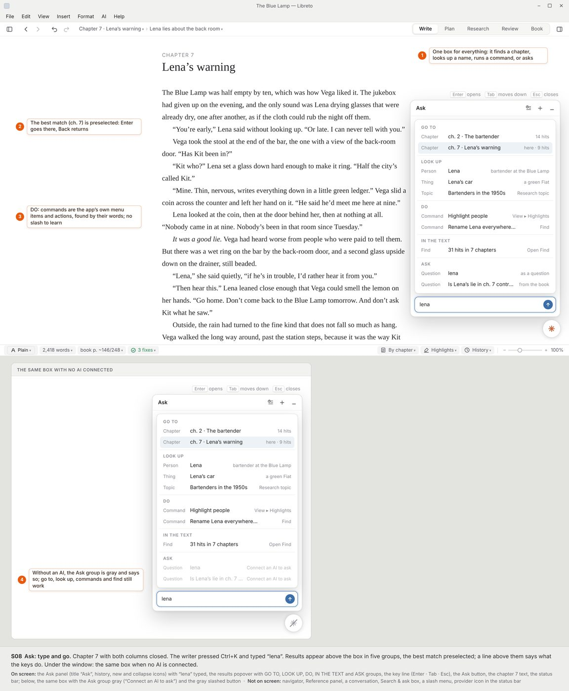

> [!NOTE]
> **Review note** on _“Ctrl+K, or a click on the round button, opens Ask at the bottom right: one box for ever…”_
>
> Too many groups. Maybe some icon would help. I like universal searchers, but with so many groups and different results, I think it will be hard to know where you need to go. Another thing that worries me is that local search will be very fast and AI will take its time to answer...

> [!NOTE]
> **Review note** on _“No AI is involved while you type. The groups come from Libreto's index: chapter and sce…”_
>
> But what if I write a question or something only an AI can answer? A longer text will be interpreted as needing AI?
> Even if the best match is the first one at the first group, I'm worried about blocks moving while typing and that non-previsible results box. Will each block show a spinner or similar while loading?
> How will be computed that showing a chapter is better than another? Recently worked? More matches? More previous interest? It's where the character is presented? It's what you asked and chose before? If no AI is used here, we'll need a lot of heuristics, That could have a spec on its own: what is a person, which kind of actions can be performed for a place, what makes a chapter or place in the text most suitable to be the one the user is looking for...

## S09 · Ask: a conversation

When the typed text is a question, or you choose the Ask row, the same panel becomes the conversation. It floats over the right side of the window, never over the page, and can be moved, resized, or collapsed back into the button with `–` or `Esc`; a dot on the button says an answer is waiting. The AI reads the whole book through the Codex and the open scene, and answers with links: a chapter name jumps the page there (and `Back` returns), a person's name opens the Reference panel. Its answers carry **buttons** when there is something to do: "Add as a note", "Show both places", "Open in Research", and for any change to the text a before-and-after block with "Apply" and "Skip". Nothing in the book changes until a button is clicked, and every applied change is one Undo away.

The AI has the whole app in reach, through the same commands you use: it can open a chapter, reorder cards, create a task, link a topic to a place, hide a column, start a review. The clock icon lists earlier conversations, with a search; "+" starts a new one; conversations are named by their first exchange. Right-click ▸ "Ask about this" on a selection opens the panel with the selection quoted.

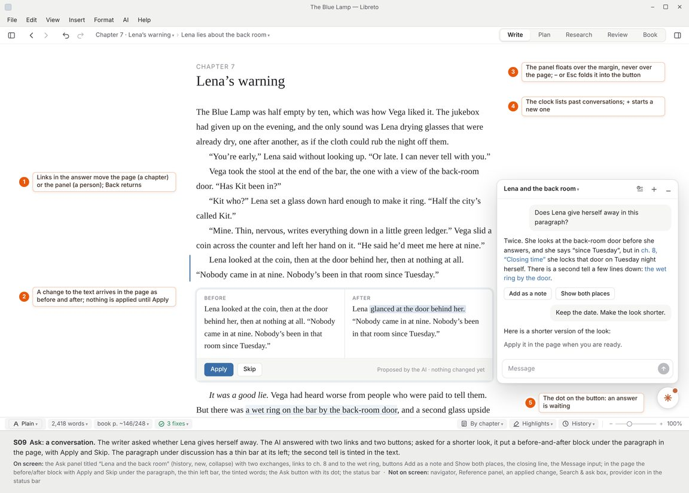

> [!NOTE]
> **Review note** · S09 · Ask: a conversation
>
> What if a paragraph takes three pages? How will you compare it with the new version? Should we add "[...]" before and after to save space? Maybe not marking the paragraph but the lines in which changes will be applied (text continues from before the comparison to after it).
> Instead of Apply and Skip, maybe a button under each of the versions like "Keep mine" and "Apply proposed" or similar would be more graphical. Of course, as always, with shortcuts, if the focus is on that double window.
> I still don't know how Ask chat window will behave with a right panel. Let's see more screenshots.

> [!NOTE]
> **Review note** on _“When the typed text is a question, or you choose the Ask row, the same panel becomes th…”_
>
> "The AI reads the whole book through the Codex". That seems a lot of reading! I hope Codex will be prepared for that kind of things to be done very quickly: summarized chapters or scenes, links from one to another, characters in each place... I don't know much about indexes, but I imagine that like a place where you get more info when you go deeper. So if someone asks for "lena", it can quickly find in an index of names that Lena is a character. Then, it reads about the person. Then, it can know exactly in which chapters or scenes she appears and what she is doing in each and how many times her name appears. Also, who she interacts with. It can know which chapters or scenes the user has been working on recently (of course, the chapters and scenes tree is there), which other questions the user made and what chose... I don't know, there are so many variables involved into this. This should be enough to generate scripted options for the Ask menu, but also as a starting point for the AI (which could use the same results obtained before even being asked). You'll design the index, these are only ideas I can think of, but if you know more efficient ways to organize it, that's all yours. Oh, and the index must be regularly updated. That takes work too. If a scene changes, maybe a lot of points of the Codex must be updated to match with new info. But how? And above all, when? If we have AI working each second, tokens limit will be reached in a few minutes!

> [!NOTE]
> **Review note** on _“The AI has the whole app in reach, through the same commands you use: it can open a cha…”_
>
> Great! We must be sure everything can be accessed by menus, keys, mouse and AI.

## S10 · Hold Alt

Hold `Alt` for half a second and the page shows everything Libreto knows about it: people, places and things tinted by kind, styled passages labeled in the margin, notes, tasks and fixes in the gutter. Release it and the page is clean. `Alt`+click on a name opens its peek. If `Alt` is awkward (it also opens menus on Windows, which Libreto suppresses for a held key), `Ctrl+Shift+A` toggles the same reveal and the Highlights menu keeps any kind on permanently. Hovering does nothing by itself: no card ever pops up because the mouse passed over a word.

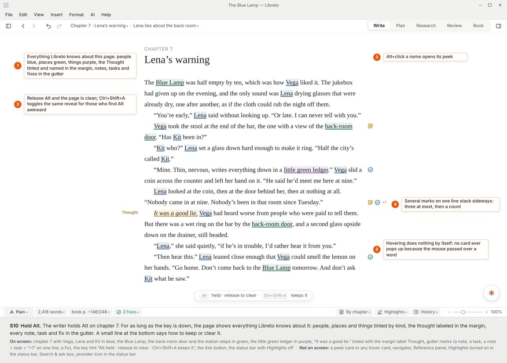

> [!NOTE]
> **Review note** · S10 · Hold Alt
>
> We need coherent colors for each type of item Libreto knows.
> Again, we need to rethink how Write and Review mode work.

## S11 · Peek and the Reference panel

`Alt`+click a name, or right-click ▸ "Look up", and a small card says who that is, with the chapters she is in and a picture if she has one. "Open the card" opens the **Reference panel** on the right: the Codex entry for Lena. The Codex is what the book itself says, built from your text and corrected by you: a line about her, where she appears, who she knows, **facts** quoted from the text with their chapter, facts taken from your research with their source, open questions ("about fifty" in ch. 2, "not yet forty" in ch. 8), and the **research topics** linked to her. A picture can be dropped on the card.

Two rules keep the panel from becoming a maze. **A link to the text moves the page** (and `Back` returns); **a link to another entry moves the panel** (and the panel's own `‹` returns). The panel has no tabs and no search box: to look up something else, click its name in the text or press `Ctrl+K` and type it. "Open in Research" opens the same entry at full size, in Research mode.

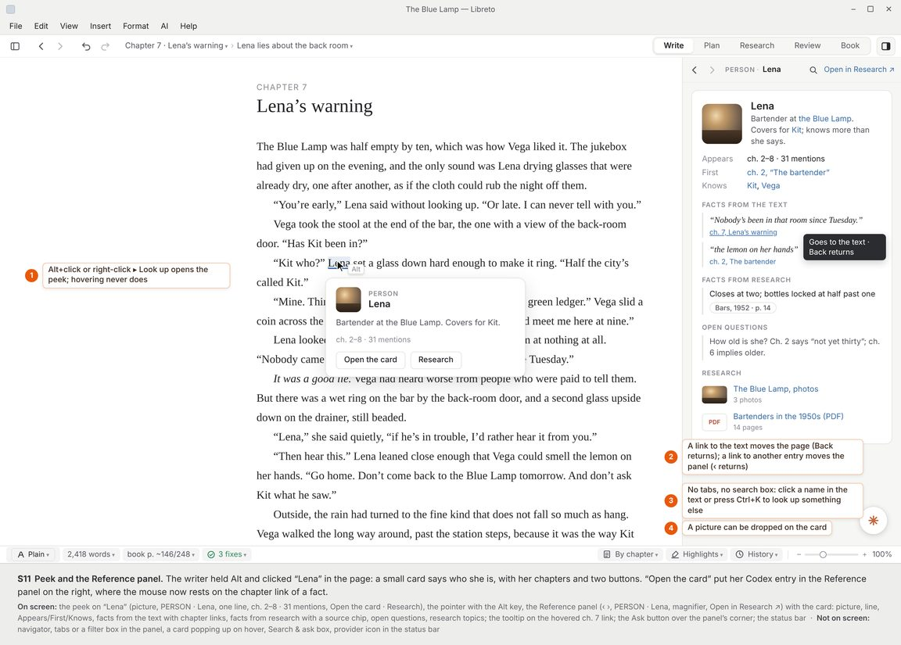

> [!NOTE]
> **Review note** · S11 · Peek and the Reference panel
>
> You say "No search box", but there is a magnifying glass in the right panel.
> What exactly "Back" means? The exact place the user was before? That could mean one character at the time if the writer was writing... Is it more like a "zone"? From paragraph to paragraph? Only when a real jump was made? What is a real jump? Or only when a link is clicked?
> I'm thinking about the user adding a comment to a sentence just written: "Check with chapter 10". That could be automatically linked. Again, now I'd miss user's comments if they only appear in Review mode. We need to unify or split them in a very clear way.

> [!NOTE]
> **Review note** on _“Alt+click a name, or right-click ▸ "Look up", and a small card says who that is, with t…”_
>
> How can the user look at Codex to, for example, add a picture to a character? Do we have a real Codex navigator?

> [!NOTE]
> **Review note** on _“Two rules keep the panel from becoming a maze. A link to the text moves the page (and B…”_
>
> Good the two back buttons. I still don't see Codex and Research to be the same...

## S12 · Everything open, the text in the middle

The most Write can show on a 1440 px laptop: chapters on the left, Lena's card on the right, highlights on, two marks in the gutter, the Ask button over the panel's corner. The page is where it always is: centered on the window, 620 px wide at 100 %. The columns took the margins, not the text. Shown to judge the load; nobody needs this all day.

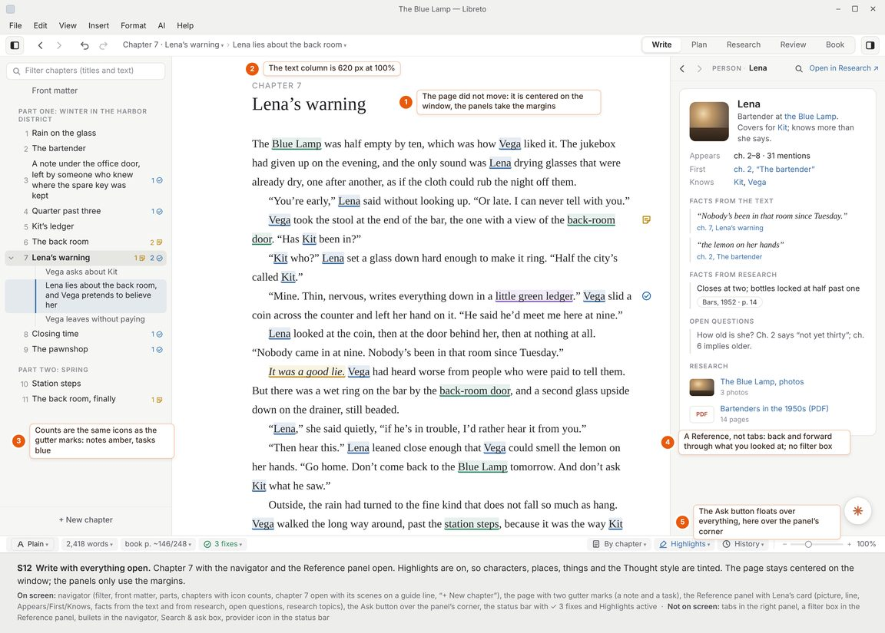

> [!NOTE]
> **Review note** on _“The most Write can show on a 1440 px laptop: chapters on the left, Lena's card on the r…”_
>
> Let's make both sides the same width, that keeps the text always centered. Unless it's too much for just chapter titles and too few for right panel info. We'll adjust it, but I'd prefer not allowing the user to resize them because we just found the right sizes. We need to decide what shrinks before when resizing the window. And we also need to be sure what and which max width will have anything we put at the sides of the text.

## S13 · One key back to the page, and Focus

`Ctrl+Shift+H` closes both columns and quiets the highlights; the same key brings back what was open. The rule is simple: the key restores the layout as it was when you hid it; if you open a column by hand in between, the key just hides again. `F11` goes further: **Focus** leaves only the page, without strip, status bar or Ask button; the mouse brings back a small "Exit focus" at the top, and `F11` or `Esc` leaves. The Focus page keeps the book's paragraph spacing and first-line indent as set in Book; nothing is reformatted.

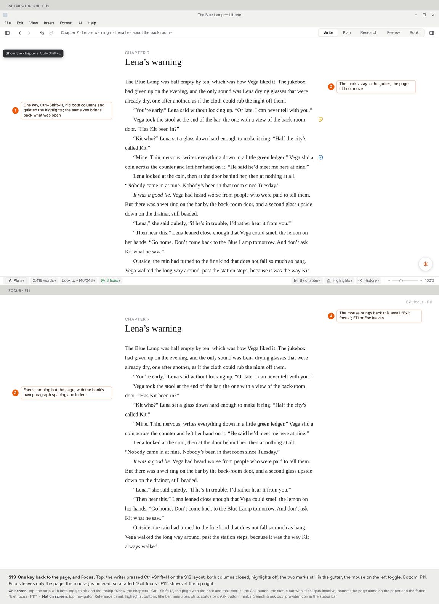

> [!NOTE]
> **Review note** · S13 · One key back to the page, and Focus
>
> Should comments and badges be shown in Write mode? We talked about this before and we need to decide how to use Write and Review mode.
> Are modes sorted by usefulness or in any working order?

> [!NOTE]
> **Review note** on _“Ctrl+Shift+H closes both columns and quiets the highlights; the same key brings back wh…”_
>
> Should focus view show all the book instead of a chapter file? We need to think about the use of both modes. But if the user wants to look back for something, they won't be able to do it if not going out of focus mode. Maybe we need to think the kind of things a user may need when focused. For example, styles? Or they are more a formatting thing? We just want to write at that point. Focus mode could be for people not interested in formatting and for pros who know the shortcuts.

## S14 · A note, without leaving Write

Writing and fixing are the same hour, so notes do not wait for a mode. Right-click ▸ "Add note", `Ctrl+Shift+M`, or the small "+" that appears at the right of the line under the mouse: a card opens beside the line, you type, `Esc` returns to the sentence. The card folds to an amber icon in the gutter at that line; clicking the icon opens it again right there, with a short **line from the icon to the card** and the anchored words tinted, so there is never a doubt which words it is about. Several notes on one line stack sideways.

Three things live in the gutter, and the difference is what they ask of you. A **note** is a remark, yours, a reader's or the AI's, and asks nothing. A **task** asks for a decision: a doubt to settle, a fact to check, a proposed change to accept or reject. A **fix** is a change Libreto already made, there to be undone if wrong. Every card has the same buttons: Reply, Ask (the AI explains or proposes a fix), Done, Delete; **Accept** and **Reject** appear only when a change is attached. Changing a note's kind never changes its buttons.

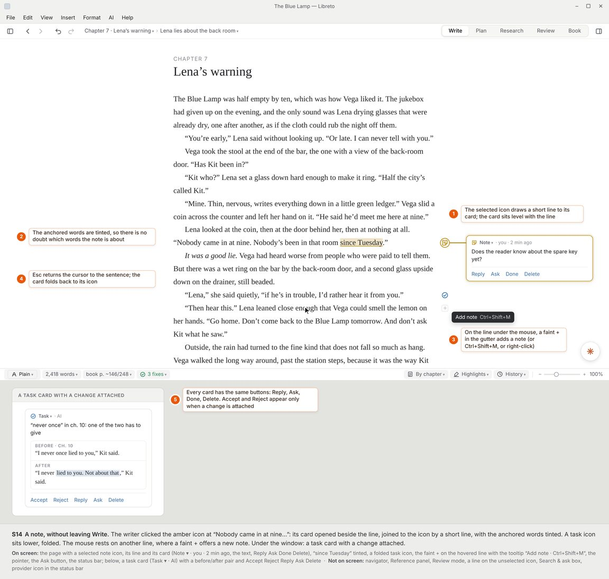

> [!NOTE]
> **Review note** · S14 · A note, without leaving Write
>
> Yes, this is our dilemma. Gutter or no gutter in write mode. Somehow it is clear it must be there. But also, then why we have a review mode? Just for batch review? That could be the balance. But we need to decide which elements are shown in write mode and their icons.
> Another question: what if you click a comment icon in the gutter and then you alt+click on a name? How do right panel and comments live together? That's why we need to think a lot about spacing and what things can be visible at the same time. One over the other and the second one dimmed and/or blurred? Right panel always behind any comments or thing put on it?
> Same for left panel and what you sometimes show about styles. I'm not really sure we must show styles that way (I'm talking about when you write "Thought" or similar in the left margin).
> Let's review spaces a lot!

## S15 · Review

Review is the same page with the margin open. Choose it when the second pass starts: your own notes, the editor's, the AI's checks and the small fixes, all at once. The left column is the chapter list with counts, plus filter chips (All · Notes · Tasks · Fixes · Editor · AI) so "what did Marta say?" is one click. In the margin, every card sits level with its line and its words carry a faint tint; the selected one moves level with its line, draws its line to the text and tints its words strongly, the others stay quiet and push away when they collide, and several on one line fold into one stack with a count. **Review all** walks the book one card at a time: `Enter` accepts or marks done, `Tab` skips. "AI: review this chapter" adds its findings to the margin as tasks, never to the text. Switching back to Write keeps the same scroll and cursor; the cards fold to icons.

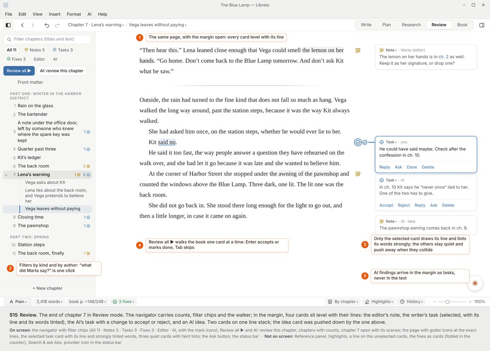

> [!NOTE]
> **Review note** on _“Review is the same page with the margin open. Choose it when the second pass starts: yo…”_
>
> Editor or the right person name?
> About other people reviews, we need a place to import things from another Libreto project or Word file. Maybe even at the start screen, when opening the file? I don't think so... And once an external document is linked to this one to fix things, will it be always linked or at some time we can just unlink it and lose the non-fixed comments?
> I'd like to see how you imagine "Review all". Also, I'd like to see a scroll bar as an example of a page full of comments or notes or tasks or whatever. So to see how they can be independently moved from the text.
> Again, we need to have very clear the types of items we can show (comments, fixes, notes, errors, unknown words...) and the places they can be shown and how.
> For me, going to Review mode should be to start a pass of fixing things. So here things must be clearly shown, while in Write mode only some of them or none or I don't know.

## S16 · Plan

Plan shows the book as cards, one per scene, in groups (chapters, or groups you name). Drag a card to move it; before you drop, Libreto warns when the move breaks continuity ("Vega reads the ledger before Kit finds it"). Moves are collected in a bar at the top, "3 moves · Apply · Discard"; nothing changes in the text until Apply, and leaving the mode with moves pending asks once. Groups move as a whole by their header; deleting a group with scenes sends the scenes to **Unplaced**, never away, and Unplaced shows at the end of the chapter list in Write.

A click on a card opens its detail beside it: the scene's line, who is in it, where, the facts it relies on, its words. "Details" shows a second line on every card. Cards carry labels (point of view, status, storyline, timeline, and one of your own), and **"Color by"** chooses which of them paints the cards; the legend at the bottom shows the current one. Point of view and place fill themselves from the Codex; status and storyline are yours. Scenes come from your breaks and from detection; the AI only summarizes them, in the background after a pause, and never creates a task without being asked unless the AI level says so.

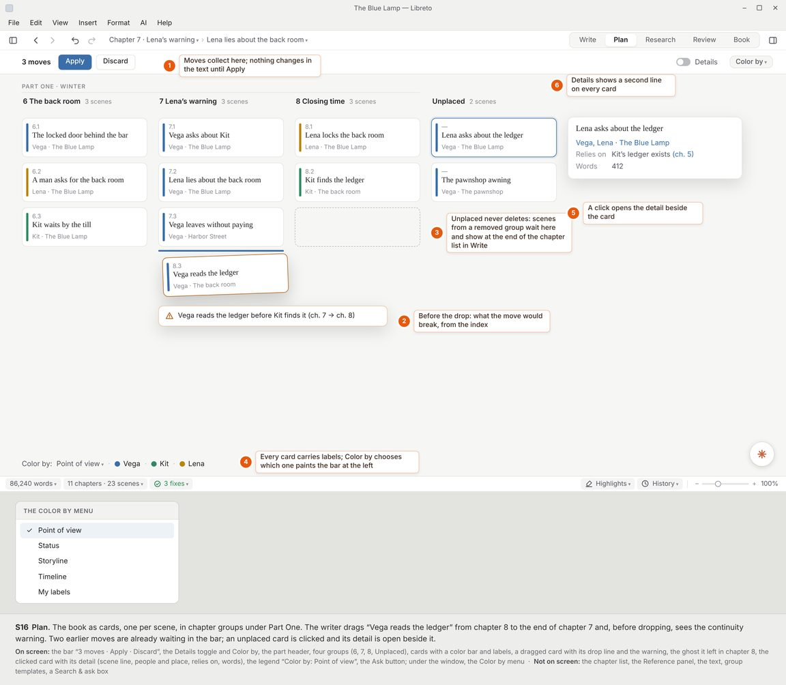

> [!NOTE]
> **Review note** · S16 · Plan
>
> How to move between chapters? Here I can only see 6 to 8. Shouldn't they be horizontal instead of vertical? And we need some way to scroll.
> I think I prefer Apply and Discard to the top right.
> Of course, Undo must correctly work here.
> Breadcrumbs don't make much sense here. And what about Back button? It can take you back to text, for example? We need a warning before going out of this screen with unsaved changes.
> We also need a way to easily create new cards, probably in the right panel, to be able to fill things in.
> Is the detailed view the same as when clicking on a card? Maybe clicking on a card or creating a new one should show more info in the right panel, probably extracted from Codex apart of the minimal details off the card. This should be the info Codex has for a scene.
> Creating a new scene puts it on the top of Unplaced, for example, so it is easy to locate and move later. It is a place where a book can be designed top-to-down, so it must feel comfortable and easy to use. When a scene is selected, it should be clearly marked in the board. Even if scroll is needed. For example, if there is a way to come from a scene in Write mode to plan mode, the scene should be selected and screen scrolled into it and right panel with all the info.
> "Issues" or similar should be shown next to "Apply" button, so that they can be viewed all at once just by clicking.
> As always, simple but powerful screens.

> [!NOTE]
> **Review note** on _“Plan shows the book as cards, one per scene, in groups (chapters, or groups you name). …”_
>
> A summary of possible errors must be shown when clicking Apply. Not sure if that can take a lot of time...
> Is "Unplaced" then a chapter?
> Another thing writers do is to delete a scene from some place but they don't want to throw it away, so they may open a new doc to store there discarded things. They may not go never back there, so that text is lost. Could we add a place for that kind of texts? They could be like "ideas" (if we have a place for them), but they should be stored differently, it's just discarded text that could be added into another place.

## S17 · Research

Research is where material lives before it is true. The left column is your **library** in two sections that are different things: **Codex**, what the book says (people, places, things, motifs, built from the text), and **Research**, what you gather (an **Inbox** for anything dropped in, then **topics**). A topic is a document like a chapter: a title, text with the same styles, pictures inline, files attached (PDFs, images, links), and a row of what it is linked to. "Bars in the 1950s" need not be in the Codex; Lena need not have a topic. In the center, the topic itself, large. On the right, the Reference panel shows what the topic links to: Codex entries and the chapters that mention them.

Linking is mostly free. Names from the Codex typed in a topic are recognized the way they are in the manuscript, so the topic and the entry know each other at once. The writer adds the rest with "Link to…" or by dragging a topic onto a name in the text. Moving knowledge from research to the Codex is one gesture: select a passage in a topic and "Pin as fact of…"; the fact shows on the entry with its source. The AI helps both ways from Ask: it summarizes a PDF, proposes facts and links as tasks, asks what the Codex still lacks ("Lena's age is contradicted; nothing in research settles it"), and proposes to split or merge topics; the writer can do all of it by hand. Topics are renamed by clicking the title, split with "Move to a new topic", merged by dropping one on another, and deleted to the Inbox.

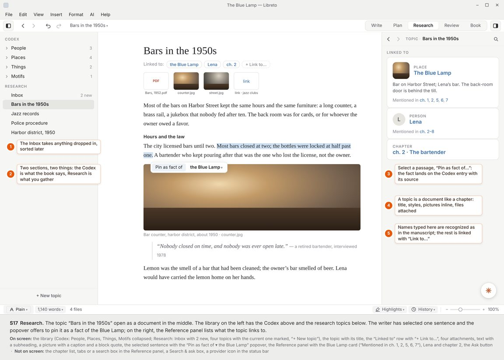

> [!NOTE]
> **Review note** · S17 · Research
>
> I'm not yet sure if mixing research and codex is a good idea. How many entity types can we have (persons, places...)? How are links added? Is "Pin as a fact" shown when selected text or when right-clicking?
> Do Alt shows something similar here than in Write mode?
> How is inbox filled? What does it show?
> How paste works (in general)? Plain text? Headers identified?
> Is "Ask" button context-aware? Does it work different if we are at research than at Write?
> I don't get the split and merge topics idea. Can topics have subtopics? Or folders or similar?
> I think this part still needs a lot of work.

> [!NOTE]
> **Review note** on _“Research is where material lives before it is true. The left column is your library in …”_
>
> I think we can't add images to the book right now. It should be fixed. Also, graphics, diagrams, etc. with image footers, links, etc. Maybe this will be needed for articles, papers, etc. in the future, but it's a good addition at this point too. Footer notes, translator notes...

## S18 · A Codex entry at full size

Clicking a Codex name in the library opens the entry in the center, with room: the picture, the line, the facts from the text and the facts from research told apart by their source, who she knows, where she appears scene by scene, the open questions, and the research topics about her. Everything can be edited here, including the name (which renames her in the text and in the topics through "Rename everywhere"). This is the whole Codex, one entry at a time, and the only place it is shown at full size.

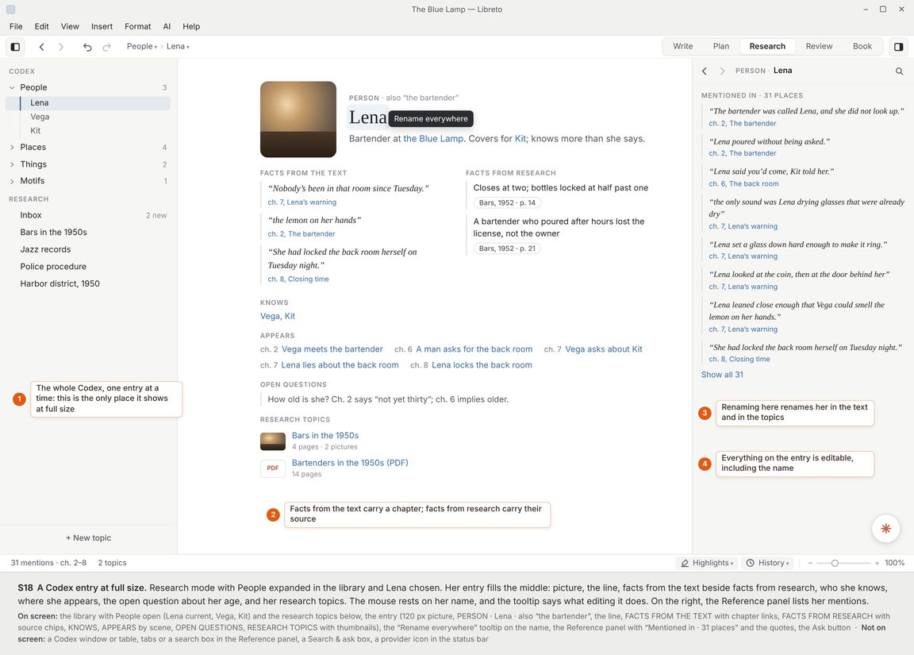

> [!NOTE]
> **Review note** · S18 · A Codex entry at full size
>
> Everything on the entry is editable...? I should not be able to edit the places where the character appears. I can't see nothing editable or that should be editable here.
> I think Codex should be read-only (except for rename, for example). It's info extracted from the book. BUT when the writer sees something in the Codex that is not correct, they should have a way to access the place to fix it or to as AI questions about this or to fix it too. So it should be like a Ctrl+H (or key to find and replace) where you find something you need to manually edit: you abandon the find dialog for a moment, fix it with text, etc. It must be agile to get to the places where wrong ideas are. Same for open questions or similar.
> Asking the codex without AI could be a great addition. I don't know how, I don't want a SQL-like tool, but "When does Lena talks to Kit?" for example or other types of questions.
> Codex must have its own spec, as said before.

## S19 · Research beside the text

While writing, you want one thing: the photo of the bar, two facts. `Alt`+click "Blue Lamp", choose "Research" on the peek, and the Reference panel shows the topic, readable and scrollable, with its pictures. Enough to check and go on. "Edit in Research" opens the topic in the mode, and `Back` returns to the sentence. Gathering happens in Research; using happens beside the text.

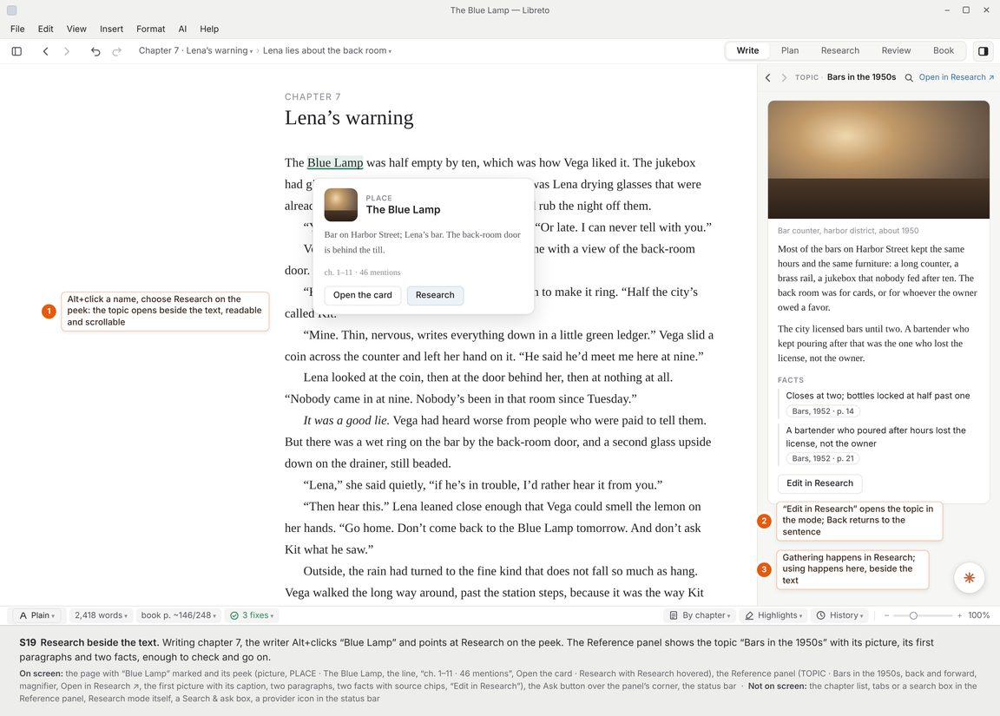

> [!NOTE]
> **Review note** · S19 · Research beside the text
>
> Looks good to me. Just a couple of things:
> "Back returns to the sentence", what is Back and where is it?
> I see your right panel examples always fit in one page, but I suppose they can have a scroll bar, right?
> How much research info is shown in the right panel? All, so the writer has everything to find? Or it is always necessary going to Research. Again, does "Ask" have context about the screens and panels that are open, to help more with the current tasks?

## S20 · Find and Replace

`Ctrl+F` opens a strip at the top of the page; `Ctrl+H` adds the Replace row, the same width. "Whole book" or "This chapter", nothing finer. In the whole book, hits walk across chapters and `Back` returns to where the cursor was. **Replace all** never replaces blindly: it opens a list of every hit in context, each with a checkbox, and a "Replace 27" button. When the found text is a Codex name, the strip offers **Rename everywhere** instead, which changes the text, the Codex and the topics together. "Pattern" turns on regular expressions; the "?" opens a tester with the current paragraph as sample text, and "Ask for help" hands the pattern to the AI.

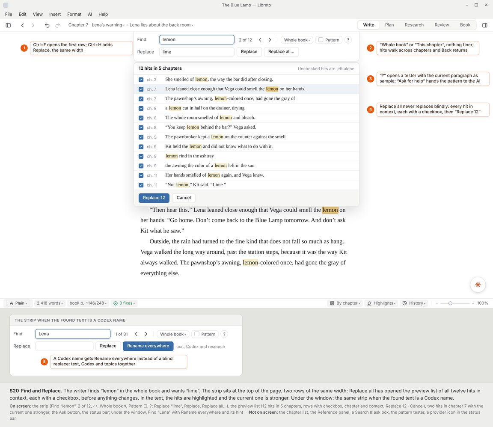

> [!NOTE]
> **Review note** · S20 · Find and Replace
>
> I like the Rename everywhere button, but it should be explicitly said that an entity has been detected.
> If the user just replaces all Lena by Tena, will Codex detect it at some point and restructure all of its knowledge? Will it be quick?
> Updating Codex is very important, that's why I say we'll need a spec only for it.

> [!NOTE]
> **Review note** on _“Ctrl+F opens a strip at the top of the page; Ctrl+H adds the Replace row, the same widt…”_
>
> We should have a magnifying glass icon, not everybody knows how to open Ctrl+F. Should Back go back through all recent replaces? Maybe we should improve Back and Forward buttons with a small arrow, as some browsers do.
> Patterns is the right work? Who doesn't know about them, won't be worried about naming, but who wants to use regexes will want to know this is a regex search. The "?" is not easy to understand. Maybe we must rethink regex search as something apart or  just that checking the regex check box opens the tester. We also talked about a small regex help dialog, I really thought that was the "?".
> We had an arrow to go from "Find" to "Replace" dialog shapes. In general, the dialog structure is not very nice. Look for examples: browsers, editors...
> What if instead of 12 hits like here there are 200? Are all of them shown?

## S21 · Sharing with a reader

File ▸ Share… is one dialog with two halves. **Send** makes a named snapshot ("Sent to Marta, November 7"), exports a Word file whose paragraphs carry their ids, and lists the readers of this book. **Receive** looks in Downloads, or where you point, for a copy that belongs to this book, copies it into the book's folder (never opened as the working text) and records it in History. With an email tool connected, the AI drafts the message and later finds the reply; otherwise the two steps are written on the dialog.

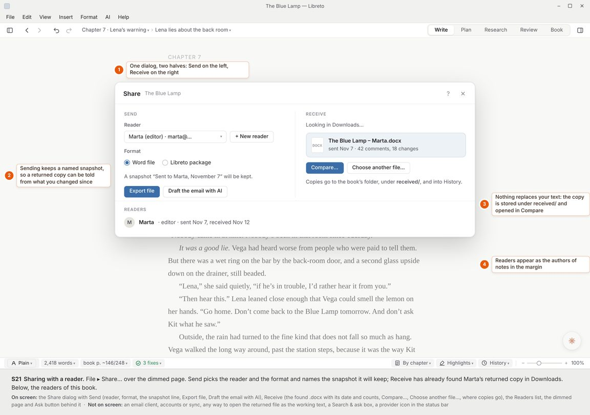

> [!NOTE]
> **Review note** on _“File ▸ Share… is one dialog with two halves. Send makes a named snapshot ("Sent to Mart…”_
>
> Where is the Share button? Should we add it visible on the UI? The classic "cherries" icon?
> What about sharing it as a Libreto project? If it can be useful to writers, it will also be to editors. Oh, I see!
> Date is important, but time too (even people can live at different time frames).
> Share being Send and Receive is confusing... Can we find a better way to say it? Or not mixing both in the same dialog? Or use two tabs?
> If there are no readers, a message should be shown: "You don't have people to share it yet" or similar. "Add a person by name, role and email" (or not too long).
> Looking in Downloads is OK if there are permissions. Documents or near the place where the project is are other places to look.
> Should Compare be part of Review? Is it a new mode? Should it be visible with other modes?

## S22 · A reader's copy, compared

Receiving opens **Compare** as a sheet over the window. It shows your manuscript as it is today, one column, and only the paragraphs that differ get a block under them; "Only differences" folds the rest. The version you sent is used underneath to tell who changed what, and is never shown: the sides are named by person, **Marta's** and **yours since sending**, never "theirs" and "mine". A paragraph only Marta changed shows her version with the changed words marked and **Take** and **Keep mine**; "Take all of Marta's changes in paragraphs you did not touch" does those in one go. A paragraph changed by both shows two compact cards and four buttons: **Keep mine**, **Take Marta's**, **Keep both**, **Merge for me**, the last a proposal from the AI that takes both into account; whatever is chosen becomes the paragraph, editable, with a small mark saying where it came from. Her comments bypass the merge and become notes in the margin with her name. The header counts "4 of 18 decided"; "Done" applies the decisions and nothing enters the text before it; "Back to the text" leaves the sheet at any time.

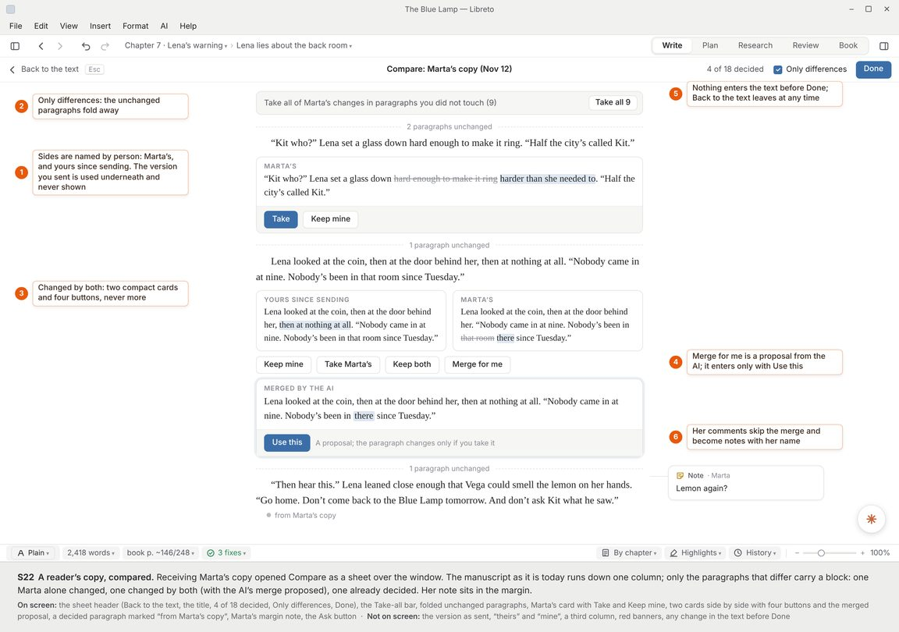

> [!NOTE]
> **Review note** on _“Receiving opens Compare as a sheet over the window. It shows your manuscript as it is t…”_
>
> Let's suppose I sent the project by my own to Marta and the system doesn't know what does "Yours since sending" actually means. Can it discover it by looking at History?
> What happens when accepting something? It disappears from the Compare view?
> Should we also see a "Keep both" preview? What if paragraphs are too long? I talked about a "[...]" option before.
> Are buttons correctly located? Would it help to have "Keep mine" and "Take Marta's" inside each box or it would be more confusing? Or each on one side of the compare row?
> You say comments skip the merge and become comments. Shouldn't they be directly discarded? Would it be possible to compare them again after finishing this Compare session? How to resume a compare session? What if I go Back to the text? Are comments kept for a review session? Will the Review session be similar to this Compare view? Should Review and Compare be mixed somehow or they are very different processes and need different approaches?
> Back to the text warns about unmerged comments? What's the exact difference between "Back to the text" and "Done"?
> "Only differences" must be enabled by default. If I click on "2 paragraphs unchanged", are they shown, to add context? What if they are 200 paragraphs? Are only one or two shown or all? How to move through the text to the next comparison in the case "Only differences" is not checked or I clicked "200 paragraphs unchanged"?
> Is Ask contextualized here?
> Can you show the 2 paragraphs unchanged line with a wave line? Some other softwares do that. I think Google Books do something like that.
> What is shown after something is accepted or rejected? Is it somehow marked? Can it be undone at this moment? Click to return to decision? Is there a way to just edit the text? For example, the writer wants to take Marta's idea, but he wants to write it his way and redo all the sentence at this moment.

## S23 · History

History is a sheet: every writing session on one line, grouped by day, with hours, words and a one-line summary. Clicking a line opens it in place: what changed, where, each a link. "View as it was" reads that day's version without differences; "Compare with today" puts the old version on the left and today on the right, scrolled together, with **Restore** on any old paragraph or on the whole chapter. Reading an old version is for remembering; deciding paragraph by paragraph is the received-copy screen. Questions in words ("when did I write about Lena's car?") go to Ask.

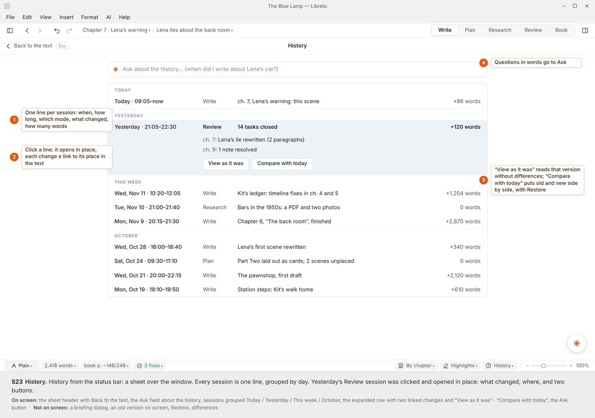

> [!NOTE]
> **Review note** on _“History is a sheet: every writing session on one line, grouped by day, with hours, word…”_
>
> Who filled the "Lena's lie rewritten" and when?
> How to know what "1 note resolved" means?
> In general, we are working with small examples, but what if a lot of changes were done? How will they be shown? This is also valid for other parts of the app, where data could be overwhelming to be shown at once.
> What if one session covered Write and Research? I'm saying for the column. Or they are considered two different sessions? That could make sessions grow a lot!
> +86 words. Maybe positive and negative could be shown, as with Git? How to keep track of that? Is each minimum change stored to undo and to history? How will it grow?
> About comparison, will it open a Compare view as the last screenshot? I understand we must reuse code for that.
> I see History and Compare views are over the text, although mode keeps being "Write". This can be confusing. How must we call them? Views? New modes?
> Who fills the "(when did I write about Lena's car?)? AI? Or it is just an example? Can Codex answer to that question only with scripts or AI is needed here? If Codex can answer it, man, Codex will be a good piece of software on itself!

## S24 · Book

Book shows the book as it will print. The left column has page thumbnails; the right has the layout: a template to start from (paperback 5.5 × 8.5 in, trade 6 × 9 in, A5, manuscript, reading PDF), page size in cm or in, margins, fonts, and how chapters open: number and title, title only, number only, or **nothing** but a new page and space, for writers whose titles were only for working. Pictures in the text are laid out as figures. Arrows and Page Up/Down turn pages; the layout of a whole novel takes seconds and updates while you adjust. Export (PDF, Word, EPUB) is here.

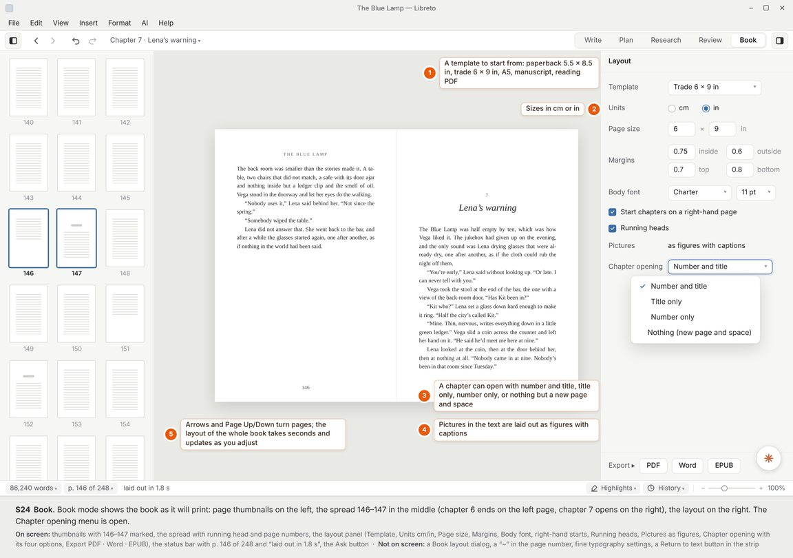

> [!NOTE]
> **Review note** on _“Book shows the book as it will print. The left column has page thumbnails; the right ha…”_
>
> Should page thumbnails be shown in pairs if the printing mode is two-page?
> cm or in could also be decided in settings, same as how to show times, etc.
> I'd like to see the option to show it as one page or two pages. That's what make sense for "inside" and "outside" margins to exist. Otherwise, "left" and "right" would be enough. Same for "Start chapters on a right-hand page". I don't know if "Trade" means that for you.
> What other options are there for Pictures? What about adding, for example, figures or words indexes? This must be simple but powerful, adapted to the expected type of document.

## S25 · The AI, connected or not

AI ▸ Connect, or the gray Ask button, opens this. The **disclosure** is always on this screen, with a warning sign, not behind a link: AI text may raise copyright, contest and disclosure problems; Libreto records what the AI wrote and can report it. Below: how to connect (Claude by key; through Claude Desktop where allowed), the level of help (Off · Quiet · Reviews · Proactive) with what each means, which model does the big work and which the small tasks (naming scenes, merging aliases, sorting notes: short judgments a small model gives reliably, and a local one may give later; finding names in the text is not a model's job at all, the index does it), what is sent and the log, and the cost this month. Libreto works fully without any of it.

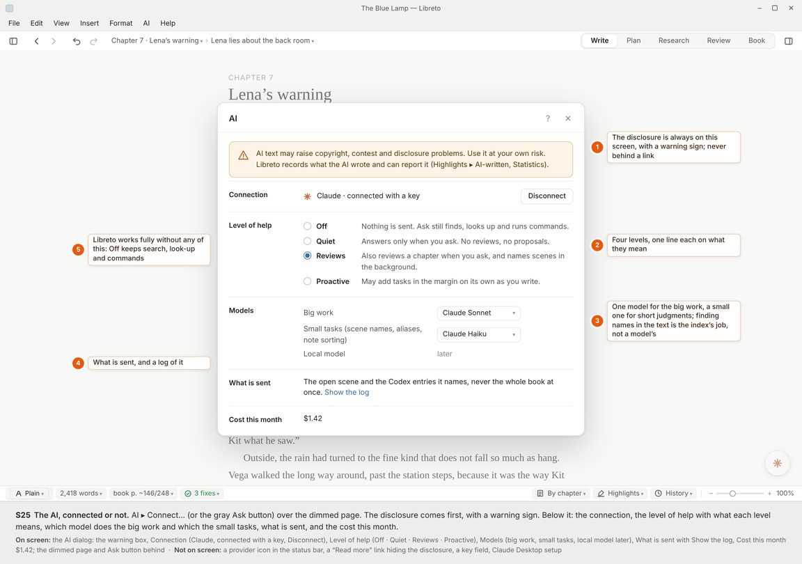

> [!NOTE]
> **Review note** on _“AI ▸ Connect, or the gray Ask button, opens this. The disclosure is always on this scre…”_
>
> Should this dialog be a part of Settings? And it must accept other providers, so maybe the dialog can adapt. For now, only one provider at a time will be accepted.
> Will "Ask" and chat dialogs show the model being used? Or, in this case, Haiku will only be used in the background and chats and questions will be answered by Sonnet (using Haiku in the background if needed)?
> What's the "?" for? We need to standardize it. It must be shown always or never. We also talked about the possibility of a keyboard shortcuts icon. Need to be thought.
> "What is sent" is only to show that it saves tokens? What are logs and how to access them from other places? Are they about this book or the app? Can the app be configured differently for different books? I mean in general, not only AI. In that case, we need a Settings and a Book Settings dialogs...

## S26 · Settings

One dialog, six groups, each with a "?" that opens its help. **Shortcuts** is the group to show: every key, searchable and editable, and a check against the current keyboard layout that flags any shortcut needing a dead key or AltGr.

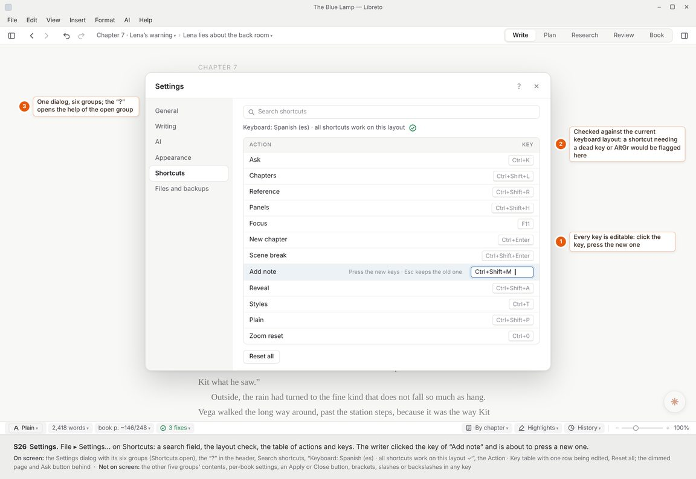

> [!NOTE]
> **Review note** · S26 · Settings
>
> I'd like to see the rest of Settings.
> What about a search field for settings? It works quite well in Ubuntu, you just start typing. Also macOS have something similar.
> About shortcuts, they are always a pain, because you may actually need the mouse to move to the field before pressing the keys, they can be already used... I think we can learn a lot about how VSCode does it.
> Does "Chapters" mean "Show left panel (chapters, items...)"? Same for the rest. What the key does must be very clear.

## S27 · Help

Help is not a column. `F1` opens the **Help window** at the topic of what has focus; the Help menu opens its contents; "how do I add a chapter?" typed in Ask answers from the same help with a link. Tutorials are short, one per feature, offered once when the feature first matters; each runs in your own book with a bubble pointing at the control, can be left at any step with `Esc`, and is never required.

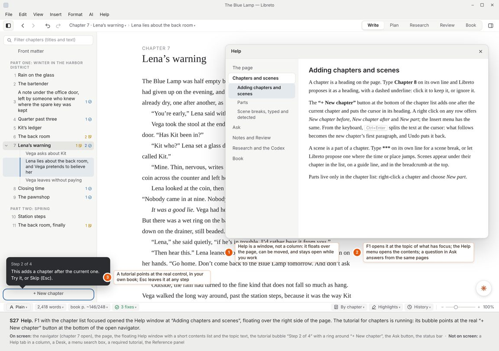

> [!NOTE]
> **Review note** · S27 · Help
>
> Looks good. Add graphics or small examples when needed. For example:
> *** -> [scene line drawing]
> I like the tutorial thing.
> I'd like a search button. If it responds to F1 or Help menu -> Open Help, then it must be searchable. In an intuitive way, not hundreds of menu items at the left. When searching, only affected fields are there, sorted by relevance. When not searching, maybe a few big topics with an arrow that shows subtopics or similar.

## S28 · Statistics

A sheet from the word count in the status bar or View ▸ Statistics: words per chapter and per day, sessions and time, a grid of who appears where, reading time; tabs for the detail, "Back to the text" to leave.

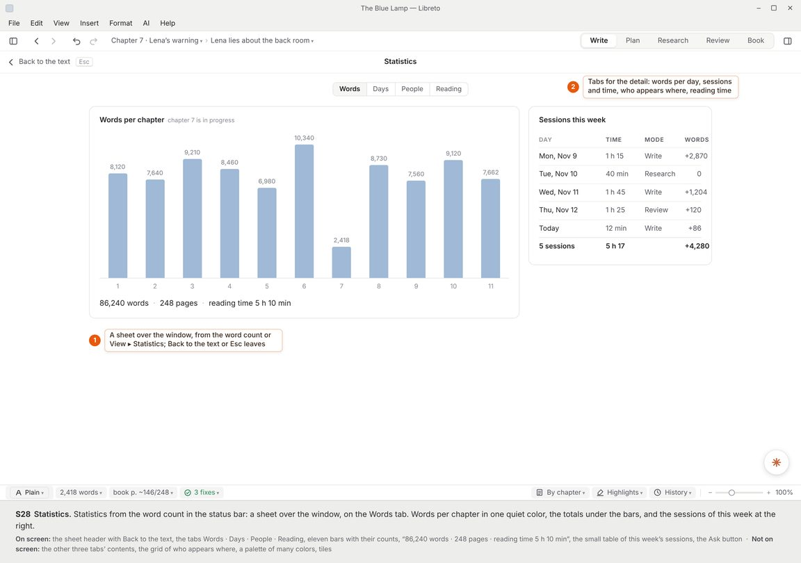

> [!NOTE]
> **Review note** · S28 · Statistics
>
> Again, I'd like to see the other tabs. About "Back to the text", we also talked about that before. If that is some overimposed window type, all of them (Comparing, History, Statistics...) should use the same code. And it must be clearer when we are in one of these windows. Maybe modes or other info should be dimmed, as they don't make sense here. Or showing it like a window with shadows over the mode below it.
> How long does it look back? Just one week? Months? Years? All?

## S29 · Everything in the status bar and the menus

Not a moment: the status bar menus and the seven menus opened together, to see what lives where after the changes. The style palette has a filter; the view item offers By chapter and Whole book (S32); Highlights lists people, places, things, motifs, styles, notes, tasks, fixes and AI-written text; the zoom menu has "Fit width"; History rows are links. File has Share…; View has Focus (`F11`), Panels (`Ctrl+Shift+H`) and Statistics; `Ctrl+0` resets zoom.

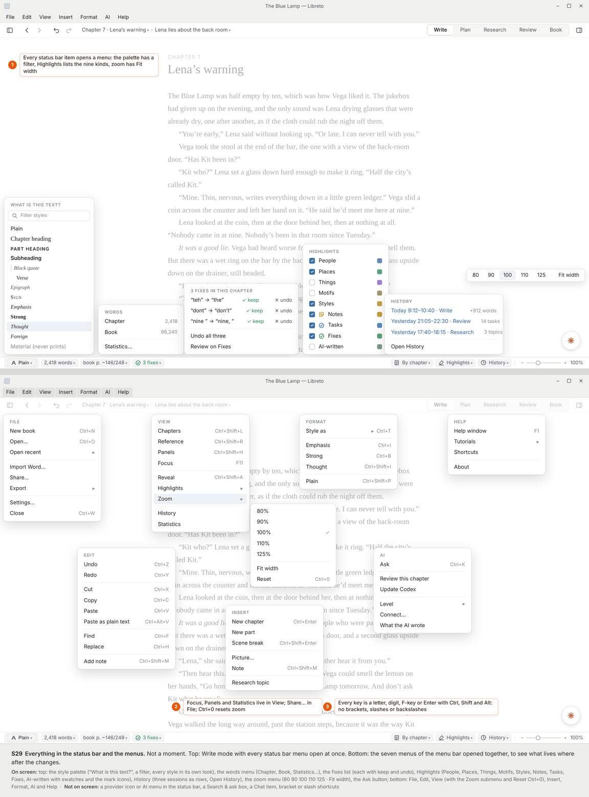

> [!NOTE]
> **Review note** · S29 · Everything in the status bar and the menus
>
> "New book" should be "New project"? We need to talk about wording in general.
> Share: think about it (send and receive together, other ways of sharing?)
> What is Export exactly? Isn't it the Book mode?
> Settings OK, what about Project settings, do we need it?
> View menu is contextual? Chapters only in the modes that allow it, otherwise Topics or whatever? Do Panels mean "All panels"? Do they have a check box when shown or hidden? Reveal is static? I mean, pressing Alt only shows things while pressing. Is Reveal shown until disabled?
> Zoom in and zoom out should have their usual keys shown there too, Ctrl++, Ctrl+-.
> Now I see History and Statistics in View menu, just as if they were views or windows over the text, as I asked. What about Comparing versions? It also has the "Back to the text" button.
> Why "Thought" is in the menu with Emphasis and Strong, as if it was a very important style? Are those two inside "Style as" too? I accept those two as very usual, just like plain, to be there, but we need to think which of them earn that place.
> Insert Research topic from the Write mode? This is to start something? What is shown when clicked?
> Review this chapter (or even Review the book) and Update Codex are done when the user asks? Also in the background? Maybe we need a setting for that?
> What are AI Level and Connect? Links to the same dialog? As I want it to be in Settings, let's restructure this menu. No problem in adding an AI -> Settings menu that opens Settings at the AI tab.
> "What the AI wrote", "Logs", Statistics... Maybe we need some menu for all these things that are about the project but not the project? Reports or something. All printable or exportable.

> [!NOTE]
> **Review note** on _“Not a moment: the status bar menus and the seven menus opened together, to see what liv…”_
>
> I like more the probably outdated styles menu here than the one you featured above. All fonts same size (or just slightly different to show differences) but showing their look.
> What if instead of "3 fixes" there are 300?
> Be careful with "Fit width". I thought we discarded it. Only text size grows in the same space. Anyway, about the slider, I see it is not centered, I thought there were more items to the right of 100% (125, 150, 200, 300, 400) than to its left (25, 50, 75). Put it in the right place when we decide (probably by testing) which zoom levels are added.

## S30 · Three window sizes

How the window adapts. At **1440 px** and above, both columns fit in the margins. Between **1200 and 1440**, one column at a time; opening the other closes the first. Below **1200**, the open column lies over the margin and the edge of the page, and the page stays put; below about 900 the page itself narrows. The Ask panel keeps its width and shortens.

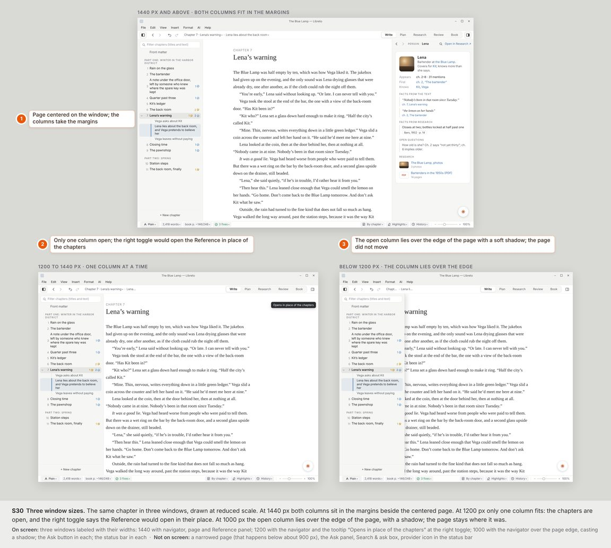

> [!NOTE]
> **Review note** · S30 · Three window sizes
>
> I like it. I don't know if that would work on a phone, though. What about floating menus? They don't close when clicking something on them, right? I mean: Open, Click, Close.

## S31 · Right-click, everywhere

Not a moment in the app: the right-click menus side by side, so they can be checked as one family. The rule is the same for all of them: **the few things done here most often, then the way to the rest.** In the text with a selection: Style as ▸, Emphasis, Thought, Add note, Ask about this, Look up (when the selection is a name), Find in the book, Cut / Copy / Paste. In the text with no selection: Style as ▸, New chapter here, Scene break here, Add note, Ask, Paste. On a mark or its gutter icon: ✓ Keep, ✗ Undo, Add note, "Why?" (the AI explains a proposal), Ignore this word (for a red mark). On a chapter row: New chapter before / after, New part before / after, Rename, Remove the chapter mark, Delete chapter…; on a scene row: Rename, Start a new chapter here, Remove the scene break, Delete scene…. On a Plan card: Open, Rename, Labels ▸, Move to ▸ (chapter list), Unplace, Delete…. On a Codex entry: Open, Rename everywhere, Highlight in the text, Research this, Delete…. Every menu walks with the arrows and `Enter`, typing filters it, `Esc` closes it; the only icons are the ones the app already uses for marks and modes.

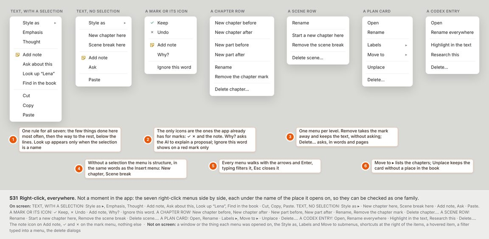

> [!NOTE]
> **Review note** on _“Not a moment in the app: the right-click menus side by side, so they can be checked as …”_
>
> Emphasis and Bold, not Thought.
> Ask about this could have the [Claude] logo. Actually, maybe we need to rethink the icon for Ask, in case AI is not connected.
> Again, need to check what "New part before" means if we are between two scenes that are inside a part and a chapter.
> Delete chapter could say "Delete chapter content" or "Delete all chapter text" or similar.
> For cards, assign color? Or colors didn't work like that, right? They are for Persons, places, etc.
> Is "Why?" accessible from another place without contextual menu? Do app menus change to add these things? Or they just appear as buttons at the right place and also in contextual menu?
> Typing filters menus? For these short contextual menus too? I think adding a search box here is too much.
> Good job! We'll need to keep track of exactly what is seen and what isn't at each possible place the user can right-click. I don't know if there's usually a module for that or how to define them (a JSON? I don't know), but we need to do it seriously, because I don't want weird things appearing in menus or missing items.

## S32 · By chapter, or the whole book

The page can hold one chapter or the whole book, and the switch is the **"By chapter ▾"** item at the right of the status bar, next to Highlights. **By chapter** is the default: the page is one chapter, and at its end a gray line reads "Next · 8 Closing time ↓" (at the top, "Previous · 6 The back room ↑"). Clicking it goes there; so does the cursor: the down arrow on the last line, or `Page Down` at the end, crosses into the next chapter's first line, the up arrow on the first line crosses to the end of the previous one, and `Ctrl+Page Down` / `Ctrl+Page Up` jump a whole chapter from anywhere. **Whole book** shows every chapter on one long page, each heading as a divider with its part above it when parts exist; the chapter list follows the scroll and highlights where you are, a double click on a row scrolls there, and the status bar still counts the chapter under the cursor. Either way the marks, the notes and the Reference panel behave the same; the switch is remembered per book. `Back` returns from any jump.

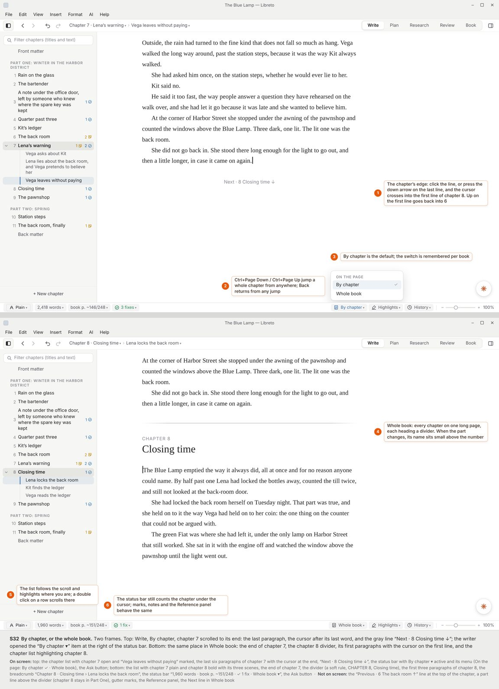

> [!NOTE]
> **Review note** · S32 · By chapter, or the whole book
>
> I like it. Anyway, I doubted about the usefulness of the chapter view. We must think about this. Or maybe make Whole book as default. I'm not sure why I doubted so much, read my previous notes.
> About chapter separation, is it different from section separation? Same for Parts. Everything must be clear here.

## S33 · Notices, Undo and tips

Not a moment in the app: the one way Libreto tells you something changed, and the one way back. Every automatic change and every notice is the same **card at the bottom center of the page**: an icon, one line that names the place ("Scene break removed in ch. 7"), **Undo**, and ✕. It is never on a timer: it folds away when you type or click elsewhere, and it remains as a line in **History ▸ Today**, each line with its own Undo, so a notice seen late is a notice, not a loss. **Undo is one list.** Your typing, Libreto's fixes, a kept proposal, a deleted scene, a move applied in Plan, a change the AI applied: all on the same stack, so `Ctrl+Z`, the Undo on the notice and the ✗ on a mark's card are the same step, in the same order, and Redo brings it back. The fixes item in the status bar lists today's fixes with Keep / Undo and "Undo all"; History holds the snapshots for anything bigger, such as a chapter deleted last week. **Tips** use the same card, one a day at most, and only when Libreto recognizes a habit from a fixed list (retyping what a fix changed, removing detected breaks by hand, reaching for the mouse for something with a key): "Show me" demonstrates, "Not this one again" is remembered, Help ▸ Tips lists them all, and Settings has the switch.

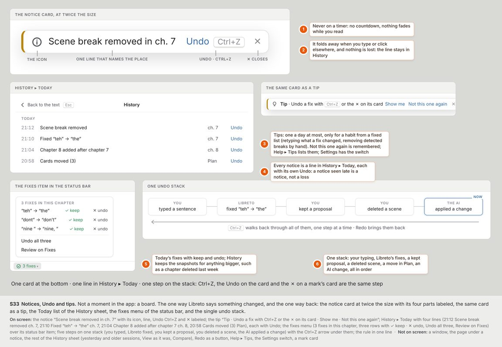

> [!NOTE]
> **Review note** on _“Not a moment in the app: the one way Libreto tells you something changed, and the one w…”_
>
> Yes, but how much typing each Undo step keeps?
> I don't like that typing makes the notice go. It's very easy to be typing when a note just appears and disappears too quickly.
> So, with Ctrl+Z we can undo the stack, but we can also undo specific things from the history? What if other changes are stacked over them?
> I mean: Fixed "teh" -> "the" makes sense to be undone if the writer didn't then delete all the paragraph. Undoing that at the present point does not make sense. Or do they disappear from undo history (as random undo) when they don't exist anymore? This can be very hard to track. This is also valid for History: You add a paragraph, then you delete the whole chapter. Can you undo adding the paragraph now? Of course, not, so some changes can't be undone without undoing first all the stack. It would be nice to recover a deleted chapter, but maybe it's not always possible: other chapters can have appeared and disappeared at the same place multiple times and also adding a deleted chapter will probably have a lot of semantic inconsistencies. Same for the fixes menu, you can't just undo them if they don't exist anymore.

## What changed in draft 5, and why

Everything below answers the notes on draft 4 for screens 1 to 8; screens 9 to 30 are unchanged apart from the strip, the status bar and the notice card.

- **Modes at the right of the strip.** The breadcrumb needs room on laptops with large fonts and the two cannot both be centered; the pill at a fixed right edge is where design tools put their mode switch, and the breadcrumb owns the left. One line, no second row.
- **Status bar items look clickable**: a soft background and a ▾ on every item that opens a menu. A hint alone was not enough.
- **One card for every mark**, on hover or `Ctrl+.`: what happened, Was / Now, ✓ ✗ with `Enter` / `Delete`; `F8` walks the marks. The same card is the margin card in Review.
- **The fix rule is written down**: one possible answer and no meaning touched; "recieved" is fixed, "quite / quiet" is proposed. A fix fades red to green and never moves the text.
- **One underline per problem, one underline per word**, red before blue before green; one gutter icon per line with a count; a count opens the stack as a list.
- **Red marks** have no icon in Write and a Spelling filter in Review; their card offers candidates and "Add to the book's words".
- **Review filters by people**, named when you share; the AI never guesses who a reader is.
- **The welcome line is a card**, on no timer, that slides into the Ask button and stays reachable there and in History.
- **Kind of text at Start** sets the names of up to three structure levels (parts / chapters / scenes, acts / scenes, nothing); a book can gain or lose a level later. Front matter and Back matter are rows in the list.
- **Start shows the full path on one line** under "Will be stored in", cleaned as you type, and a cover tile per book.
- **Right-click menus per level and per place**, written out in S31; removing a mark never deletes text and never asks, deleting asks in words and pages.
- **Dragging in the chapter list points to Plan** instead of moving; cutting and pasting across chapters is free and any coherence problem becomes a task later.
- **Scene breaks** from any repeated symbol, with Undo; the break is a selectable block; a proposed break is a mark like any other, with the usual card; detected scenes are named by first words without an AI.
- **By chapter or Whole book** (S32), with a gray Next / Previous line and cursor crossing; `Ctrl+Page Down` jumps a chapter.
- **One notice, one Undo** (S33): the card at the bottom, History ▸ Today, one stack for everything, tips through the same card.
- **A chapter heading starts a chapter**: applying the style mid-chapter splits there. The style palette reads as a list (names in the interface font, samples at the right), with "+ New style…".
- **Ask needs no AI while you type**: index, fixed order, three rows per group; questions are templates; no on-device model in version 1. The Codex is kept by the writer, by rules (names, mentions, counts, proposed entries) and, when connected, by the AI, marked as such.
- **On disk**: Markdown, one file per chapter, `***` for a scene break, readable without Libreto; said in S01 and S06.

## What changed in draft 4, and why

- **One door for the AI.** Search & ask, the Chat tab and the status-bar icon were three faces of one thing. They are now **Ask**: `Ctrl+K` or the round button; results while you type, a conversation when you ask. The button is the AI's status too: gray when not connected, pulsing when working, a dot when an answer waits.
- **The page never moves.** Columns open in the margins; the text stays centered on the window at any width that allows it.
- **The Reference panel instead of tabs.** The right column shows one thing with its own `‹ ›`: a Codex card or a research topic. No tabs, no second search box; `Ctrl+K` looks things up.
- **Codex and Research are two things in one library.** The Codex is what the book says; Research is what you gather. They sit as two sections of the Research mode, link to each other mostly by themselves (names are recognized in topics as in the text), and knowledge moves between them with "Pin as fact" and "Open in Research".
- **Review is Write with the margin open.** Notes are made and fixed in Write, beside the line; Review adds the counts, the filters and the walker. History, Compare, Statistics and Help are **sheets** over the window, not modes, so there are still five modes and nothing more.
- **One family of marks.** Underlines on the exact characters in three colors; icons, not dots, in the gutter at the exact line, with the same icons as counts on the left; dotted green = done, dashed gray = proposed. Scenes lost their bullets.
- **Lines to the text.** A selected note draws a short line from its gutter icon to its card and tints its words; unselected cards stay quiet.
- **Adding chapters without keys.** A "New chapter" button at the bottom of the list, a right-click menu on every row, the Insert menu; `Ctrl+Enter` for those who want it.
- **The "what now" dialog is gone.** Libreto reopens as you left it; a line at the bottom says what is waiting.
- **The start dialog names the folder.** The sentence under the location shows the exact path that will be created.
- **Keys on every keyboard.** `Ctrl+Shift+H` panels, `Ctrl+Shift+L` / `Ctrl+Shift+R` each column, `F11` Focus, `Ctrl+Enter` chapter, `Ctrl+Shift+Enter` scene break, `Ctrl+Shift+M` note, `Ctrl+Shift+A` reveal, `Ctrl+0` zoom reset, `Alt+1…5` modes, `Alt+←/→` back and forward. Every key is editable in Settings and checked against the layout.
- **Replace all shows the list first.** And a Codex name offers "Rename everywhere" instead of a blind replace.
- **Cards can take a color** with a legend you name; "Color by" fills them from the Codex.
- **Pictures** on Codex entries, in research topics and in the book itself.
- **The disclosure is always visible** on the AI screen, with a warning sign.

## Questions

Open from draft 4 (screens 9 to 30 are still unread):

1. "Ask" as the name of the single door (button and `Ctrl+K`)? Alternatives: Assistant, Chat, the provider's name.
2. Keep Review as a mode (same page, margin open), or make it a switch inside Write?
3. The Reference panel without tabs and without its own search box: yes?
4. Research mode as the library with two sections, Codex and Research: right split, right names?
5. Keys: `Ctrl+Shift+H` panels, `F11` Focus, `Ctrl+Enter` chapter, `Ctrl+Shift+Enter` scene break, `Ctrl+Shift+P` Plain: fine?
6. "Styles" as the word, with "What is this text?" as the palette's title, or another word?
7. Hold `Alt` kept, with `Ctrl+Shift+A` as the alternative?
8. One color per card plus "Color by": enough for planning?
9. The chat floating only, docking later: yes?
10. Pictures in the manuscript (figures) in version 1?

New in draft 5:

11. Modes at the right of the strip: acceptable, or would you rather lose Undo / Redo from the strip and keep the pill centered?
12. The mark card's keys: `Ctrl+.` to open, `Enter` ✓, `Delete` ✗, `F8` next mark. Fine on your keyboard?
13. Dragging in the chapter list only points to Plan. Too strict, or right?
14. Kinds of text at Start: Novel, Novel without parts, Short story, Play, Essay, Plain text. Missing one? Should a book be able to change kind later, or only gain and lose levels?
15. The "By chapter / Whole book" switch at the right of the status bar, next to Highlights, rather than centered: fine?
16. The cover tile: colored initial by default, a picture if dropped, an AI sketch on request. Worth having in version 1?
17. Tips: one a day at most, from a fixed list of habits, with "Not this one again". Enough, or still intrusive?
18. No on-device model in version 1: the Ask list and the Codex upkeep run on the index and rules alone, the AI only when connected. Agreed?

> [!NOTE]
> **Review note** on _“"Ask" as the name of the single door (button and Ctrl+K)? Alternatives: Assistant, Chat…”_
>
> For now, Ask, given AI is now clearly optional.

> [!NOTE]
> **Review note** on _“Keep Review as a mode (same page, margin open), or make it a switch inside Write?”_
>
> Oh, this is my big question! I don't know!

> [!NOTE]
> **Review note** on _“The Reference panel without tabs and without its own search box: yes?”_
>
> Yes, much better.

> [!NOTE]
> **Review note** on _“Research mode as the library with two sections, Codex and Research: right split, right …”_
>
> This point and Write/Review are my two big problems. Let's think more about this. Anyway, what you showed looks quite good.

> [!NOTE]
> **Review note** on _“Keys: Ctrl+Shift+H panels, F11 Focus, Ctrl+Enter chapter, Ctrl+Shift+Enter scene break,…”_
>
> Yep.

> [!NOTE]
> **Review note** on _“"Styles" as the word, with "What is this text?" as the palette's title, or another word?”_
>
> Styles is good for now. Yes.

> [!NOTE]
> **Review note** on _“Hold Alt kept, with Ctrl+Shift+A as the alternative?”_
>
> Yes, but Ctrl+Shift+A is permanent instead of Alt that disappears when stopping holding?

> [!NOTE]
> **Review note** on _“One color per card plus "Color by": enough for planning?”_
>
> I think so.

> [!NOTE]
> **Review note** on _“The chat floating only, docking later: yes?”_
>
> Floating, but I want to see it with a panel below it.

> [!NOTE]
> **Review note** on _“Pictures in the manuscript (figures) in version 1?”_
>
> Yes.

> [!NOTE]
> **Review note** on _“Modes at the right of the strip: acceptable, or would you rather lose Undo / Redo from …”_
>
> I don't like it at the right, but I think breadcrumbs may be useful if no left panel is open. We could decide to remove breadcrumbs later if we see they are not used.
> What about learning from users? "Do you want to send anonymous data about the tool using (no content, etc.)?". We could have statistics.

> [!NOTE]
> **Review note** on _“The mark card's keys: Ctrl+. to open, Enter ✓, Delete ✗, F8 next mark. Fine on your key…”_
>
> Yes.

> [!NOTE]
> **Review note** on _“Dragging in the chapter list only points to Plan. Too strict, or right?”_
>
> Well, Plan has the tooling to say "Moving this here will touch this, this and this" and a way to accept all changes done. Doing it in the text won't have that warning, right? But on the other hand, if that will make the user cut and paste, that's not a solution... Can you think of a way?

> [!NOTE]
> **Review note** on _“Kinds of text at Start: Novel, Novel without parts, Short story, Play, Essay, Plain tex…”_
>
> I talked about this. Not sure, maybe there are too many types. About changing from one type to the other... We should have rules between all of them and know what will be lost.

> [!NOTE]
> **Review note** on _“The "By chapter / Whole book" switch at the right of the status bar, next to Highlights…”_
>
> Yes, fine, but check again my doubts about both modes.

> [!NOTE]
> **Review note** on _“The cover tile: colored initial by default, a picture if dropped, an AI sketch on reque…”_
>
> Colored initial is OK. But the user should be able to choose a color, a predefined image or even upload a picture of their own. It must be cut, resized, etc., so if it is too complicated, we may let only a color (chosen by the user if they want) with the initial.

> [!NOTE]
> **Review note** on _“Tips: one a day at most, from a fixed list of habits, with "Not this one again". Enough…”_
>
> This looks OK. If they are discreet and also useful (appearing at the right time given the user habits or after seeing what a user can be looking for), even more than one per day could be OK. But how do we train something to identify possible wrong attempts? Again, having user data about the tool usage would be great.

> [!NOTE]
> **Review note** on _“No on-device model in version 1: the Ask list and the Codex upkeep run on the index and…”_
>
> Ok. We need to evaluate the costs of having an on-device model and how useful could it be. As you said, using Haiku for very easy tasks could work fine.
