# Libreto — Specification

> Reviewed copy of `libreto-screens-d6-v1-2026-11-13-1917-reader.html` with the notes of `review-notes-d6-2026-11-15.md`: the document as it was annotated, with 80 notes by the owner under the sections they are about (exported 2026-11-15 · 80 notes). The HTML file is the annotatable version; open it in a browser to read the notes beside the text.

## Preamble & scope

**Revision**: 1

Status: **for annotation.** One document, in the order a writer who has never seen Libreto would meet things. Before each screen, a short paragraph says how you get there, what it is for and what it lets you do; then the picture. Not a guide and not a specification. The pictures are in `concepts-d4/`; the review page puts a note field under each one.

Draft 6 answers the 73 notes on draft 5, which covered every screen (`concepts/review-notes-d5-2026-11-13.md`). The two questions that ran through them, **Write against Review** and **Codex against Research**, got one answer each, and most other changes follow from those two. What changed, and why, is at the end, with the open questions and a list of what moves to the specification.

## Libreto in one minute

Libreto is a writing app for long texts: novels first. Its window is a **page in the middle**, with two columns that can open beside it and never move it: on the **left**, a list of what you are working on (the chapters; in Research, your topics; in the Codex, the cast); on the **right**, the **Reference panel**, which shows one thing at a time: a person, a place, a topic. Both columns are 320 px wide, always; nothing to resize. Along the top, six **modes** as tabs name the job you are doing: **Write, Plan, Research, Codex, Review, Book**. Choosing one dresses the same window for that job; it never takes you somewhere you cannot come back from with one key.

The AI has **one door**: the round **Ask** button at the bottom right of the window, or `Ctrl+K`. The same box finds a chapter, looks up a name, runs a command ("export PDF") and asks a question about the book; when the question needs the AI, the box becomes a conversation. The AI can do anything you can do in Libreto, but it never changes your text, your chapters or your cards without a button you click first. When no AI is connected, the button is gray and the box still finds, looks up and runs commands. Everything else in Libreto works without an AI; where the AI adds something, the screen says so.

Seven rules hold everywhere:

1. **The page never moves.** Columns open in the margins; the text stays centered.
2. **Four colors, one meaning each.** **Red**: a word Libreto does not know. **Blue**: pending, something proposed and not yet decided, whoever proposed it (a grammar fix, a detected scene break, an AI finding, a reader's change). **Green**: done by Libreto, undoable. **Amber**: a note, a remark that asks nothing. Underlines on the exact characters in Write; the same four as badges at the exact line in Review, as counts in the chapter list and as filters.
3. **Write is for writing, Review is for deciding.** Write shows the underlines and your own notes, nothing else; everything that waits for a decision waits in Review, and the Review tab says how many.
4. **One way back.** `Esc` closes whatever just opened and returns the cursor to the text; `Back` (`Alt+←`) returns from any jump, across modes too; `Ctrl+Shift+H` hides both columns and brings them back.
5. **Nothing replaces your words unasked.** Fixes while you type are small, green and undoable; everything else arrives blue, as a proposal with buttons.
6. **Keys that exist on every keyboard.** Letters, digits, F-keys and Enter with `Ctrl`, `Shift` and `Alt`; no brackets, slashes or backslashes.
7. **One Undo, one notice.** Everything that changes the text, yours or Libreto's, is one list: `Ctrl+Z`, the Undo on a notice and the ✗ on a card are the same step. A notice is a card at the bottom of the page that stays until you say **Got it**, and a line in the bell and in History.

| Mode | Left | Center | Right | What it is for |
| --- | --- | --- | --- | --- |
| Write | chapters (optional) | the text, underlines, your notes | Reference (optional) | writing; the default |
| Plan | none | cards in lanes, the whole window | the selected card's scene | seeing and reordering scenes |
| Research | the Inbox, your topics, files | a topic, large | what it links to | gathering material |
| Codex | people, places, things, motifs | one entry, read from the book | where it appears | what the book says, checked |
| Review | chapters with counts, filters by kind and by person | the text with badges, the margin open | the cards, level with their lines | deciding; the second pass |
| Book | page thumbnails | spreads | layout settings | printing and exporting |

History, Compare, Statistics and Help are not modes: they open **over** the window as a sheet with "Back to the text" at the top left, the mode tabs dimmed behind them, and `Esc` closes them.

> [!NOTE]
> **Review note** · Libreto in one minute
>
> As a general note, I've been quickly looking into screenshots and I see we are losing our minimalistic approach. I know text is text, and a book with research, codex, comments, etc. is a lot of stuff to manage, but let's try to keep it simple. I'll be commenting each screenshot if I see it too overloaded.

> [!NOTE]
> **Review note** on _“One Undo, one notice. Everything that changes the text, yours or Libreto's, is one list…”_
>
> When undoing, the right place must be shown, probably at the center of the screen (that can be decided). I've seen applications (Word probably does that) that undo things without showing you what you are undoing, so you never know at which point of the undo stack you are.

> [!NOTE]
> **Review note** on _“Mode Left Center Right What it is for Write chapters (optional) the text, underlines, y…”_
>
> I asked you to put lanes horizontal in Plan mode. I'll see it later, though, maybe it is correct this way.
> Should Research include some kind of browser to search on the Internet? That way, no copy and paste will be needed and no AI will be needed to ask for something.
> Should Codex be editable? Let's look at it later.
> We could think of adding an importance level to Review items, it could be set by the user or by AI.

> [!NOTE]
> **Review note** on _“History, Compare, Statistics and Help are not modes: they open over the window as a she…”_
>
> Not sure if Esc must directly close them. If some unsaved work is there, that could be dangerous. Let's store that like something to be manually tested. And adding a warning if something wrong can happen. Even more, what if those windows include open cards that go away with Esc? Someone tapping Esc twice could exit the screen, and some of them can be harder to reopen again. Because I understand "Back" doesn't include reopening these windows.

## S01 · Start

When Libreto opens with nothing open, it asks for the least it can: a title and where to keep it, under the words **New project**. There is no kind of text to choose. Every project has the same three optional structure levels, **Part, Chapter and Scene**, and only the ones you use ever show: a short story is scenes without chapters, a plain text uses none. The names can be changed in Project settings (acts and scenes for a play), and those names are then used everywhere: the left list, the Insert menu, the Plan lanes, the printed book.

Under the location there is a label, **"Will be stored in"**, and under it the **full path on one line**, growing as you type the title; characters a folder cannot hold are dropped from the folder name as you type (the title keeps them). The line under that is always there: one folder per project, inside it the text as plain Markdown files, one per chapter, readable in any editor without Libreto; notes, research and history in their own subfolders. "Documents/Libreto" is the default (on a Spanish system it reads "Documentos/Libreto"); "Change…" picks another place and the path updates.

Each project gets a **tile**: a color you pick from a short row, one of a few plain images (paper, linen, a night window), or just the title's initial on the color. No AI is involved, and a real cover replaces the tile in Book when there is one. Recent projects open with one click. "Import a Word file" turns a manuscript's headings into chapters; a manuscript without headings imports as one chapter, and when an AI is connected it offers to propose where the chapters start, as blue marks you keep or skip.

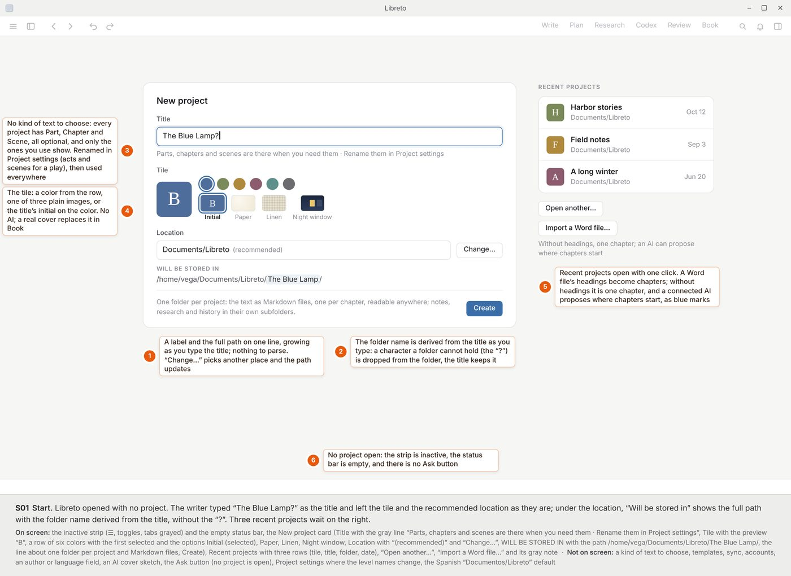

> [!NOTE]
> **Review note** · S01 · Start
>
> The three lines you put as an icon for hidden menus are right, but I expected something like different size lines. I can't find the image anywhere and I can't add it images here yet, so try to get what I mean.

> [!NOTE]
> **Review note** on _“When Libreto opens with nothing open, it asks for the least it can: a title and where t…”_
>
> I don't like having to enter project settings to change elements names. It should be decided beforehand, although also editable later (but with care, the text structure is not the same for a novel than for a play). A notice saying you can change it later in project settings would be nice.
> I'd do it like a simple choose between Book, Play or Essay (or similar). The list must be the minimum possible. Each choice with a list of possible doc types. We should include essays, papers, thesis, novels, short stories, poems, etc. Let's try the list not to be more than three or four choices, but let's use all needed to have all possibilities covered.

> [!NOTE]
> **Review note** on _“Under the location there is a label, "Will be stored in", and under it the full path on…”_
>
> I'd like to make it even clearer, something like "Choose the place to store your project", something that can make clear that you don't need to write the project name as the folder name. Or "Base path to store your project".

> [!NOTE]
> **Review note** on _“Each project gets a tile: a color you pick from a short row, one of a few plain images …”_
>
> For the tile (no need to call it tile in the UI). I expected a small dialog to choose: a letter with a choosable background color or rather one of a list of predefined images. I expected something more, at least 15 or 20 predefined thematic images that could be used for any book. For example, a hat and a whip for an adventure book, two masks (laughing and sad) for a play, a beach, a ball... I don't know, a list long and representative enough to include any kind of book. Maybe images in two or four colors in a palette. The color must be chosen, so you can choose: a) letter or predefined image, and b) a color as a letter background or to give a version of the chosen simple image in that palette of colors. The style of the drawings must be simple and according to the app design, nothing out of place. Paper, linen, etc could be images that can change color (so, images can include some textures). For now, no AI generated images (except for those that you'll generate now :-). Cover design and setting should be another totally different flow, that we should add later, probably in project settings or similar or in a place that can be understood and easy to find.
> I don't like the message next to "Create", I don't think users must know how the software works in the background. A Pro user will need to learn it somewhere else.

## S02 · Write, the first minute

A new project opens on its first chapter in Write mode, both columns closed. The heading reads "Chapter 1" in gray: a placeholder, since a numbered chapter needs no title, and typing replaces it. The top strip, left to right: the **☰ menu** (on Linux and Windows the menu bar lives behind it; on macOS the system bar stays), the left toggle, Back, Forward, Undo and Redo, then **where you are** (chapter › scene, each a menu of its siblings) with all the room it needs, then the six **mode tabs**, and after a gap the **Find** magnifier, the **bell** for notices and the right toggle. Tabs are tabs: the current one is underlined, and the Review tab carries a small blue count when something waits there.

The status bar shows the style at the cursor in its own look (here **Thought**, italic, because the cursor is in one), the words, the page this would be in the printed book, and **"● 12 to review"** in blue, which is the same count as the tab and opens Review. At the right: a **⌨** button that lists the keys that work right where you are, the view switch (**Whole book ▾**), **Show ▾** (underlines on or off, and the highlights of S10), History, zoom. Every item that opens a menu looks like it does. The round **Ask** button at the bottom right is the AI's door; its tooltip says `Ctrl+K`.

The marks are the thing to look at. In Write the page carries **underlines only**, on the exact characters: **red** dotted for a word Libreto does not know and cannot fix alone, **blue** dotted for anything it proposes, **green** dotted for a change it already made; the gutter holds **your own notes** and nothing else. The rule for what gets done without asking is short: **Libreto changes by itself only what has one possible answer and does not touch meaning**: a word that is not a word with exactly one correction one slip away ("teh", "recieved", a doubled letter, a missing apostrophe), a space before a comma, a double space, straight quotes to curly. Two possible answers ("quite" or "quiet" are both words), agreement ("the letters was"), anything longer than a word: proposed, in blue. When a fix happens, the red underline fades to green in under half a second; the text never moves. Underlines never pile up on one height: when a problem spans a word that already has one, the second underline is drawn one row lower, so two marks are always two lines.

**Hovering any mark**, or resting the cursor inside it and pressing `Ctrl+.`, opens the same small card everywhere: a title that says what happened ("Done · typo", "Pending · agreement"), **Was** and **Now**, and two buttons. On hover the buttons are plain; opened from the keyboard they show their keys inside (`Enter` ✓, `Delete` ✗), which is how the keys are learned; the first hover of all says "Ctrl+. opens this from the keyboard" once. `F8` and `Shift+F8` jump to the next and previous mark. A proposal is **one underline under the whole affected text**, never two underlines for one problem.

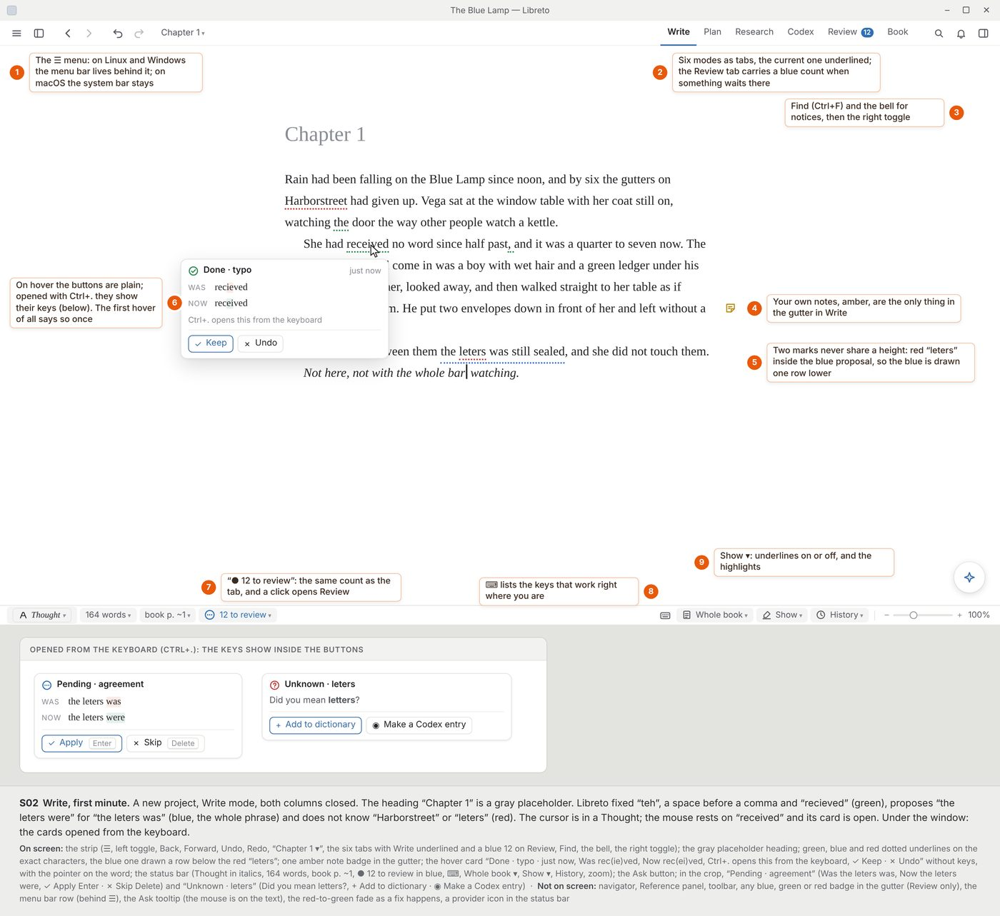

> [!NOTE]
> **Review note** · S02 · Write, the first minute
>
> I'm not sure if I like tabs more than buttons as before. Tabs look better at that right place. If we could center it (for example, by removing breadcrumbs), they would look better as mode buttons. In later screenshots I've seen underlined tab and text under it are too close. Not sure, maybe we go back to buttons or another style that make it clear they are one or the others, exclusively.
> "12 to review" and "a click opens Review", a click on the menu or a click on one of the items?
> The keyboard button could be a good idea... We'll see it later, I'm not sure. Is there a key to show all keys?
> The dialog with "Unknown - leters" don't show the keys. Also, only "Add to dictionary" and "Make a Codex entry" (why this one?)? Shouldn't buttons next to "Did you mean 'letters'?" also fix or skip it?

> [!NOTE]
> **Review note** on _“The marks are the thing to look at. In Write the page carries underlines only, on the e…”_
>
> I don't like how different height underlines show. Let's go back to show them in precedence. If the most important one is red underline, then blue can only be shown around the red underline. If two fixes (for example, red and green) are in the same exact word, then hovering could show both things or the more important one only.

> [!NOTE]
> **Review note** on _“Hovering any mark, or resting the cursor inside it and pressing Ctrl+., opens the same …”_
>
> This kind of tips should be shown here and there, not only once. And I understand F8 and Shift+F8 is similar to how it will work in Review mode, one after another.

## S03 · The marks, up close

Not a moment in the app: the family of marks at twice the size, so the rules can be checked once. Four underlines: **red** = unknown word, **blue** = pending, **green** = done, **amber** = a note (your own, on the words it is about). A detected scene break or a detected heading is a pending mark too: a **blue dashed rule** where it would go, and nothing exists until you keep it. The same four colors are the four **badges** of Review, small icons at the exact line: a **?** in red, **…** in blue, **✓** in green, a **note** in amber; in Write only the amber one shows. Readers' changes and AI findings are blue like any proposal; who they come from is a word on the card and a filter in Review, never another color.

The card is the same for all four, and differs only in its buttons. **Unknown** (red): the candidates ("Did you mean…"), **Add to dictionary** (the word is right, spell it so from now on) and **Make a Codex entry** (it is a name). **Pending** (blue): **Was** and **Now** with the changed part tinted, no italics, spaces shown as **middle dots** (·) so "a comma" and "a comma" can be told apart, then ✓ Apply and ✗ Skip. **Done** (green): the same two rows, ✓ Keep and ✗ Undo. **Note** (amber): the text, Reply, Done. When one line holds several marks, Review shows one badge with a count and a click opens them as a list; Write still shows every underline. The rule to remember: **red you fix by typing, blue waits for you in Review, green is done and one Undo away, amber is a remark.**

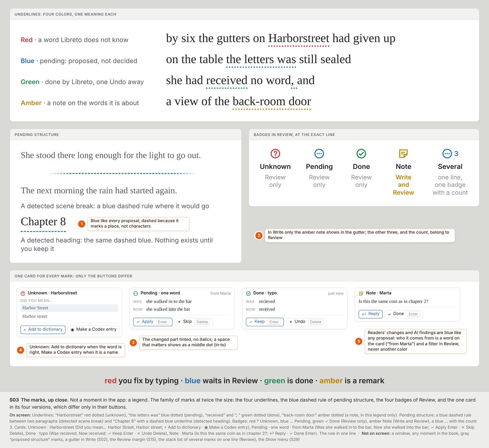

> [!NOTE]
> **Review note** · S03 · The marks, up close
>
> I don't like the note icon, let's choose another one. Or another color. Maybe a gray note? What's the best option?
> "One line, one badge, with a count", what if they are different badge types?
> Unknown - Harborstreet: It's not clear you can choose a line. Maybe a button or check to show it? Isn't there an option to skip or dismiss? I don't like "Make a Codex entry", is this the right place?
> Should AI notes be shown differently before opening?
> What happens with replies? Will comments be exported to Word? Maybe that should be set in export options.
> Is "Done" the right word? It must make clear the idea "I read the note and I don't want to do anything with it or I already did it!. AI should help fixing things.

## S04 · Coming back

Libreto reopens exactly as you left it: same mode, same chapter, same columns, the cursor where it was. No dialog asks what you want to do. A **notice** at the bottom of the page says where things stand: when you last wrote, how much, and what is waiting (things to review, cards not placed, clippings in the Inbox), each with a button. Like every notice it stays until you press **Got it**; typing does not dismiss it. Then it lives in the **bell** at the top right, which shows a dot while something there is unread, and as the first row of History. The card can be turned off in Settings.

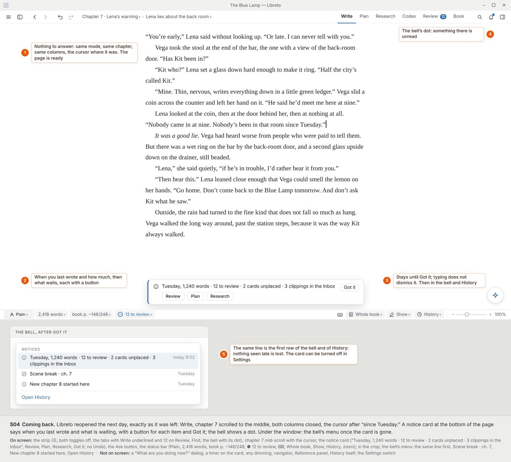

> [!NOTE]
> **Review note** · S04 · Coming back
>
> What is shown in Notices? For example, what do the other two lines in your example mean? When did they appear? Are they notices or fixes? How to delete them from the list? Clear the list? Is that list a taste of history?
> We must make clear what are notices, history items, undo list, comments, notes... Don't mix them.

> [!NOTE]
> **Review note** on _“Libreto reopens exactly as you left it: same mode, same chapter, same columns, the curs…”_
>
> It should say "Last session". And how are its buttons chosen? A "Don't show anymore" button would help.

## S05 · Chapters, on the left

Open the left column with the icon at the top left or `Ctrl+Shift+L`. It lists parts, chapters and scenes by the names your project gives them. Scenes are indented under their chapter with a thin guide line and lighter text, **no bullets**; in Write the list carries **no badges**, so nothing on it looks like a mark, and the counts appear in Review. One click peeks at a chapter without leaving your place; a double click goes there; `Back` returns. The filter box at the top matches **titles and text**, so "lena" shows every chapter where she appears, with a count, and parts stay as headings over their matched chapters. Nothing finer is offered here: Find (`Ctrl+F`) and Ask do the rest.

Every row has a right-click menu for its level. A **chapter**: New chapter before / after, **Start a new part at this chapter**, Rename, Remove the chapter mark (the text joins the previous chapter), Delete chapter…. A **scene**: New scene before / after, Rename, Start a new chapter here, Remove the scene break, Delete scene…. A **part**: Rename, Remove the part mark (its chapters stay). A part always starts where a chapter starts, so there is never a part "before a scene". Removing a mark never deletes text, asks nothing, and has Undo; deleting asks, in words that mean something: "Delete the scene 'Vega asks about Kit'? 1,300 words, about 5 pages. It goes to Discarded, where you can get it back." **Front matter** is the first row and **Back matter** the last, each folded, each with a **+ New ▾** at its right that lists what can go there (title page, dedication, epigraph; acknowledgments, about the author); only filled ones print.

**Dragging a row moves it.** A line shows where it will land, the pointer refuses only the impossible (a chapter inside a scene), and the drop is one Undo. When the AI, or the Codex's own facts, know the move breaks continuity, the notice says so instead of a dialog stopping you: "Moved 'Vega asks about Kit' after chapter 8 · Kit finds the ledger only in chapter 9 · Undo · Got it". Cutting text from one chapter and pasting it into another goes the same way, scene break lines included. **"+ New chapter"** at the bottom adds one after the current chapter, with the cursor in its heading and a notice that says where it went; the same from the Insert menu, from `Ctrl+Enter` (the text after the cursor becomes the new chapter's first paragraph), or by typing "Chapter 8" on its own line. Structure can grow later: starting the first part puts every chapter before it in "Part One".

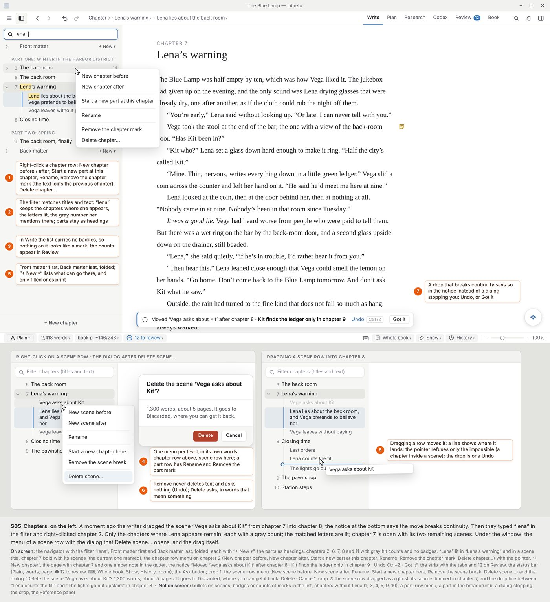

> [!NOTE]
> **Review note** · S05 · Chapters, on the left
>
> An X at the chapters search box. And contextual menu must not show some things. Same for the "+" I just proposed. They must not work in filter mode.
> I don't understand the "+ New" button, I think my option improves that. But yes, that can't be done with keyboard only. Or can it? How to move with keyboard between panels? How to drag and drop things with keyboard? I'm not sure we must allow that, but I can imagine a scene selected and being moved up and down, even changing the chapter, with a keyboard combination. In that case, what about the coherence message? Showing at each step?

> [!NOTE]
> **Review note** on _“Every row has a right-click menu for its level. A chapter: New chapter before / after, …”_
>
> Convert a scene into a chapter? Or too complex and options?
> "Remove the X mark". Mark? Title? Separator?
> May someone want a part starting with a scene without a chapter?
> What exactly is Discarded? A list of scenes? A box with any discarded text? If they are stored like scenes, that can make it easier to find, understand and recover them.

> [!NOTE]
> **Review note** on _“Dragging a row moves it. A line shows where it will land, the pointer refuses only the …”_
>
> Undo and Got it? What about Fix it or Add a task.
> Cutting and or pasting text triggers Codex engine (good name for it) to update Codex? We need to determine how Codex is updated.
> I don't like "+ New chapter". Why not new scene or new part too? I'm thinking... What about a "+" that appears at the right between any two items of the list. Clicking on it shows what can be added at that point (part, chapter, scene). That way, we can clean right-click menu and delete the button at the bottom.
> Parts are not needed, so we don't start a book with an automatically added part. But we must allow to add them before the first item and after the last item too.

## S06 · Scene breaks, typed and detected

A line that holds only a repeated symbol (`***`, `* * *`, `---`, `~`, a single `*` or `-`, any length) becomes a scene break, drawn as a soft gray rule, with a notice ("Scene break · Undo · Got it") for the time you meant the character itself. On disk it is a `***` line in the chapter's Markdown file. When the time or place jumps without a break, Libreto proposes one with a **blue dashed** rule, and the card is the usual one: "Pending · scene break", ✓ Keep or ✗ Not a scene. A detected chapter heading looks the same way. The chapter list shows detected scenes in lighter text until they are kept, named by their first words in gray; with an AI connected, "Name the scenes" in the list's ⋯ menu proposes names, marked as proposed until you keep them.

A scene break is a block like a paragraph: a click selects it with the same selection color, it is copied, cut and pasted as its `***` line, `Backspace` or `Delete` removes it, and right-click offers "Remove scene break" and "Name this scene…". Insert ▸ Scene break (`Ctrl+Shift+Enter`) puts one at the cursor, in the middle of a sentence if that is where the cursor is, and Undo joins the halves again. Removing a break merges two scenes, the row fades out of the list and a notice says "Scene break removed · Undo · Got it".

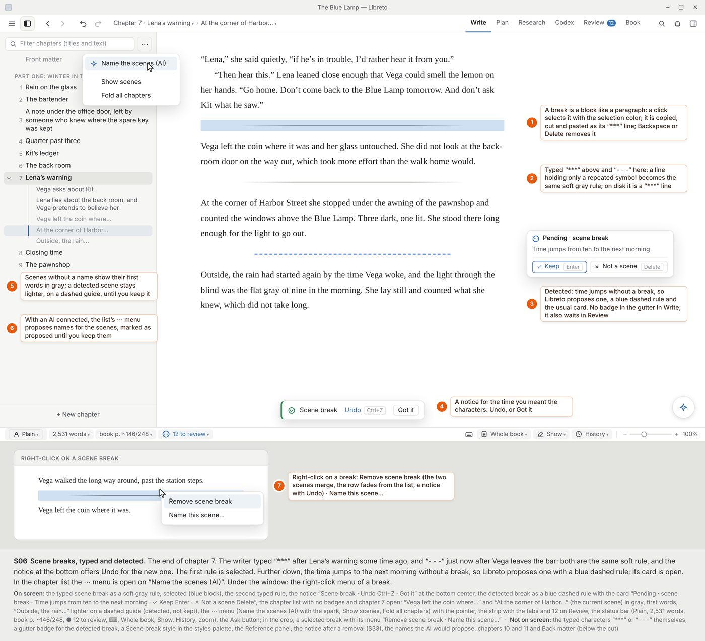

> [!NOTE]
> **Review note** · S06 · Scene breaks, typed and detected
>
> Will Name the scenes rename existing ones? Otherwise, it must be rename unnamed scenes. Show scenes and Fold all chapters do opposed things? I don't get what the first one means.

> [!NOTE]
> **Review note** on _“A scene break is a block like a paragraph: a click selects it with the same selection c…”_
>
> Should scene name be shown after or next to the separator, maybe small and in gray, so it can be renamed right there? Not sure, some writers may just use it as separators.
> Can chapterst,scenes and parts be added via right click?

## S07 · Styles

A style says **what** a piece of text is (a thought, a letter, a sign on a door, a chapter heading), not how it looks. The look is chosen later, per project, in Book; on the page every style still shows a plain working look so you can see it: a thought is italic, a sign is small caps. **Emphasis** (`Ctrl+I`) and **Strong** (`Ctrl+B`) are the two text styles every keyboard already knows, first in the Format menu and in the right-click menu; Thought, Foreign and the rest are one level down, under **Style as ▸**. A **chapter** is a container, the file on disk; its **heading** is the chapter's first line in the Chapter heading style, and a chapter without one shows its number in gray, in Write and as the divider in the whole-book view. That is also why applying "Chapter heading" to a paragraph in the middle of a chapter **starts a new chapter there**, with a notice and Undo: a heading is where a chapter begins.

The chip at the bottom left always shows the style at the cursor, written in that style's look. Click it, press `Ctrl+T`, or right-click ▸ "Style as" for the palette: **each row in its own look at one size**, the way S29 showed it, with the key at the right where there is one; a filter box on top, **"+ New style…"** at the bottom, which opens a small dialog: the name, paragraph or text, what it is based on, and its working look (italic, small caps, indent, a color). With the cursor in a paragraph and no selection, a paragraph style takes the whole paragraph, a text style takes the word under the cursor or, at the end of a word, what you type next. Menus from the menu bar and palettes walk with the arrows and filter as you type; right-click menus only walk. When something is wrong by Libreto's own rules (a forty-word heading, two headings in a row), it becomes a blue mark in Review without any AI; "AI: review this chapter" adds the AI's findings the same way, chapter by chapter in the background with a line in the status bar ("Reviewing 7 of 11 · Stop"), and the count on the tab grows as they arrive.

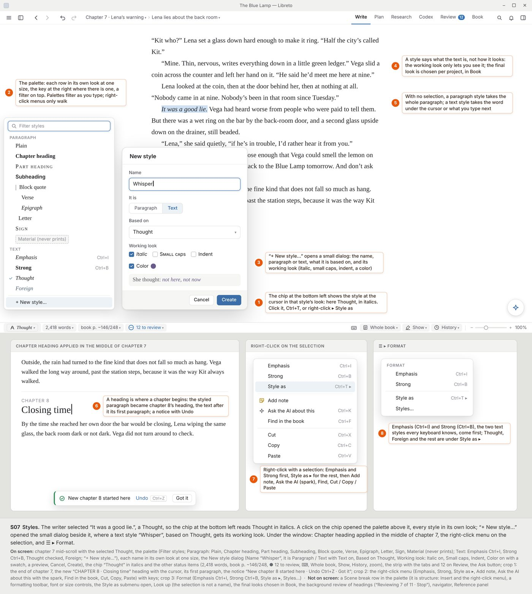

> [!NOTE]
> **Review note** · S07 · Styles
>
> Right-click Emphasis and Strong shown styled?
> What is "Material (never prints)"?
> What is "Styles" in Format menu? Are they in Settings or is it just a window to format all of them? I'd prefer in Settings. But for the project or the app? I choose the app, so it's for the user.

> [!NOTE]
> **Review note** on _“A style says what a piece of text is (a thought, a letter, a sign on a door, a chapter …”_
>
> I think Book doesn't yet have styles configuration.
> I know many people can miss Bold, Italics and  Underline buttons at hand, but I don't want them to be like in a regular word processor. Any idea to make it an easy transition for anyone?
> How does it behave in chapter view if we add a new chapter somewhere?

> [!NOTE]
> **Review note** on _“The chip at the bottom left always shows the style at the cursor, written in that style…”_
>
> "What it is based on". Should we rethink it? It can grow uncontrolled. If we already have "Paragraph" and "Text", is that dependency needed? But... How to show texts in bigger fonts, then? Maybe three or four sizes? Biggest, Bigger, Big, Regular, Small? Think of a good way to do it. Background color? Underline? I don't want to make it over complex. It must be simple, but enough to set it up correctly. For example, Chapter heading is serif and Subheading is Sans. Should we have only three types of fonts too? Serif, Sans, Mono? But then we need to only use three font faces in all book.
> So:
> Give it a name
> Choosing  between Paragraph and Text
> Choosing between three font faces
> Choosing between font sizes
> Options: Bold, Italic, Underline (?)
> Options: Indent
> Colors: Font, Background, to choose.
> An example text shown.
>
> Should we add the option to modify basic existing styles (maybe with a Reset)?

## S08 · Ask: type and go

`Ctrl+K`, or a click on the round button, opens **Ask** at the bottom right: one box for everything. As you type, results appear above the box in **three** short groups: **Go to** (chapters and scenes, people, places, things and topics, each row with the icon of its kind, so a place and a chapter are told apart at a glance), **Do** (a command, such as "Export PDF" or "Show people"), and **Ask the AI**, which appears only after three words or a question mark, with the typed text as the question. `Enter` on the preselected row acts and `Back` returns; `Tab` moves down the list; `Esc` closes the box and puts the cursor back in the text. Hits inside the text are not a group here: that is Find, one key away.

**No AI is involved while you type**, and nothing spins. The groups come from Libreto's index: chapter and scene titles, Codex names and aliases, topic titles, the commands with a few words each ("rename", "show", "export"). The order is fixed and plain: an exact name before a prefix before a part of a word, the current chapter first, what you used recently first; the best match is the top row of the first group that has one, so there is no guessing to explain (the exact ranking is a page of the specification, not of this document). Each group shows three rows and "4 more…" when there are more. The AI row shows the **spark** icon, the one icon for the AI everywhere in Libreto, never a provider's logo, and it is absent when no AI is connected. The Ask box also knows where it was opened: from a Research topic, "summarize this" means the topic; from a selection, the selection is quoted.

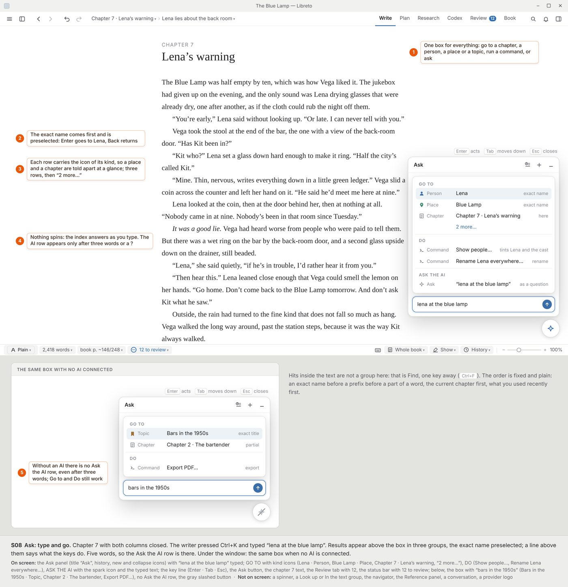

> [!NOTE]
> **Review note** · S08 · Ask: type and go
>
> What does it mean "Back returns"?
> I see "Chapter 7: Lena's warning". The text right after it is always a scene, even without a long line? It would be weird a line there, so a chapter always starts with a scene, right? About what I told you of adding a title to a scene separator, how would it be done here?
> Same at the end of a chapter, a scene always ends there, even with no line.
> Is the history button in the dialog a list of previous conversations or questions?
> If the user uses Ask to get answers from AI, it may feel wrong that Ask line is not always the one selected. Maybe it should always be there selected and the rest accessible with keyboard or mouse. Having to always choose can be hard to understand. I think last line must be always selected and the rest can be chosen.
> What about a small notice in the dialog to ask for an AI connection to improve results?
> Is the "+" for a new conversation? Close to minimize button looks weird.

> [!NOTE]
> **Review note** on _“Ctrl+K, or a click on the round button, opens Ask at the bottom right: one box for ever…”_
>
> What does "Show people" do?
> Three words or question mark...? Not sure yet.

## S09 · Ask: a conversation

When you choose the Ask the AI row, the same panel becomes the conversation. It opens **over the right column**, which dims under it, so the page keeps its place and the panel can still be glanced at; it can be moved anywhere, resized, or collapsed back into the button with `–` or `Esc`, and a dot on the button says an answer is waiting. The header names the model in use. The AI reads the book through the Codex and the open scene, and answers with links: a chapter name jumps the page there (and `Back` returns), a person's name opens the Reference panel. Its answers carry **buttons** when there is something to do: "Add as a note", "Show both places", "Open in Research", and for any change to the text a before-and-after block. A long paragraph is not repeated twice: the block shows only the changed sentences, with **"[…]"** for the unchanged stretch between them, and under it **Take proposed** and **Keep mine**. Nothing in the book changes until a button is clicked, and every applied change is one Undo away.

The AI has the whole app in reach, through the same commands you use: it can open a chapter, reorder cards, create a note, link a topic to a place, hide a column, start a review. The clock icon lists earlier conversations, with a search; "+" starts a new one; conversations are named by their first exchange. Right-click ▸ "Ask the AI about this" on a selection opens the panel with the selection quoted.

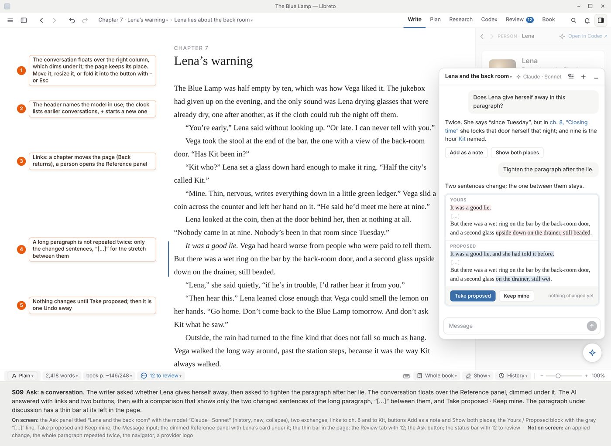

> [!NOTE]
> **Review note** · S09 · Ask: a conversation
>
> "[...]" looks good, but if it's inside the same chapter, it should not take a line but be inline.
> I'd prefer first one ("Yours") to be the first button ("Keep mine") and second button "Take proposed" for proposed. So buttons keep the order of Yours and Proposed texts. How to move through there with the keyboard?

> [!NOTE]
> **Review note** on _“When you choose the Ask the AI row, the same panel becomes the conversation. It opens o…”_
>
> When minimizing, it goes back to the icon. What happens if the icon is clicked again? Is it reset, does it keep the same conversation? Should we minimize it as a row at the bottom right? What then if Ask is clicked again? Then an X to close and reset it? So minimize and close? only at top right? What about "+", then? Where to put it?
> How "Show both places" work?
> The actions, buttons and links or all tools that can be shown in the chat deserve a spec on themselves.

## S10 · Hold Alt

Hold `Alt` for half a second and the page shows everything Libreto knows about it: people, places and things tinted by kind, styled passages labeled in the margin, every badge in the gutter. Release it and the page is clean. `Alt`+click on a name opens its peek. `Ctrl+Shift+A` toggles the same reveal and keeps it; the **Show** menu in the status bar keeps any one kind on permanently. (On Windows, where `Alt` alone opens menus, Libreto suppresses that for a held key.) Hovering does nothing by itself: no card ever pops up because the mouse passed over a word.

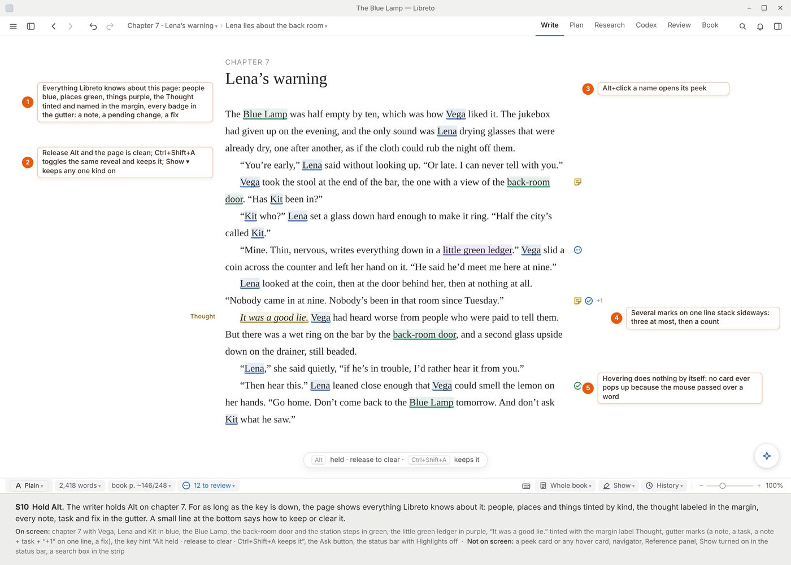

> [!NOTE]
> **Review note** on _“Hold Alt for half a second and the page shows everything Libreto knows about it: people…”_
>
> Do styled passages take place from the left panel?
> Now I see background on texts, let's forget the background color in styles I proposed before. And color should be only for when pressing Alt? I think it's better, don't show colors in text, it's a book and Alt helps with this.
> Also, don't allow taken colors (red, blue, green, orange/gray) for other styles or things. For example, Places green must be different from fixes green. Otherwise, everything will be mixed up with the same colors. Choose other shades of color for everything and don't allow in the color selection widgets colors that are already taken in the app.
> Some option to search by style?
> Which key will then be used in Windows? Can't be Alt anyway?
> I see a couple of check marks at the gutter, but no underlined words. They should also be shown when Alt is pressed, even if they were disabled in "Show". Alt must show everything.
> The count doesn't look like the one shown before.
> What happens with Alt+right click?

## S11 · Peek and the Reference panel

`Alt`+click a name, or right-click ▸ "Look up", and a small card says who that is, with the chapters she is in and a picture if she has one; its **title is a link** to the entry. "Open" opens the **Reference panel** on the right: the Codex entry for Lena, as the Codex computed it from the text: a line about her, where she appears, who she knows, **facts** quoted from the text with their chapter, facts pinned from your research with their source, open questions ("about fifty" in ch. 2, "not yet forty" in ch. 8), and the **topics** linked to her. The panel is 320 px and keeps its scroll per entry.

Two rules keep the panel from becoming a maze. **A link to the text moves the page** (and `Back` returns); **a link to another entry moves the panel** (and the panel's own `‹` returns). The panel has no tabs and no search box: to look up something else, click its name in the text or press `Ctrl+K` and type it. The spark icon in its header asks the AI about this entry; **"Open in Codex ↗"** opens the same entry at full size, in Codex mode, where it can be checked and corrected.

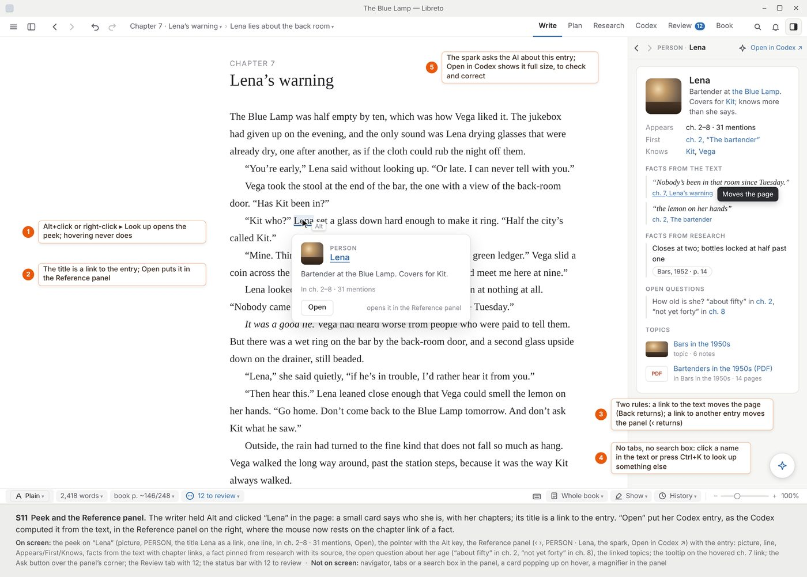

> [!NOTE]
> **Review note** on _“Two rules keep the panel from becoming a maze. A link to the text moves the page (and B…”_
>
> Reference panel title row has many problems: "Person Lena" is short here, but other words won't fit. The sparkle icon is not very visible and its function not clear. "Open in Codex" link should be different, don't know how.
> How are Facts from the text and  Facts from Research chosen? There could be hundreds of them! That panel could be very long.
> We need to make the reference panel really useful or it won't make sense.
> How much history does that panel Back store? Is it kept between sessions?
> Is "12 to review" needed now we show the 12 in Review mode tab?
> I'd like to see what the keyboard button shows, maybe in later screenshots.

## S12 · Everything open, the text in the middle

The most Write can show on a 1440 px laptop: chapters on the left, Lena's card on the right, the reveal on, the Ask button over the panel's corner. Both columns are 320 px; the page is where it always is, centered on the window, 620 px wide at 100 %. The columns took the margins, not the text. Shown to judge the load; nobody needs this all day.

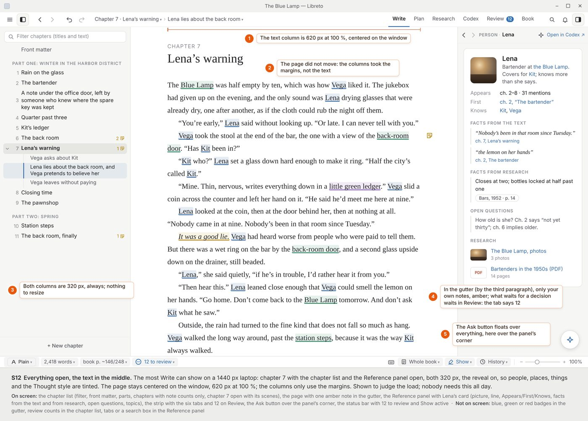

> [!NOTE]
> **Review note** on _“The most Write can show on a 1440 px laptop: chapters on the left, Lena's card on the r…”_
>
> You didn't show "It was a good lie" style text at the left gutter.
> Is there an option to make UI font size bigger? Not doc text, it's another thing.
> Floating Ask button is OK, but we need an extra margin at the bottom so panel text is never behind the button.

## S13 · One key back to the page, and Focus

`Ctrl+Shift+H` closes both columns and quiets the reveal; the same key brings back what was open. The rule is simple: the key restores the layout as it was when you hid it; if you open a column by hand in between, the key just hides again. `F11` goes further: **Focus** leaves only the page, without strip, status bar or Ask button; in the whole-book view it is the whole book, scrolled where you were. The mouse brings back a small "Exit focus" at the top, and `F11` or `Esc` leaves. The Focus page keeps the project's paragraph spacing and first-line indent as set in Book; nothing is reformatted.

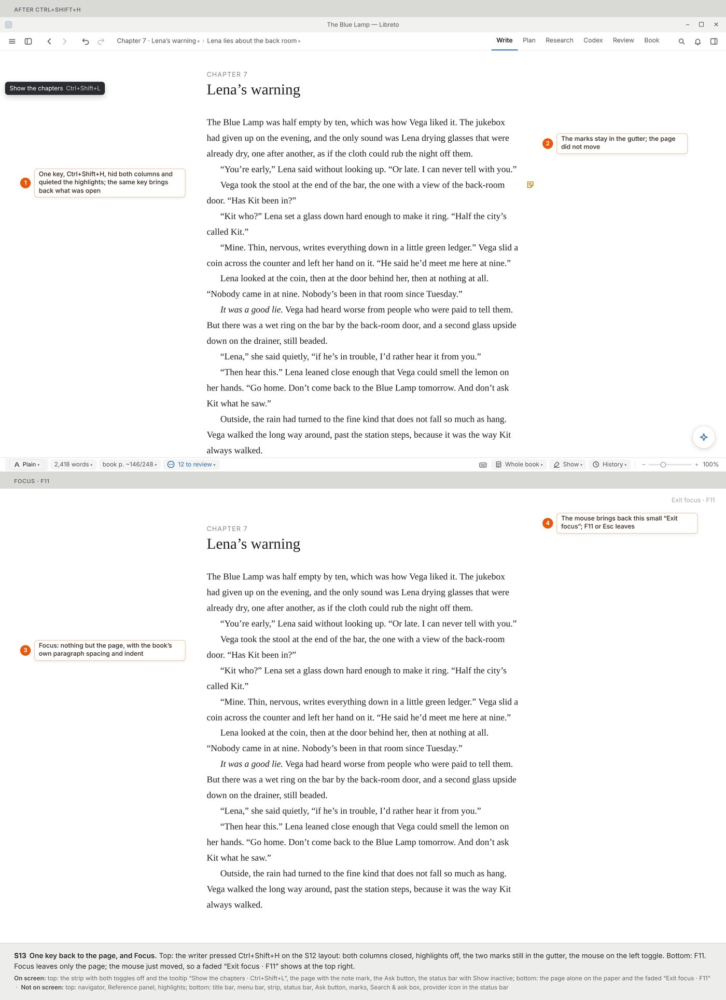

> [!NOTE]
> **Review note** · S13 · One key back to the page, and Focus
>
> If we show keyboards shortcuts in the app, all of them must follow the same style.
> Do we have a Focus button anywhere?

> [!NOTE]
> **Review note** on _“Ctrl+Shift+H closes both columns and quiets the reveal; the same key brings back what w…”_
>
> Not sure about Esc here, I don't know if Focus allows to open peeks that disappear with Esc. That could be confusing.

## S14 · A note, without leaving Write

Writing and noting are the same hour, so notes do not wait for a mode. Right-click ▸ "Add note", `Ctrl+Shift+M`, or the small "+" that appears at the right of the line under the mouse: a card opens beside the line, you type, `Esc` returns to the sentence. The card folds to an **amber** icon in the gutter at that line; clicking the icon opens it again right there, with a short **line from the icon to the card** and the anchored words tinted, so there is never a doubt which words it is about. Several notes on one line fold into one icon with a count.

A note is yours and asks nothing; it has Reply, Done and Delete, and "Done" turns it green and keeps it. Your own notes are the only badges Write shows. A reader's note, an AI finding or a grammar proposal waits in Review, where its card carries the person's name; a note can mention a place ("check with chapter 10") and the chapter becomes a link by itself.

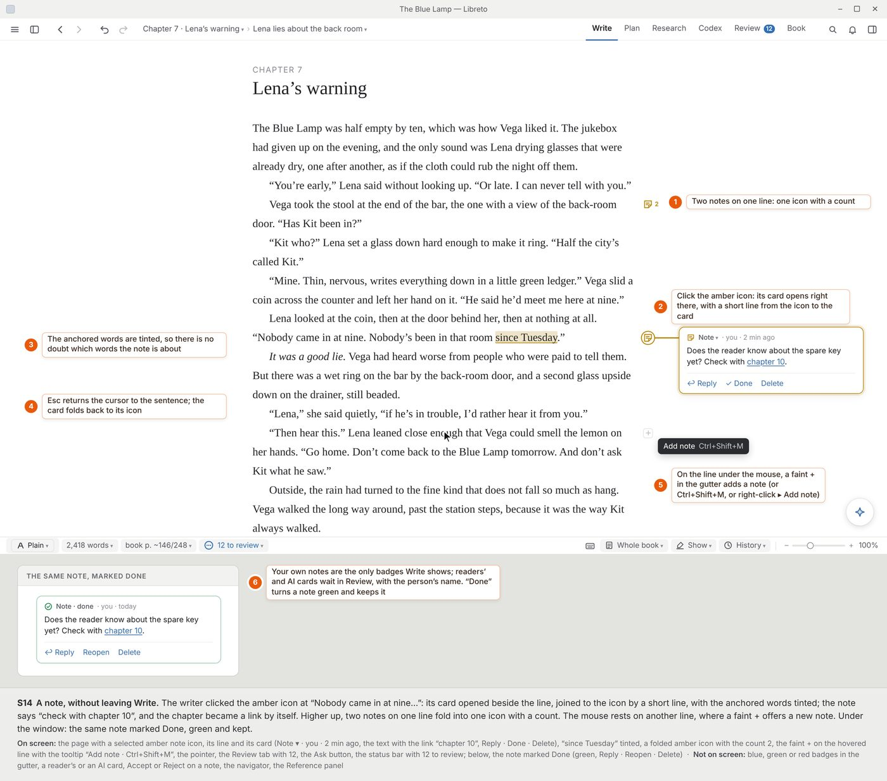

> [!NOTE]
> **Review note** · S14 · A note, without leaving Write
>
> When you click the "Add note button" next to a paragraph, the note is for all the paragraph, but if you had some selected text in that paragraph it becomes anchored to that text, right?
> What if right panel is open when you click a note icon? Why Ctrl+Shift+M? Is it usual? Why not use N instead of M?

## S15 · Review

Review is the same text, still editable, with everything that waits for you shown at its line. Choose it when the second pass starts, or click the count on the tab. The left column is the chapter list with counts, plus two rows of filters that combine: **by kind** (All · Notes · Pending · Done · Unknown) and **by person** (You · Marta · AI), so "what did Marta say?" is one click and "AI, pending" two. The ⋯ menu of the column has **Import a reader's notes…** for a Word file whose comments and changes arrive as blue cards with the reader's name; names come from sharing (you name the reader when you send a copy), Word brings its author, anything unnamed is "A reader", renameable, and the AI never guesses who someone is.

The gutter shows the four badges at the exact line, one per line with a count when a line holds several; the **margin** on the right is 320 px with its own scrollbar, and every card sits level with its line. The selected one draws its line to the text and tints its words strongly; the others stay quiet and push away when they collide. Each card names who it is from and offers only its buttons: a note has Reply and Done; a pending change has ✓ Apply, ✗ Skip, **E** to edit the proposed text first, and the spark ("Why?", the AI explains it); a done fix has Keep and Undo. **Review all** at the top of the margin walks the cards one at a time (S34). Write and Review share the cursor and the scroll, so switching is a blink; the other modes remember their own place.

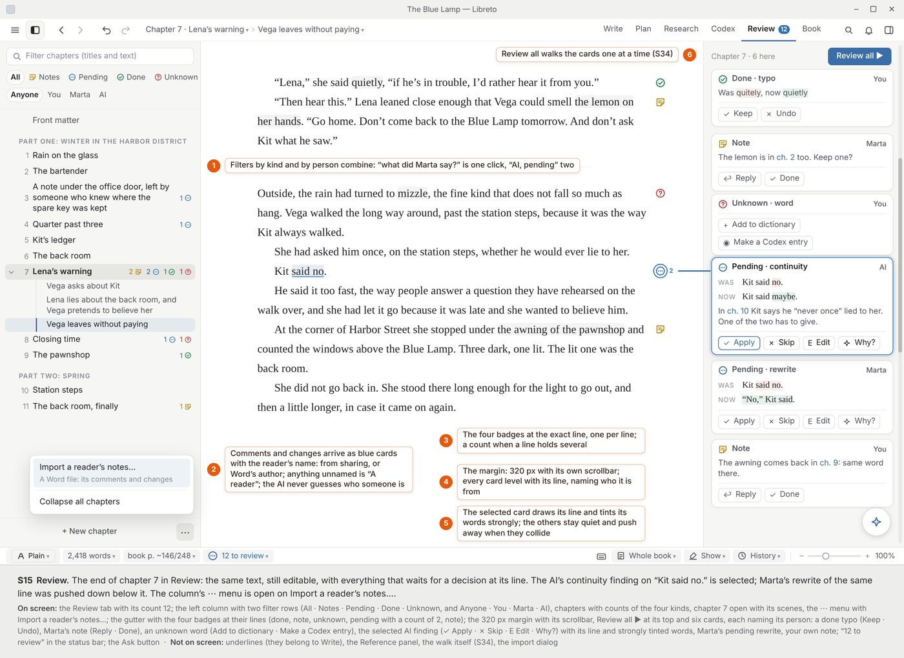

> [!NOTE]
> **Review note** · S15 · Review
>
> Do filters stack? Do all need to be clicked? Or you need Ctrl+click? I prefer not to use Ctrl+click. But filters don't look as filters. Let's give them another look. Also, what if there are a lot of reviewers? A lot of rows of people names?
> "A count when a line holds several". What if they are different types? Which icon is shown?
> I don't like the question mark icon. It doesn't look like a question mark. Maybe another font? Or are they SVG files. In that case, try to improve it.
> What if you click on a note (the line appears) and you scroll any of the two blocks (text or right panel)? Does the line become diagonal or angled or whatever?
> What if nothing is selected? It does not make sense (or does it?) to scroll through the right panel and see notes without knowing where they belong for context. I mean, should scrolling the right panel scroll the text along it? Both solutions can be confusing if not thought.
> Importing a reader's note should be more visible or the user must know how to get there from other places.
> Do Review all starts by the selected one or the first one?
> We need to improve this screen: filters must look like filters and what are flows must be differentiated, probably at the right: Review all and import comments from someone/a file. It must be clearly understood what "Import" and "comments" or "notes" mean for a regular user. Also, a hover message. It must be clear that when someone gives you a copy of the document with notes, they can be added through this step. So Review can mean review your own notes and add notes from other places. The diff tool must be powerful here, since things and chapters can have been moved or placed in other places. Paragraphs can have been removed or added. What does a note for a deleted text mean in this context?
> Should in this view things be marked? I mean, underlines for unknown words, for example. If they are visible in Write, why aren't they visible here? This view should be more like "there are a lot of things to fix", here they are. Of course, if the one selected is shown in a more intense way, that is okay.
> The keyboard icon doesn't look vertically centered. I'm not still sure if that's the better place for it, it's like a help button and it is mixed with other non-related things.

> [!NOTE]
> **Review note** on _“The gutter shows the four badges at the exact line, one per line with a count when a li…”_
>
> When clicking on an icon or a task on the right panel, do things scroll to the right place?

## S34 · Review all

**Review all** turns the margin into a walk: one card at a time, level with its line, the text scrolled to it, and a line at the top that says "4 of 12 · Pending · Marta". The filters you set in the left column decide which cards are in the walk. The keys are inside the buttons: `Enter` ✓, `Delete` ✗, `E` edit the proposal before applying, `Tab` skip for now, and `Esc` leaves the walk where it is. **"Don't bother me"** on an AI or rule finding stops that kind of finding for this project ("long headings", "repeated words") and says so; Settings lists what was silenced. When the walk ends, the margin says what was decided and what was skipped, with Undo for the whole walk as one step.

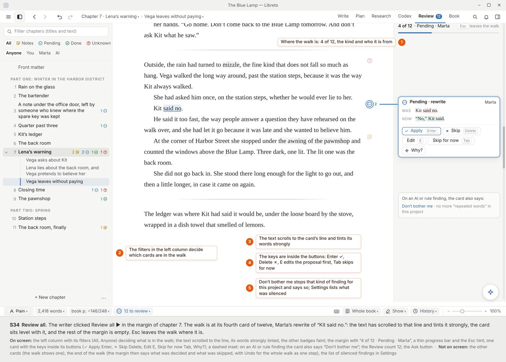

> [!NOTE]
> **Review note** on _“Review all turns the margin into a walk: one card at a time, level with its line, the t…”_
>
> Esc to stop the walk can be confusing. A button to stop it would be better. But what if you go out of this mode? What if you come back? Is walk disabled?
> "4 of 12 · Pending · Marta" could be too long to fit. Also, this is the text I told you before that is too close to the mode tabs, there is no margin.
> Skip and Skip for now: Maybe Skip should be "Dismiss" or similar. It must be clear the note will disappear.
> In this mode, scrolling the right panel to see the full length of the text should be allowed without scrolling the text central panel.
> Sometimes you use a (non-vertically centered) "E" and sometimes you don't. I don't like that E.

## S16 · Plan

Plan shows the book as cards, one per scene, in **lanes**: one lane per chapter, side by side, the parts as a thin band above their chapters, and the view scrolls sideways; a long book is a long shelf, not a long page. There is no breadcrumb here and the left column is closed; the right column is the **Reference panel** with the selected card's scene: its line, who is in it, where, the facts it relies on, its words, its labels, all editable, and **"+ New card"** for a scene that does not exist yet (it lands in Unplaced until you drag it in). Arriving from a chapter, that chapter's cards are scrolled into view and the current scene is selected.

Drag a card to move it; the lane under the pointer lights up, and before you drop, Libreto warns when the move breaks continuity ("Vega reads the ledger before Kit finds it"). Moves are collected at the **top right**: "3 moves · 1 issue · Apply · Discard"; **Issues** opens the list of warnings, so you read them once before Apply, and nothing changes in the text until then; leaving the mode with moves pending asks once. A lane moves as a whole by its header. Two lanes close the shelf: **Unplaced**, cards that belong to no chapter (not printed, not counted), and **Discarded**, texts you removed from the book but kept; both are also rows at the end of the chapter list in Write, gray. Cards carry labels (point of view, status, storyline, timeline, and one of your own), and **"Color by"** chooses which paints the cards; the legend at the bottom shows the current one. Point of view and place fill themselves from the Codex; status and storyline are yours.

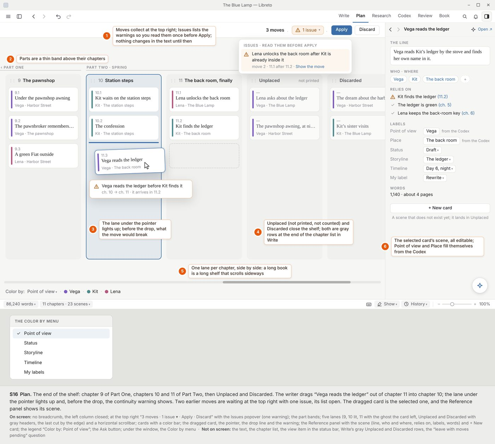

> [!NOTE]
> **Review note** · S16 · Plan
>
> How are storylines tracked? I think we don't have tooling for that.
> What about "My labels"? What are they?

> [!NOTE]
> **Review note** on _“Plan shows the book as cards, one per scene, in lanes: one lane per chapter, side by si…”_
>
> Why not horizontal lanes? What do you think can grow more? Chapters or scenes? Keyboard shortcuts to navigate and move things around?
> Can all moves be seen somehow? A stack like: "Lena talks to Kit" moved from after "Kit's thoughts" (chapter 5) to after "Lena jumps" (chapter 7). Hard to show it. And with what will break coherence. "3 moves" and "1 issue" may become the same.
> About "Status: draft", where else is it shown? I like it, how to show the writer gives it as finished or working or draft...? Should it be seen in the Chapters panel?
> Issues must have some button or similar to "Add a new task" or a warning saying it will be created.
> New card button should be at some other place. I'd say above the cards table. Right click should also work to add or delete scenes, etc. Delete when selected too.
> Unplaced and discarded should be separate from the rest, with a line or whatever.
> So Unplaced and discarded are seen at the end in Write mode. With a special chapter or even part, I guess. In that sense, I think you said somewhere that a scene that is deleted moves there automatically. It's Ok, unless the writer doesn't want so. What about deleted text? Maybe a right-click item to "Move to discarded".

> [!NOTE]
> **Review note** on _“Drag a card to move it; the lane under the pointer lights up, and before you drop, Libr…”_
>
> Continuity: "Vega reads the ledger before Kit finds it", can that be discovered only with Codex, without AI? Will Codex be so powerful? Again, who updates it?

## S17 · Research

Research is where material lives before it is true. The left column is your material: an **Inbox** for anything dropped or pasted in (a link, a photo, a PDF, a paragraph from a web page), then your **topics**, which can sit in one level of folders ("Bars", "Jazz"), then the files. A topic is a document like a chapter: a title, text with the same styles, pictures inline, files attached, and a row of what it is linked to. "Bars in the 1950s" need not be in the Codex; Lena need not have a topic. In the center, the topic itself, large. On the right, the Reference panel shows what the topic links to: Codex entries and the chapters that mention them. The Codex is not here anymore; it has its own tab.

Linking is mostly free. Names from the Codex typed in a topic are recognized the way they are in the manuscript, so the topic and the entry know each other at once. The writer adds the rest with "Link to…" or by dragging a topic onto a name in the text. Moving knowledge from research to the Codex is one gesture: select a passage in a topic and **"Pin as fact of…"**, in the right-click menu and in the toolbar of the selection; the fact shows on the entry with its source and a link back. Ask knows where it is: opened here, "summarize this PDF" means the open one. The AI, when asked, summarizes, proposes facts and links (blue, in Review), and proposes to split or merge topics; the writer can do all of it by hand. Topics are renamed by clicking the title, split with "Move to a new topic", merged by dropping one on another, and deleted to the Inbox.

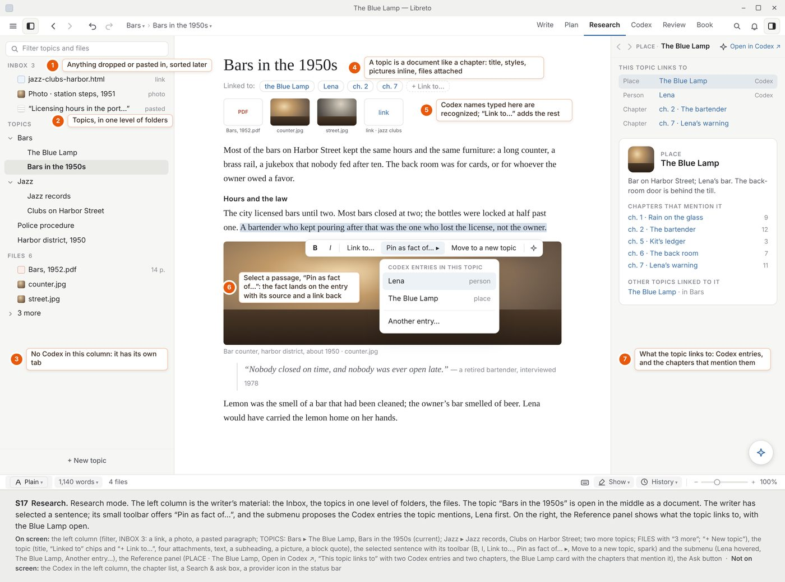

> [!NOTE]
> **Review note** · S17 · Research
>
> I don't understand "Pin as a fact of...".
> How are folders created?
> Link to... is not clear

> [!NOTE]
> **Review note** on _“Research is where material lives before it is true. The left column is your material: a…”_
>
> How things get to the Inbox? From where?
> How are Research and Codex related? Who links them, topics and entities?

## S18 · The Codex

The Codex is **what the book says**, and it has its own tab because it is neither writing nor research: it is the book, read by Libreto and checked by you. The left column is the navigator: **People, Places, Things, Motifs**, each with a count, filtered as you type. The center is one entry, large, and most of it is **read-only because it is computed**: where she appears, scene by scene, with the scenes as links; who she is with, and how often; the facts quoted from the text with their chapter; the **open questions**, found by rules without any AI ("about fifty" in chapter 2, "not yet forty" in chapter 8), each with **"Fix in the text →"** on each side of the contradiction, so the Codex is a way back into the manuscript rather than a second place to type the truth. What you edit is yours: the name and its aliases, the kind, the picture, a line about her, your notes. Facts pinned from Research keep their source and a link to the topic.

Under the entry, **questions the Codex answers without an AI**: "When are Lena and Kit together?", "Who is in the back room in chapter 7?", "Which scenes has Lena alone?", each a list of scenes computed from the index. The Codex keeps itself: names, aliases, mentions and scenes are indexed as you type; a new capitalized name that appears three times is proposed as an entry (blue, in Review). The AI touches it only when asked, or at the end of a session if Settings say so, and what it writes (a summary, a question the rules cannot see) is marked as the AI's. Renaming happens here or in Find, and both change the text, the Codex and the topics together; replacing a name blindly is not possible, because Find recognizes it as an entry. The right column shows the topic or the paragraph the selected fact points to.

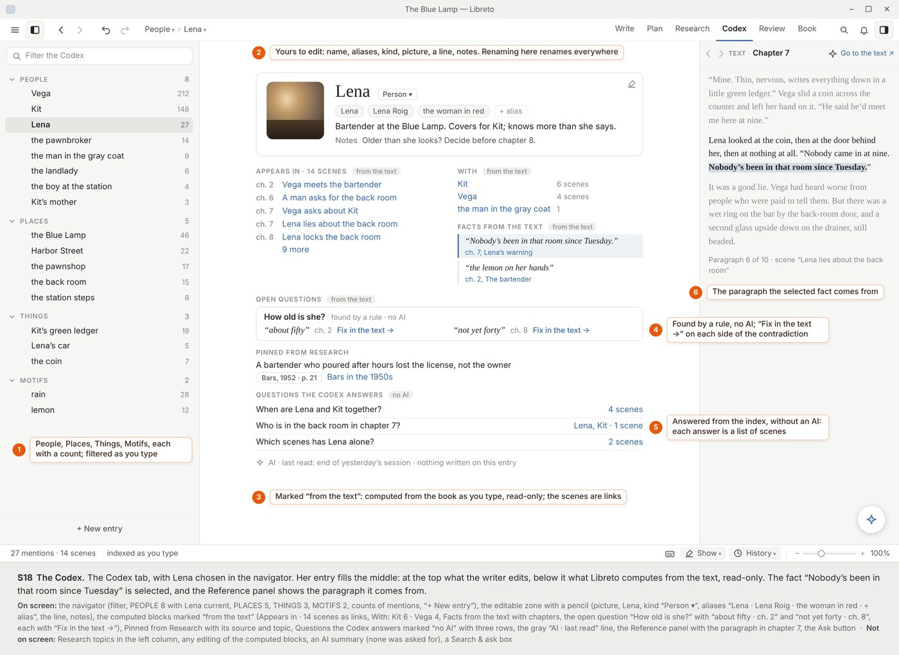

> [!NOTE]
> **Review note** · S18 · The Codex
>
> I'll need to see this live.
> I still don't understand when Codex is updated. At the end of the session with AI is not an option, it's when the user closes the software.

> [!NOTE]
> **Review note** on _“The Codex is what the book says, and it has its own tab because it is neither writing n…”_
>
> How can "about fifty" in chapter 2, "not yet forty" in chapter 8 be found without AI?

## S19 · Research beside the text

While writing, you want one thing: the photo of the bar, two facts. `Alt`+click "Blue Lamp", choose "Research" on the peek, and the Reference panel shows the topic, readable and scrollable, with its pictures. Enough to check and go on. "Edit in Research ↗" opens the topic in the mode, and `Back` returns to the sentence. Gathering happens in Research; using happens beside the text.

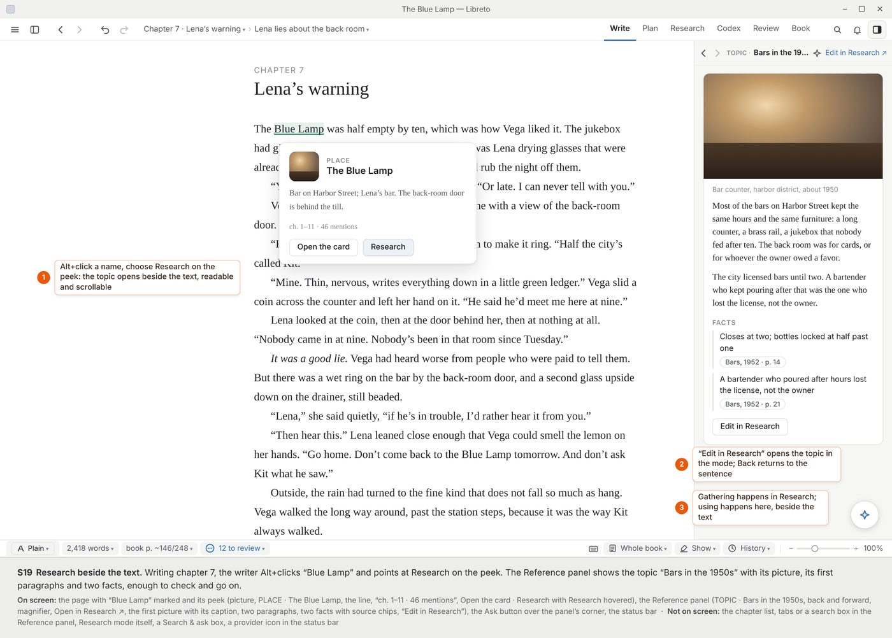

> [!NOTE]
> **Review note** on _“While writing, you want one thing: the photo of the bar, two facts. Alt+click "Blue Lam…”_
>
> Shouldn't the peek show Codex and Research links?
> As always, you try to put too many things in the right bar title. Restructure it. Maybe a bigger title, a link to Research mode.
> How does clicking to Research in the Blue Lamp peek opens "Bars in the 1950s"? Why not another related research topic?

## S20 · Find and Replace

The magnifier in the strip, or `Ctrl+F`, opens a strip across the top of the page, the kind every editor and browser has: the box, "3 of 27", ‹ ›, then **Aa**, **Whole word**, **Regular expression** as checkboxes, and **Whole book** or **This chapter**, nothing finer. `Ctrl+H` adds the Replace row at the same width. In the whole book, hits walk across chapters and `Back` returns to where the cursor was. The first time Regular expression is checked, a small **tester** opens under the strip with the current paragraph as sample text; the "?" beside it opens it again, and "Ask the AI for help" hands the pattern over, when an AI is connected.

**Replace all** never replaces blindly: it opens a list of every hit in context, **grouped by chapter**, each chapter folded with its count when there are hundreds, each hit with a checkbox, and a "Replace 27" button. When the found text is a Codex name, the strip says so, **"Lena is a person in the Codex (27 mentions, 2 aliases)"**, and offers **Rename everywhere** instead, which changes the text, the Codex and the topics together; aliases are renamed one by one from the entry.

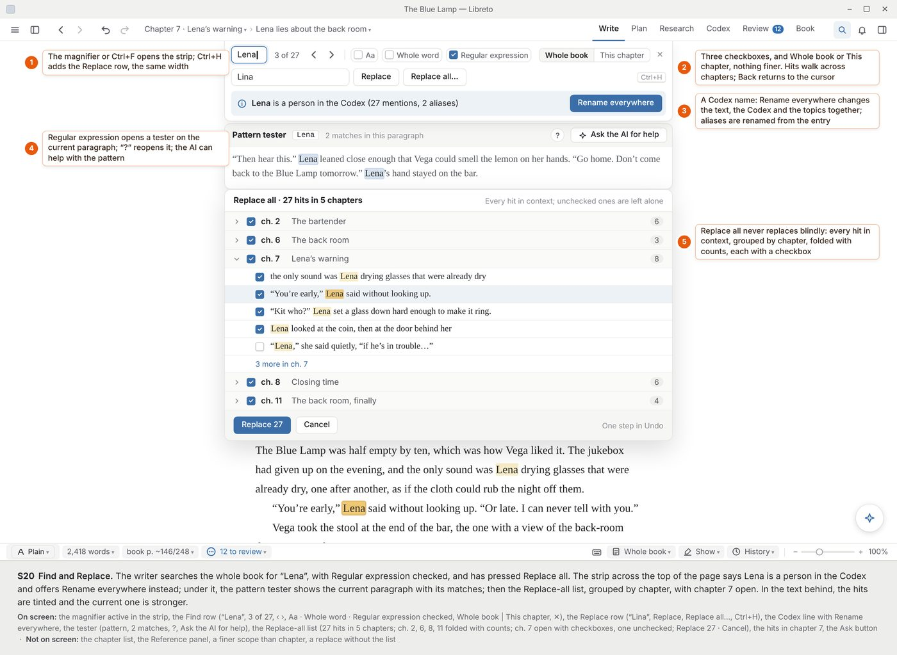

> [!NOTE]
> **Review note** on _“The magnifier in the strip, or Ctrl+F, opens a strip across the top of the page, the ki…”_
>
> The find box is too small. The whole dialog is too big and has many things. We need to make it smaller. Maybe advanced search for more options. Look at how Google Docs do it.
> Whole book/This chapter should not appear in whole book view.
> I'd like the Find dialog to be at the right, under the magnifying glass.
> We need to make sure text is not covered when searching and/or replacing. It must feel simple. Maybe a Replace all button opens a new dialog, same as advanced search. I don't know, but I don't like how it fills the screen with a lot of stuff.
> How does Ask the AI for help button works? Where that help is open?

> [!NOTE]
> **Review note** on _“Replace all never replaces blindly: it opens a list of every hit in context, grouped by…”_
>
> Will Codex be updated if the user directly replaces all items? How and when will Codex detect it?
> Doesn't Codex need AI for the first creation (and later updates)?

## S21 · Sharing with a reader

File ▸ Share has two commands, because they are two moments. **Send a copy…** makes a named snapshot ("Sent to Marta · November 7, 18:32"), exports a Word file whose paragraphs carry their ids, and lists the readers of this project with their names, editable; with an email tool connected, "Draft the message" asks the AI to write it. **Receive a copy…** looks in Downloads, or where you point, for a copy that belongs to this project, copies it into the project's folder (never opened as the working text), records it in History and opens Compare in Review. When nothing was ever sent, the dialog says so instead of pretending: "No copy of this project has been sent yet. A received file is compared with the text as it is today." A whole project can also be sent as one file, for a reader who has Libreto.

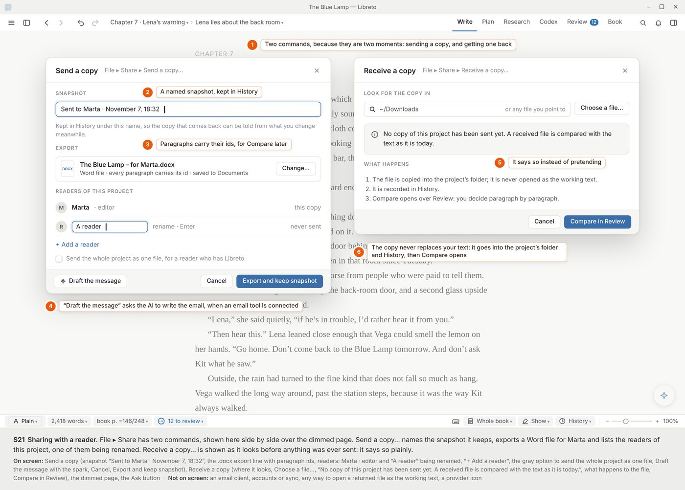

> [!NOTE]
> **Review note** · S21 · Sharing with a reader
>
> No, it should be easier to understand.
>
> Send a copy:
> - Name of the person to share it with (or "With who?"), being clear it is the name of the person to be shared with (with autocomplete if person already exists, making clear it will be added otherwise). Where to keep track of people who read the project?
> - Format: Libreto, Word (, PDF?)
> - Where to save it (or send through email, which could open another window or open user's email).
>
> Receive a copy:
> It should not allow to set a directory. Or a file or directly the list of candidate files found in Downloads or similar folders. The system should also keep track somewhere of versions shared with it, which are in the project directory. But it is easy for a Word document, not for a Libreto project inside another Libreto project. We must design a way to read and store versions, comments, etc. Maybe instead of storing the Libreto version, only changes should be imported and stored.
> Also, Receive a copy should make it clear it is to compare with current work. Too much text as "What happens", it should not be there, dialog must be clear about what it does.

## S22 · A reader's copy, compared

Receiving a copy, or Review ▸ **Compare with Marta's copy**, opens **Compare** as a sheet over the window. It shows your manuscript as it is today, one column, and under each paragraph Marta changed, her version in a box, with the changed words marked. Between the differences a **wavy line** says what is folded: "⌇ 14 paragraphs unchanged"; "Only differences" is on by default, and off shows them all. The version you sent is used underneath to tell who changed what, and is never shown: the sides are named by person, **Marta's** and **yours since sending**, never "theirs" and "mine". Under each box, the buttons: **Take Marta's** or **Keep mine** for a paragraph only she changed; **Keep mine**, **Take Marta's**, **Keep both** and **Merge for me** (an AI proposal from both) when both of you changed it; **E** edits the result before taking it. A decided row folds to one line with its choice and Undo. Her comments become **blue cards in Review** with her name, whatever you decide about the text. The header counts "4 of 18 decided"; "Back to the text" leaves at any time and the sheet resumes where it was; "Done" appears when everything is decided and applies it as one step.

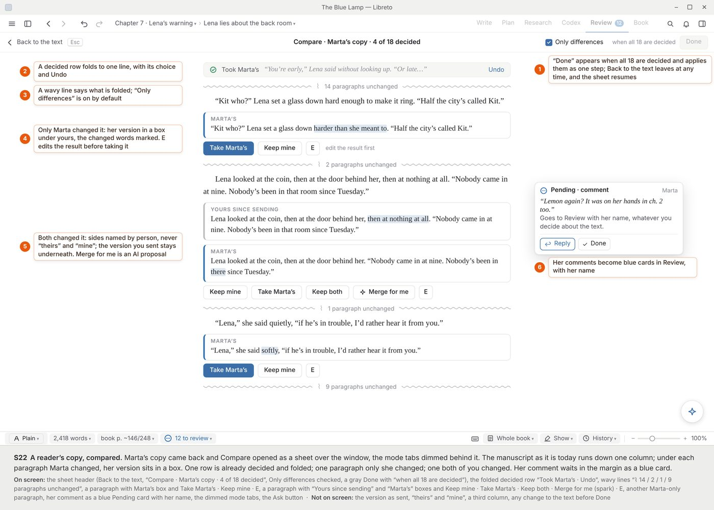

> [!NOTE]
> **Review note** on _“Receiving a copy, or Review ▸ Compare with Marta's copy, opens Compare as a sheet over …”_
>
> Don't use this character: ⌇
> Should it be a version of Review? Actually, it's the same about notes, so the flow (like Review all) should be the same. About changes and double versions, isn't it also needed in regular Review? And I preferred when they were put one next to the other instead of above and below.
> I don't like the "E" button. Better Edit.
> Also, regular review could take advantage of "x paragraphs unchanged" too.
> I mean, should we rather "Add notes from a review file" instead of "Receive a copy"? So they are added to the Review window?
> I think we should rethink these processes. Add a button to import notes from another document in Review mode and make it more straightforward. But then, how to differentiate this version's notes from the rest? What does "Marta" mean if there are two versions of Marta's comments? When a version is just imported, maybe Review window with just those changes should be shown.
> What happens if "x paragraphs unchanged" is clicked? Are those paragraphs unfolded? How to collapse them again?

## S23 · History

History is a sheet. A **session** is one run of the app, from opening to closing, and each is one line, grouped by day: the hours, small icons for what you did in it (wrote, planned, reviewed), **+86 −12** words, and a one-line summary. Clicking a line opens it in place: what changed, where, each a link. **Snapshots** are listed under the day they belong to: the automatic ones (end of a session, before a big action such as Apply in Plan or Rename everywhere, and every ten minutes while you write, folded under a "…" so they do not fill the list), and the named ones ("Sent to Marta"). "View as it was" reads that snapshot without differences; "Compare with today" opens the Compare sheet with the snapshot in Marta's place and **Restore** on any paragraph or on the whole chapter. Questions in words ("when did I write about Lena's car?") go to Ask, and need an AI.

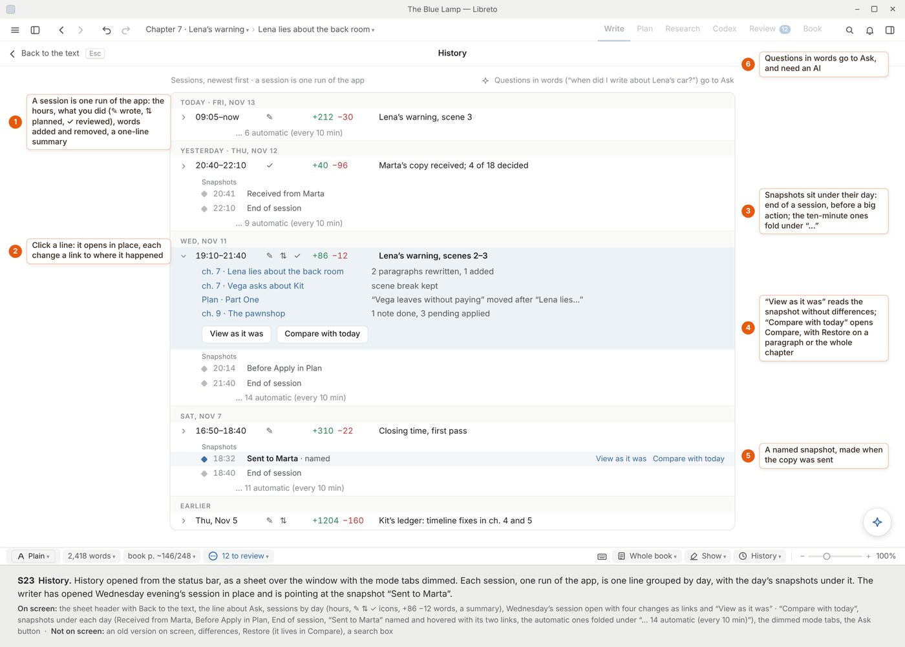

> [!NOTE]
> **Review note** · S23 · History
>
> Not quite sure... This software is growing fast and many things will only make sense once tested live. Let's see how it behaves.
> For example, what is shown if I click on any link? The place? The change when it was done? What if it doesn't exist anymore now?
> What are snapshots for? What's their use? Can I compare them?
> Should the compare view (pending if it is moved into Review for comments added or not) show both files one next to the other, probably taking all the screen? What to do with them? Can I take things from one or the other? Can I merge them? Will the diff work as expected? What if a chapter was moved to another place? Will the diff still work? It doesn't quite work in GitHub.

## S24 · Book

Book shows the book as it will print. The left column has page thumbnails, **in pairs** as the spreads will be, or one by one with the switch at its top; the right has the layout: a template to start from (paperback 5.5 × 8.5 in, trade 6 × 9 in, A5, manuscript, reading PDF), page size and margins in the unit Settings chose (cm or in), fonts, how chapters open (number and title, title only, number only, or **nothing** but a new page and space), and whether a chapter **starts on a right-hand page**. Pictures in the text are laid out as figures (in the text, at the top of the page, or on a page of their own) and footnotes go to the foot of their page. Arrows and Page Up/Down turn pages; the layout of a whole novel takes seconds and updates while you adjust. Export (PDF, Word, EPUB) is here.

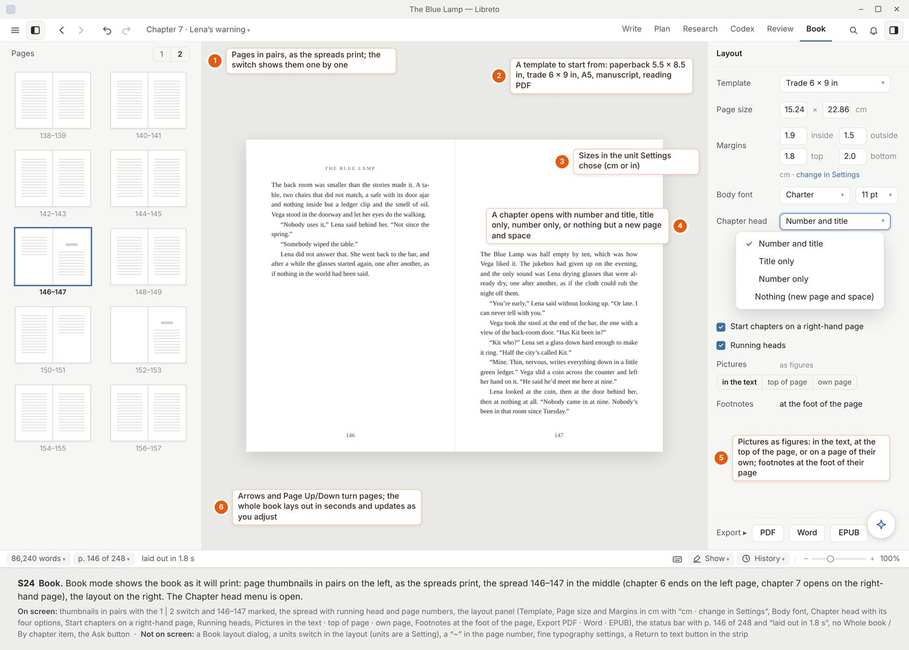

> [!NOTE]
> **Review note** on _“Book shows the book as it will print. The left column has page thumbnails, in pairs as …”_
>
> 1-2 switch is not clear. I'd prefer it on the right panel as "Print in two sides" or similar. Thumbnails will change with this switch.
> Page size boxes are too small here, text almost doesn't fit. You are mixing inches with cm here.
> We need a place, probably here with the preview, where we can map work styles to print styles. I don't know how, maybe it must be in settings (project or app?) or here in a dialog. It should be a preview of things. For example: Chapter mark, a lot of tweaks that make sense (like Start in new page), colors, font, etc. That way, Body font here won't be needed at all, it will be defined in Plain style. Some styles must exist always and can't be deleted. Others could be deleted, so mapping could disappear even after set up.
> Chapter head, the same, not needed here but in its place, defining it correctly. We'll offer a nice standard.
> Start chapters on a right-hand page should only appear when two-page setup is chosen (or being grayed out with a hint explaining why).
> Not sure if EPUB and PDF exports are similar at all. About Export as Word, why here we have so many options and not when sharing it? What about comments and similar? Print comments?
> By the way, I only see export here, but it should be for printing too. So what is shown when clicking on a Print menu? This Book mode or something easier to print the working copy?
> Pictures as figures? Is there another option? Same for Footnotes, where should they go if not at the bottom of a page?
> We need to rethink what we really need to export or print a book, what depends on what and how to make it easy for a one-click users and for users that want to tweak it more. We won't get a Word level, because Word gives too much freedom, but we'll do something nice to read.
> In the future, we can think about adding templates that people can share and install or whatever. We could add some predefined ones after doing some research of how books are usually printed or expected.
> Export [arrow]: Remove the arrow.
> cm · change in Settings... It's ugly. Maybe the 22.86 cm could have a link in "cm" to the settings or just a select box that updates settings.
> How would Ask button help here? Can you ask a way to print in words and it tweaks it?

## S25 · The AI, in Settings

The AI is a tab in Settings, **AI**, and the gray Ask button opens it. One provider at a time: Claude with a key, or through Claude Desktop where that is allowed, with more to come; the model it uses is shown here and in the header of every conversation. Under it, the **level** of help (Off · Quiet · Reviews · Proactive) with what each means, and **when Libreto reads the book**: only when asked, at the end of a session, or every so often; the default is the end of a session, because reading costs tokens and the index already answers most things. The **disclosure** is always on this screen, with a warning sign: AI text may raise copyright, contest and disclosure problems; Libreto records what the AI wrote and can report it. What is sent, and the cost this month, close the tab. The **Reports** menu holds the rest: "What the AI wrote" (every passage, with where it is), the AI log per project, and Statistics. Libreto works fully without any of it, and this walkthrough says where an AI is needed each time it is.

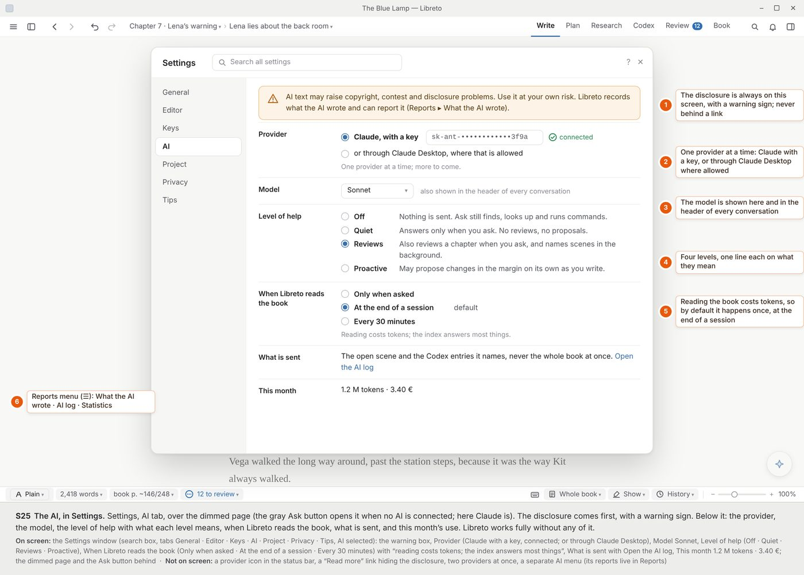

> [!NOTE]
> **Review note** on _“The AI is a tab in Settings, AI, and the gray Ask button opens it. One provider at a ti…”_
>
> The gray Ask button should show Ask without AI. Something in the dialog could link to AI settings.
> Levels are OK, but it should be clearer what they can do.
> I don't like "At the end of a session". It is AI work, it can't happen when the user closes the program and the computer. Maybe better at the start of a session, but then it will be late for some things. Well, they could appear on the go in Review badges. What about limiting money amount? If you have an AI working on the background, you'll never know how much money you are spending. We need plans in apps NOW, Anthropic!
> Now I see it. Do we have an autosave notice or something? Maybe on the status bar: "Saving..." and "Saved at xx:xx".

## S26 · Settings

One window, tabs on the left: **General**, **Editor**, **Keys**, **AI**, **Project** (this project only: the names of the structure levels, the readers, the styles' working looks, the tile), **Privacy** (anonymous usage statistics, off until you turn them on, with what they contain in plain words), **Tips**. A search box at the top finds any setting in any tab. **Keys** works like a code editor's: a table of command · key · where it applies, click a key to record a new one, conflicts flagged, and a check against the current keyboard layout that flags any shortcut needing a dead key or AltGr. Every "?" in Libreto opens Help at that spot; it is the same "?" everywhere.

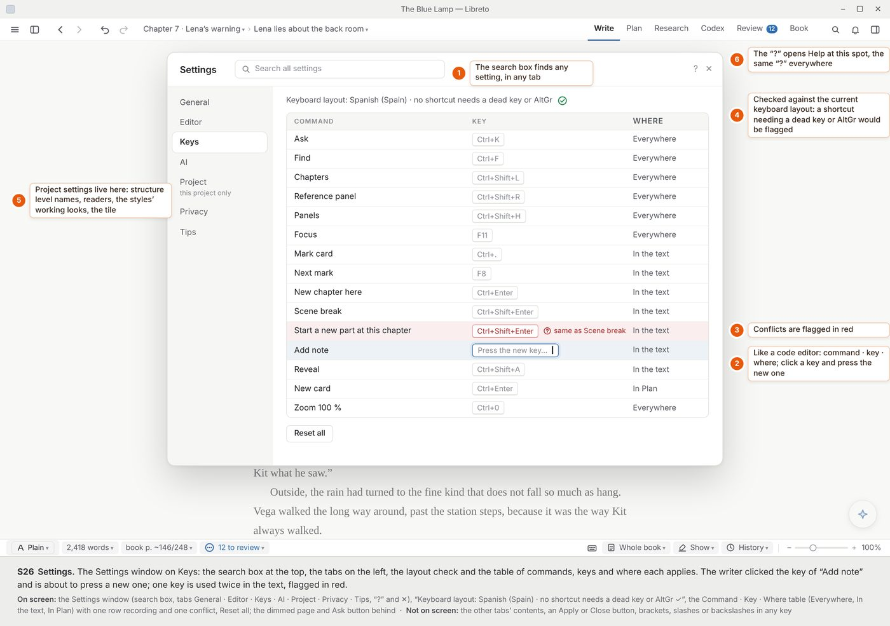

> [!NOTE]
> **Review note** on _“One window, tabs on the left: General, Editor, Keys, AI, Project (this project only: th…”_
>
> Not sure if Project setting must live with app settings... I don't think so. I could not see the rest of Settings windows, so I can't be sure what it contains. A link to Project settings here and to app settings there could help.
> I don't get the "?" button. It doesn't appear anywhere else, right? In this case, Help should open into the current view help.
> Search and Keyboard layout look pretty well.

## S27 · Help

Help is not a column. `F1` opens the **Help window** at the topic of what has focus, and its search box finds the rest; each topic is a short text with a small drawing of the control it talks about. "How do I add a chapter?" typed in Ask answers from the same help with a link. Tutorials are short, one per feature, offered once when the feature first matters; each runs in your own project with a bubble pointing at the control, can be left at any step with `Esc`, and is never required. Help ▸ Tips lists the tips Libreto can give.

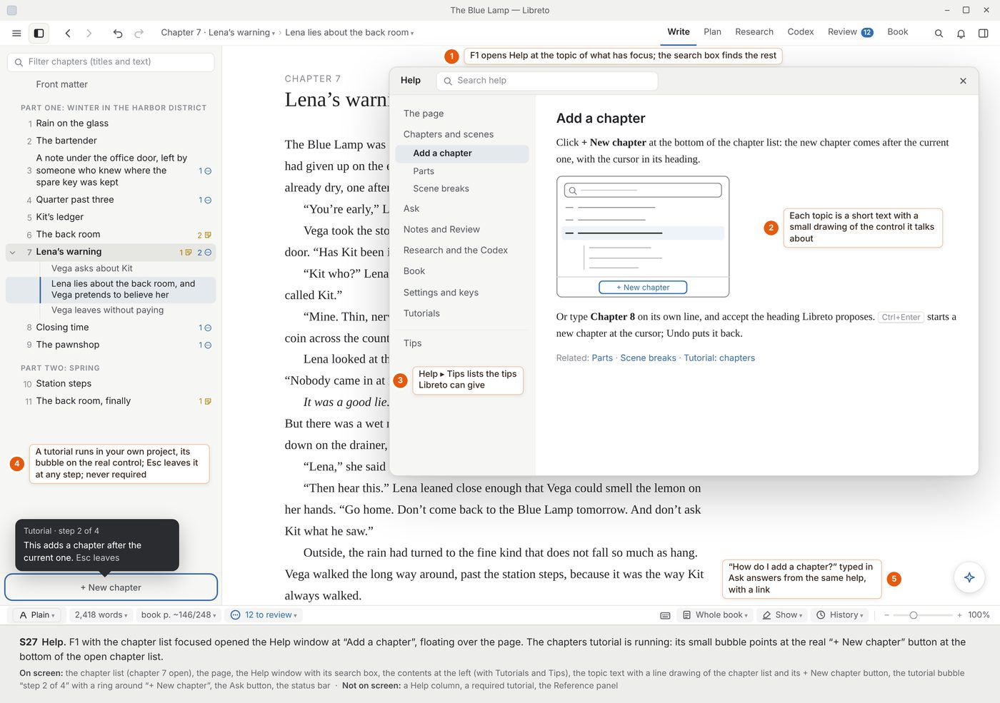

> [!NOTE]
> **Review note** · S27 · Help
>
> LGTM. We'll need to create a good and very useful help and see when tutorials are enabled to the user.

## S28 · Statistics

A sheet from the word count in the status bar or Reports ▸ Statistics, with the mode tabs dimmed behind it: tabs for **Words** (per chapter and per day), **Sessions** (time and words), and **Who appears where** (a grid of people by chapter), a range at the top (this week, this month, all), and "Back to the text" to leave.

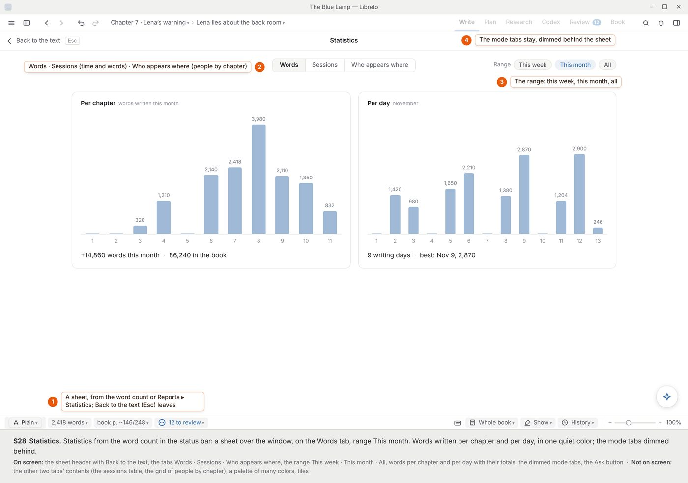

> [!NOTE]
> **Review note** · S28 · Statistics
>
> We'll go improving statistics. Codex is a too powerful tool to just offer a couple of data topics.

## S29 · Everything in the status bar and the menus

Not a moment: the status bar menus and the ☰ menu's seven menus opened together, to see what lives where. **File**: New project, Open, Recent, Import a Word file, Share ▸ Send a copy… / Receive a copy…, Export ▸ PDF / Word / EPUB, Project settings…. **Edit**: Undo, Redo, Cut, Copy, Paste, Find, Replace, Rename everywhere. **Insert**: Scene break, New chapter here, Start a new part at this chapter, Picture, Footnote, Front matter ▸, Back matter ▸. **Format**: Emphasis (`Ctrl+I`), Strong (`Ctrl+B`), Style as ▸, Styles…. **View**: Chapters, Reference panel, Panels (`Ctrl+Shift+H`), Focus (`F11`), Whole book / By chapter, Show ▸, Reveal (`Ctrl+Shift+A`), Zoom in / out / 100 %. **Reports**: Statistics, What the AI wrote, AI log, History. **Help**: Help (`F1`), Tips, Tutorials, About. The style palette shows each row in its own look; **Show** lists underlines, people, places, things, motifs, styles, notes and AI-written text; the zoom menu offers 50 to 200 % with 100 % in the middle, no "Fit width"; the **⌨** button lists the keys that work where you are; History rows are links.

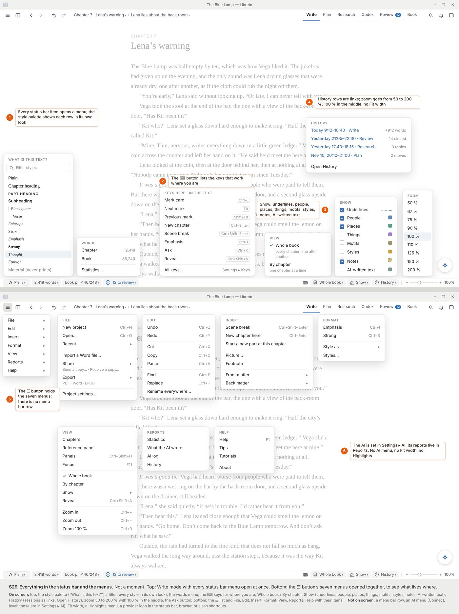

> [!NOTE]
> **Review note** · S29 · Everything in the status bar and the menus
>
> Whole book and By chapter should look exclusive.
> You may need to redo Insert menu if you look at my previous comments.

> [!NOTE]
> **Review note** on _“Not a moment: the status bar menus and the ☰ menu's seven menus opened together, to see…”_
>
> What does "book p. 146/248" show when clicked? Must it be a button?
> Whole book and By chapter are not aligned.
> Maybe Strong and Emphasis should be before in the Styles menu. A lot of people will miss them as buttons. And now menus are stacked at the three lines button, finding Format is harder. We could keep on mind menus could return back...

## S30 · Three window sizes

How the window adapts. The page is 620 px and each column 320 px, so at **1260 px** and above both columns fit in the margins. Between **1000 and 1260**, one column at a time; opening the other closes the first. Below **1000**, the open column lies over the margin and the edge of the page, and the page stays put; below about 900 the page itself narrows. The Ask panel keeps its width and shortens.

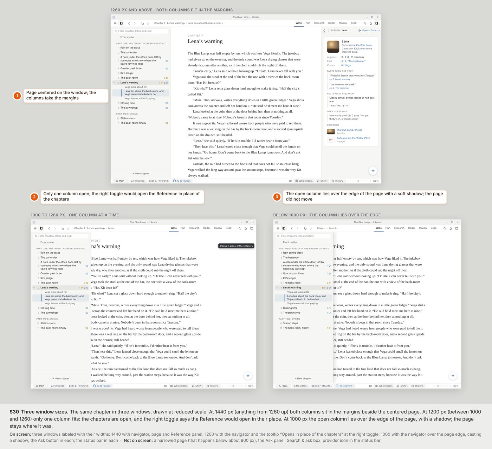

> [!NOTE]
> **Review note** · S30 · Three window sizes
>
> I think the second one is wrong. Text should have moved to the right to let space for the panel, right?
> What about mobile view? Would it be usable?
> What about making UI fonts bigger or smaller?

## S31 · Right-click, everywhere

Not a moment in the app: the right-click menus side by side, so they can be checked as one family. The rule is the same for all of them: **the few things done here most often, then the way to the rest.** In the text with a selection: Emphasis, Strong, Style as ▸, Add note, Ask the AI about this (spark), Look up (when the selection is a name), Find in the book, Cut / Copy / Paste. In the text with no selection: Style as ▸, New scene here, New chapter here, Add note, Paste. On a mark: ✓, ✗, Add note, Open in Review, Add to dictionary (for a red mark). On a chapter row: New chapter before / after, Start a new part at this chapter, Rename, Remove the chapter mark, Delete chapter…; on a scene row: New scene before / after, Rename, Start a new chapter here, Remove the scene break, Delete scene…; on a part: Rename, Remove the part mark. On a Plan card: Open, Rename, Labels ▸, Move to ▸, Unplace, Discard…. On a Codex entry: Open, Rename everywhere, Show in the text, Research this. Right-click menus walk with the arrows and `Enter` and close with `Esc`; they do not filter as you type, only the menu bar's menus and the palettes do. The only icons are the ones the app already uses for marks, kinds and modes. The full inventory of every menu, as a list, is a page of the specification.

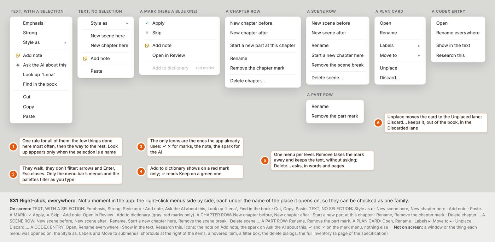

> [!NOTE]
> **Review note** · S31 · Right-click, everywhere
>
> Only the menu bar's menus and [...] filter? Where? I didn't see it, not even in Help menu.
> I didn't look at all menus carefully, but we need them to be well done. Everything expected must be there and nothing more.

## S32 · The whole book, or by chapter

The page holds the **whole book** by default: every chapter on one long page, each heading as a divider with its part above it when parts exist; the chapter list follows the scroll and highlights where you are, a double click on a row scrolls there, and the status bar counts the chapter under the cursor. The switch is the **"Whole book ▾"** item at the right of the status bar. **By chapter** is for those who want one chapter on the page: at its end a gray line reads "Next · 8 Closing time ↓" (at the top, "Previous · 6 The back room ↑"), clicking it goes there, the cursor crosses too (the down arrow on the last line, `Page Down` at the end), and `Ctrl+Page Down` / `Ctrl+Page Up` jump a whole chapter from anywhere. Either way the marks, the notes and the Reference panel behave the same; the switch is remembered per project. `Back` returns from any jump.

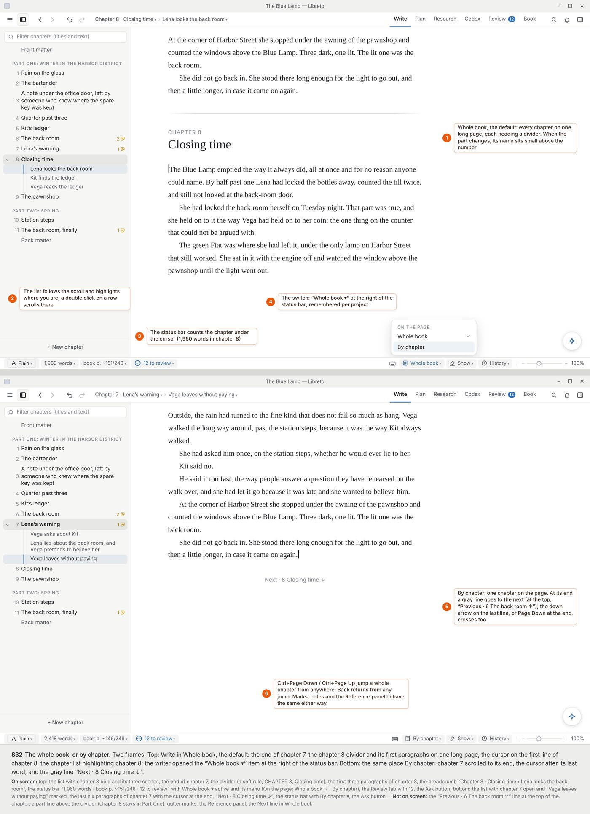

> [!NOTE]
> **Review note** on _“The page holds the whole book by default: every chapter on one long page, each heading …”_
>
> Read my previous comments about possible scene titles shown or lines where they begin/end.

## S33 · Notices, Undo and tips

Not a moment in the app: the one way Libreto tells you something changed, and the one way back. Every automatic change and every notice is the same **card at the bottom center of the page**: an icon, one line that names the place ("Scene break removed in chapter 7"), **Undo**, and **Got it**. It is never on a timer and typing does not dismiss it; **Got it** does, and only one notice shows at a time: the others wait in the **bell** at the top right, which shows a dot, and its menu lists today's notices with their Undo where it still applies. Every notice is also a line in **History ▸ Today**.

**Undo is one list.** Your typing (grouped by pauses, so one `Ctrl+Z` takes back a phrase, not a letter), Libreto's fixes, a kept proposal, a deleted scene, a move applied in Plan, a change the AI applied: all on the same stack, so `Ctrl+Z`, the Undo on the notice and the ✗ on a card are the same step, in the same order, and Redo brings it back. The Undo on an old notice works while nothing later touched the same place; when something did, the notice says so and offers **"Restore this version"**, which opens History at the snapshot from before. A fix you undid stays in the Done list, gray, so it is not proposed again. **Tips** use the same card, one a day at most, and only when Libreto recognizes a habit from a fixed list (retyping what a fix changed, removing detected breaks by hand, reaching for the mouse for something with a key): "Show me" demonstrates, "Not this one again" is remembered, Help ▸ Tips lists them all, and Settings has the switch.

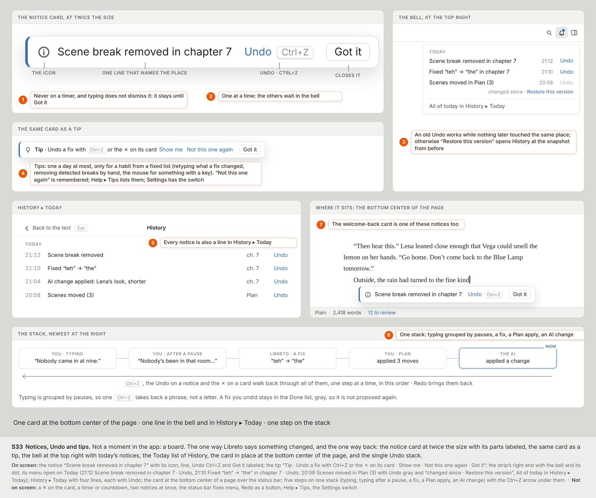

> [!NOTE]
> **Review note** · S33 · Notices, Undo and tips
>
> Is "Show me" a link to a tutorial or Help or similar?
> Restore this version looks like "Delete all the work I've been doing and let's go back to one week before", very dangerous.
> The welcome back card should show "Last session:" somewhere. Or "Previously, on The Blue Lamp..." :-)

## What changed in draft 6, and why

Everything below answers the notes on draft 5, which covered all screens.

- **Write is for writing, Review is for deciding.** Write shows only the underlines (switchable in Show) and your own notes; counts, badges, filters, readers' and AI cards and the walker are Review's. The Review tab and the status bar carry the count, so nothing waiting is invisible. The two share cursor and scroll.
- **Four colors, one meaning each.** Red unknown, blue pending, green done, amber note; gray proposals are gone (a detected break is blue). Underlines never share a height; Was / Now tints the change and shows spaces as middle dots.
- **Codex is a mode.** It was half of Research and is the book read by Libreto: a navigator, a computed, read-only entry with "Fix in the text", questions answered from the index without an AI. Research keeps the Inbox, the topics (one folder level) and the files; "Pin as fact" is the bridge. The Codex gets its own specification.
- **Six modes as tabs** in the strip, apart from the right toggle; the ☰ menu at the far left hides the menu bar on Linux and Windows; Find and the bell sit before the right toggle. Columns are 320 px, fixed.
- **Notices stay until "Got it"**, one at a time, the rest in the bell; the welcome-back card is one of them. Undo is linear; an old Undo works while it is still the latest change at that place, otherwise "Restore this version".
- **Whole book is the default view**; By chapter stays as the option.
- **No kinds of text.** Part / Chapter / Scene, optional and renameable per project; "New project" instead of "New book"; the tile is a color, a plain image or an initial.
- **Dragging in the chapter list moves**, with a drop line, a continuity warning in the notice and Undo; "Moving happens in Plan" is gone. A part starts at a chapter; Front and Back matter have "+ New ▾"; deleting sends to Discarded.
- **Plan**: horizontal lanes, Reference panel for the selected card and "+ New card", "moves · issues · Apply · Discard" at the top right, Unplaced and Discarded lanes, no breadcrumb.
- **Ask**: three groups (Go to with kind icons, Do, Ask the AI after three words), no spinners, spark icon for the AI, context-aware; the chat floats over the dimmed right column; long paragraphs compare with "[…]"; "Take proposed / Keep mine". The ranking goes to the specification.
- **Find** from the magnifier in the strip, a browser-like strip with checkboxes, a tester for regular expressions, hits grouped by chapter, "Rename everywhere" names the entity.
- **Share** is two commands, Send a copy… and Receive a copy…, with date and time and a plain message when nothing was sent. **Compare** opens from Review, folds unchanged stretches under a wavy line, puts the buttons under each box, edits with E, folds decided rows with Undo, turns comments into blue cards, resumes. **History** counts sessions as runs of the app with mode icons and +/− words, and lists snapshots.
- **Styles**: Emphasis and Strong first (`Ctrl+I`, `Ctrl+B`), the palette in its own looks at one size, a "New style" dialog; right-click menus do not filter.
- **The AI lives in Settings ▸ AI**: one provider, the model shown, the level, when Libreto reads the book (session end by default, for tokens), the disclosure; a Reports menu with What the AI wrote, the AI log and Statistics. Where an AI is needed, the walkthrough says so.
- **Settings** with tabs, a search box, Project settings, a code-editor-like Keys tab, anonymous statistics off by default. **Help** searchable with drawings. **Book** with spreads, right-hand page starts, units from Settings, figures and footnotes.
- **Status bar**: "● 12 to review" instead of the fixes count, a ⌨ button for the keys where you are, Show instead of Highlights, zoom 50 to 200 % without "Fit width".

> [!NOTE]
> **Review note** on _“Notices stay until "Got it", one at a time, the rest in the bell; the welcome-back card…”_
>
> Good, but if no one notices the note until two hours later (that should not happen) it may not make sense at that point. An X could look better than Got it. And each note closed could be animated to go to history or the bell or wherever it goes.

> [!NOTE]
> **Review note** on _“Whole book is the default view; By chapter stays as the option.”_
>
> By chapter must be carefully reviewed, in case some UI or semantic stuff don't make sense there.

> [!NOTE]
> **Review note** on _“Plan: horizontal lanes, Reference panel for the selected card and "+ New card", "moves …”_
>
> I rather see vertical lanes... Next time show me both to choose, with pros and cons.

> [!NOTE]
> **Review note** on _“Find from the magnifier in the strip, a browser-like strip with checkboxes, a tester fo…”_
>
> Redo the Find and Replace dialog as explained.

> [!NOTE]
> **Review note** on _“Share is two commands, Send a copy… and Receive a copy…, with date and time and a plain…”_
>
> Should compare be part of Review? Then, how to compare older versions from history? Think of the best way to manage this, please.

> [!NOTE]
> **Review note** on _“Status bar: "● 12 to review" instead of the fixes count, a ⌨ button for the keys where …”_
>
> Not sure if I like it or if it is in the right place. Maybe just after the zoom slider?

## To the specification

Things the notes asked for that are too long for a walkthrough and will be pages of the specification: the **Codex** (kinds, aliases, what is computed and how, the questions it answers, when the AI is read); the **index and the Ask ranking**; **what works without an AI**, mode by mode, as a table; the **menu inventory** as one list; **Undo semantics** (grouping, old undos, restore); the **spacing and overlap rules** for underlines, badges and cards, and what happens when zoomed out; **on disk**: Markdown per chapter plus a small sidecar file for marks and notes, continuous autosave, and how a chapter's file is named when chapters are renumbered; **when Libreto reads and proposes**, by level, with tokens in mind.

> [!NOTE]
> **Review note** · To the specification
>
> Perfect, I missed some answers. They were here! :-)

## What changed in draft 5, and why

Everything below answers the notes on draft 4 for screens 1 to 8; screens 9 to 30 are unchanged apart from the strip, the status bar and the notice card.

- **Modes at the right of the strip.** The breadcrumb needs room on laptops with large fonts and the two cannot both be centered; the pill at a fixed right edge is where design tools put their mode switch, and the breadcrumb owns the left. One line, no second row.
- **Status bar items look clickable**: a soft background and a ▾ on every item that opens a menu. A hint alone was not enough.
- **One card for every mark**, on hover or `Ctrl+.`: what happened, Was / Now, ✓ ✗ with `Enter` / `Delete`; `F8` walks the marks. The same card is the margin card in Review.
- **The fix rule is written down**: one possible answer and no meaning touched; "recieved" is fixed, "quite / quiet" is proposed. A fix fades red to green and never moves the text.
- **One underline per problem, one underline per word**, red before blue before green; one gutter icon per line with a count; a count opens the stack as a list.
- **Red marks** have no icon in Write and a Spelling filter in Review; their card offers candidates and "Add to the book's words".
- **Review filters by people**, named when you share; the AI never guesses who a reader is.
- **The welcome line is a card**, on no timer, that slides into the Ask button and stays reachable there and in History.
- **Kind of text at Start** sets the names of up to three structure levels (parts / chapters / scenes, acts / scenes, nothing); a book can gain or lose a level later. Front matter and Back matter are rows in the list.
- **Start shows the full path on one line** under "Will be stored in", cleaned as you type, and a cover tile per book.
- **Right-click menus per level and per place**, written out in S31; removing a mark never deletes text and never asks, deleting asks in words and pages.
- **Dragging in the chapter list points to Plan** instead of moving; cutting and pasting across chapters is free and any coherence problem becomes a task later.
- **Scene breaks** from any repeated symbol, with Undo; the break is a selectable block; a proposed break is a mark like any other, with the usual card; detected scenes are named by first words without an AI.
- **By chapter or Whole book** (S32), with a gray Next / Previous line and cursor crossing; `Ctrl+Page Down` jumps a chapter.
- **One notice, one Undo** (S33): the card at the bottom, History ▸ Today, one stack for everything, tips through the same card.
- **A chapter heading starts a chapter**: applying the style mid-chapter splits there. The style palette reads as a list (names in the interface font, samples at the right), with "+ New style…".
- **Ask needs no AI while you type**: index, fixed order, three rows per group; questions are templates; no on-device model in version 1. The Codex is kept by the writer, by rules (names, mentions, counts, proposed entries) and, when connected, by the AI, marked as such.
- **On disk**: Markdown, one file per chapter, `***` for a scene break, readable without Libreto; said in S01 and S06.

## What changed in draft 4, and why

- **One door for the AI.** Search & ask, the Chat tab and the status-bar icon were three faces of one thing. They are now **Ask**: `Ctrl+K` or the round button; results while you type, a conversation when you ask. The button is the AI's status too: gray when not connected, pulsing when working, a dot when an answer waits.
- **The page never moves.** Columns open in the margins; the text stays centered on the window at any width that allows it.
- **The Reference panel instead of tabs.** The right column shows one thing with its own `‹ ›`: a Codex card or a research topic. No tabs, no second search box; `Ctrl+K` looks things up.
- **Codex and Research are two things in one library.** The Codex is what the book says; Research is what you gather. They sit as two sections of the Research mode, link to each other mostly by themselves (names are recognized in topics as in the text), and knowledge moves between them with "Pin as fact" and "Open in Research".
- **Review is Write with the margin open.** Notes are made and fixed in Write, beside the line; Review adds the counts, the filters and the walker. History, Compare, Statistics and Help are **sheets** over the window, not modes, so there are still five modes and nothing more.
- **One family of marks.** Underlines on the exact characters in three colors; icons, not dots, in the gutter at the exact line, with the same icons as counts on the left; dotted green = done, dashed gray = proposed. Scenes lost their bullets.
- **Lines to the text.** A selected note draws a short line from its gutter icon to its card and tints its words; unselected cards stay quiet.
- **Adding chapters without keys.** A "New chapter" button at the bottom of the list, a right-click menu on every row, the Insert menu; `Ctrl+Enter` for those who want it.
- **The "what now" dialog is gone.** Libreto reopens as you left it; a line at the bottom says what is waiting.
- **The start dialog names the folder.** The sentence under the location shows the exact path that will be created.
- **Keys on every keyboard.** `Ctrl+Shift+H` panels, `Ctrl+Shift+L` / `Ctrl+Shift+R` each column, `F11` Focus, `Ctrl+Enter` chapter, `Ctrl+Shift+Enter` scene break, `Ctrl+Shift+M` note, `Ctrl+Shift+A` reveal, `Ctrl+0` zoom reset, `Alt+1…5` modes, `Alt+←/→` back and forward. Every key is editable in Settings and checked against the layout.
- **Replace all shows the list first.** And a Codex name offers "Rename everywhere" instead of a blind replace.
- **Cards can take a color** with a legend you name; "Color by" fills them from the Codex.
- **Pictures** on Codex entries, in research topics and in the book itself.
- **The disclosure is always visible** on the AI screen, with a warning sign.

## Questions

Answered by the notes on draft 5 and settled above: Ask as the name; the Reference panel without tabs or search; the keys; "Styles"; `Alt` momentary with `Ctrl+Shift+A` as the toggle; one color per card with "Color by"; the chat floating (now over the right column); pictures in the manuscript; the card's keys; dragging in the list (now allowed); fewer kinds of text (now none); the switch's place; the tile without an AI sketch; the tips; no on-device model in version 1 (to be evaluated later, by cost).

Open in draft 6:

1. **Six tabs, Codex its own mode.** Right split between Research (what you gather) and Codex (what the book says)? Is "Codex" the word?
2. **Write shows only underlines and your notes; everything else waits in Review**, counted on the tab. Is that the line you meant, or should readers' notes also show in Write?
3. **Four colors.** Readers' changes and AI findings are both blue, told apart by the person filter and the card's name. Enough, or does "from a person" need its own look?
4. **Whole book as the default view**: yes?
5. **Part / Chapter / Scene**, optional and renameable, instead of kinds of text: fine? Should "Scene" stay out of the list until the first break?
6. **☰ menu** on Linux and Windows, the system bar on macOS: fine, or always the bar?
7. **Notices stay until Got it**, one at a time, queued in the bell. Demanding enough to be noticed, or too demanding?
8. **An old Undo** only while nothing later touched the same place, otherwise "Restore this version": acceptable?
9. **Plan lanes sideways**, one per chapter, with the shelf scrolling horizontally: right, or vertical lanes?
10. **When Libreto reads the book with the AI**: end of a session by default, on request otherwise. Right default?
11. **"Don't bother me"** in Review all silences a kind of finding for the project. Per project, or for every project?
12. **Anonymous usage statistics**, off by default: worth having at all in version 1?
13. **Footnotes, figures and a right-hand page start** in Book for version 1: confirmed? Indexes (people, places) at the back, or later?
14. **A project sent as one file** to a reader who has Libreto: version 1, or later?

> [!NOTE]
> **Review note** on _“Six tabs, Codex its own mode. Right split between Research (what you gather) and Codex …”_
>
> Yes, I think so. Too many modes, but let's do it like this for now.

> [!NOTE]
> **Review note** on _“Write shows only underlines and your notes; everything else waits in Review, counted on…”_
>
> Not sure yet. Like this for now.

> [!NOTE]
> **Review note** on _“Four colors. Readers' changes and AI findings are both blue, told apart by the person f…”_
>
> Person or AI must be visible, maybe an icon with the initial or similar.

> [!NOTE]
> **Review note** on _“Whole book as the default view: yes?”_
>
> Yes.

> [!NOTE]
> **Review note** on _“Part / Chapter / Scene, optional and renameable, instead of kinds of text: fine? Should…”_
>
> I explained it before.

> [!NOTE]
> **Review note** on _“☰ menu on Linux and Windows, the system bar on macOS: fine, or always the bar?”_
>
> I think we'll use the regular bar for now.

> [!NOTE]
> **Review note** on _“Notices stay until Got it, one at a time, queued in the bell. Demanding enough to be no…”_
>
> Good question. Maybe a long enough timeout should be set. Or maybe some notices can just go away while others need to be kept until dismissed.

> [!NOTE]
> **Review note** on _“An old Undo only while nothing later touched the same place, otherwise "Restore this ve…”_
>
> Yes, but read my note about how "Restore this version" could sound.

> [!NOTE]
> **Review note** on _“Plan lanes sideways, one per chapter, with the shelf scrolling horizontally: right, or …”_
>
> I asked for horizontal lanes in the sense of one horizontal row per chapter, but you did it vertical. I'd like to see both with pros and cons.

> [!NOTE]
> **Review note** on _“When Libreto reads the book with the AI: end of a session by default, on request otherw…”_
>
> Explained before.

> [!NOTE]
> **Review note** on _“"Don't bother me" in Review all silences a kind of finding for the project. Per project…”_
>
> Per project.

> [!NOTE]
> **Review note** on _“Anonymous usage statistics, off by default: worth having at all in version 1?”_
>
> If it's cheap, let's add it. It should be asked to the user when installing.

> [!NOTE]
> **Review note** on _“Footnotes, figures and a right-hand page start in Book for version 1: confirmed? Indexe…”_
>
> Yes. We don't have examples of footnotes in the text. They should show right at the place where they are generated, in a smaller font, since we don't have pages.

> [!NOTE]
> **Review note** on _“A project sent as one file to a reader who has Libreto: version 1, or later?”_
>
> Maybe later, I explained some problems. For now no one has Libreto yet :-)
