# Libreto — walkthrough, draft 8

**Revision**: 1

Status: **for annotation.** One document, in the order a writer who has never seen Libreto would meet things. Before each screen, a short paragraph says how you get there, what it is for and what it lets you do; then the picture. Not a guide and not a specification.

Draft 8 is not an answer to notes: it answers an outside critique of draft 7 (`critique-d7.md`, six reports, about 525 findings), written as if someone else had designed the app, and it changes the frame. **The six modes are gone.** The reasons, and everything else that changed, are at the end, with the questions that are yours to decide. Screen S50 draws the smaller alternative (four modes) so the two cuts can be compared.

## Libreto in one minute

Libreto is a writing app for long texts: novels first. Its window has **three columns** and only the middle one is always open. On the **left**, the **Navigator** lists what you work on, in three sections chosen at its head: **Book** (front matter, parts, chapters, scenes, back matter), **Codex** (the Brief, threads, people, places, things, motifs) and **Research** (the Inbox, your topics, files). In the **center**, whatever you opened: the manuscript, an entry of the Codex, a topic, the Brief. On the **right**, the **side panel** shows one thing beside it: a person or a topic for reference, a chapter to read while you write another, the **Review** margin, the **Ask** conversation, or, when you look at pages, the book's layout.

When the center holds the manuscript, a small switch at the top shows three **views** of it: **Text** for writing, **Board** for the scenes as cards, **Pages** for the printed book. They are the same book: a scene moved on the Board has moved in the Text, a style changed in Pages has changed in the Text. Nothing else in Libreto is a "place": **Review** is a button that opens the margin beside the text you are on; History, Statistics and AI activity open over the window and close back to where you were; Settings and Help are windows; Export, Print and Send a copy are dialogs.

The AI has **one door**: the round **Ask** button at the bottom right, or `Ctrl+K`. The same box finds a chapter, opens a person, runs a command and, when you ask a question, becomes a conversation in the side panel. The AI can do what you can do in Libreto, but it never changes your text, your chapters or your cards without a button you press; everything it proposes waits in Review. Without an AI, Ask still finds, opens and runs commands; everything else in Libreto works without one, and where the AI adds something, the screen says so and what it costs.

Seven rules hold everywhere:

1. **The page stays put.** Columns open beside the text; the text stays centered. Only a narrow window moves it, once.
2. **One shape per meaning, color second.** A **wavy** red underline: check this spelling. A **dashed** blue one: a suggestion waits. A **thin** green line: Libreto fixed it for you. An **amber tint** behind words: a note. Every mark can be told without seeing color.
3. **Nothing replaces your words unasked.** Fixes while you type are small, green and undoable; everything else is a suggestion with Accept and Reject, and a suggestion whose text you changed since is marked **out of date**, never applied over your words.
4. **One way back for each kind of thing.** `Esc` closes the innermost thing that is open. `Back` (`Alt+←`) returns from any jump. `Ctrl+Z` undoes the last thing **here**. **Revert** takes back one older thing (a reorder, a round of review, an agent's session) and says what it could not.
5. **Libreto saves as you type, and says so.** "Saved 19:32" in the status bar; when it cannot save, it says that in red and keeps your words.
6. **Keys that exist on every keyboard and every desktop**: no brackets or slashes, nothing a Spanish layout types with AltGr, nothing Linux desktops or input methods take. Every key can be changed, and the change is checked against your layout.
7. **Plain words.** Accept, Reject, Resolve, Undo, Leave as is, versions; the same verb for the same act everywhere.

| What you want | Where it is |
|---|---|
| write | Book in the Navigator, Text view |
| see and move scenes | Board view |
| see the printed book, design it, export | Pages view; File ▸ Export…, File ▸ Print… |
| decide on notes and suggestions | the Review button, beside the text |
| look someone up while writing | `Ctrl`+click a name, or the side panel |
| what the book says about Lena | Codex in the Navigator |
| your material | Research in the Navigator |
| ask, find, run a command | Ask, `Ctrl+K` |
| what changed, and go back | History in the status bar, File ▸ Versions & history |
| goals and numbers | the word count in the status bar, View ▸ Statistics |
| preferences | Tools ▸ Settings (`Ctrl+,`) |

## S00 · The map of the whole app

Libreto is one window. On the left is the Navigator, with a three-way switch at its head: Book (front matter, parts, chapters, scenes, back matter, and the Unplaced and Discarded boxes), Codex (the Brief, people, places, things, motifs, threads) and Research (the Inbox and topics). In the middle is the open document: the manuscript, whole book or one chapter, seen as Text, Board or Pages; or a Codex entry, a research topic or the Brief. On the right is the side panel, which shows one thing at a time: Reference (an entry or topic beside the text, or a chapter to read alongside), the Review margin, the Ask conversation, or, in Pages, Book layout. The menu bar sits above, the strip below it, the status bar at the bottom.

Everything else opens over this window and is gone when finished. Small things (the quick look, a mark card, menus, notices, Find) appear over the text without dimming it. Sheets (History, Statistics, AI activity) cover the work area and carry a "Back to the text" link. Dialogs (Export, Print, Send a copy, Add notes, Replace all, Rename everywhere, Book details, an agent's permissions) ask one question and close. Settings and Help are windows of their own.

Four ways back, and each does one thing. Esc closes the innermost thing in front. Alt+Left and Alt+Right walk the jumps between documents and never undo anything. Ctrl+Z undoes the last thing in the place you are looking at, and never takes you elsewhere. Revert takes back one older thing, such as a review round or an agent session, as a new step that says what it could not undo.

**Changed from draft 7:** new page. Draft 7 had six modes and no single picture of where things live; the navigation critique (A-01, A-02, A-12) asked for one map and for one meaning of Back, Esc and Undo.

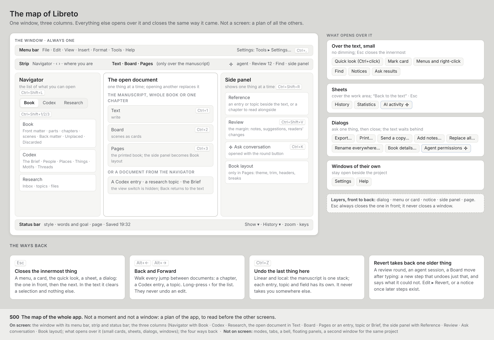

## S01 · Start

When Libreto opens with no project, the window holds one card, "New project", and a short column beside it. The card asks for a title, then what you are writing. Book is chosen; Play and Paper are shown dashed and marked "later", each with one line on what it will add (acts and cues, citations and a reference list), so nobody wonders where they are. Next come the language of the book (it sets quotation marks, hyphenation and spell check, and is not the language of the app), where to keep the project, a look (a letter on a color, or a simple line drawing), and an optional goal such as about 80,000 words by June 30. A goal becomes a daily quota; skipping it costs nothing.

Under the folder field, in gray, Libreto shows the folder it will create, so nobody types the title twice. The title keeps every word and character, however long. Only the folder name is cleaned: characters that file systems reject are dropped, it is cut at a word near 60 characters, and a name that already exists gets the next free number ("The Blue Lamp 2"). A folder is never overwritten or merged.

The right column holds Recent projects (each with its look), "Explore a sample book", which opens a short finished book to look around in, and "Bring in a Word manuscript…", which opens the import preview before anything is created. There is no strip, status bar or Ask button here, because no project is open.

**Changed from draft 7:** Play and Paper are visible but honest ("later") instead of live choices; language of the book, an optional goal, the sample book and the import door are new; the long-title rule is drawn (critique B).

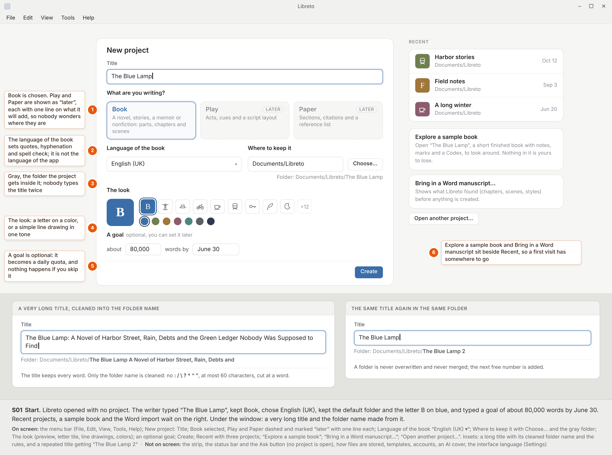

## S02 · The empty first chapter

A new book opens on its first chapter, empty, with the cursor already in it and the heading "Chapter 1" as a gray placeholder. Under the cursor sit three quiet doors: "Just write" (start typing, this all goes away), "Plan first" (open the Board and lay out scenes as cards) and "Start from an idea ✦" (answer three short questions and Libreto sets up your Brief). They are not a dialog and not a template gallery; they are a hint on the page, and the first letter you type removes all three. After twelve words nothing remains of them, and they do not come back for that chapter.

Only the third door uses the AI, and the spark says so. It opens the conversation in the side panel, not a floating window: a context strip shows what is being sent ("Brief · empty · about 0.4k tokens"), and Libreto asks three short questions (who is it about and what do they want, where and when, what should a reader feel at the end). You may skip any. The answers become a Brief, and, if you ask, scene cards on the Board. Nothing is written into your chapters.

The status bar says "0 words · Saved": nothing is missing and nothing is lost, and the goal ring stays empty until you write. The Navigator is closed on purpose; with one chapter there is nothing to navigate.

**Changed from draft 7:** the empty chapter is new. Draft 7 dropped a new writer into a blank page with no way in except knowing the modes (critique C).

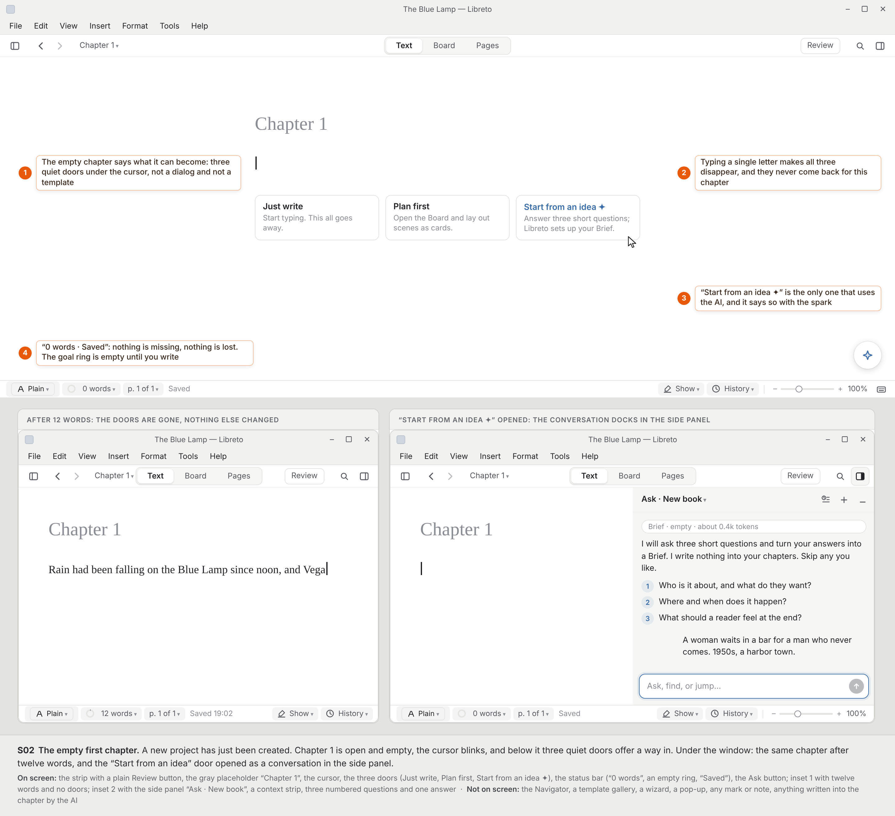

## S03 · Write, the first minute

You are on a new project's first chapter with nothing open but the text. The strip names where you are ("Chapter 1 ▾") and, centered, the view switch Text · Board · Pages, which exists only while the center holds the manuscript. On the right, Review is a toggle: its number says how many things wait, and pressing it opens the Review margin beside this same text.

Libreto marks four things, each with its own shape so color is never the only clue. A wavy red line means a word it does not know ("leters"). A dashed blue line means a suggestion waits ("the envelopes was"). A thin solid green line means it fixed something for you ("received", which fades after the session). An amber tint on words means a note, and the bubble in the gutter is your own note; other people's notes appear as hollow bubbles, and Show ▸ Notes chooses Mine, All or None.

Resting the mouse on a marked word opens one small card. It names the kind of mark, shows the choices, and carries a round initial saying who it is from: L for a Libreto rule, You, M for Marta, the spark for the AI. For a spelling mark the buttons are Leave as is and Add to dictionary; for a suggestion, Accept, Reject and Edit; for a fix, Undo. Opened from the keyboard (Ctrl+.) the keys show inside the buttons, and Alt+↓ and Alt+↑ step to the next and previous mark.

The status bar shows the style at the cursor, words against today's goal (the ring), the page in the printed book, and Saved, then Show, History, zoom and the keys for here.

**Changed from draft 7:** no mode switch, Undo arrows or bell; marks differ by shape (wavy, dashed, thin solid, tint); notes show as a tint plus a bubble; buttons say Accept, Reject, Undo, Leave as is.

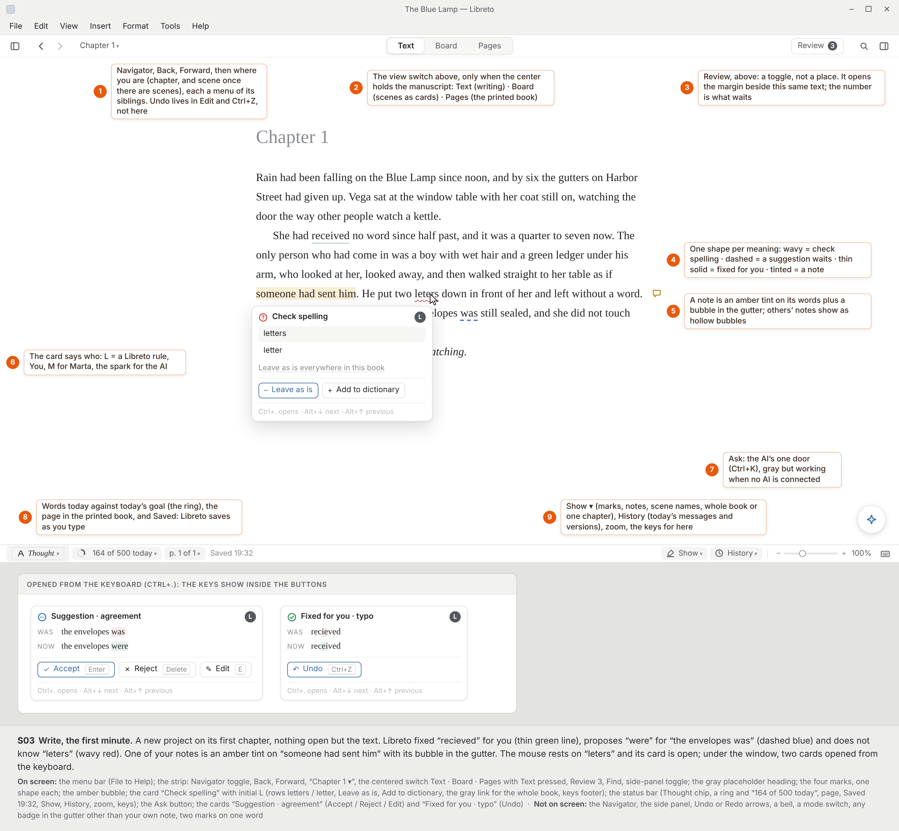

## S04 · The marks, up close

This is a legend, not a moment in the book: the marks at twice their size so the rules can be checked once. Each meaning has its own shape. Wavy means check spelling, dashed means a suggestion waits, thin solid means Libreto fixed it for you (and the line fades after the session), and a tint behind the words means a note. Color is the second channel, never the only one. The same row is shown as it would look to a person with deuteranopia and to a person with protanopia (simulated with standard color matrices), and the four marks are still four different things.

Every card carries a round initial for who it is from: L for a Libreto rule, You, M for Marta, T for Teo, the spark for the AI, and an agent's name for an external agent such as Claude Code. A word can carry more than one thing, but it shows one underline. When several things meet on one word, they stack into one card, headed "4 on “leters”", with a row for each (the spelling check, an AI suggestion, a change from Marta, your own note), each with its own initial and buttons, and Alt+↓ steps through them.

The last card is for a change you cannot see. When Marta turns a straight apostrophe into a curly one, nothing looks different, so the card says so in words: "A straight apostrophe becomes a curly one. One character changes: ' (U+0027) to ’ (U+2019). The words are the same." You can accept or reject it like any change.

**Changed from draft 7:** four colors with dotted underlines became four shapes (critique C accessibility); the color-blind check, the stack for many things on one word and the look-alike card are new.

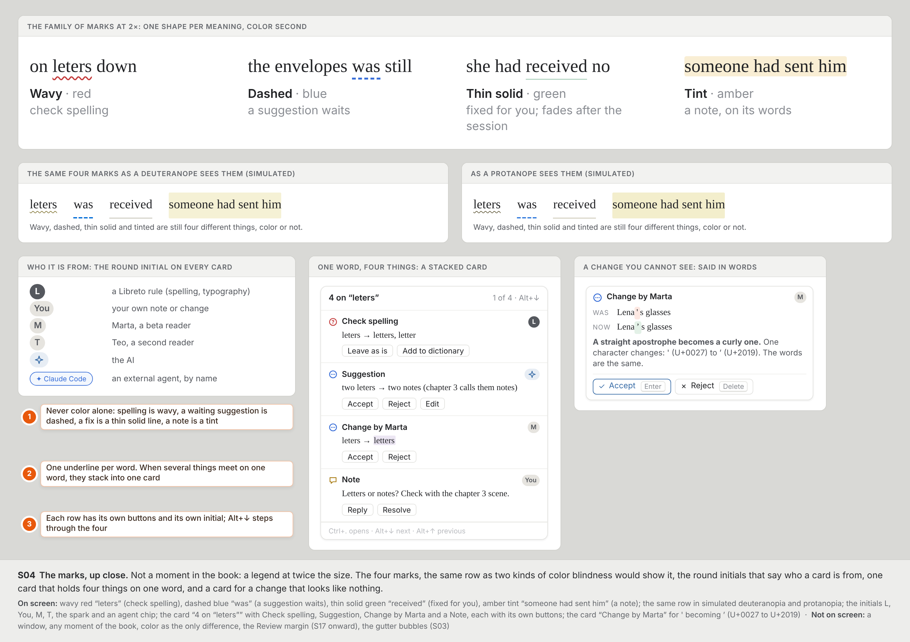

## S05 · Coming back

Libreto reopens exactly as it was left: the same chapter, the same scroll, the cursor where you stopped. Nothing asks what you want to do. At the bottom of the page sits the Last session card.

It says when you last worked and how much ("1,240 words, goal 1,000"), then "Where you were": the paragraph you were in, with its chapter and scene, so you can find your voice again. Under "What waits" are three buttons, each of which goes there: "12 to review" opens the Review margin beside the text, "2 cards unplaced" goes to the Board, "3 clippings in the Inbox" goes to Research. A line offers the catch-up: "✦ Catch up: 3 scenes changed · ≈0.03 € · Read now". It runs only if you press Read now, and the cost is shown first. Libreto also names the next card on the Board, and the card has "Don't show this again".

The card stays until you press ✕ or type on; it does not use a timer. When it goes, a short line goes to History ▸ Today.

After a long gap the same card says how long it has been ("Sunday Nov 8 · 10 days ago") and, if you set a goal with a date, what the goal would now need: "To still finish by June 30 the daily goal is now 1,150 words. Stay at 1,000." Stay at 1,000 changes nothing. The card never says "you missed 10 days", and there are no streaks or trophies. The status bar starts the new day at "0 of 1,000 today".

**Changed from draft 7:** a card with Where you were, the goal and an offered catch-up replaces the bare notice; the bell is gone, and the long-gap case is drawn (critique C, F).

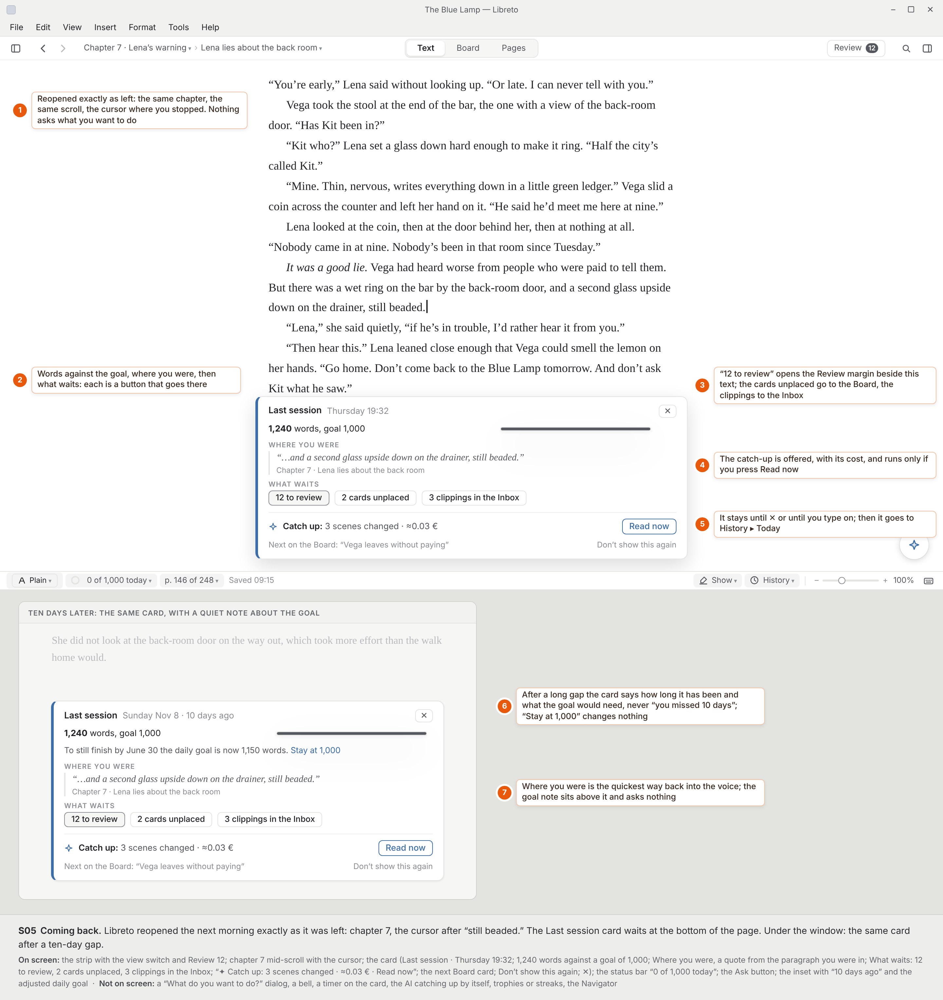

## S06 · The Navigator on Book

The Navigator is the left column. At its head is a three-way switch, Book · Codex · Research (Ctrl+Shift+1, 2, 3), and under it a filter. On Book it lists the whole shape of the manuscript. Written pages that are not chapters live in two groups: Front (Dedication, Epigraph) and Back (Acknowledgments, About the author). Generated pages, such as the title page and the contents, are not rows; they are switches in Pages. In between come an unnumbered chapter (Prologue, which shows a space instead of a number), parts as quiet labels, and chapters with their numbers. The current chapter opens to its scenes, and the current scene is marked with a blue bar.

A long title keeps its place: it is clamped to two lines and ends with "…", and the full title is the heading on the page. Discarded and Unplaced are pinned at the bottom with their counts. Discarded holds every text removed from the book, with Put back; Unplaced holds cards that belong to no scene yet.

Resting the mouse between two rows shows a blue line and a small +. Its menu offers Scene, Chapter, Part and Unnumbered chapter, so nothing is added at the bottom by accident. Right-click gives each level its own short menu; on an unnumbered chapter, "Numbered ☐" turns the number on. Numbering style (7, VII, Seven, Chapter seven) is a theme setting, not a row property.

**Changed from draft 7:** the section switch, Front and Back groups, unnumbered chapters, clamped titles and pinned Discarded and Unplaced are new; the + offers Unnumbered chapter (critique A, E).

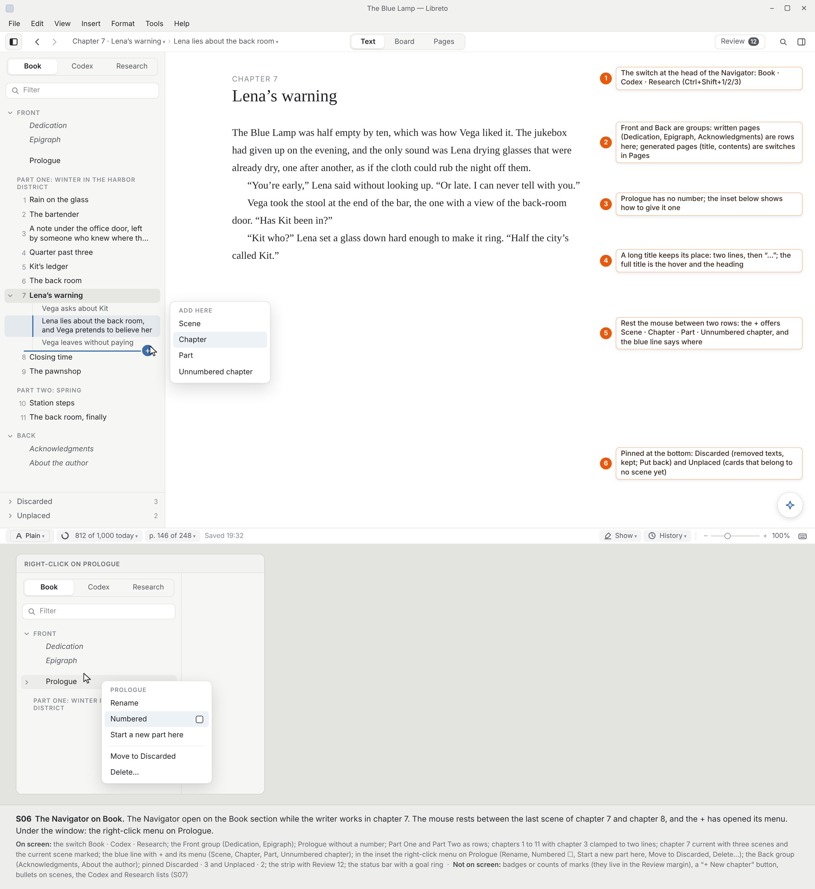

## S07 · The Navigator on Codex, Research, and a filter

The same left column changes with the switch at its head. On Codex it starts with the Brief (the book's intent, sent with every AI request) and Threads (setups and payoffs, computed and your own, "6 open"), then the kinds of entry with their counts: People 8, Places 5, Things 4, Motifs 2. A kind opens in place, one level deep, and "4 more…" keeps a long list short. Clicking an entry opens it in the center; Ctrl+click looks it up beside the text.

On Research the Inbox is always on top with its count and a dot while something waits there (clippings and dropped files land in it). Below are topics, which are folders one level deep, each with its files inside, and loose files at the end. Nothing sits more than two clicks from the top.

On Book, typing in the filter replaces the list with what matches: titles and text, each result with its chapter and the sentence around the word ("…a green ledger under his arm…"), and a summary ("12 matches in 5 chapters"). While a filter is on, nothing can be dragged, added or removed, and the column says so in a small note with the way out (Esc clears the filter), so a half-hidden list is never rearranged by accident.

**Changed from draft 7:** Codex and Research are sections of one Navigator rather than modes; the Brief and Threads lead Codex; the filter state is explicit about what it locks (critique A).

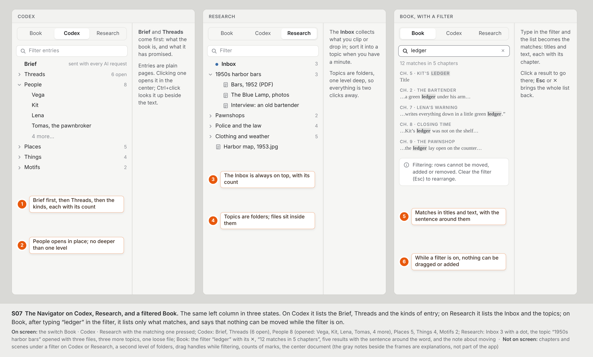

## S08 · Scene breaks and structure edits

Structure is made by typing and corrected by notices. A line of only *** (or - - -, or ~) followed by Enter becomes a soft gray rule and the cursor moves to the next paragraph; on disk it stays a *** line, so the file is readable anywhere. Libreto also notices breaks you did not mark: where the time jumps ("The next morning…") it draws a dashed blue rule and offers a card, "Suggestion · scene break", with Accept and Reject. Nothing exists until you accept, and in the Navigator the detected scene waits on a dashed guide, in gray.

Structural edits never ask first; they say what happened, in words and numbers. After deleting chapter 8 the notice reads "Deleted chapter 8 "Closing time" (2,300 words); the chapters after it moved up one", with Undo and "Open in Discarded". The text is not gone: it is in Discarded (now 4), and the Navigator renumbers. The notice says Undo while it is the latest step and Revert after later edits. It stays until you type on or press ✕, and then it goes to History ▸ Today.

A paste that contains headings could start many chapters at once. Libreto pastes first, then says "This paste starts 12 chapters", with "Make them chapters", "Paste headings as plain text" and Undo. Until you choose, the text is already in and one Undo takes it all back.

**Changed from draft 7:** notices say Undo or Revert and state counts; the delete notice offers Discarded; the many-chapter paste is a case of its own; breaks accept and reject like any suggestion (critique B).

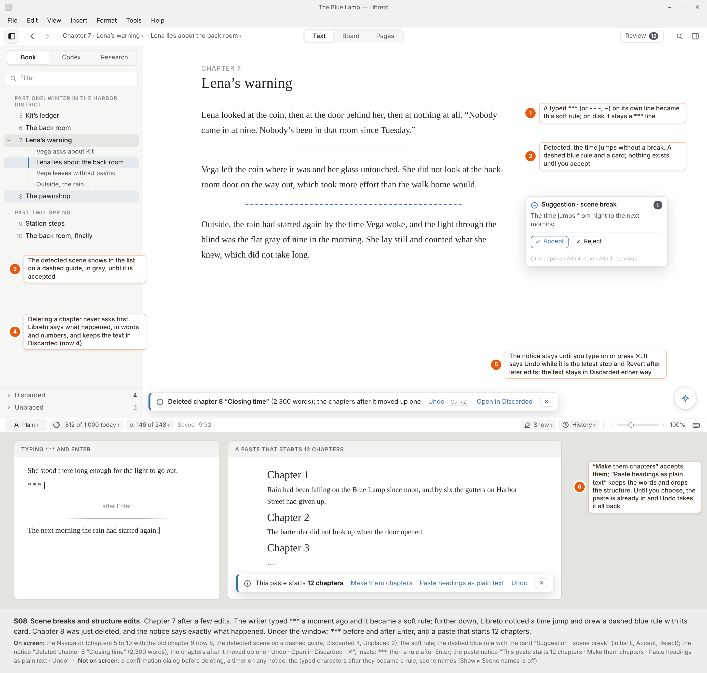

## S09 · Styles

Select some words and a small bar appears above them with "I Italic", "B Bold" and "Style as ▾". Italic and Bold are the two everyone reaches for (Ctrl+I, Ctrl+B); behind them the styles are still called Emphasis and Strong, so changing how Emphasis looks in the book's theme changes every italic at once. "Style as ▾", the chip at the bottom left, or right-click ▸ Style as open the palette: each style is shown in its own look, with the key at the right, grouped as Paragraph styles (Plain, Chapter heading, Subheading, Letter, Sign, Verse, Not printed) and A few words (Emphasis, Strong, Thought, Foreign). A check marks the style at the cursor, and the chip always shows it in its own look.

"+ New style…" opens a small dialog. A style has a name, whether it is for paragraphs or a few words, a face role (body, heading, sans or mono, from the book's theme), a size step with what it prints at ("prints 11 pt"), bold, italic and small caps, and a key. Paragraph styles also get alignment, indent, space before and after, and "After Enter ▾"; these are grayed for a few-words style. If the new style would look the same as an existing one, Libreto says so quietly: "Looks the same as Emphasis on the page", with a button to use Emphasis instead.

Styles belong to the book, so it prints the same anywhere; "Save to my styles" also adds the style to Settings, so new books start with it. How the page looks while you write (font, size, spacing, page color) is a personal setting under Settings ▸ Writing and never changes the book.

**Changed from draft 7:** Emphasis and Strong are labeled Italic and Bold; styles are per book with Save to my styles; the dialog uses face roles and size steps, and warns about look-alikes; free text colors are gone (critique E).

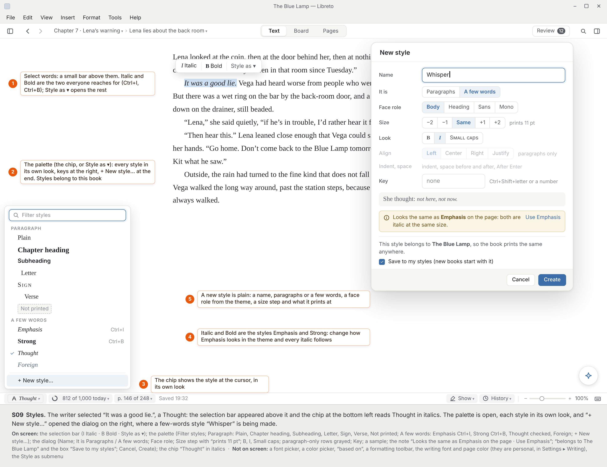

## S10 · Ask while typing

Press Ctrl+K, or click the round Ask button in the corner, and one box opens over the text. While you type, nothing is sent anywhere: the rows come from Libreto's own index of the book, in a fixed order (exact name, then names that start with what you typed, then names that contain it; the current chapter and recent things first). Go to lists chapters, scenes, people, places, things and research topics, each with its kind; Do lists commands such as Find or Rename. Typing "led" puts Chapter 5, Kit's ledger first, already selected, with the hint "Enter: go". Hits inside the text are not a group here; that is Find, one key away.

Whether the box thinks you are asking a question decides what is preselected. The question row (the last one) is preselected only when the input looks like a question: three words or more, or a question mark. "led" is not one, so Enter goes to the chapter. "what if Lena" is, so the question row is selected, and an AI actions group appears above it with "What if… for this scene" and "Brainstorm about Lena", each showing its estimated cost before anything runs. Ctrl+Enter asks the AI from any state, so a short question never needs a question mark.

With no AI connected there is no AI actions group, and the last row is gray and reads "Connect an AI to ask questions", a link to Settings ▸ AI. Enter then takes the first result. Everything else works exactly as before, so the box is useful on day one.

**Changed from draft 7:** the Do group stays but the question row is no longer always preselected (it was, whenever an AI was connected, so Enter on a short search asked the AI instead of going); AI actions show their cost (F-B).

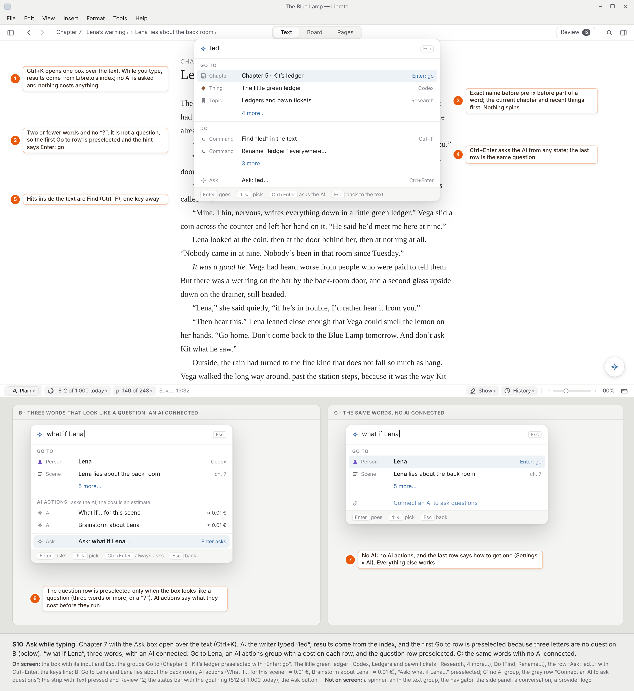

## S11 · Ask, a conversation

When a question is asked, the conversation opens in the side panel, beside the text, not floating over it. The page keeps its place and its width, and the conversation survives closing the panel: the clock lists earlier conversations, the plus starts a new one. Under the head a context strip shows what travels with each question: the Brief, the scene you are in, the entries it mentions (here Lena and Kit), and the size, "≈ 3.1k tokens". Hovering an answer shows what it cost and which connection answered, so the money and the account are never a surprise.

Answers point at the book. A chapter link moves the page (Back returns); a name opens its entry in this same panel. When the AI proposes a change it appears as a suggestion card showing only the words that change, tinted, with Accept, Reject and Edit. The same words carry the dashed blue underline in the text, and a thin bar marks the paragraph under discussion. Nothing is applied until Accept, and accepting is one step that Ctrl+Z takes back.

Every suggestion stores the text it was based on. If that text has changed since, the card turns gray-blue and says "Out of date · your text changed since"; it offers Show both, Ask again and Reject, and it can never be applied blindly over newer words. The older "Tighten the paragraph after the lie" card shows this state.

**Changed from draft 7:** the conversation is docked, not floating, and no longer hides the Reference panel (A, F); proposals gained a lifecycle and the Out of date state (D-12); the context strip and per-answer cost are new (F-3); Take proposed/Keep mine became Accept/Reject/Edit.

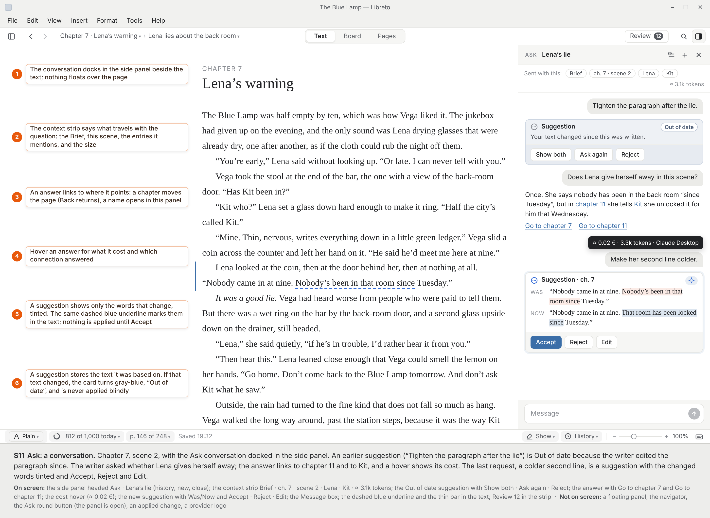

## S12 · Quick look and the side panel

Ctrl+click a name in the text, or right-click it and choose Look up, and a small card appears beside it: the kind, the name as a link, a line about it, the chapters it appears in, and the Research topics linked to it. Nothing opens by hovering. Open puts the entry in the side panel, where it stays while you keep writing; the panel's head has two rows, the arrows and the kind (PERSON) with a close button, then the name large, so a long name is never squeezed beside buttons. The body is a summary of the Codex entry, not all of it: a line, where she appears, the five most recent facts with "All 84 facts in the Codex", open questions, and Research topics. The foot always offers Open in Codex and Ask the AI.

The same panel shows other things beside the text. Choosing a Research topic puts it there, readable and scrollable with its photos (here the bar), and the foot reads Edit in Research: gathering happens in Research, using happens beside the text. Choosing "Open beside" on a chapter shows that chapter read-only, headed "TEXT · ch. 2 · The bartender", with Open and Show in text; this is split reading, for checking one part of the book while writing another. There is exactly one place to edit chapter 2, the center.

A link to the text moves the page and Back returns; a link to another entry moves the panel and its own ‹ returns. Alt+← and Alt+→ walk both.

**Changed from draft 7:** "peek" is now quick look and opens with Ctrl+click, not Alt+click, which Linux desktops take (C); the panel also holds research topics and read-only chapters, replacing a separate beside-the-text screen (A, N12).

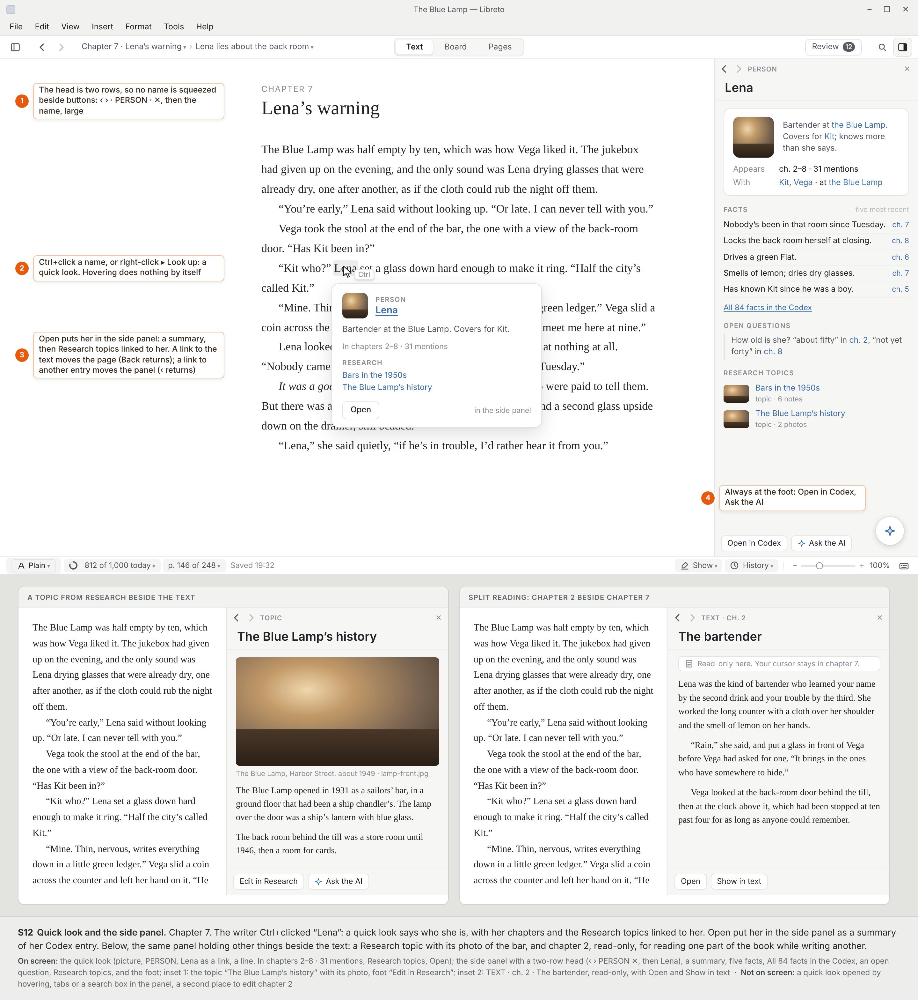

## S13 · Show names and styles

Ctrl+Shift+A, or Show ▾ ▸ Show names and styles in the status bar, lets the page show what Libreto knows about it. People, places, things and motifs get a tint behind their words (violet, cyan, brown, magenta) and nothing else: no underlines, because underlines belong to marks (spelling, suggestions, fixes) and the two are not drawn together. Marks are hidden while this is on. Styled passages are named in the left margin at their paragraphs, here Thought and Letter. It is a toggle that stays until you turn it off. Holding Alt for it is an opt-in in Settings ▸ Keys, because on many systems Alt belongs to the desktop.

Provenance is shown the same quiet way. A sentence that the AI wrote, that you accepted and then edited, carries a thin hatched bar in the margin; hovering it says "AI, accepted Nov 9, edited by you · 40 % of its words remain". The percentage is how much of the AI's original wording is still in the sentence, so the writer can judge how much of the text is theirs. Ctrl+click a tinted name opens its quick look; hovering opens nothing by itself.

**Changed from draft 7:** was "Hold Alt"; now a toggle with a plain name, tints instead of underlines under names so marks stay unambiguous, color-blind safe by shape (C-10), and AI provenance as a hatched bar (D-16, F-14).

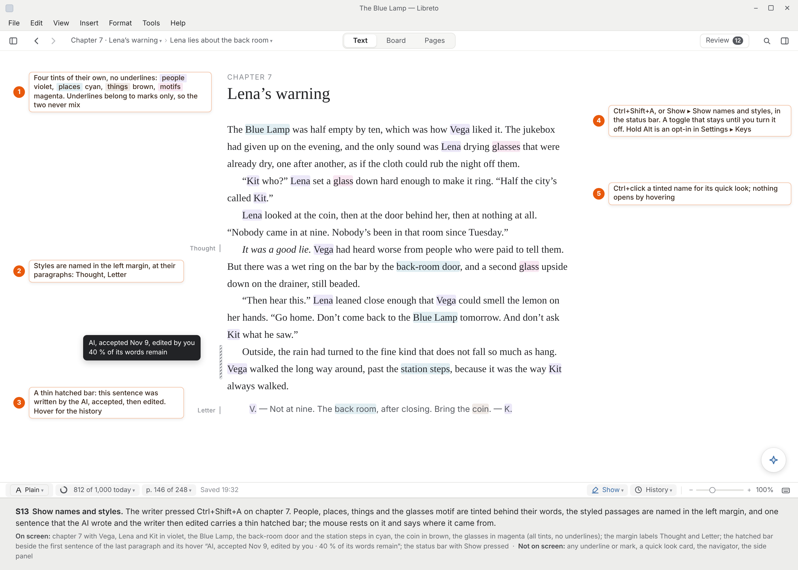

## S14 · Everything open, the text in the middle

This is the most the window shows on a 1440 px laptop: the Navigator on the left (280 px, with Book, Codex and Research at its head), the manuscript in the middle, and the side panel on the right (350 px, here showing Lena). The text column is 620 px at 100 % and stays centered on the window; the two columns take the margins, not the text. Nobody needs this all day; it is drawn to judge the load, and each column closes with its toggle in the strip (Ctrl+Shift+L for the Navigator, Ctrl+Shift+R for the side panel).

The inset is the honest version at 1280 px. There the Navigator and the side panel need 630 px beside a 620 px text, more than the window has, so they cannot both stay. When the second is opened, the one opened earlier closes and a notice says so with Reopen. The text keeps its width and does not move. Narrower still, the panels become overlays above the text and close with Esc. For people who need larger type, the interface size is a setting (Settings ▸ Reading & seeing, up to 200 % or the system's); the page then keeps its measure in characters and the columns scale with it.

**Changed from draft 7:** the chapter list and Reference panel became the Navigator and the side panel, both always one thing at a time; the 1280 px case is now drawn instead of ignored (B, C-11).

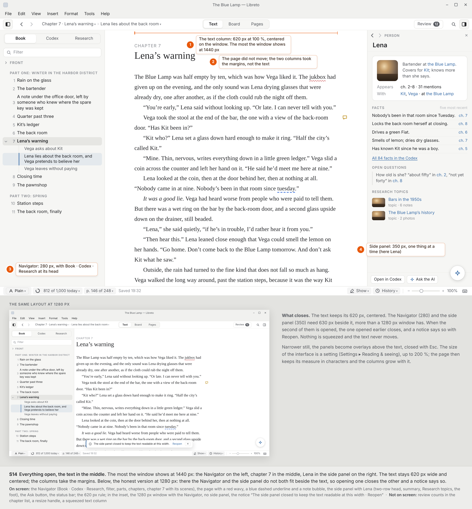

## S15 · Focus and the sprint

F11, or View ▸ Focus, leaves only the page: no title bar, menu, strip, status bar or Ask button. The page keeps the book's own paragraph spacing and indent, and shows whatever was open (the whole book or one chapter), scrolled where you were. When the mouse moves, a small "Exit focus · F11" shows at the top; F11 leaves. Esc closes only what is open on the page (a quick look, a card) and never Focus itself.

A sprint is started from View ▸ Sprint (25 minutes by default) and adds one thing to Focus: a thin time bar above the page with "18:40 left of 25:00". It does not blink, flash or count words while you write. When the time is up a small card says "+412 words in 25 minutes" with the day's total and a Close button. There are no trophies, streaks or sounds; the number is the writer's own, and the card goes away when closed or when typing continues.

**Changed from draft 7:** Focus no longer shares a screen with "hide the columns" (that key was dropped); the sprint, its bar and its ending are new (C-14).

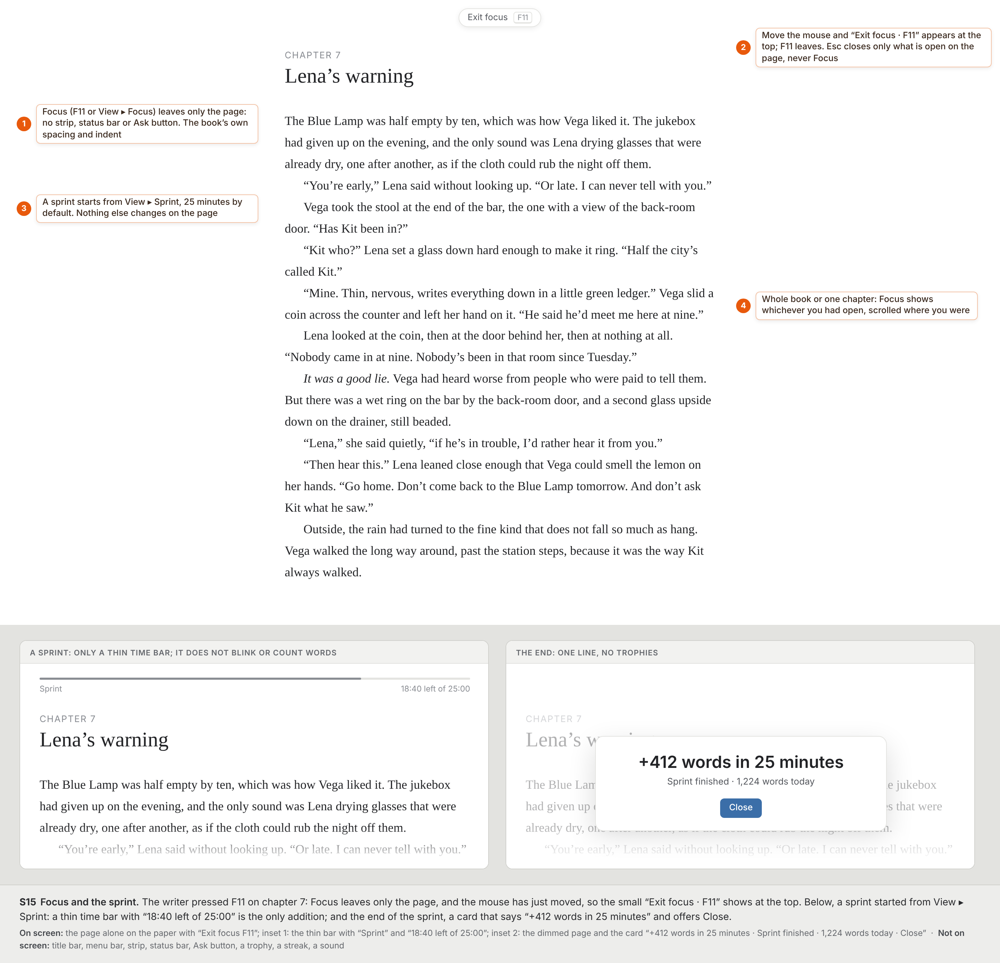

## S16 · Notes while you write

In the Text view a note is written where the sentence is. Select words and press Ctrl+Shift+N (or right-click ▸ Add note, or use the faint + beside a line) and a small editor opens in the margin of that line; the words it holds are tinted amber. Enter adds the note, Esc cancels, and the amber bubble that remains in the gutter is yours.

Someone else's note is quieter. A note from Marta, Teo or the AI shows as a hollow gray bubble with no tint on the words, so the page you write on stays calm. Resting the mouse on it says who and how many ("Marta · 1 note · Open in Review"), and clicking opens that note in the Review margin, never in the middle of the sentence you are writing.

Which notes the gutter shows is a choice in the status bar's Show menu: Notes: Mine (the default), All, or None. The same menu holds marks, scene names, whole book or one chapter, and Show names and styles (Ctrl+Shift+A). Mark shapes stay the same everywhere: wavy red is spelling, dashed blue is a waiting suggestion, thin green is a fix, amber is a note.

**Changed from draft 7:** others' notes are no longer invisible in Write; they are hollow gray bubbles you can switch on or off, and the note is typed beside its line (D critique, hidden feedback).

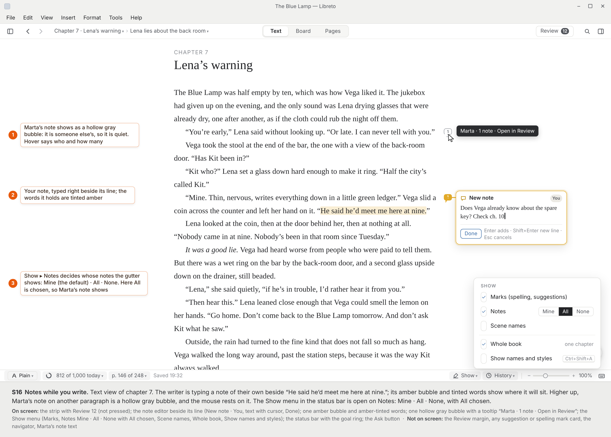

## S17 · The Review margin

Review is not a place you go to; it is a margin that opens beside the text you are already in. The Review button at the right of the strip (Ctrl+Shift+V) toggles it, and the number on it counts what waits for you. The text stays editable, and every card sits level with the line it is about.

The head of the margin lists the rounds. Each import of a reader's copy, each AI pass, each agent session and the standing Libreto rules is one round, with its progress ("Marta · Nov 7 · 150 / 300", "AI pass · Nov 12 · 12 / 80 · ≈0.42 €"). Below are plain on/off filters (Notes, Suggestions, Fixed, Spelling, Unread, Resolved) and the Page | List switch. Review all ▶ starts the walk, and "Add notes from a reader's copy…" opens the import.

Cards are of a few kinds. A continuity finding offers Fix here, Fix there and Why?. A proposal whose text has changed since it was made turns gray-blue and says Out of date, with Show both, Ask again and Reject; it is never applied blindly. Several items on one line become a stack ("3 on this line"). A thread of 28 messages keeps its last two and folds "26 earlier messages", and a very long note is clamped with Read all. The Navigator carries per-chapter counts.

**Changed from draft 7:** Review is a toggle beside the text with rounds, an Unread filter and a Resolved filter, out-of-date cards and folded threads (F-D-01, F-D-20, F-D-36).

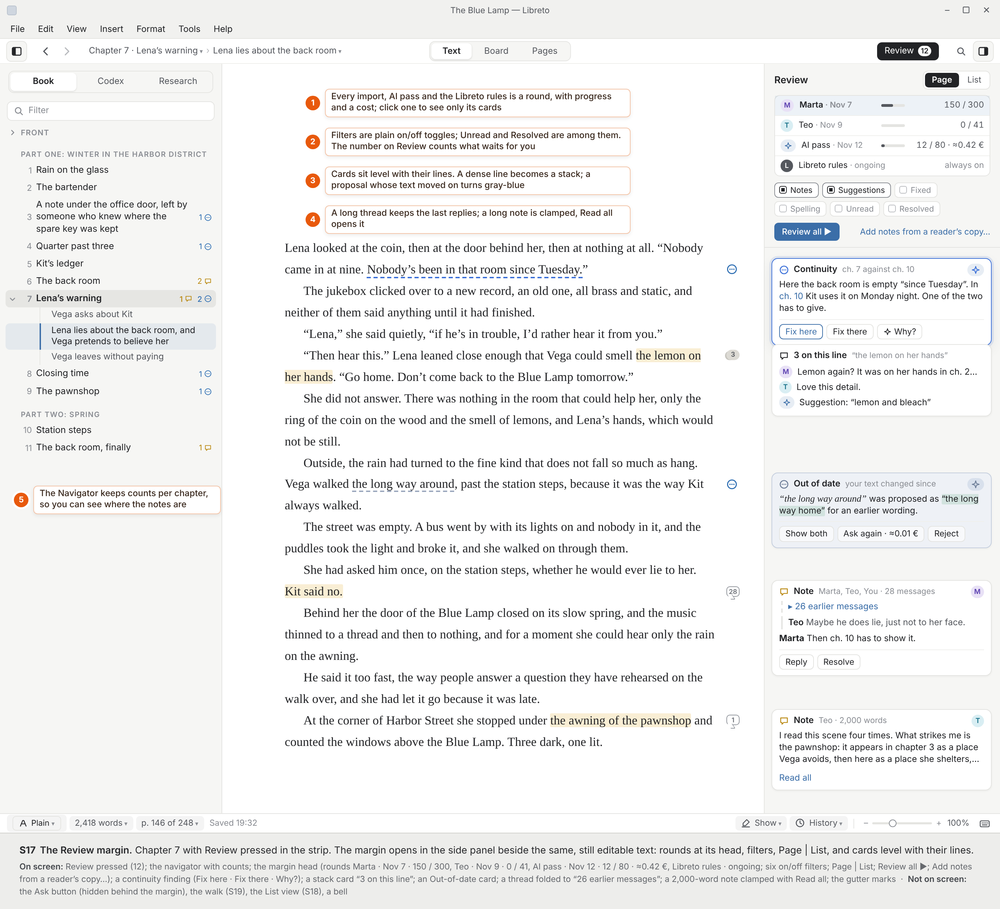

## S18 · Review as a list

When a reader's copy brings 300 items, going card by card is the wrong tool. Switching the margin from Page to List widens it over the page and shows the items as a table: chapter, the quoted words, who raised it (initials), the kind (note, change, suggestion), its state, and a blue dot for what you have not read yet. Click a row to jump to its line; Page brings the text back beside a narrow margin.

Rows are grouped, and the first group is "Flagged by 2 readers": where Marta and Teo marked the same words, which is usually where the book has a real problem. The remaining groups follow by round, and long ones are folded.

Ticking rows (or Shift+click for a range) raises a bar with bulk actions: "3 selected · Resolve 3 · Reject 3 · Clear". Resolve closes notes you have dealt with; Reject refuses changes and suggestions. Both are recorded with the round, so Revert on the round can still undo them.

**Changed from draft 7:** a list view with bulk actions and an agreement group replaces one long scroll of cards (F-D-20, F-D-30, F-D-31).

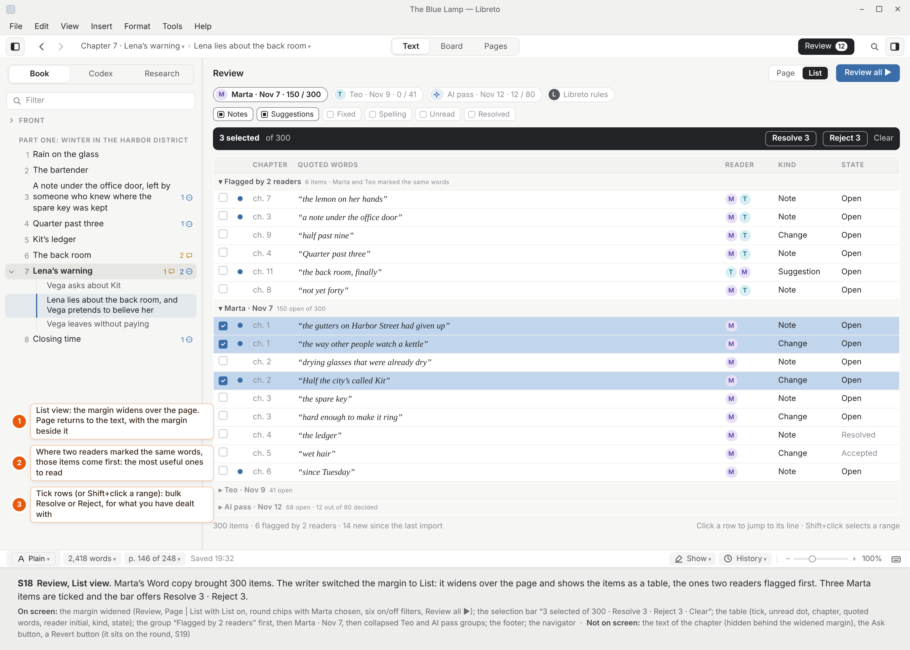

## S19 · Review all

Review all ▶ turns the margin into a walk through one round, one card at a time. The text scrolls to the line, the card sits level with it, and the reader's change is outlined in their tint. Accept (Enter), Reject (Delete), Skip (S) and Edit (E) have their keys inside the buttons; Edit lets you reword a change before taking it.

The header counts what is decided and what is left ("Marta · decided 150 · left 150"), not a position. A position such as "4 / 12" moves when you skip, filter or the list changes; decided and left only ever change by your own decisions. Stop ends the walk at any time, and the margin resumes at the next undecided card when you come back, even after restarting the app.

The keys act on the card only while it has focus. Clicking in the text lets you type, and the walk waits; nothing you type ends it. At the end the margin says "Decided 296 · Skipped 4", offers to show the skipped ones, and carries Revert this round, which inverts only what the round did and reports what it could not.

**Changed from draft 7:** stable progress, no Esc trap, and a per-round Revert instead of "Undo all" (F-D-22, F-D-23, F-D-24, F-D-25).

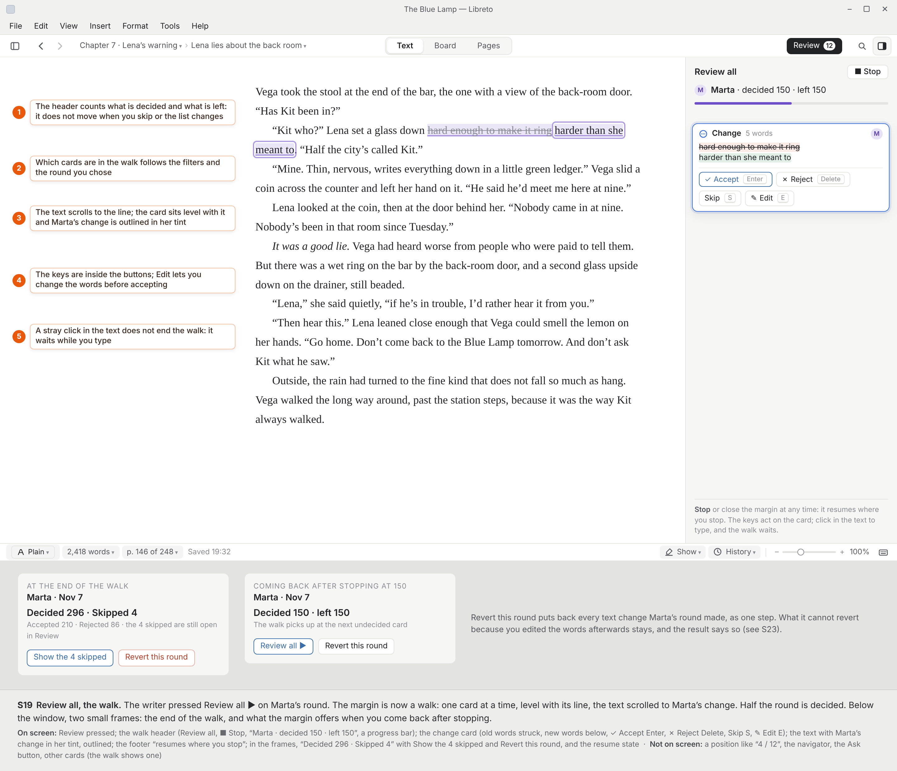

## S20 · A reader's copy comes back

When Marta returns the Word file you sent her, drop it on the Libreto window, or use Review ▸ Add notes from a reader's copy… or File ▸ Add notes from a reader's copy…. A dropped file that Libreto recognizes shows one line, "This is the copy you sent to Marta on Nov 7", with Add her notes. All three doors open the same dialog.

The dialog says what is in the file: 212 comments, 63 tracked changes, and 9 untracked edits that Libreto found by comparing the text with what it sent on Nov 7. Word's author name ("Usuario") is mapped to a reader once and remembered. It also says how much is new (comments: "198 already imported · 14 new"), so adding the same copy twice is harmless.

If the book moved on since you sent it, a warning says so ("38 % of paragraphs changed since you sent it"). It is not a block: the import compares three ways, what you sent, what you have now and what she did, so your own edits stay and only real conflicts need you (S21). Nothing is applied to the text; her items wait in Review under their own round, to be accepted or rejected.

**Changed from draft 7:** a real import step with author mapping, counts, duplicate detection and a staleness warning, plus the drop-a-file door (F-D-13, F-D-14, F-D-16, F-D-18).

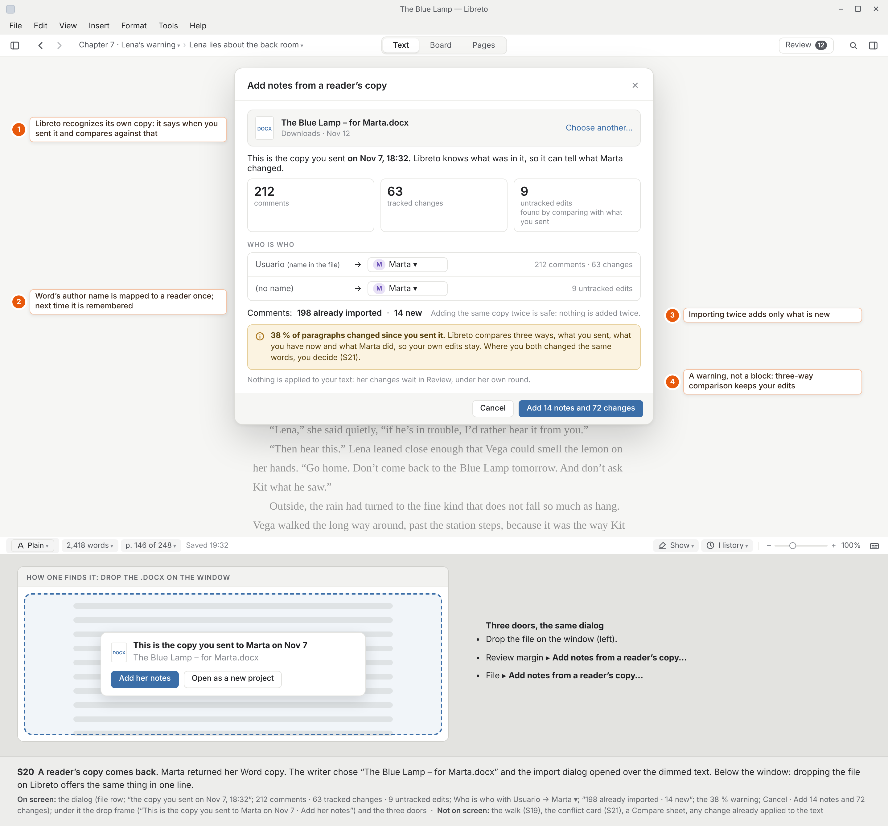

## S21 · Readers' changes in the text

After an import, a reader's changes appear inline, the way a shared document shows them: struck-through old words, inserted new ones, each tinted with that reader's color and marked with their initial, and a ✓ to take or ✗ to leave each change. Marta and Teo can touch the same sentence and both show.

Libreto remembers what you sent, so it compares three ways. Where you and Marta changed different words of a paragraph, it merges them and says so ("You and Marta changed different words: merged · Undo"). Only when you both changed the same words does a conflict card appear, with three rows: what you sent on Nov 7, yours, and Marta's. Use mine, Use Marta's, or Merge for me ✦, an AI proposal whose price (≈0.01 €) is shown first and which you still accept or reject.

Comments whose words no longer exist are not lost. They are grouped as "Unplaced comments (4)" at the top of the margin, with their quoted words, so you can place them by hand.

**Changed from draft 7:** inline, three-way and per reader, replacing side-by-side Yours | Marta's blocks (F-D-07, F-D-08, F-D-09, F-D-19).

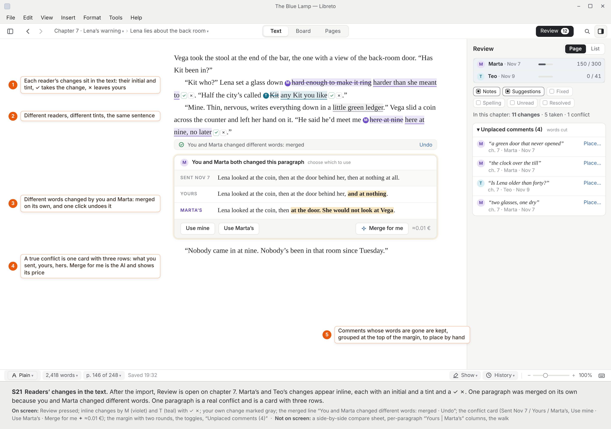

## S22 · Send a copy

File ▸ Share ▸ Send a copy… asks four small things. To whom: a reader, kept with the book so a returned copy can be recognized. Format: Word, PDF, or a Libreto file. What goes in: notes (Open only by default, so resolved ones stay out), AI notes (excluded by default, they never travel unless you include them), and a switch to mark your own changes since the last copy to the same reader as tracked changes, so she sees what is new. Where: a folder or your email program with the file attached.

The Word file carries a hidden identity for each paragraph, which is what later lets Libreto recognize it and compare three ways. You appear in it under the author name set in Book details.

Sending also saves a version, named "Sent to Marta · Nov 7, 18:32", listed in File ▸ Versions & history with Compare with now and Open. That version is the base the returned copy is compared against.

**Changed from draft 7:** options for open-only notes, excluded AI notes and marking changes since the last copy, and the sent copy is a "version" in History (F-D-37, F-D-38).

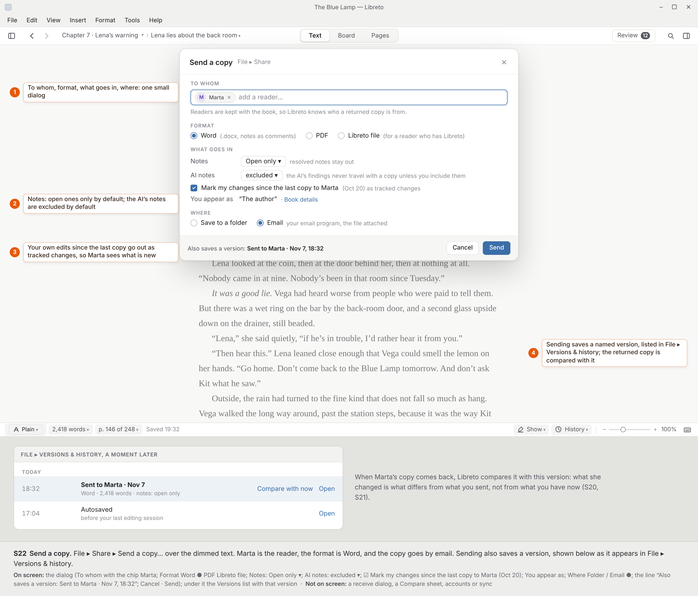

## S23 · Undo and Revert

Ctrl+Z is linear and belongs to what you are looking at. The manuscript is one stack; each Codex entry, each research topic and each field has its own, so undoing in Lena's entry never touches the chapter. Every Undo scrolls to its place, flashes the change and says what it was ("Undone: scene break removed"); the Edit menu names the step before you press it.

Taking back something older is Revert: a new step that inverts just that one thing, such as a reorder on the Board after ten minutes of typing, a whole review round, or an agent session. It says what it could not do: "Reverted 38 of 40 moves; 2 scenes you edited since were kept · Show".

Notices that report a change say Undo while it is the latest step, and Revert once you have typed on. They stay until you type on or press ✕, never on a timer. There is no bell: passing messages go to History ▸ Today in the status bar, which lists today's events with Revert where it still applies and All versions… for the rest. Decisions that wait for you live in Review, not there.

**Changed from draft 7:** one global Undo list and a bell are replaced by per-document stacks, Revert for older things, and the History popover (F-D-41, F-D-42, F-D-43, F-D-58).

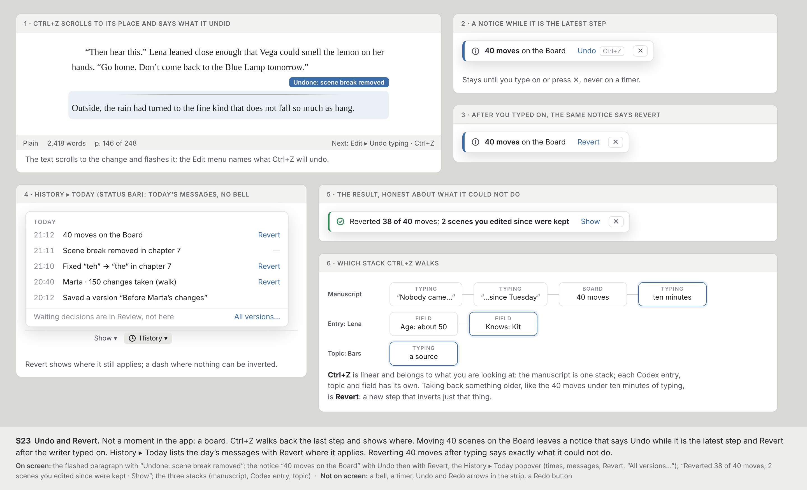

## S24 · Board view

The Board is the second view of the manuscript, next to Text and Pages in the switch at the middle of the strip (Ctrl+2). It shows the book as scenes on cards: one row per chapter, the scenes of that chapter from left to right, and each part as a thin band between rows. A card carries the scene's number and line, who tells it and where it happens, its status and its storyline. A long chapter scrolls sideways inside its own row, and the board scrolls down like the chapter list. The Navigator on the left stays on Book; clicking a chapter there scrolls the board to its row. Above the board there are only two controls: a new card, and Color by, which decides what the card colors mean (point of view, place, status, storyline or your own label).

A move is a move: when you drag a card to another chapter, it is done at once, and the text of both chapters changes with it. There is no Apply and no Discard to answer later. What Libreto knows about the move appears in a notice at the bottom of the board, in plain words: “Moved ‘Lena unlocks the back room’ to ch. 10. Kit is inside the back room in 10.2 before Lena unlocks it.” The notice says Undo while the move is the latest step you took, and Revert once you have done other things since; Add to Review turns the warning into a card in the Review margin so it is not lost. The notice stays until you type on or close it, and a closed notice remains in History ▸ Today.

Unplaced (scenes written but not in the book, not printed, not counted) and Discarded (kept, never printed) are the last two rows, in gray, and the last two rows of the Navigator as well. The side panel shows the selected card's scene: its line, who and where (filled from the Codex), status, words and labels, all editable there.

**Changed from draft 7:** moves apply immediately with a notice, Undo and Add to Review instead of an Apply/Discard bar and a moves menu (A-5, D-9); the board shares the window with the Navigator and the side panel instead of being its own mode; the column variant is dropped.

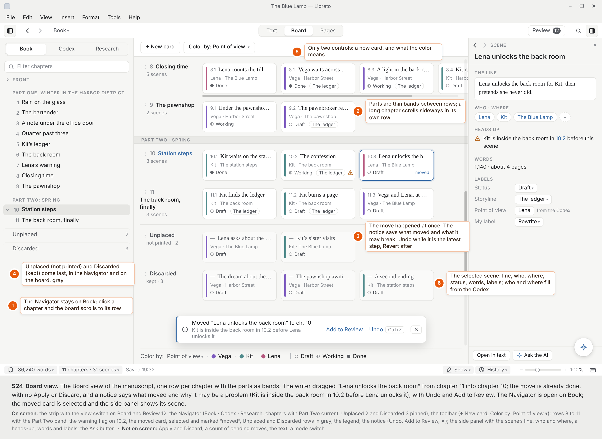

## S25 · A Codex entry

The Codex is the book's memory of its people, places, things and motifs, and an entry opens in the center of the window like any document. You reach it by switching the Navigator to Codex (Ctrl+Shift+2), or from a name in the text: Ctrl+click opens its quick look, and Open in Codex at the foot of the side panel brings the entry to the center. Because the center no longer holds the manuscript, the Text · Board · Pages switch disappears and the breadcrumb reads Codex › People › Lena. Back (Alt+←) returns to exactly where you came from; its tooltip says so: “Back to ch. 7 · Lena's warning”.

The top of the entry is yours: picture, name, kind, aliases, a one-line description and notes. Renaming here renames everywhere. Below the description is the line For the AI, the only text about her that is ever sent to an AI, with its size in words and tokens and when it goes along (when she is mentioned). A note can be marked Never send to the AI; a private note stays on this computer whatever the AI level is. Everything under the headings marked “from the text” is computed by the index as you type, without an AI, and cannot be edited: the scenes she appears in, the facts quoted from the text (each can be pinned or marked Not a fact), open questions, and the Threads she is part of (setups and payoffs, with the ones never paid off flagged). When two facts disagree, as with her age, the question names both places and each side offers “Fix in the text →”; the entry never edits the book itself.

The status bar tells the truth about the AI's reading of this entry: how far it has read, how much has changed since, and what reading again would cost. The catch-up is offered here, not run silently.

**Changed from draft 7:** the Codex is no longer a mode but the Navigator's second section, with the Brief and Threads above People; the AI controls are on the entry itself (For the AI, Never send, the cost line) (F-S18b); Back says where it goes; the “When the AI reads” card is gone.

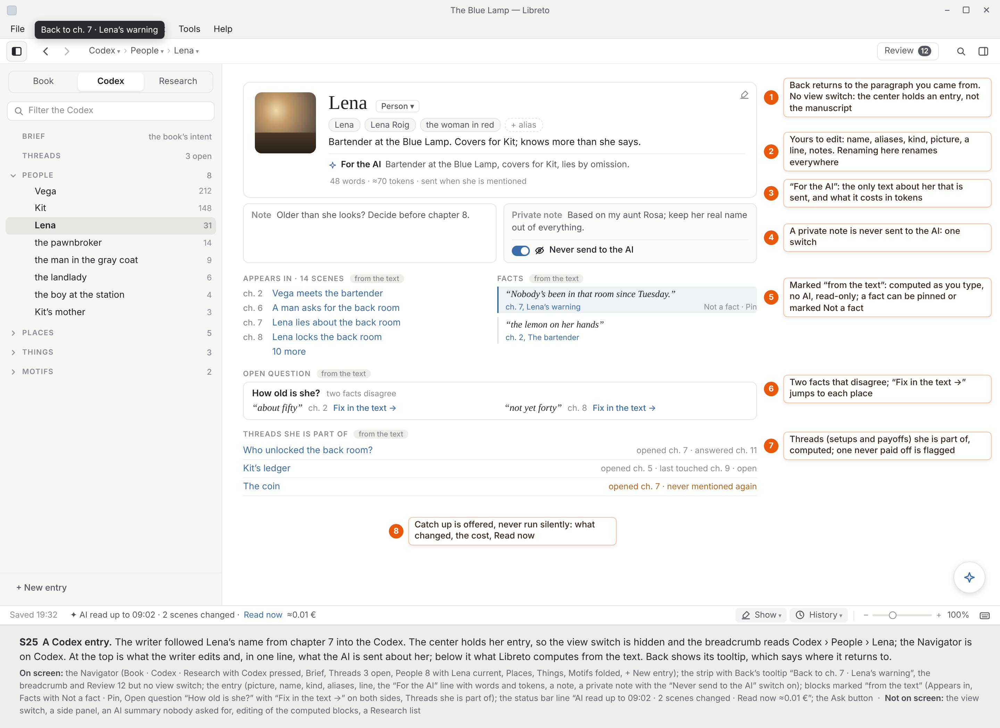

## S26 · The Brief

The Brief is the first row of the Codex. It is one document about the book itself, written in the writer's own words: the premise, the audience, the voice (what to do, what not to do, and two short samples), the length (80,000 words, 24 chapters, and where the book stands: 54,300 so far), the world rules, the open threads (setups still waiting for a payoff, found by Libreto and added by you), and what the AI may do in this book. It is stored with the book as brief.md.

Its second job is the AI. The Brief is sent with every AI request, so the AI starts from what this book is and not from a blank page; the footer says how big it is ("≈ 900 tokens · sent with every AI request"), because it is sent every time. The permission is the writer's: Nothing, Suggest edits (the default), or Draft scenes when asked. Nothing the AI does is applied on its own.

"Fill in by interview" asks a few questions and proposes fields. A proposed field appears in blue and dashed (here a new world rule, "Rain falls in every chapter until chapter 12") with Accept and Reject; it is not part of the Brief, and not sent, until it is accepted.

**Changed from draft 7:** new screen. The book's intent, targets and the AI permission had no home and were scattered across settings (F-AI-45, F-AI-46).

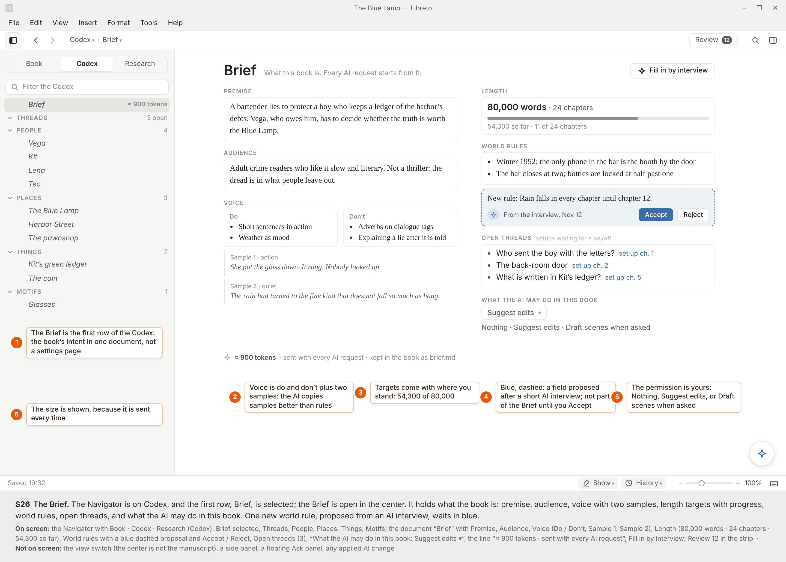

## S27 · A research topic

Research is the writer's own material: things you gathered about the world of the book. You reach it by switching the Navigator to Research (Ctrl+Shift+3). It lists the Inbox, where anything new lands first (drop a file, a picture or a link on the window, use Edit ▸ Paste into the Inbox, or right-click ▸ Send to the Inbox), then your topics, in one level of folders, and your files. A topic opens in the center as a document like a chapter, with a title, styles, pictures inline and files attached, so the view switch is hidden and the breadcrumb shows Research › Bars of the 1950s › Licensing hours. There is no browser inside Libreto in this version; a web page comes in as a link or as a pasted passage.

A topic is connected to the book in two ways. Codex names typed in it (Lena, the Blue Lamp) are linked at once, and “Link to a person or place…” adds the rest by hand. And any passage can become a fact: select it, right-click, Add to the Codex as a fact of ▸ Lena, and the fact lands on her entry with this topic as its source and a link back. Send to the Inbox is gray here because this already is Research.

The side panel lists what the topic links to: the entries, the chapters that mention them, the facts already sent to the Codex, and the files. Nothing in Research is printed or counted in the book's words, and nothing is sent to an AI unless you ask about it.

**Changed from draft 7:** Research is the Navigator's third section instead of a mode, and its topic opens in the center under a breadcrumb; the right-click menu is the same, with the fact going to the Codex from any topic.

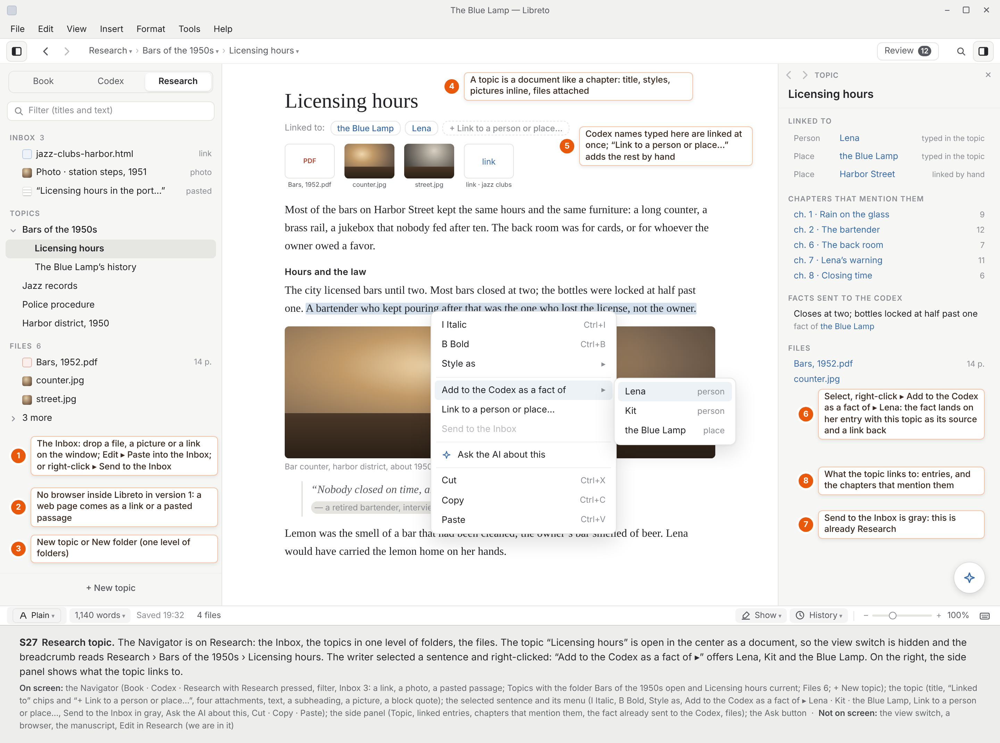

## S28 · Find, Replace and Rename

The magnifier in the strip (or Ctrl+F) opens a small box under it, over the margin and never over the text. You type, the hits are tinted in the page, the current one stronger, and the box says “3 of 27”; Enter and the arrows walk the hits across chapters and Back returns you to where your cursor was. The box searches the whole book, so there is no “this chapter” to choose: the view setting in Show decides what you see, not what is searched. Replace and Options open under the field. Options are Match case, Whole word, Regular expression and Only in a style (every Thought, every Letter).

Replace changes the current hit. Replace all… never replaces blindly: it opens a dialog with every hit in its sentence, grouped by chapter, folded with counts and a checkbox on each, so you can uncheck the ones you meant to keep. Replacing is one step in History, and while it is the latest step Ctrl+Z takes it back whole.

A name is not an ordinary word. When the Find field reads a name in the Codex, the box says so in one line and offers Rename everywhere. That dialog changes the entry and its aliases, the text, the Research topics and, if you check it, notes, in one step. Its hit list is the same kind of list; the hits that are probably a different word are left unchecked with the reason written beside them. Renaming Kit to Kip leaves “the first-aid kit” alone, because kit is also an ordinary word.

**Changed from draft 7:** “Style” in Options reads “Only in style”, the box never changes a name silently (Rename everywhere is its own dialog with unchecked common words, F-B-97), and the box no longer shows a Codex hint under every name search, only a link.

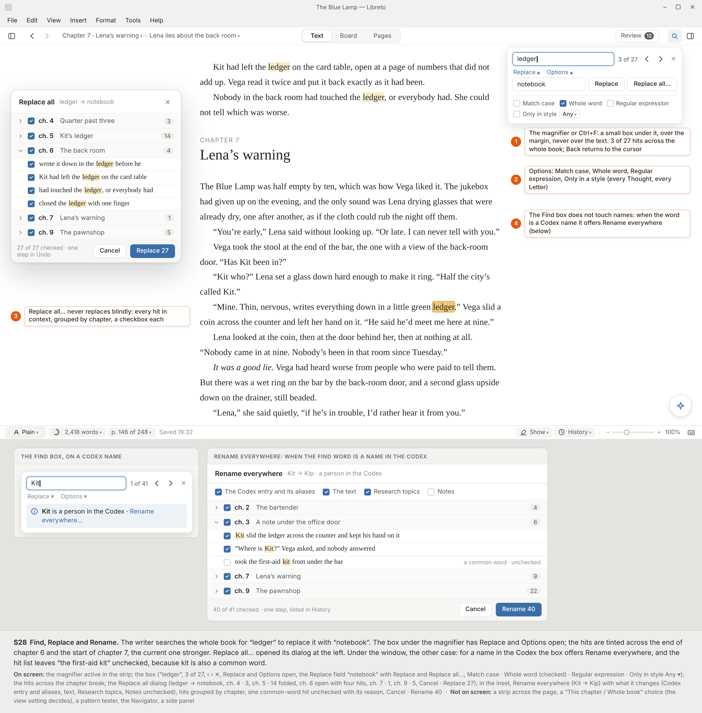

## S29 · Versions and history

History is File ▸ Versions & history, and also the History button in the status bar, where the popover shows today's messages first and a link to all of it. It opens as a sheet over the window with Esc to go back. Libreto keeps a version of the book often, without being asked: roughly at the end of each session, before any large action (a Rename everywhere, a review round, an agent's session) and at intervals while you write. Automatic versions are thinned over time, one an hour for the current week and one a day before that, and a version you save by name with Save a version… is never thinned.

The list is grouped by day, and under each day by activity block, a stretch of work with the hours, what kind (✎ wrote, ⇅ planned, ✓ reviewed), the words added and removed, and a one-line summary. Show changes on a block opens that stretch as a redline in the page (the next screen). The named and notable versions sit under their day.

The field at the top searches the past, not the present. Typing a phrase finds it in the earlier versions, narrowed by Scope (the book, a part, a chapter) and Since. When what you find is no longer in the book, the result says so, shows the text with the version and date it comes from, and offers Put back… with three places: where it was, to Discarded as a new scene, or at the cursor. Nothing is overwritten; putting back is a new step, and Open that version reads the whole old version without leaving today's text.

**Changed from draft 7:** a search across past versions with Scope and Since, Put back… with where it goes, “Save a version…” and “versions” instead of snapshots, thinning stated in words, Show changes per block (F-D-48, F-D-49, F-D-51, F-D-53); the dated sessions-and-snapshots list becomes days and activity blocks.

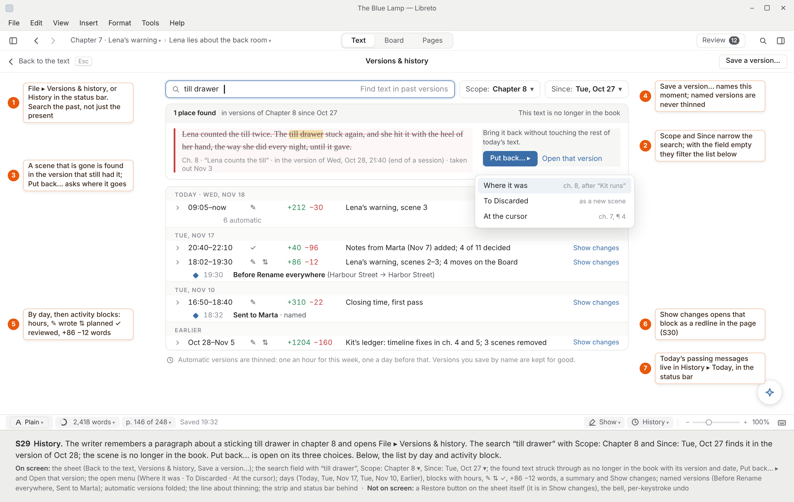

## S30 · Changes since

Show changes, on an activity block in History or from View ▸ Show changes since…, draws what changed in the chapter you are reading, right in the page. It is a way of reading the page, not a place: the chapter keeps its position and its typography, the Text · Board · Pages switch is dimmed, and a bar at the top says what you are looking at: “Changes in Chapter 7 since Tue, Nov 10”. You choose the way to read it: Inline (shown here), Side by side (the old text beside the new) or Only changed (unchanged paragraphs fold away). The arrows step from change to change and Done leaves, with nothing changed.

Inline, words taken out are struck through and words put in are underlined and tinted; the shape carries the meaning and the color only supports it. A bar at the left of a paragraph marks that it changed. A paragraph that arrived whole says where from (“moved from ch. 6”), and one changed beyond a few words is labeled “rewritten”, so you are not asked to compare every word. The text is read-only while you look.

Hover a paragraph and Restore appears: it puts that paragraph back as it was at the start of the range, as one new step you can take back again, and it leaves the rest of today's text alone. That is how a single sentence you liked better on Tuesday comes back without bringing the week with it.

**Changed from draft 7:** this screen is new; draft 7 could only compare a whole version in two columns inside History. Now the redline lives in the page with per-paragraph Restore and moved/rewritten labels (F-D-54, F-D-55).

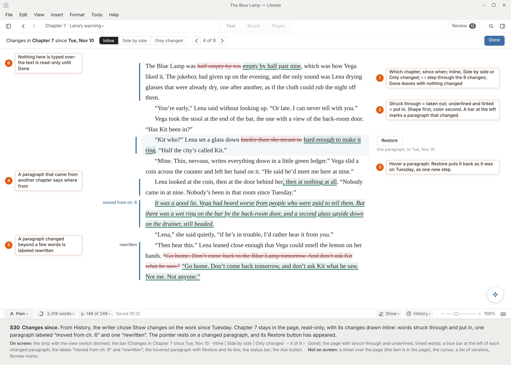

## S31 · Pages

Pages is the third view of the manuscript, next to Text and Board, and it is where the book looks like a book. You reach it with the view switch in the strip or `Ctrl+3`. The Navigator on the left turns into the book outline: a Front group (Half-title, Title, Copyright, Dedication, Epigraph, Contents), the parts and chapters with the pages each one occupies, and a Back group (Acknowledgments, About the author). The chapter you were writing stays selected, and its spread appears in the middle.

Pages written by you, such as the dedication or the acknowledgments, are rows you open and type in. Pages Libreto generates, such as the half-title, the copyright page and the contents, are rows with a tick: switch them on or off and the page count follows. The center shows the spread as it will print, with a running head and folio on the left page and the chapter opener on the right: a sink of one third of the page, “CHAPTER SEVEN”, the title, a drop cap and a first line in small caps. “Preview as” switches the same book between Print, Ebook and Manuscript, so a writer sees what each export will carry.

The right panel is Book layout: a Theme (Classic here), the trim (6 × 9 in), and groups of settings (Type, Chapter openers, Headers & page numbers, Breaks, Pictures & notes, Fine typography), folded until opened. “Layout issues 3” in its header lists what looks wrong on a page, such as a lonely line at the top of a page. There is one way out, Export…; printing on paper is File ▸ Print… and has its own small dialog. The writing font and page color you chose for Text never change the book; only the theme does.

**Changed from draft 7:** Book mode becomes a view of the same window; thumbnails are replaced by an outline with page ranges and front/back matter; a Theme replaces the table of print styles; one Export… replaces three format buttons (F-E-36, F-E-51, F-E-61).

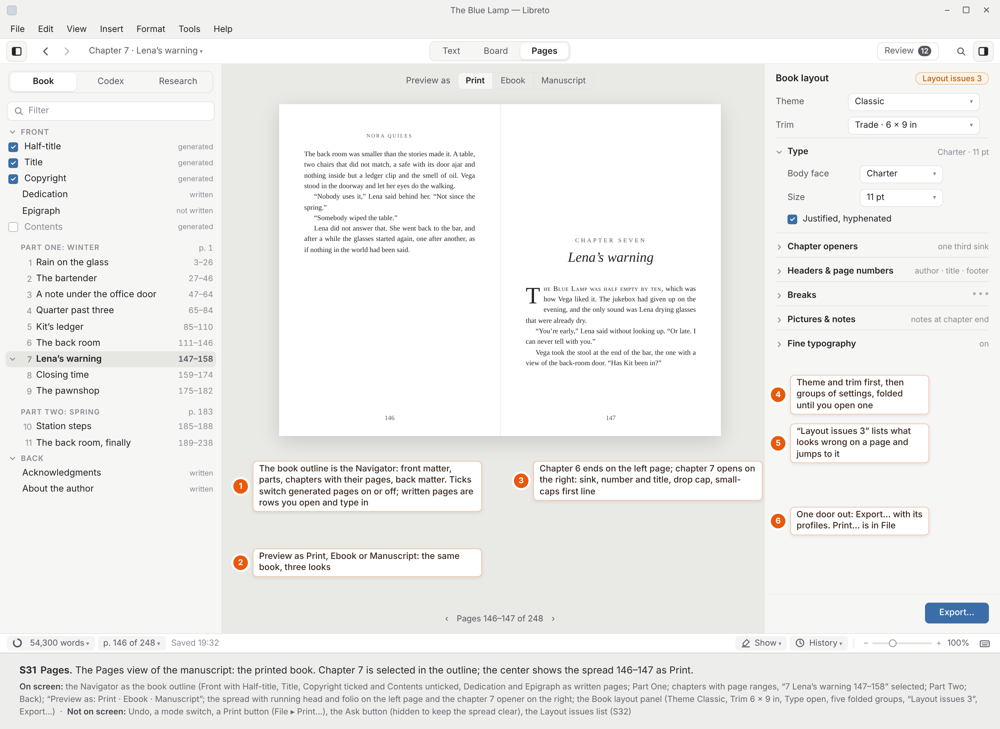

## S32 · Pages, an element clicked

In Pages you edit what you see. Click the chapter heading on the spread and it gets an outline; the right panel stops showing Book layout and shows Chapter opener instead, with an arrow back. The settings are the ones a reader would name: the label (Chapter), the number (in words, as digits, in Roman numerals), whether the title sits on its own line, the sink (how far down the page the heading starts), a drop cap, the first line in small caps, an ornament, and “Chapters start on a right-hand page”. Every change shows on the spread at once.

These settings belong to the theme, so they apply to all chapter openers, not just this one; “Reset to Classic” puts them back. A paragraph clicked the same way shows its style card instead, and a header or a picture shows its own. Chapters can be unnumbered (Prologue, Interlude, Epilogue): that is a right-click on the row in the outline, not a setting here.

Below the window, the panel it came from: “Layout issues 3” opens a list in which each row names a page and the problem (a single line at the top of page 173, chapter 10 ending with one line on page 188, a picture at 140 dpi where print needs 300) and jumps to it. The Headers & page numbers group shows the long-title case: chapter 3’s long title (“A note under the office door, left by someone who knew where the spare key was kept”) does not fit the running head, and “Set a short title…” lets the writer give the header a shorter one without renaming the chapter. Issues are information, never a block: Export mentions them and goes ahead.

**Changed from draft 7:** clicking the preview edits the element in the side panel, replacing a dialog of print styles; layout problems get a plain list that jumps to the page (F-E-46, F-E-49).

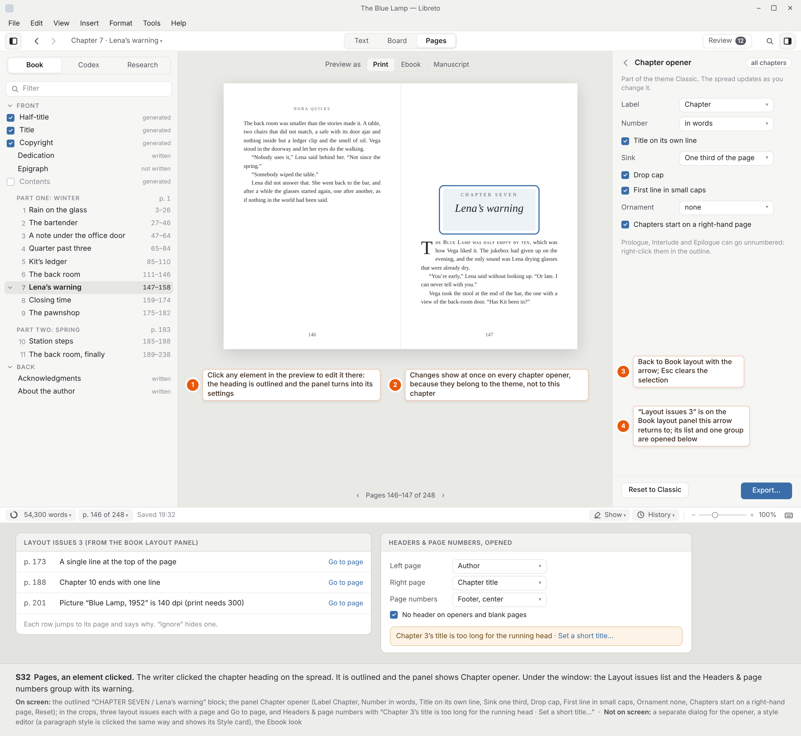

## S33 · Book details

File ▸ Book details… is the one place for facts about the book rather than its pages. The Details tab holds the title and subtitle, the author (shown as your name or as a pen name: the pen name prints on the cover and title page while the file keeps your own), the publisher, the year, the rights line, the ISBN for print and the one for the ebook, and a cover image. These feed the title page, the copyright page and the metadata of the ebook and Word files; nothing here changes how the book is laid out.

The second tab, Language & typography, decides how the book is written and set. The book language (here Español (España)) drives spell checking, hyphenation and the words Libreto writes itself: “Capítulo” on a chapter heading, “Índice” for the contents, “Parte” for a part. Each can be overridden with the writer’s own wording. Quotation marks are chosen once for the whole book: « » with “ ” inside, say, and the text and the print change together. Dialogue with raya turns a line such as “—Hola —dijo Lena—.” into the Spanish convention; the sample on the tab shows what will print. Hyphenation can be switched off for print.

The interface language stays the one the writer chose in Settings; only the book follows its own language. A book with no language set asks once when it is created.

**Changed from draft 7:** book information and typography rules get a home in File, apart from Settings and apart from the layout; ISBN, pen name and generated words are new (F-E-41, F-E-72).

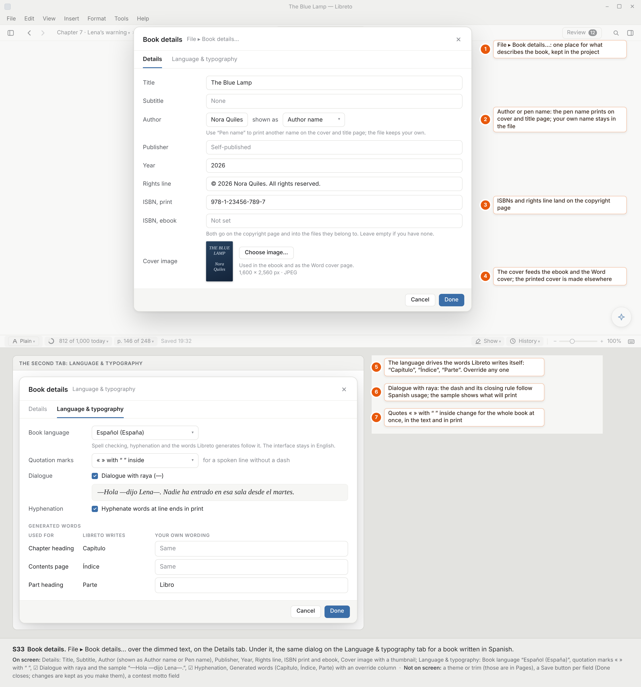

## S34 · Export and Print

Export… (File ▸ Export…, or the button at the foot of the Book layout panel) is one dialog for every file Libreto can make. The left column lists profiles as rows, each with a line saying what it is for: Print PDF (for KDP and IngramSpark), Reading PDF, EPUB, Word manuscript and Word for a reader. The right side shows only the options that matter for the selected profile: whether to include your notes, whether to include Not printed scenes, a cover page, bleed and crop marks for printers who ask for them, a file name and a folder. Open layout issues are mentioned as a line with “Show them”, but never stop the export.

Every export is kept as a version (“Exported Print PDF”), so it is always possible to see which text a file was made from. Word for a reader carries a hidden id on each paragraph; that is what lets the reader’s changes come back as a review round.

Print… is its own, smaller dialog, because printing is not exporting. It asks what: a Working copy (A4, double spaced, with your notes in the margin, for a proofreader or a red pen) or Book pages (the 6 × 9 pages centered on A4, with optional crop marks). It asks for the range: the whole book, a chapter, or pages. The system’s own print dialog opens after it.

**Changed from draft 7:** three format buttons and a notes checkbox become one dialog with profiles; printing a working copy is separated from exporting (F-E-60, F-E-61).

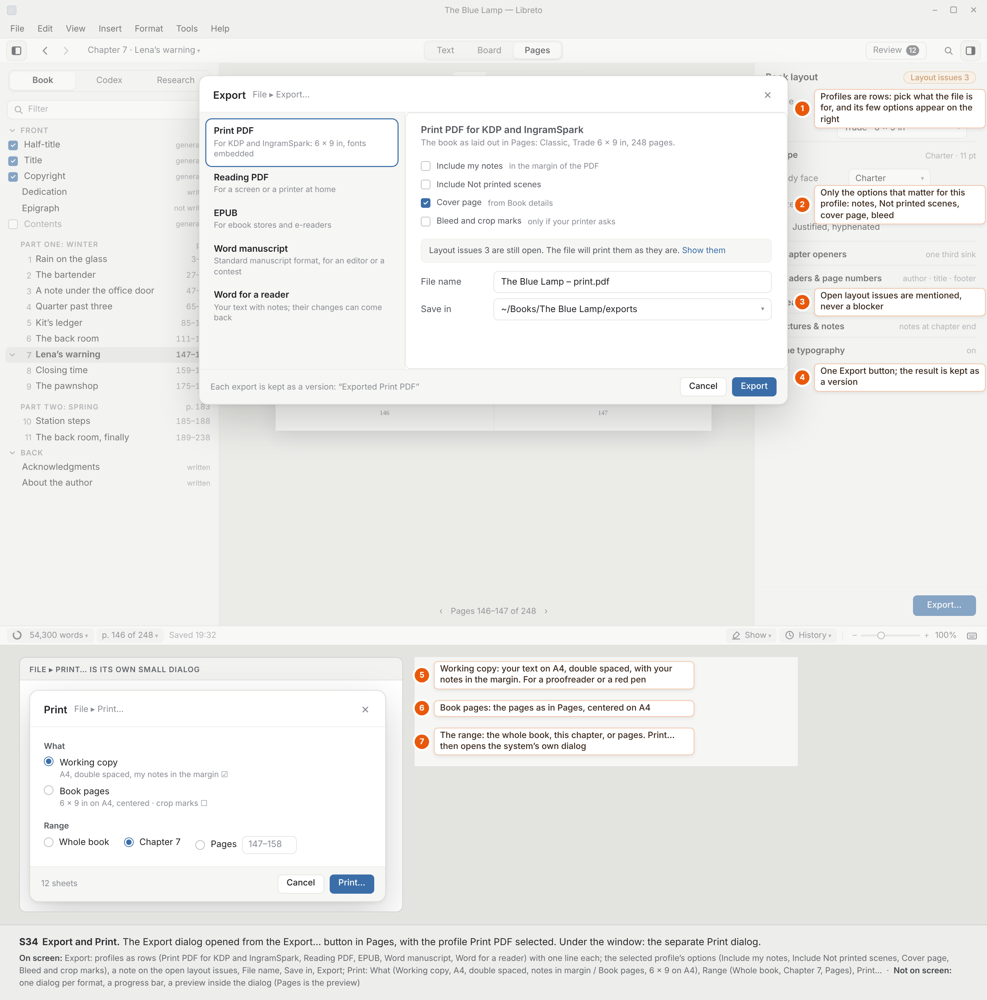

## S35 · Bring in a Word manuscript

A writer arriving with a manuscript in Word chooses Bring in a Word manuscript… on the start screen, or File ▸ Import. Libreto reads the file and shows a preview before it changes anything: on the left the structure it found (two parts from Heading 1, eleven chapters from lines such as “Chapter 1”, scene breaks from lines of “* * *”, with each chapter’s length), on the right the rules behind that structure. Each rule is a menu; change one and the left side updates, so a manuscript with unusual headings can be taught in a few seconds.

Styles the writer made in Word are matched to Libreto styles: ‘Letter body’ becomes a new style Letter, ‘Inner voice’ becomes Thought, and direct italics become Italic. The same preview counts what comes with the text: 23 comments by M. become notes, 34 tracked changes become suggestions waiting in Review (nothing is applied), and 41 names are found that could go in the Codex, if the writer wants them. The Word file is never changed.

After Import the book opens, and a card at the top of the Navigator says what Libreto read: 41 names with “Add all to the Codex”, 6 words the writer spells their own way (kept as they are, added to the dictionary), 212 possible typos and the 23 notes, each with a Review button. The card stays until it is closed and is not a wizard: each number simply leads to the place where that work is done.

**Changed from draft 7:** import becomes a preview with editable rules and a single result card, instead of a silent conversion (F-E-64, F-E-65, F-E-66).

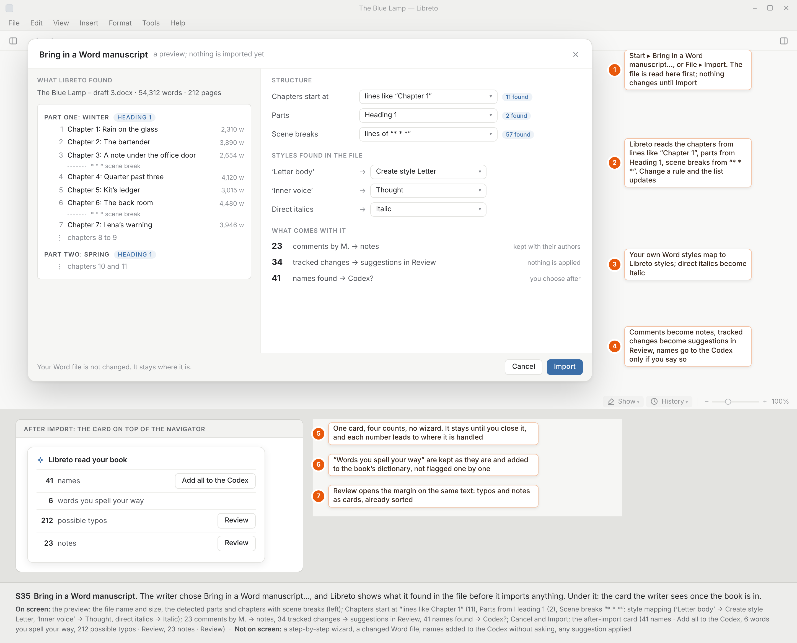

## S36 · Statistics, goals and shape

Statistics opens from the word count in the status bar or View ▸ Statistics, as a sheet over the text; Esc returns. Its tabs are Goals, Words, Sessions, Who appears where and Shape. Goals comes first because it answers the writer’s question: am I on track? The book’s target (54,300 of 80,000 words), its deadline (June 30) and the writer’s pace, “1,000 words a writing day · 5 days a week”, sit together, and the page works out where that pace leads: done around December 23, well before the deadline. Change the deadline, the target or the writing days and that line follows. The status bar’s ring (“812 of 1,000 today”) is the same number for today.

The calendar shows the last five weeks, up to today, Wednesday November 18. Written days are filled and carry their word count; rest days, the days the writer said they do not write, are hatched; today is outlined; a missed day is simply empty, with no red and no count of losses, even after ten days away (November 9 to 17). “This week 1 of 5 days” is the only summary. There are no trophies, streaks or badges: the page is a quiet record, not a game.

The Shape tab looks at the book rather than at the days. One column per chapter shows how much of it is dialogue, how long the sentences are on average, and how long its scenes are, plus a line of where a chosen character appears. Outliers are marked but not judged: chapter 9 is 78 % dialogue, Kit is absent from chapters 10 and 11, all of Part Two. Whether that is a problem is for the writer to decide.

**Changed from draft 7:** a Goals tab with a deadline-driven quota and a day calendar, and a Shape tab, join Words, Sessions and Who appears where; the ring in the status bar replaces a separate goals screen (F-C-52, F-C-54).

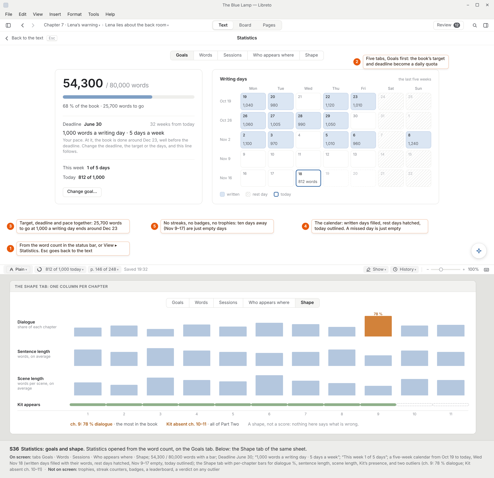

## S37 · Settings, AI

Tools ▸ Settings… (Ctrl+,) opens the one Settings window; the AI section holds everything about the assistant, and nothing else in Libreto needs it. At the top are two ways to connect. The first, and the default, is the writer's own Claude subscription, reached through Claude Desktop and Libreto's connector: no key to paste, and the card says which book it is connected to ("Connected to The Blue Lamp") and that proposals arrive in Review. The second is an API key, pay per use, marked advanced; it shows the key masked and two model rows, a stronger model for writing and chat and a cheaper one for background reads, each with a price hint. Only one card is in use at a time.

Below the cards, three levels: Off (nothing is ever sent), When I ask (only through Ask, Ctrl+K), and Also on its own. The last opens three checkboxes (catch up at the start of a session, after I move scenes, while I write at breaks) and an honest estimate: with the subscription the requests are part of the writer's plan; with a key, "≈ 2 € / month at your pace". The catch-up is offered on the Last session card, never run silently. For the key, a budget gives a monthly limit, shows what is spent, stops at the limit and says so, and asks first before any single request above a set price.

The disclosure is a live line, not a warning box: "This book: 1,204 AI words, 2.2 % · Report", counted as the writer works, with the report one click away (S40). Last, "Agents may draft new scenes: Ask each session" governs Claude Code and other agents (S38). Under the window are three states that exist: the budget reached, Claude Desktop not running (Ask turns gray, nothing else changes), and an answer cut off at the length limit with a Continue button.

**Changed from draft 7:** one provider chosen from two cards (subscription first, key advanced) instead of a provider list; levels are Off / When I ask / Also on its own with checkboxes and a cost estimate; the disclosure is a live percentage instead of a warning box.

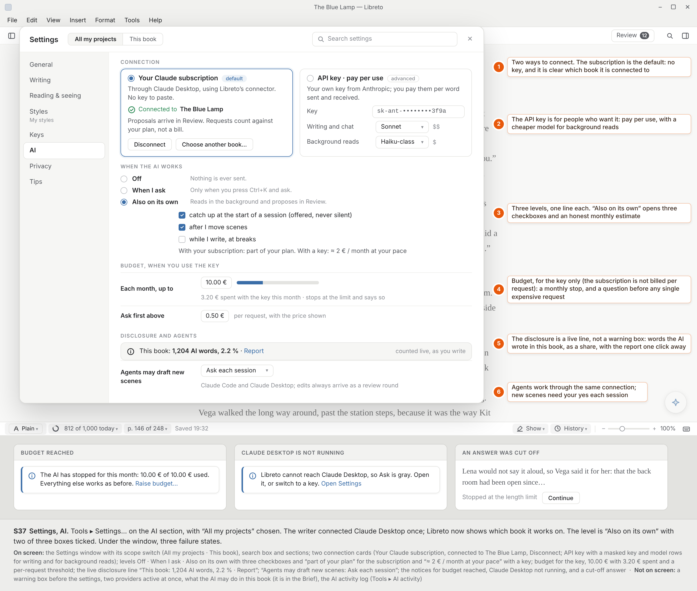

## S38 · An agent at work

An external agent such as Claude Code works on the book through Libreto's API while the writer keeps writing. The first time it asks, a dialog opens ("Claude Code wants to work on The Blue Lamp"): a checklist of what it may do (read the book, the Codex and the Brief; propose edits; draft new scenes; changing the text directly is shown but never offered), a scope (here chapters 12–14), quotas (50 waiting proposals, 20,000 words) and the line "A version is saved first (always)". The writer chooses Allow for this session, Always allow these, or Deny.

While the agent works, a chip appears in the strip beside Review: "✦ Claude Code · drafting ch. 12 · 7 proposals · ■". The square stops it at once. Clicking the chip opens a popover with the goal ("Draft chapters 12–14 from the outline"), the scope, the grants, the quota ("7 of 50 proposals waiting · 5,880 of 20,000 words"), the last calls the agent made, and Pause and Stop. The chip vanishes when the session ends.

Nothing the agent writes lands in the manuscript text. Edits to existing text arrive as one review round in the Review margin (the Review count goes from 12 to 19), with the usual Accept, Reject and Edit per change. New scenes arrive as blue italic draft scenes in the Navigator, tagged "draft", under the chapter they belong to; chapters inside the agent's scope carry a quiet "agent" label. A draft is opened and accepted whole (S39). Because a version was saved first and the session is recorded, the whole session can be reverted from Tools ▸ AI activity (S40). The writer can keep writing anywhere, including in chapters the agent is working on, since the agent's proposals record the text they were based on and go out of date if it changes.

**Changed from draft 7:** new. Agents had no screen; this adds the chip, the per-session permission dialog, quotas and the draft-scene lifecycle (F-AI-04).

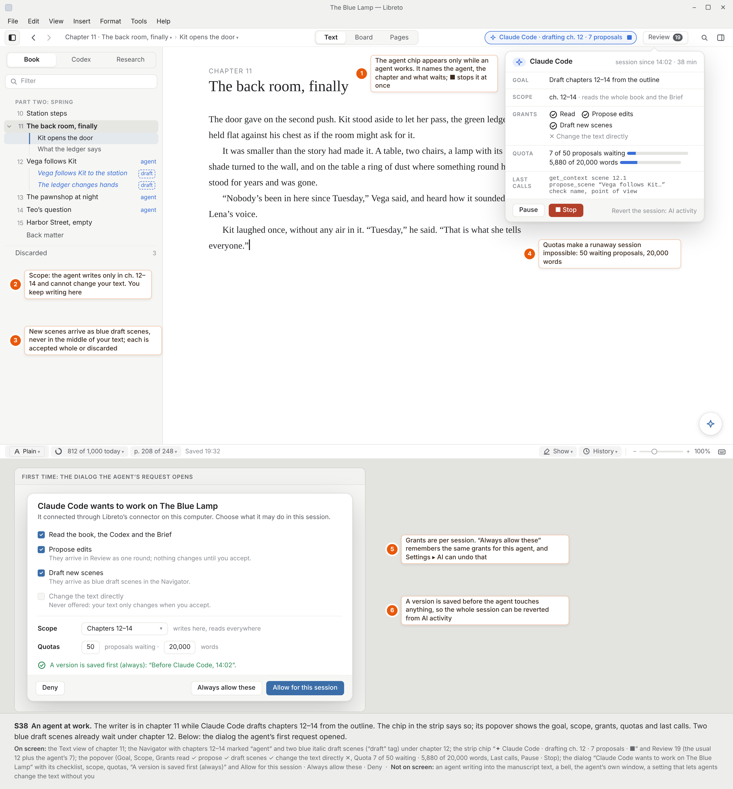

## S39 · A draft from an agent

A scene written by an agent opens in the page like any scene, so the writer reads it in the same typography as the book. It is marked in three ways: a blue rule runs down the left edge of the text, the Navigator row is blue italic with a "draft" tag, and a header at the top of the page says whose it is: "Draft by Claude Code · from card 'Vega follows Kit to the station' · 2,940 words". The text cannot be edited until it is accepted, and its words do not count in the book's page count, word total or goal.

The header also reports the checks the agent ran before handing it over: here, one name not in the Codex ("Mr. Abel", with a link to add it) and point of view fine. Three buttons decide: Accept into the book makes it an ordinary scene at its place in the chapter (one step, and Revert can undo it afterwards), Ask for changes… takes a short instruction that goes back to the agent while the draft stays as it is, and Discard moves it to Discarded, where it stays like any discarded scene.

The writer can leave notes on a draft exactly as in the book: an amber tint behind the words, a bubble in the gutter, and a card ("Kit wouldn't say this") with Reply and Resolve. The agent reads the notes when asked for changes. Accepting a draft whole is the only way it enters the book; there is no half-applied draft.

**Changed from draft 7:** new. Draft scenes from agents are shown read-only with provenance, checks and three explicit outcomes, instead of arriving as ordinary text.

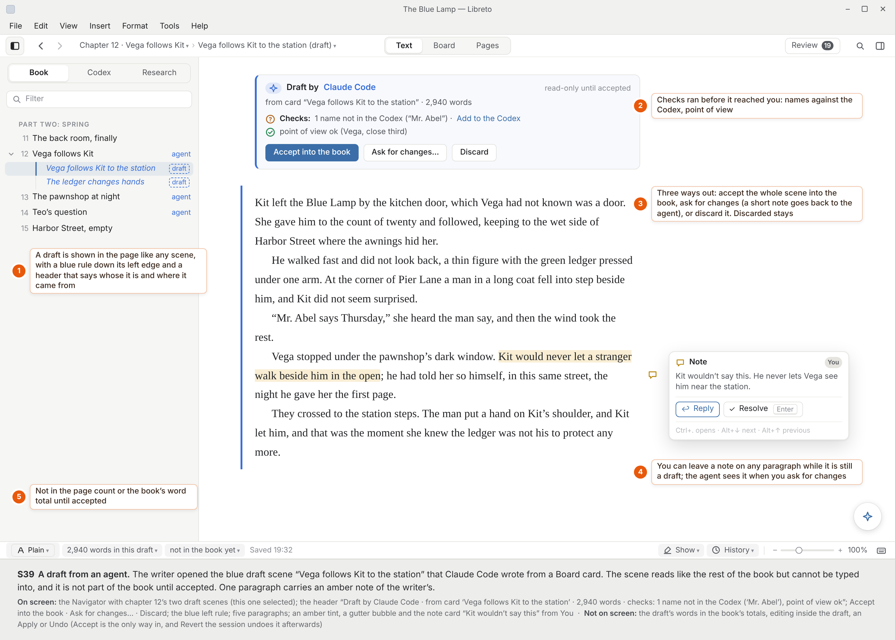

## S40 · AI activity

Tools ▸ AI activity opens a sheet over the text (Esc or Back to the text returns). It answers three questions on three tabs. Requests: what did the AI do and what did it cost? Each row has the time, what was asked, how it was sent (API key or subscription), tokens in and out, the cost, and what came back. Rows made through the subscription show "plan" instead of a price, since they count against the writer's plan, not a bill. A summary at the top shows the month's requests, tokens and spend against the budget set in Settings ▸ AI.

In the book: how much of the text is still the AI's. The total ("1,204 words of 54,300 · 2.2 %") matches the live line in Settings ▸ AI, and per-chapter bars split suggestions the writer accepted from draft scenes accepted whole. Words the writer has since rewritten count as the writer's own, so the figure drops as the book is revised. Export report… writes the numbers and the per-chapter breakdown to a file, for a publisher, a contest form or a platform that asks.

Sessions: each agent session with its goal and what it changed. A running or finished session offers "Revert this whole session". Revert is a new step that inverts only what the session did, and says what it could not undo, such as text the writer changed afterwards; a reverted session reads "Nothing left to revert".

**Changed from draft 7:** new sheet; draft 7 had only a warning box and a log link. Disclosure is now measured per chapter and exportable, and agent sessions can be reverted whole.

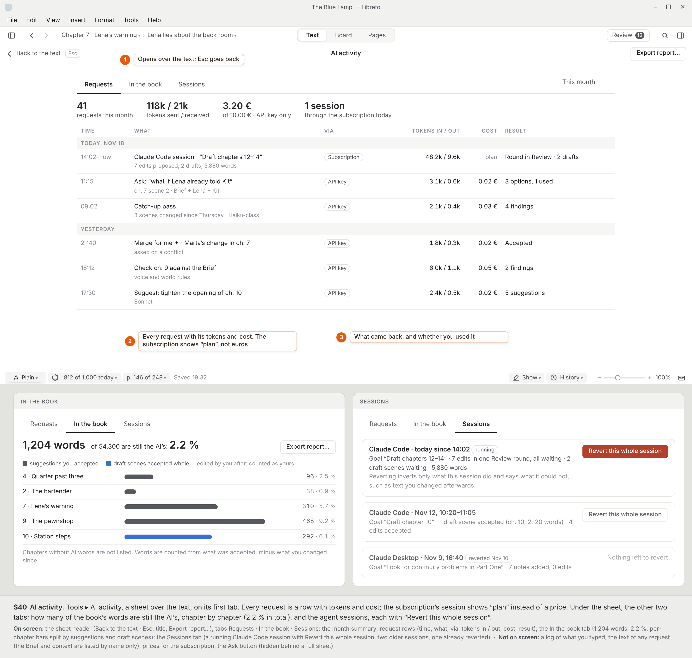

## S41 · Settings

Tools ▸ Settings… (Ctrl+, ; also Edit ▸ Settings on Linux) opens one window with two scopes, chosen at its head: All my projects (yours, on this computer) and This book (stored in the book and travelling with it). The sections are General, Writing (font, size, spacing, page width), Reading & seeing (theme, interface size, S42), Styles, Keys, AI (S37), Privacy and Tips. In This book, sections that only make sense as personal settings are grayed with "yours only"; what stays active is the book's goal and writing days, its spelling words, the book's own styles, the AI rules for the book and what the book stores.

The search box looks in both scopes and every section at once. Typing "chapter heading" finds five settings: in All my projects the My styles entry, the screen preference for larger headings and the key for Insert chapter heading; in This book the book's own Chapter heading style and the chapter-opener format in Pages ▸ Book layout. Each result says where it lives, highlights the match, and opens straight there. The scope switch shows how many matches each scope holds.

The same name can exist in both scopes on purpose. My styles seeds every new book; once the book exists its styles belong to the book and take their look from its theme, so changing a personal font, size, spacing or page color never changes how the printed book looks. Book details (title, author, ISBN, language) are in File ▸ Book details, not here.

**Changed from draft 7:** one window with two scopes and a cross-scope search instead of Settings and Project settings as two windows that link to each other.

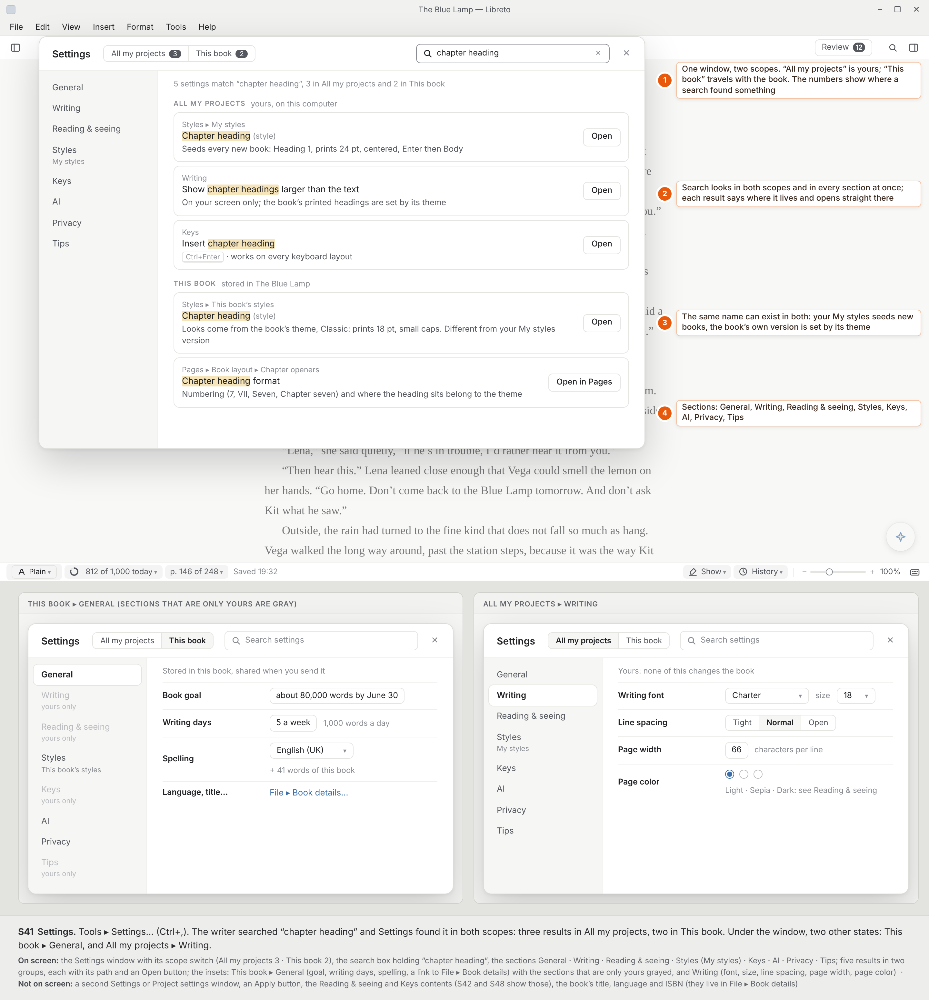

## S42 · Reading & seeing

Settings ▸ Reading & seeing gathers everything that changes how Libreto looks and reads, for the person at the keyboard and not for the book. The theme is one row: Light, Sepia, Dark, High contrast or Follow system. The page font can be Charter or a face made for easier reading (Atkinson Hyperlegible, OpenDyslexic, Lexend). Interface size runs from 100 % to 200 %, or follows the system; it scales the menus, strip, Navigator and side panel, and the status bar together, so nothing overlaps, while the page keeps its own size and its measure of about 66 characters. Messages stay until the writer closes them, and Reduce motion and click-only cards are one tick each.

Under the choices is a live sample paragraph showing the four marks, so the writer sees what each theme and font does to them at once. The marks are told apart by shape first and color second: a wavy line for spelling, a dashed one for a waiting suggestion, a thin solid one for a fix, a tint behind the words for a note. That is why they stay distinguishable in any theme and for color-blind readers.

Below the dialog, the same Text view in Dark and in Sepia (the page and chrome recolored, every mark re-tuned for its page), and at interface size 175 %. A small table gives the contrast measured on these colors: body text is above 13 : 1 in every theme, and each mark is at least 3 : 1 against its page, the usual minimum for a shape that carries meaning.

**Changed from draft 7:** new. Draft 7 had interface size only and no themes; this adds themes, reading fonts, scalable geometry and measured contrast.

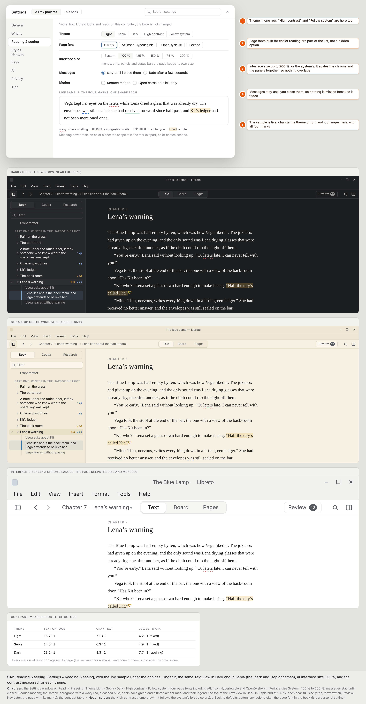

## S43 · Help, tips and tutorials

Help is a floating window opened with F1 or the Help menu. It opens on the topic of whatever has focus: with the Show button focused, it opens "Show: what the text wears", with a small line drawing of the control it explains. The contents on the left, with Tutorials and Tips at the bottom, and a search box find everything else. There are no "?" buttons anywhere; F1 is the one way in. Typing a question in Ask answers from the same pages, with a link.

A tip is a small card that appears once, in a quiet moment and never while the writer is typing: a sentence about something Libreto can do, with two buttons. "Show me" plays the tip on the writer's own text (here it rings a name and opens its card), once; "Not this one again" keeps that tip away for good, and ✕ only closes it. Help ▸ Tips lists every tip, including those turned off, so none is lost.

A tutorial runs in the writer's own project and points at the real control: here, a ring on the Review button and a bubble reading "Step 2 of 4 · Leave". It moves on when the writer presses the control, and Leave ends it at any step. Tutorials are never required and never reopen on their own. The picture shows all three at once, which would not happen in practice: a tip and a tutorial step do not appear together, and Help does not open on its own.

**Changed from draft 7:** Help opens on the focused control with its drawing, tips have "Show me" and "Not this one again", and tutorials name their step and a Leave button; the tutorial moved from the chapter list to Review.

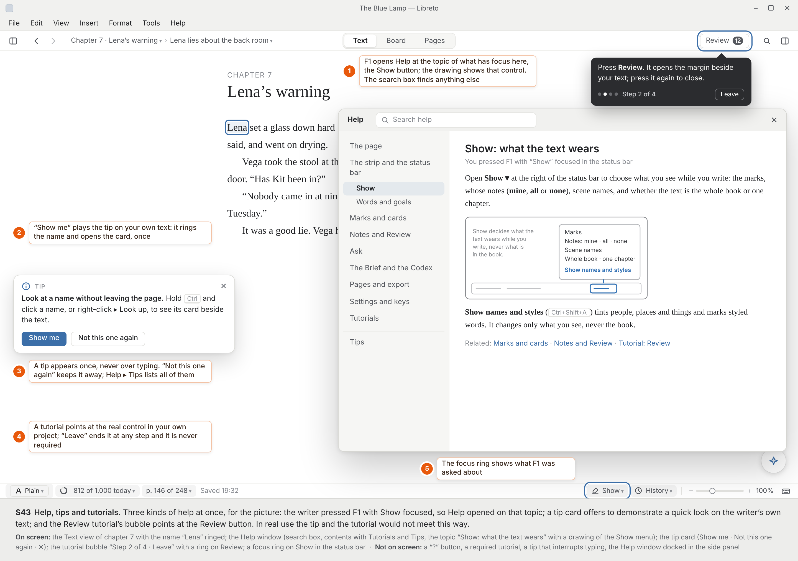

## S44 · A long book and long names

A book of two hundred chapters is still one list. Parts are collapsed to one line each with their chapter range; the open part shows its chapters. A chapter title is cut at two lines with the full title on hover, and its number stays on the first line. Part names keep their own letters and are never forced into capitals. A chapter without a title reads "Untitled", a scene without one "Untitled scene" (an empty one "Empty scene"), and an unnumbered chapter such as a Prologue shows no number. The filter at the head of the Navigator finds a title in the whole list, and in a book this size the Text view shows only the chapters near you, so the scroll bar stays honest.

The breadcrumb in the strip gives up names in a fixed order as it narrows: the part first, then the chapter shortens, and the scene, where you are, stays longest. Its menus become a filter box once a level holds more than twenty entries.

Long words behave. A sixty-character web address wraps at the column edge, in the text and inside a card's Was and Now, so nothing runs under a panel. A seventy-character person's name in the side panel head clamps at two lines with the full name on hover and the aliases below. When two entries share a name (Kit the boy, and Kit, the bag), the quick look opens a short list saying what each is, and Enter opens the first.

**Changed from draft 7:** new screen. It answers the "break it" critique on long titles, part names, untitled scenes, the 200-chapter breadcrumb, long names in the panel head, and duplicate names (F-B-22, F-B-24, F-B-68, F-B-69, F-B-70).

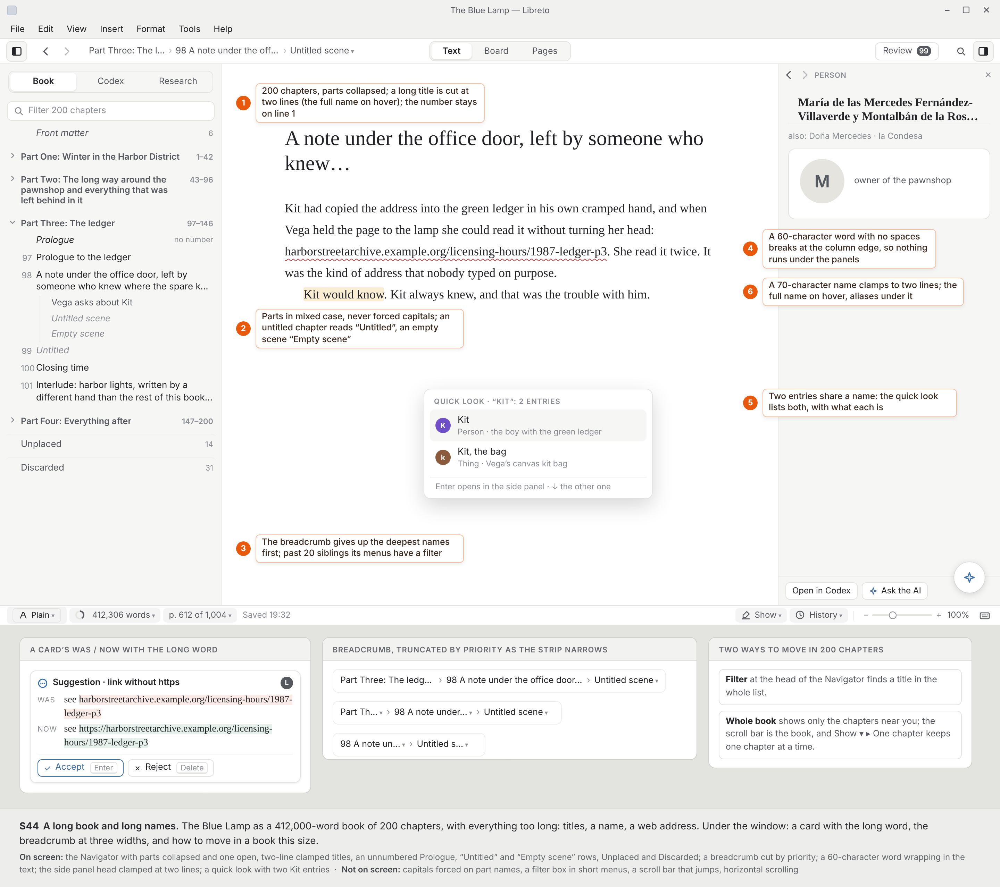

## S45 · Zoom, interface size and window width

The page is a measure in characters, not a fixed number of pixels, and the columns scale with the interface size. Four frames show what that means. At 200 % zoom on a 1440 window both columns close and the page takes the window, about fifty characters to a line; nothing scrolls sideways, and zoom changes the text only, never the menus.

With the interface size at 150 % and large text on a 1280 window, a column is 480 pixels wide, so two columns and the page cannot all fit. The panel opened last wins, as in S14, and the other waits behind its button. In a 1000 pixel window with Spanish labels the strip gives way in a fixed order: the view switch becomes icons with the label of the active view, the breadcrumb loses the part and shortens the chapter, and the Review button keeps its count. Numbers and dates follow the language ("54 300 palabras"). Menus are translated whole.

On a 2560 pixel window the columns hug the page with a gap of 48 pixels and the outer space stays empty, so the eye never travels half a screen to reach the list. A wider window adds margin, not longer lines.

**Changed from draft 7:** new screen replacing the window-sizes screen. Draft 7's 1260 px breakpoint, 200 % zoom, interface size and six Spanish mode labels all overflowed (F-B-16 to F-B-20, F-B-32, F-A-70); the model now has three view labels, scaled columns and a defined order of what gives way.

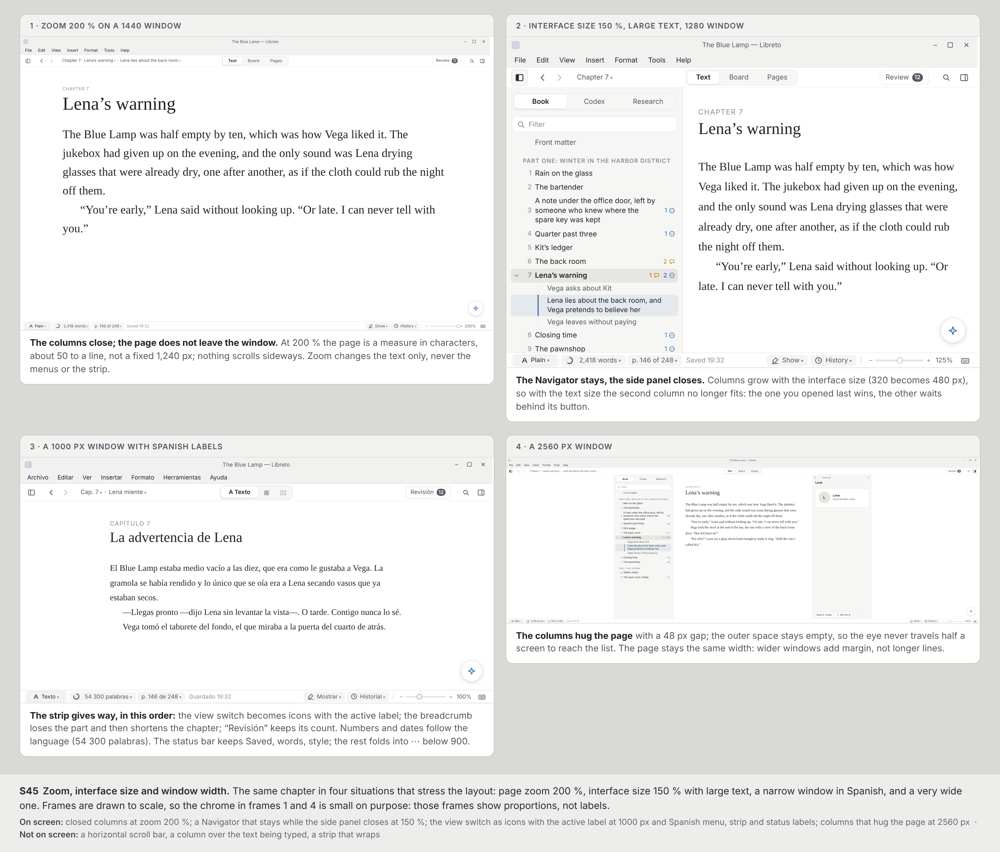

## S46 · When things go wrong

Libreto never shows a calm "Saved 19:32" while nothing is being saved. If the folder disappears (a USB stick pulled, a full disk), the Saved item turns red and reads "Not saved since 19:32", the window title gets a dot, and a standing notice says what failed and that the words are kept in a safe copy on this computer, with two ways out: Choose another place and Retry. Typing goes on. Notices like this one stay until the writer acts or closes them; they are not on a timer.

After a crash, the next start says "Recovered 43 words after Libreto closed unexpectedly" with Show, which opens them in History in place. When a cloud folder makes a second copy of a chapter ("A second copy of chapter 7 appeared (laptop-B, 18:02)"), Compare opens the two side by side, three-way, and nothing is overwritten. On the Start window a project open on another computer says so, with Open read-only as the safe choice and Open anyway behind a question, because two computers writing at once make two copies of every chapter.

The AI fails in the place where it was asked. Offline, a question waits and is sent when the connection returns, while finding from the index still works. At the monthly limit the conversation says "Stopped: this month's limit" with Raise it, never silently. An answer cut off by a rate limit shows no Accept button, only Retry and Copy what came (to paste it yourself); nothing in the book changes.

**Changed from draft 7:** new screen. Draft 7 drew no failure state at all (F-B-72, F-B-73, F-B-75, F-B-80, F-B-81, F-B-82, F-B-83, F-B-86).

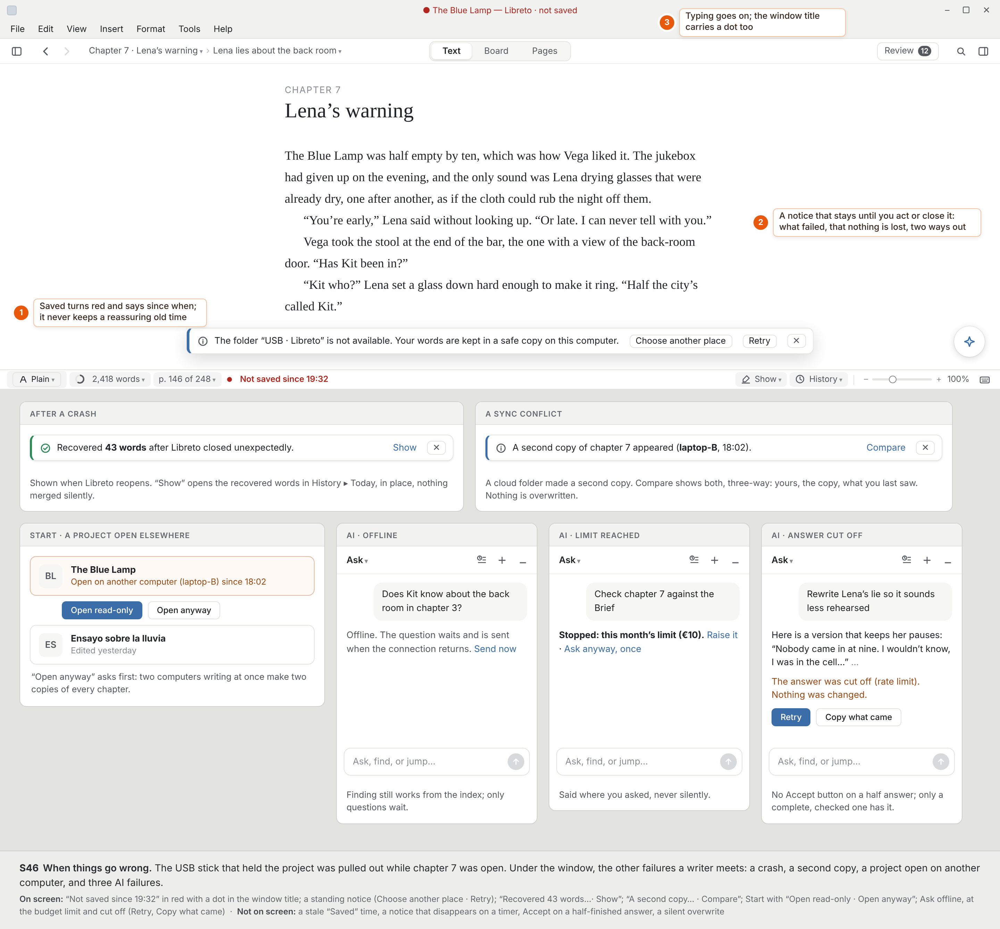

## S47 · All the menus

Every menu of the menu bar is opened at once so that anything a writer might look for can be checked against where it is. File holds the project (new, open, close, save a version, versions and history, bring in a Word manuscript, send a copy, add notes from a reader's file, export, print, book details) and starts with a gray line, "Saved automatically · 19:32". Edit holds Undo, Redo and Revert, the clipboard commands, Find and Replace, Rename everywhere and Settings. View holds the panels, the three views, the three Navigator sections, Back and Forward, next and previous mark, Show, Show names and styles, whole book or one chapter, Focus, Sprint and zoom. Insert holds Note, Footnote, Picture, scene breaks, chapter and part, front and back matter. Format holds Italic, Bold, Style as, Clear style, styles, passage language and Book layout. Tools holds Ask and the AI actions, Statistics, AI activity, Language and typography, spelling and Settings. Settings is both in Edit (where Linux writers look) and in Tools, and opens the same window.

The spark marks what uses the AI; those items are dimmed when no AI is connected. Menus walk with arrows and Enter and do not filter as you type.

Below are the right-click menus for six places: text with a selection, text without one, a mark, a chapter row, a Board card, and a Codex entry. Each begins with what is done there most often and ends with the way to the rest. Every item in a right-click menu also exists in a menu of the bar or in the Navigator, so nothing can be found only by right-clicking.

**Changed from draft 7:** the old inventory screens now show seven menus with Settings, Revert, Close project, Insert ▸ Note, Show names and styles and the Navigator sections added, and Reports removed (F-A-19 to F-A-26).

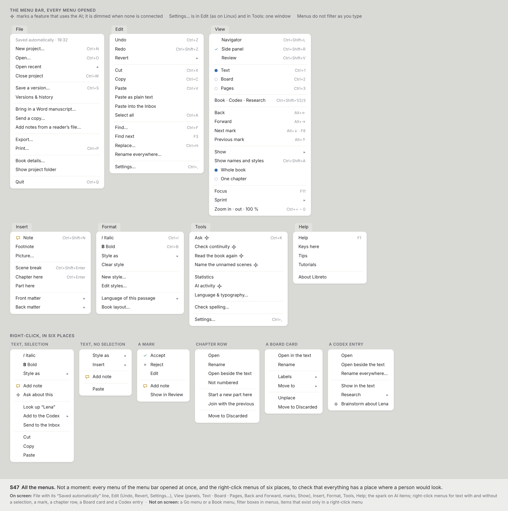

## S48 · Settings, Keys, on a Spanish keyboard

Settings ▸ Keys is a table of commands, their keys, and where each works. It starts by naming the keyboard layout it detected (here Spanish, Spain) and says that every key was checked against it, against the input method and against the window manager. Libreto's default keys are chosen to exist on every layout and to be free on the common Linux desktops: no AltGr, no dead keys.

When a key is not available, the row says so and says what Libreto did. Ctrl+. is taken by the input method's emoji picker, so the mark card also answers to Alt+Enter. Alt+click is the window manager's way of moving a window, so the quick look is Ctrl+click instead; the option to hold Alt to show names and styles is off by default for the same reason. To change a key, click it and press the new one. A key that cannot work is refused before it is saved, with the reason: Ctrl+Alt+E types the euro sign on this layout, so it will not become the key for Add note.

The search box finds a command or a key, a Flagged filter lists only rows with a problem, and Reset all keys returns everything to the defaults.

**Changed from draft 7:** replaces the plain keys list. Draft 7 listed keys without checking them (Alt+click, Ctrl+., F8 and Ctrl+Alt combinations all collide on Linux or with Spanish layouts); see F-B-01 to F-B-10 and the "Keys on this system" request.

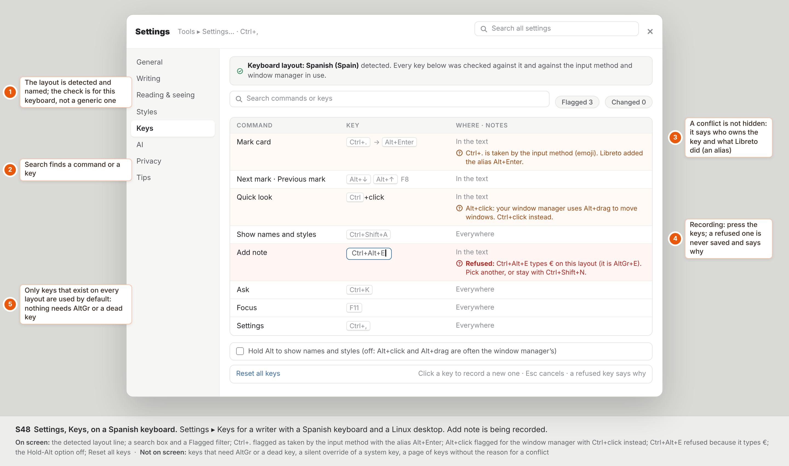

## S49 · Empty places

A new book has many places with nothing in them yet, and each says what belongs there and how to fill it, in one or two sentences, without a tour. The Board, with a single scene, shows that card and explains it: each scene is a card, drag to move it, drop it on a chapter in the Navigator to send it there. One button, "Outline from the Brief ✦", offers the single useful start for a writer who has written a Brief.

The Research Inbox, empty, is a dashed drop area that says what goes in (a PDF, a picture, a web address, a piece of text, or a paste) and that sorting can wait. The Codex says "Names appear here as you write": names that come back a few times are offered as entries, and a New entry button is there for the writer who wants to start. The Review margin says "Nothing waits for you" and says what will appear there, with a way to bring in a reader's notes. Pages, with half a page written, draws exactly that: one half-filled page, a blank page beside it with no placeholder text, and "Go on writing".

None of these invents content, shows a bare zero, or opens a tutorial.

**Changed from draft 7:** new screen. Draft 7 left every empty state to the imagination (F-B-113, and the motivation lens asking for empty states that say what goes there and how).

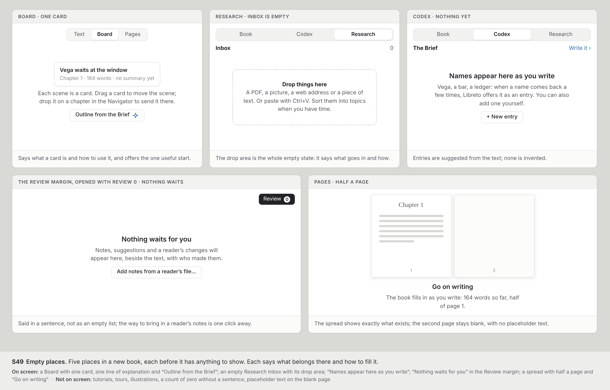

## S50 · The alternative, four modes

This screen is not the proposal. It draws the other way of cutting the app, so that the owner can set the two side by side and choose. In the four-mode cut the strip holds Write, Plan, Notebook and Book as places, and Review stays a separate toggle at the right. Write and Plan show the manuscript as text and as cards; Notebook joins the Codex and Research in one list, with the Brief on top; Book is the printed pages with their settings.

Against the draft 8 model (one window, three views of the manuscript, and Book, Codex, Research as sections at the head of the Navigator) the four-mode cut keeps the idea of dressing the window for a job, fits narrow windows and Spanish labels better than six modes did, and needs the least redrawing. It costs more: the left and right columns change meaning from mode to mode, a Notebook mode buries the Inbox under the Codex, opening a Codex entry while writing changes the mode and takes the text off the screen (draft 8 opens it beside the text), and Book still mixes the preview with its settings. There is also a mode switch and a changing Navigator to learn, where draft 8 has two switches of three labels each.

Nothing else in this draft depends on this cut.

**Changed from draft 7:** new comparison page. It is option B of the navigation critique (A, O-1), drawn only for comparison (N14); draft 8 follows option A.

## What changed in draft 8, and why

Draft 8 answers the outside critique of draft 7 (`critique-d7.md`; ids such as F-A-01 point into its six reports). The first move was to change the frame; most of the rest follows from it.

- **No modes** (F-A-01, F-D-66). Write, Review, Plan and Book were views of one text; Research and Codex were other collections. Now the Navigator chooses the collection (Book · Codex · Research), the center opens one document, and the manuscript has three views (Text · Board · Pages). Left is always a list, center always the work, right always one thing beside it. Back walks every jump. S50 draws the four-mode alternative.
- **Review is a toggle** beside the same text, with **rounds** (a reader's file, an AI pass, an agent session, Libreto's rules), a Page and a List view, bulk actions, Unread and Resolved filters, and progress that does not shift under you. Others' notes show in the text as hollow bubbles, so you never rewrite a paragraph without knowing Marta commented on it.
- **Proposals go out of date** instead of overwriting newer text; a cut-off answer offers nothing to apply.
- **Undo and Revert**: `Ctrl+Z` is the last thing here; Revert takes back one older thing and reports what it kept. The bell is gone: messages go to History ▸ Today and stay until you have typed on, not for twenty seconds.
- **Marks by shape** (wavy, dashed, thin, tint), checked in color-blind simulation; who made a mark is an initial on its card, with **L** for Libreto's own rules (draft 7 said "You").
- **Plain words**: Suggestion, Accept, Reject, Fixed for you, Check spelling, Leave as is, versions, Show names and styles, quick look; Italic and Bold labeled as such.
- **Readers' copies**: dropping the returned file on the window recognizes it; an import dialog maps authors and counts what is new; changes appear inline per reader, merged automatically where you changed different words, with one three-row card (sent, yours, theirs) for a real conflict.
- **History** with scope, date and text search without an AI, "Save a version…", "Put back" for a deleted scene, and the changes in a chapter since a date shown in the page.
- **The Board moves at once**, with Undo and the continuity notice; no Apply / Discard to remember. Rows, as draft 7 proposed.
- **Styles belong to the book**, seeded from your own; one look per style, decided by the book's theme; your writing font, size and page color are yours and never change the book.
- **Pages is a book designer**: an outline with front and back matter, themes, click an element to change it, chapter numbers in any format, unnumbered prologues, running heads, layout issues; **Export** is one dialog with profiles, **Print** a small dialog of its own; **Book details** and **Language & typography**.
- **Start and the empty page**: the book's language, an optional goal, a sample book, a Word import preview; three quiet doors on the first empty chapter. Play and Paper are shown as "later" until they have tools of their own.
- **Motivation**: goals with a daily figure and a ring in the status bar, a calendar of writing days without trophies, "Where you were" when you come back, sprints in Focus.
- **The AI**: your Claude subscription first (Claude Desktop through Libreto's connector), an API key as the advanced option; three levels with one checkbox per automatic behavior and its estimated cost; the catch-up offered on the Last session card, never silent; the conversation docked in the side panel with what it sends; **the Brief**; external agents visible (a chip with Stop, permissions per session, drafts accepted whole, Revert the whole session); **AI activity** with costs and the share of AI words still in the book.
- **Failure states** are drawn: not saved, recovered after a crash, a second copy from another computer, open elsewhere, the AI offline, out of budget or cut off.
- **Sizes and extremes** are drawn: 200 chapters, long titles, a word without spaces, zoom 200 %, interface 150–175 %, 1000 px in Spanish, 2560 px, dark and sepia.
- **Menus hold the app**: Settings in Tools and Edit, Add note in Insert, Versions in File, Statistics in View; the right-click menus as one family.

## To the specification

Pages the critique asked for, too long for a walkthrough: the **proposal lifecycle** (base text hash, out of date, rebase when the range is untouched); **Undo and Revert** semantics per surface; **review rounds** and the import (ids in Word files, matching by text when there are none, three-way merge, several readers); the **file format** (stable chapter files with a title slug, `book.yml` for order, a lock file, conflict-copy detection, external changes); **language rules** for fixes per book language; the **layout and spacing rules** in scalable units, not pixels; the **theme model** and what an element editor can set; the **AI connection paths**, the token economy (stored scene summaries, the context builder shared with agents, cost estimates) and the **agent tool set** (orient, read with a budget, propose with a base hash, check, ask the writer; nothing that deletes, exports or sends); **accessibility** (screen-reader roles and announcements, focus order, contrast tokens); the **key table** checked against layouts and desktops; the **menu inventory**.

## Questions

Yours to decide; each can be answered in a line.

1. **No modes** (one window, Navigator sections, three views, Review as a toggle), or the four modes of S50, or back to six?
2. **"Codex"**, or a plainer name (Story bible, Cast & world)? A five-person test would settle it.
3. **Plain words** (Accept / Reject, Fixed for you, Leave as is, versions, Italic and Bold labeled as such): adopt all?
4. **Marks by shape** (wavy, dashed, thin, tint): right, or too busy?
5. **Others' notes in the text** as hollow bubbles, with Show ▸ Notes: Mine / All / None: right?
6. **Readers' changes inline** (per change, per reader) instead of draft 7's two columns per paragraph: right?
7. **Undo and Revert** as two words for two acts: acceptable?
8. **No bell; messages stay until you have typed on**, then go to History ▸ Today: right?
9. **Styles in the book with one look**, your writing font apart: right?
10. **Play and Paper** in version 1: shown as "later" (as drawn), or minimal tools for one of them?
11. **The AI through your Claude subscription first**, the API key as advanced: right? And the catch-up offered, not automatic?
12. **The Brief** at the top of the Codex: the right home?
13. **Agents' new scenes as drafts** accepted whole, their edits as a review round: right?
14. **Goals visible from day one** (the ring in the status bar): or only when you set one?
15. **The Board moves at once**, with Undo, no Apply: right?
16. **No Undo arrows in the strip** (Edit menu and `Ctrl+Z`): fine?
