# Libreto — Specification

> Reviewed copy of `libreto-screens-c2-v1-2026-11-11-0004-reviewed.html`: the document as it was annotated, with 20 notes by the owner under the sections they are about. The HTML file is the annotatable version; open it in a browser to read the notes beside the text.

## Preamble & scope

**Revision**: 1

Draft 2, after the owner’s review of 6 November. Three axes, each with one visible switch: Views of the book (Text, Cards, Book) in the top strip; Workspaces (Just write, Planner, Reviser, Pro) in the status bar; Focus mode. Around the text: the top strip (Back/Forward, Undo/Redo, view switcher, breadcrumb, Search & ask), the Navigator on the left and the Side panel on the right (both fold to visible handles), the notes column, and the status bar (chapter words, approximate page, auto-fixes, Highlights, Workspace, History, AI status, zoom). Drawn as Linux/Windows, with a menu bar.

The visual style is placeholder: calm greys, one blue accent, a book serif for the text. Keys appear only in hover tooltips, one example per screen. Orange numbered dots are annotations, not part of the interface.

## S00 · Start screen

Opening Libreto with nothing open: one card to start a new project (type, title, author, language) and, on the right, Open and the recent projects. Opening another project replaces the current one; there are no tabs.

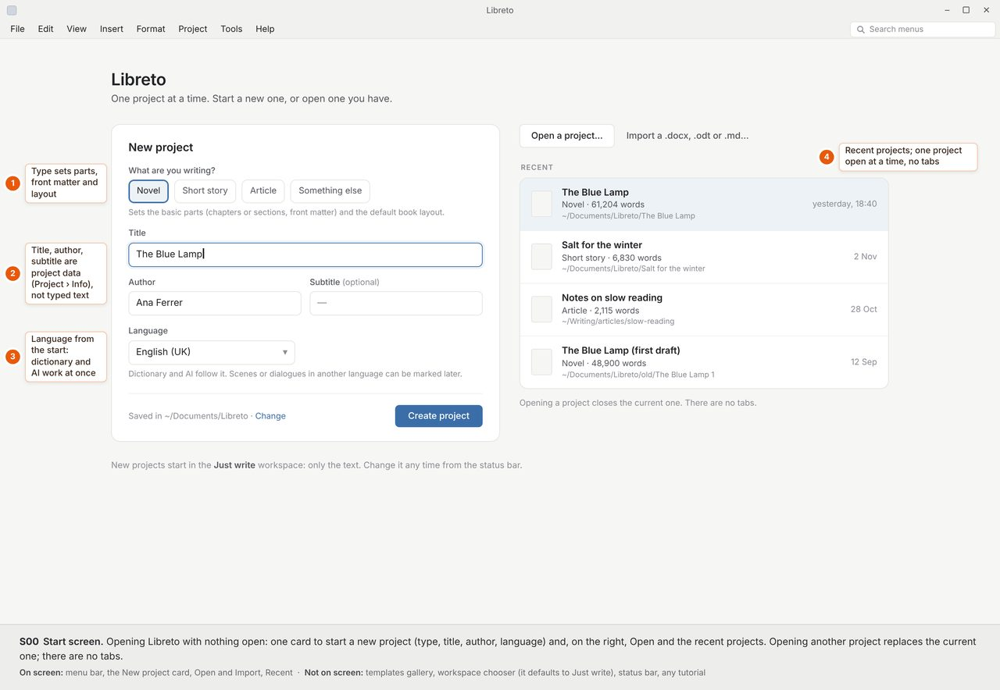

> [!NOTE]
> **Review note** · S00 · Start screen
>
> LGTM. I suppose other project types may have other required fields. That part could need a small research or just common sense.

## S01 · Just write, first minute

A new novel in the Just write workspace. The writer types “Chapter 1” on its own line and keeps going: it becomes a chapter heading, marked faintly like any other auto-fix, and the counter in the status bar goes up. The rules for what counts as a chapter are below.

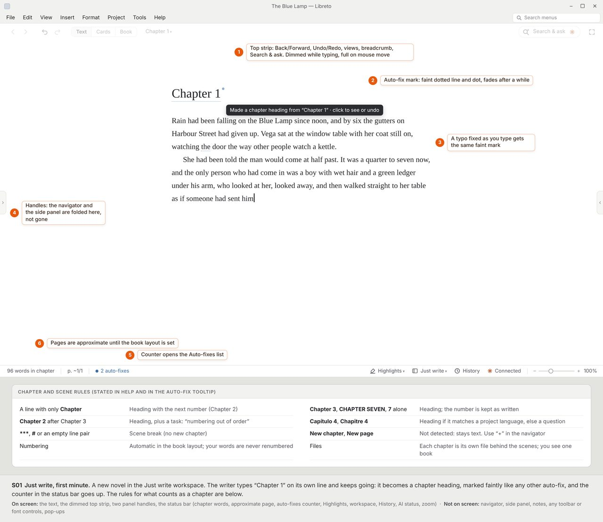

> [!NOTE]
> **Review note** · S01 · Just write, first minute
>
> It is beginning to look cool! We have more UI, but I think it's needed.
> The "Made a chapter heading..." message is real? I mean, is this shown? I think I prefer the more discrete faint dotted line and dot. Oh, sorry, I know get it, it's hovering! About typos, the whole word must be dotted; when it is, for example, a comma added (if we decide this is licit do to) or something small, we need to make it visible. I think the dot will help the more.
> Can we put "Search menus" inside the Help menu, as other software do? Two search boxes so close look weird.
> What is the square next to "Search and ask"? The focus mode? It looks like a full-screen view.
> The Claude icon and "Connected" could be replaced by the icon in orange or grayed, and hovering will tell "Disconnected", same as if you try to do something that needs it. It will ask to login or add an API key or whatever we find as a good solution (probably both if we plan to allow multiple AI chats).
> About "***" or "#" or two intros, it's a good idea. Should we accept Markdown or similar things that get automatically converted? We should show a horizontal ruler to mark scene division (something nice, maybe gray and fading to the ends). It should be clear for the writer that something happened in case he wants to undo it. When hovering the line, a "Scene separator" or "New scene" or similar should be shown. At the end, it can be decided how to show it in the final version. Is this compatible with AI-generated scene separation?
> If someone doesn't use "Chapter x" but just a text with style, we need to decide how to show it, if numbering in work mode and then deciding when exporting.
> Question that doesn't have nothing to do with this: let's talk about ethics. Should we allow that all this powerful tooling is used to write books or scripts fully with AI? It's not actually a bad thing, but... And if we let the code open, anyone could anyway delete some prompts and skip any restriction, so we can just recommend not to abuse it for possible problems with copyright, AI-detection, contests... This when AI is enabled, just a disclaimer, use at your own risk, etc.

## S02 · Session briefing: last session

Next morning, Reviser workspace. The briefing is the last session’s summary from History: what you were doing, each line a link to the place, the totals, what is waiting. It has no buttons; the dashed ghost shows where it goes when closed.

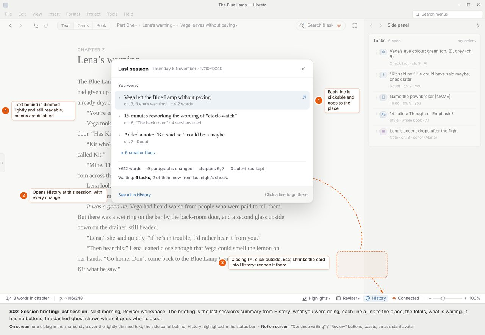

> [!NOTE]
> **Review note** · S02 · Session briefing: last session
>
> Clear! The text "Click a line to go there" should not be there. Moving the mouse or cursor should make it clear. When the window is closed, it must be animated to its place and "History" must be gently highlighted once or twice. Then, when clicking it, we have two options: always show the last session, which can be weird because some time later "last session" can mean "this session" or show full history: one line per session with a short summary of what was done. Clicking one opens something like what you showed ("Last session" only for last session). Another option when clicking History is showing last session for some time. I think it should show all history and the user just makes one click for "Last session". At this point, I don't know if "See all in History" should be "See all History". Not sure, we should define what is viewed in all History, maybe you worked on a later screenshot.

## S03 · Navigator

Planner workspace, chapter 7. The navigator follows the reading: chapter 7 open, its first scene highlighted. Scenes are found by a script plus a small model (change of place or time, scene breaks) and named with a one-line summary the writer can rename, split or merge here.

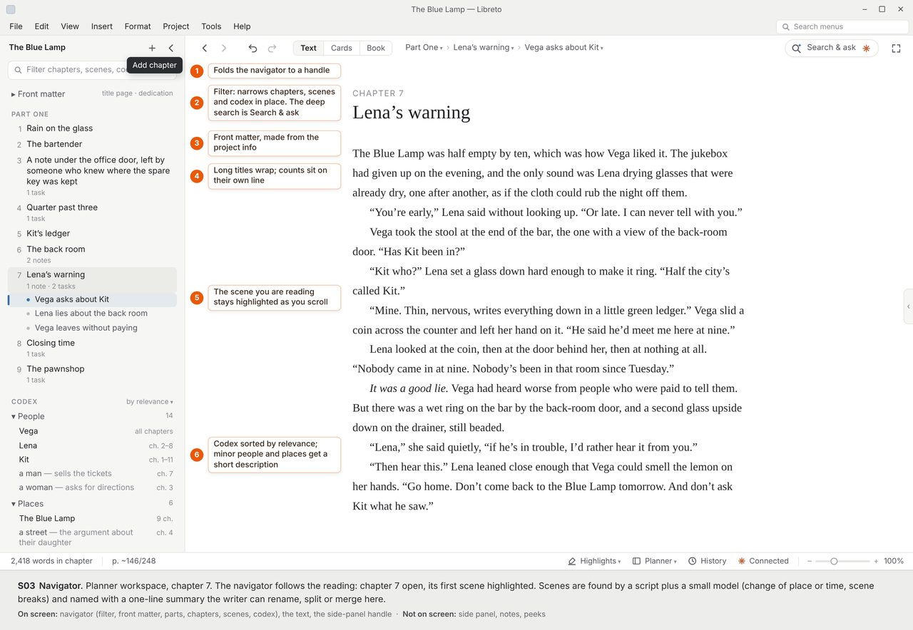

> [!NOTE]
> **Review note** · S03 · Navigator
>
> "title page - dedication" should not be there. Front matter is enough.
> When you click "Add chapter" what happens? A blank page if you are seeing only one chapter? What if you are in the full view? Where is the chapter added? Between which chapters? Or after the one selected? How to create scenes?
> Hiding arrow for chapters is too similar to the back arrow. I'd prefer not having to move the mouse to open and close the left panel. For example, an arrow or three lines or an icon at the top left.
> Why Front matter has an arrow to collapse and chapters don't?
> I don't like the new "1 note · 2 tasks" in a new line. Too vertical space. Could we reserve a space (like a column) at the right for, maybe, "1 * 2 *" with colored dots. Colors must be coherent with the rest of the app. We need to know how many different things could be shown there. Hovering shows "1 note · 2 tasks". Long titles use multiple lines (I think it's better than using "...").
> Why characters can have things like "ch 2-8"? If they have long names? In the image it says "People 14", but only 5 are shown. How do we decide if a character needs to be there? There may be hundreds of secondary characters. Also, Codex is only shown here? Is there a place where the user can see all the codex in an accessible way? Does it make sense?
> When you open a side panel, the top row items are displaced. This can make it weird if they move around when opening and closing panels. Maybe they could be always over the text, not taking the panels space. It needs some thinking, because resizing windows could make it not fit.
> If someone renames a scene, it should be kept unless all the scene text is deleted. Or add a task if the text doesn't fit the title anymore.

## S04 · Notes column

Reviser workspace, end of chapter 7. Notes sit in their own column beside the text, each next to its paragraph with a small badge in the margin. The writer has just added “Kit said no.” → Doubt: the default type is Note, and the AI set Doubt; the chip shows it can be changed.

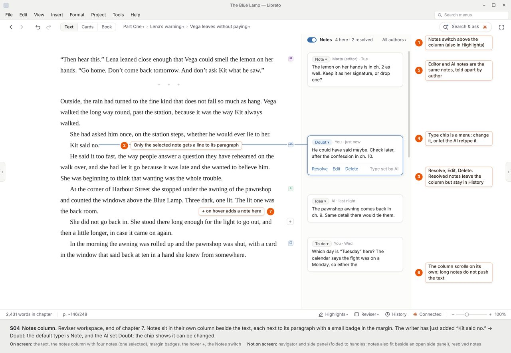

> [!NOTE]
> **Review note** · S04 · Notes column
>
> "The lemon on her hands is in ch. 2...". "ch. 2" should be a link.
> How to open a note or the notes panel? For example, hovering the note icon at the right will show the note type (doubt, idea...) and clicking it opens the panel and note?
> Lines move in diagonal or angle and diagonal when scrolling? Where should lines go out from? The text place or the icon place? What if there are more of one note in the same line or paragraph? Or you can't add two notes, because the "+" icon is not there anymore?

## S05 · Peek on a character, side panel

Reading chapter 7, the writer clicks “Lena”. A peek shows her character card. Kit was kept earlier, so the side panel shows him above the Tasks list; everything closed recently is listed at the bottom, ready to reopen.

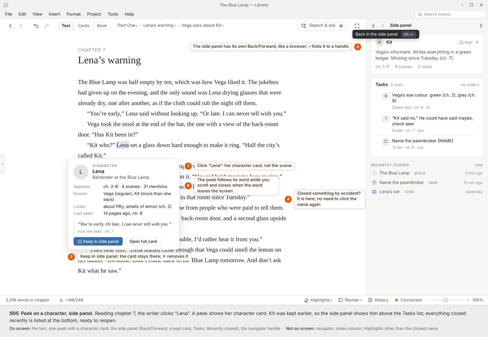

> [!NOTE]
> **Review note** · S05 · Peek on a character, side panel
>
> I don't quite understand how right panel works. How to call it, what can it show, many different types of things at the same time? When will the user need it? How will he know? What changes with back and forward arrows, is it like multiple desktops in an OS? That would be too complex. It must be simpler. I see it more with some (two or three) tabs: Tasks, Info (which could include research and characters), ...? And each tab should be able to be shown from other places, same as notes tab could be shown when clicking in a note. It must appear when the user needs it and also when the user wants to show it.
> About spacing, in general in all app, we need to test it with long names or sentences (breadcrumbs, tasks...).
> The character tab looks good, but I'd like to see the full card. Is it a bigger floating panel with back and forward arrows to navigate and do some research?

## S06 · Hold Alt: everything clickable

Holding Alt over chapter 7: characters, places, things, styled passages, note and task badges and auto-fix marks all show at once, so the writer learns what can be clicked without guessing. Right-click a word does the same for that word.

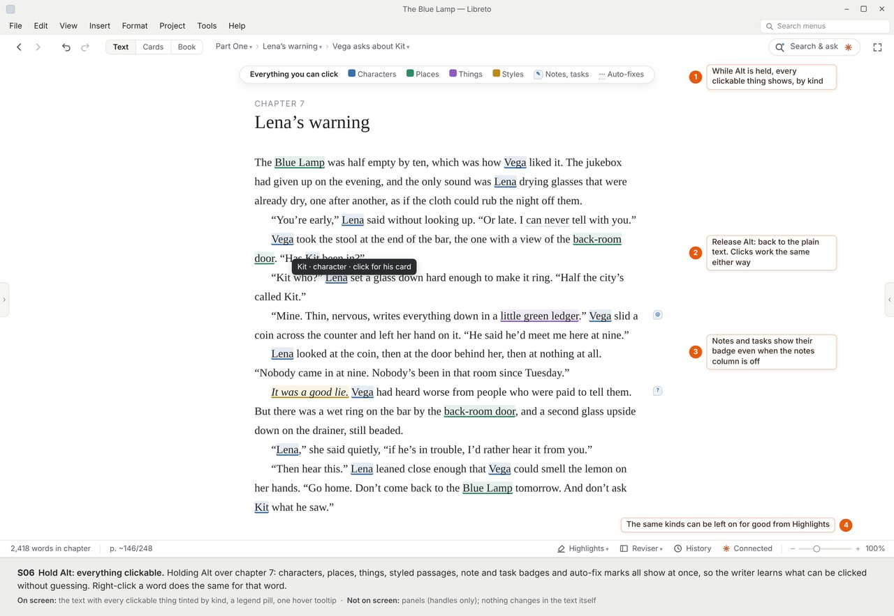

> [!NOTE]
> **Review note** · S06 · Hold Alt: everything clickable
>
> What happens when I click on Highlights? Can I choose which to show? Or it is an all or nothing shown?
> I'm worried if it will take a lot of tokens to read all the text while it is being written. For example, if I write Vega, how much time passes before it gets identified as a Character and how is it done?
> What happens when I click on some highlighted word? Does it depend on the kind of item? A peek or a panel is open?

## S07 · Search & ask

Search & ask (Ctrl+K, or the button in the top strip) with “lena” typed: places in the book, codex entries, a command and three questions about this book, each group capped. It is for finding and quick answers; a long conversation goes to the chat.

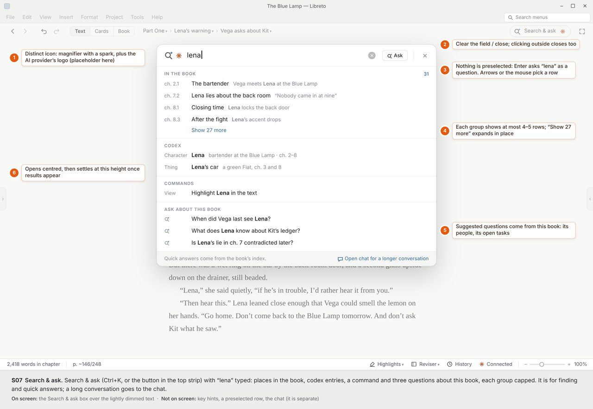

> [!NOTE]
> **Review note** · S07 · Search & ask
>
> Clicking the top strip search box and that it does not write anything and it creates a bigger one in the middle of the screen is weird.
> We need to talk about commands, I don't know what they are.
> Now the search box makes more sense. I don't like the two X so close and the Ask button. Maybe the magnifier glass is enough, but then there are also two of them. Let's keep that line simpler. Maybe instead of magnifier glass and Ask it could be Claude icon and an Intro arrow, similar to Claude Code or other chats. But then the other Claude logo should be removed.

## S08 · Chat beside the text

The writer talks the scene through with the AI. The chat is its own window, separate from Search & ask: docked under the side panel’s cards, so the text stays readable beside it. It keeps its history and can float or be minimised.

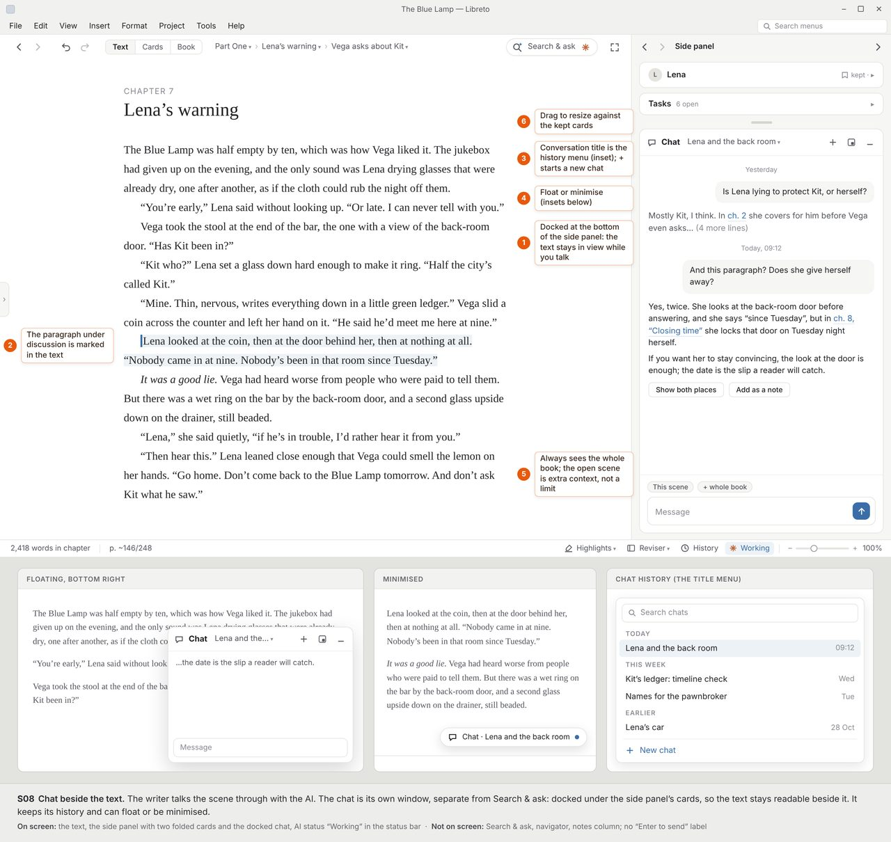

> [!NOTE]
> **Review note** · S08 · Chat beside the text
>
> I like that the text being discussed is marked. Actually, Claude could use this to show about what it's talking about. Or highlighting things twice to make the writer notice something... That kind of things.
> How to find older chats? Can it read old chats to gain context?
> The title "Side panel" is ridiculous, it should show a function.
> Why show "This scene" and "+whole book"? If it's always the same, no need to specify. Claude can understand if the question is related to current chapter or full book.
> We need to work more on the Side panel. What it keeps, how it is shown, is this a box for anything? How can chat and cards be mixed there? I think it could have tabs, but chat is too important to have it lost in any tab, it must always be present. I like it floating more than attached to the right panel, but I don't like it to be over other contents. I guess when chatting, people could close the right panel or it is just hidden when the chat is open. But maybe when chatting the user needs to see the panel. Even the chat could need to open the panel (our API should allow opening and closing panels, link to specific parts of it...).
> Or right panel could shrink to minimum with all collapsed then chat is open... I don't know. Help me fit everything once we decide what exactly side panel is.
> I like minimised chat and search chats. Search should look at titles and also at contents and sort by date or relevance, not sure. Chats should have a representative title. In Claude app, chats get a title just at the first prompt and it is not automatically changed when the discussion moves on to other topics.
> The "+" to start a new chat should be more visible. In AI chats websites, they are usually at the left, so people may not understand it is to start a new chat. Or change it for "New".

## S09 · Find, and Replace

Find in chapter 7 for “blue lamp”: a small strip at the top right, like a browser’s. By default it ignores case and accents. Replace is the same strip with a second line; it remembers the last search and replacement, while Find opens clean.

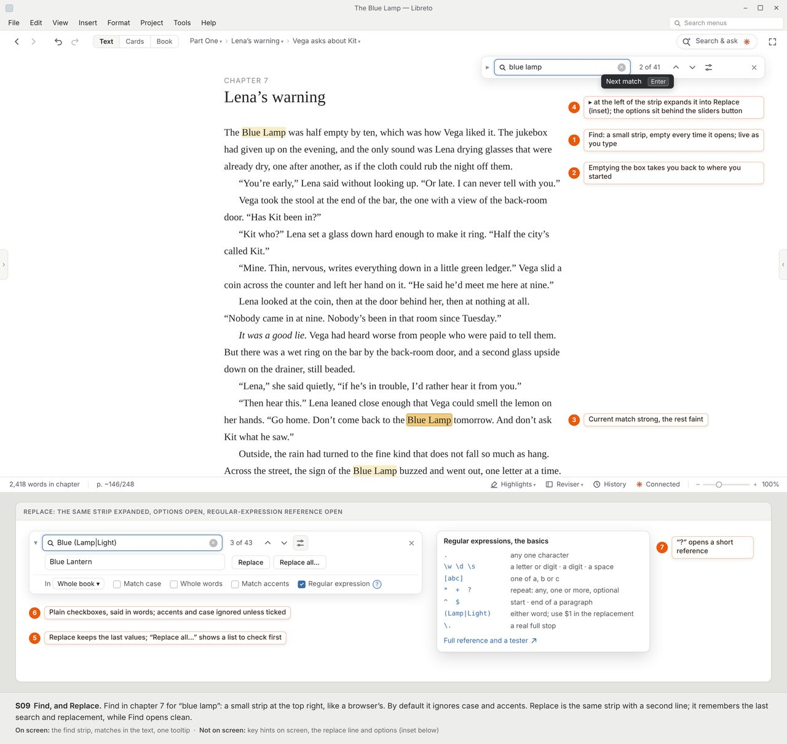

> [!NOTE]
> **Review note** · S09 · Find, and Replace
>
> Just fantastic! I miss the tips for replacing, but I think it's more simplified now. What is "Full reference and a tester"? A link to regex101 or an internal implementation of it?
> I understand, when replacing, if I hit Esc the last found word is selected, so I can edit it and then Ctrl+H opens it the same so I can continue.

## S10 · Review a task

The writer chose Review all from the Tasks list. The first task, Vega’s eye colour, opens as a choice block in chapter 9 with its evidence. Keep mine or Take proposed both move to the next task; the banner says where you are in the review. Below: the same task fixed in passing, with no review.

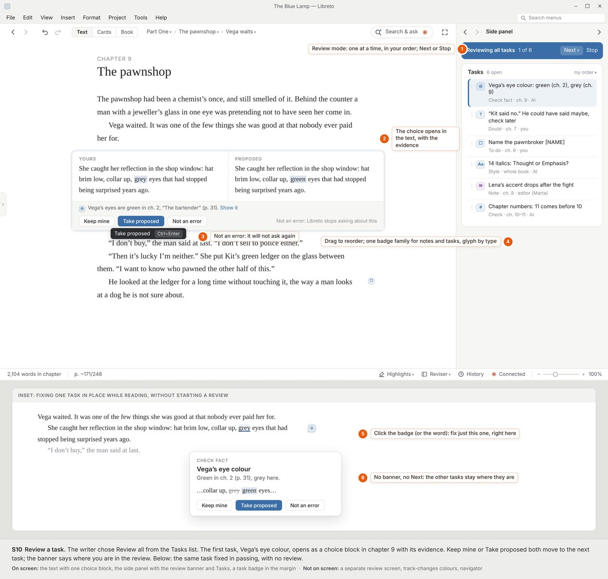

> [!NOTE]
> **Review note** · S10 · Review a task
>
> This will be a fantastic software! :-)
> "Not an error: Libreto stops asking about this" should not be shown, just when hovering.
> I understand each type of comment or issue will show differently, not all like a choice.
> Again, how I get to the Side Panel for tasks and reviews? We need to rethink the side panel.
> How or when "grey" is underlined? What does the user needs to do so that it is shown while writing?
> The rest is perfect, that's the idea!
> PS: Let's use american English, I think you use words that seem strange to me.

## S11 · Context menu and a new style

The writer selects a book title inside the text and right-clicks: Cut, Copy, Paste, then Style, Add note, Ask about this, Look up. No style fits, so New style… (below) makes “Book title”: inline, shown in italics.

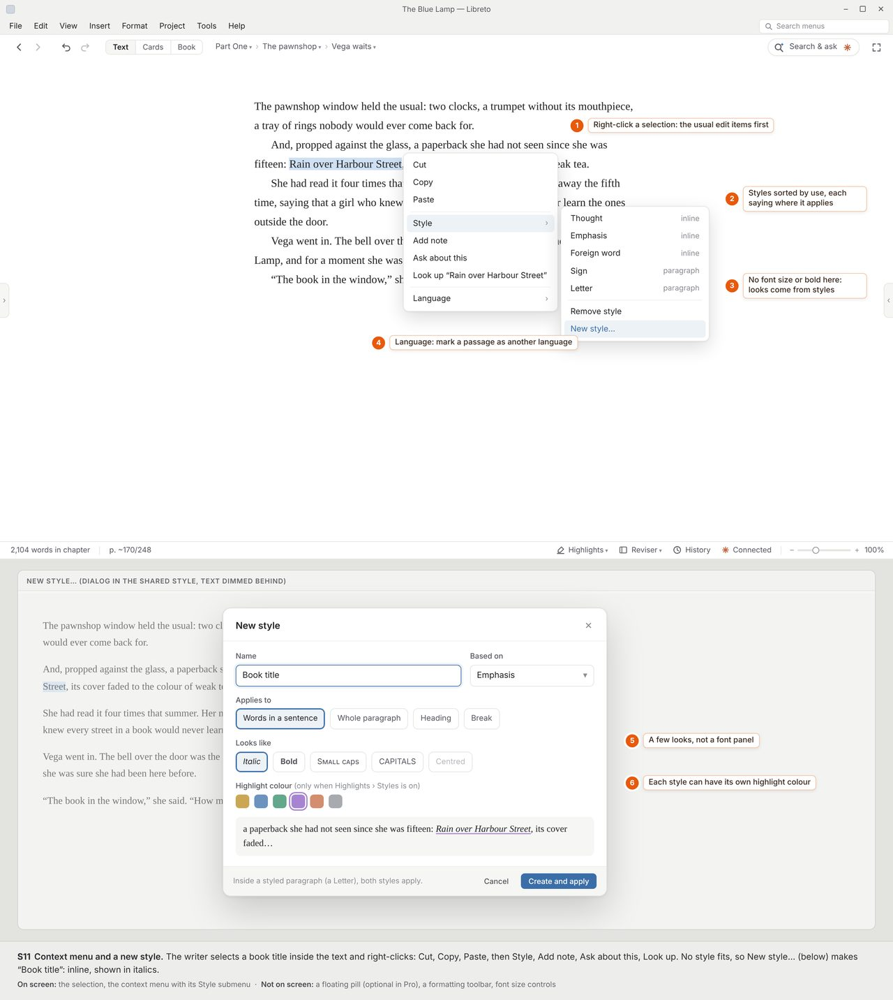

> [!NOTE]
> **Review note** · S11 · Context menu and a new style
>
> Looks good, but we need to be able to apply styles more easily. For example, Ctrl+1 for heading, Ctrl+I for emphasis, Ctrl+B for... what?
> New style panel is perfect!
> We'll need some place with all keyboard shortcuts and a way to add new ones. Of course, all the basics must be covered. For example, maybe Ctrl+T (or whatever) could open only the styles menu to choose.
> We'll also need a list of basic styles, the ones that appear in "Based on". I wouldn't like that user can create their own "parent" and "son" styles. Or should they?
> Please, all buttons same style and size in all the app. And moving with Tab must be done and intuitive.
> So when something is selected nothing is shown now? I didn't dislike the pill, just having pill and right click looked redundant. But styles should be easily selectable. In the other side, it is more coherent everything having the same style... I don't know. Each writer will use their own techniques, some will be very careful with styles, others won't even know they exist... An AI pass could find all these things and fix them. If I had to use it, I'd like to have styles at hand. And a keyboard shortcuts list with option to configure and add them.

## S12 · Highlights and Workspace menus

Highlights replaces the old “marks” toggle: a menu in the status bar (and in View) with one checkbox per kind of mark. Here Styles, Notes and tasks, Auto-fixes and Spelling are on. Below: the Workspace menu next to it, which decides which panels are open.

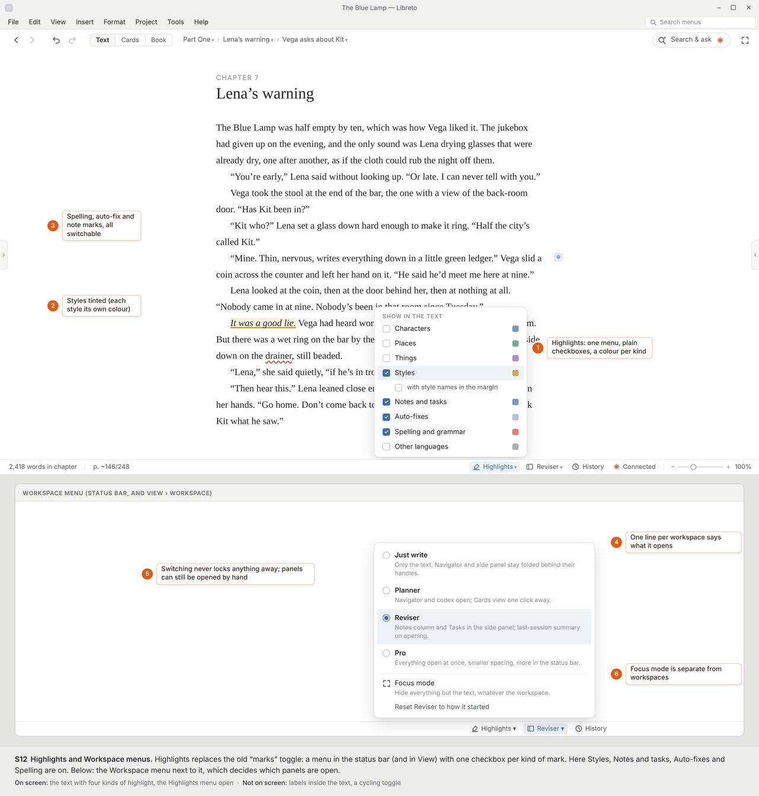

> [!NOTE]
> **Review note** · S12 · Highlights and Workspace menus
>
> What if there are two styles in the same line and you mark "with style names in the margin"?
> How is decided which styles do underline, tinted, text color...? Shouldn't it go to the New style dialog? Or they depend on the basic styles? Oh, I see, they are only tinted. Ok, for now.
> What is "Reset Reviser to how it started"? Does it mean cleaning the right panel? As I said, we need to rethink that panel.

## S13 · Auto-fixes list

The writer clicked “6 auto-fixes” in the status bar. The side panel lists what was changed as they typed, each with what was written and what it became: ✓ keeps it, ✕ undoes it, ↗ goes to the place. Undoing “cafe” → “café” also stops that fix from coming back.

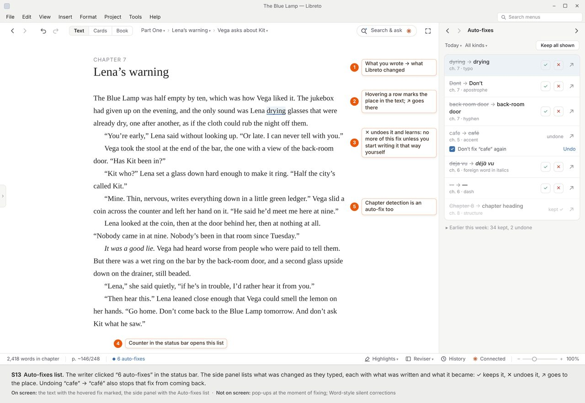

> [!NOTE]
> **Review note** · S13 · Auto-fixes list
>
> I like it. What is the diagonal arrow at the right of each line? Is it to go to the place? I'd prefer to click anywhere in the card that is not a check or an X.
> What's the alternative to "All kinds"?
> One other thing. I'm not sure "Text", "Cards" and "Book" should be at the top but at the bottom line, just like modes (similar to Word, let's take something good of it). This way we also get more room for the breadcrumb and possible centering of all top bar stuff.
> "Undo undone" sounds weird.

## S14 · History

History (called Time Machine in the notes; name to be decided), opened from the status bar. Every session is recorded and summarised; the writer asked a question, picked Thursday’s session and is comparing one paragraph with today. The engine behind it gets its own spec.

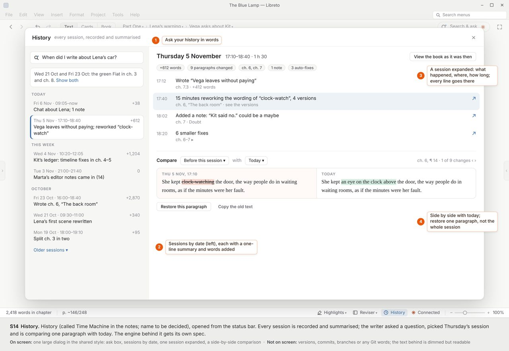

> [!NOTE]
> **Review note** · S14 · History
>
> Thu 5 Nov should be inside "THIS WEEK", not inside "TODAY".
> Again, not diagonal arrows anywhere. Hovering and clicking should be enough hint.
> I hope you'll know how to implement that diff. When a paragraph existed, then was deleted, then another day a new paragraph is added... It can be hard.
> I like it, quite clear.

## S15 · Viewing an old version

From History, “View the book as it was then”. The whole window shows the old chapter 7, read only, with a red-tinted banner and frame. The writer selects Lena’s line from that day and restores just that part.

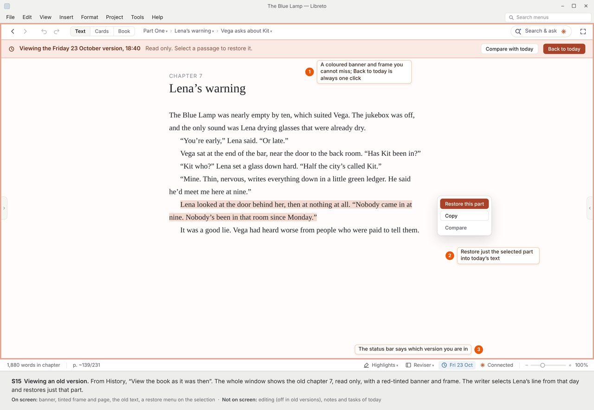

> [!NOTE]
> **Review note** · S15 · Viewing an old version
>
> How do you know a text can be restored? I mean, is the text red because it is selected or because it has been deleted? I mean, is it a diff or just the old text complete? What about a whole diff with today's version?

## S16 · Book layout, then Book view

The first time the writer switches to Book, Libreto asks for a book layout: paper size, margins, fonts, how chapters are headed, headers and footers, page numbers, front matter. The preview updates as they choose. Below: the Book view it leads to.

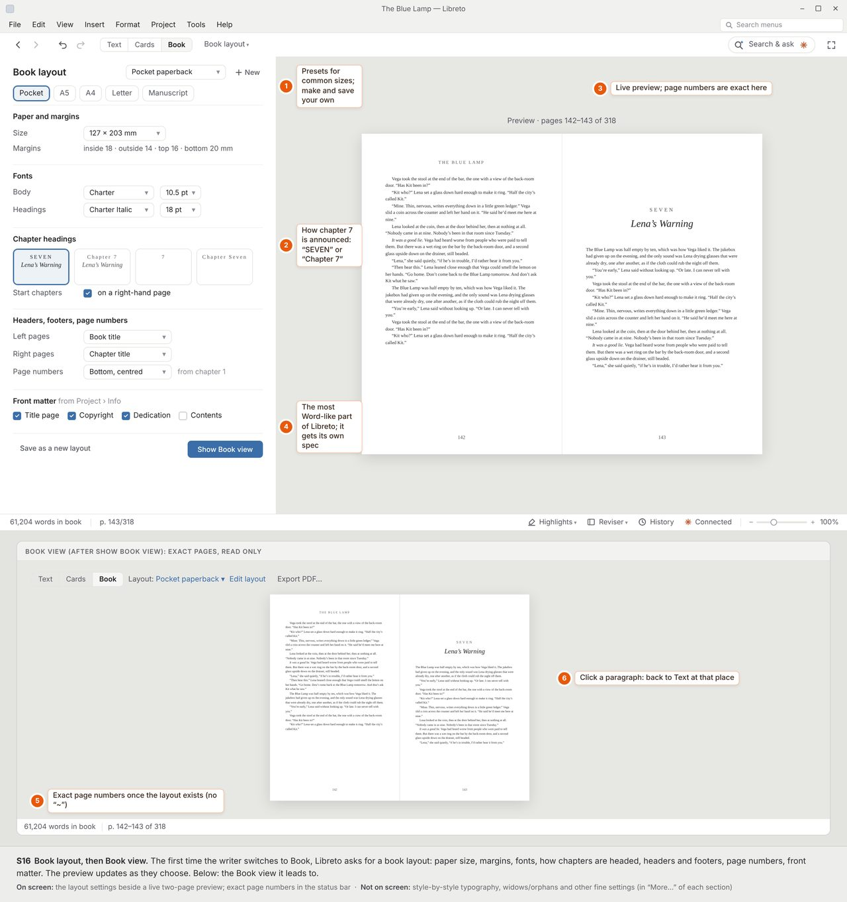

> [!NOTE]
> **Review note** · S16 · Book layout, then Book view
>
> Can you read the whole book here? Advance pages and all that (with some cool animation?)?
> Can it be set to print one-page instead of only two-pages?
> Can margins be set?
> Can page size be added?
> What does it mean Headings font size? H1?
> "Start chapters" and "on a right side page" should be just one sentence with a check box.
> Here is where we can shine. Printing books beautifully! Choose the right fonts, spacing... Here we could learn a lot from TeX and LaTeX.
> Clicking to text and return to text page can be unexpected and then having to come back again and generate the preview. Better a button or something like "Return to text". It is understood it will be at that page or near there.

## S17 · Cards view with your own groups

Planner workspace, Cards view, grouped the writer’s own way in five named groups. They drag “Vega reads the green ledger” to the first group; Libreto warns, while dragging, that it would break continuity. Nothing moves in the text until Apply order.

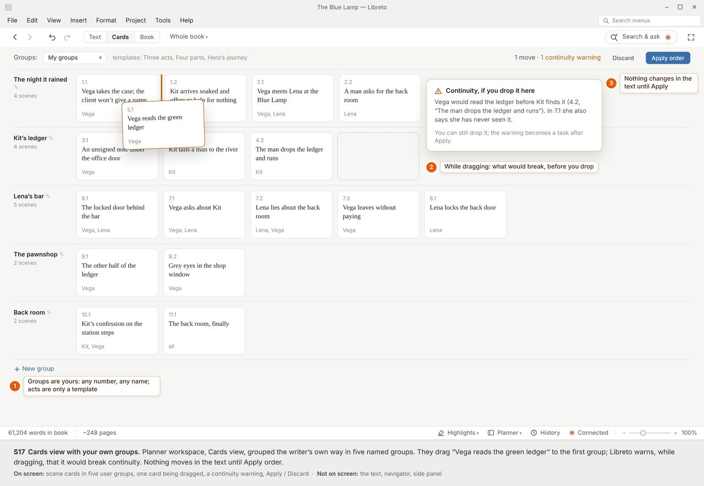

> [!NOTE]
> **Review note** · S17 · Cards view with your own groups
>
> Can really Libreto say so quickly which continuity gaps there will be. Doesn't it need an LLM to do so?
> I like it so much!

## S18 · Focus mode

Focus mode, full screen: menus, top strip, panels and the status bar are gone. The only control is “Exit focus” in the corner, which fades in when the mouse moves, so a writer who never learnt a key can still get out.

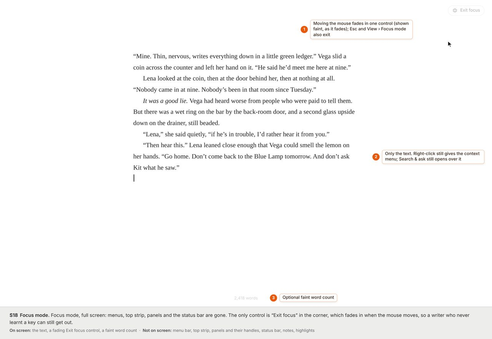

> [!NOTE]
> **Review note** · S18 · Focus mode
>
> No word count, no distractions.
> Will we have some statistics panel? How many words each chapter has, graphics, colors by character appearances...
> Or even time in sessions... What a session is must be defined. The writer can leave the computer on and go taking coffee or watching a movie. Activity should be measured.
> Of course, not all features are equally important, so they can be prioritized.

## S19 · Settings

Settings (File › Settings, or the menu search), on the AI page. One dialog with a short list on the left; each page has only the choices that really differ between writers. Shortcuts are not a page here: they are shown in every tooltip.

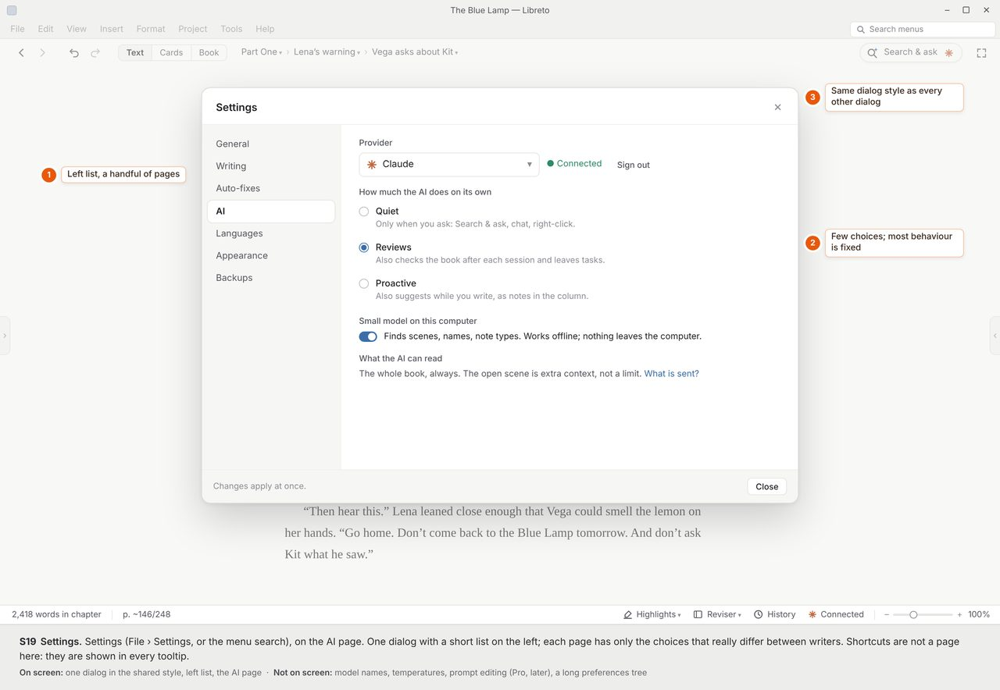

> [!NOTE]
> **Review note** · S19 · Settings
>
> "The open scene is extra content". Read my comment above. If you can read the whole book, I don't get that note.
> I'd like to see all options in other tabs.
> We'll need a dark mode. I prefer your screenshots in light mode, though. Or a few themes.
> Connecting to AI could mean signing in (I wish it is possible!) or an API key. Showing how to get them is part of the help.
> Oh, and we didn't talk about help!
> I don't believe anyone reads large chunks of help docs or looks for things. Contextual help is better. Well, we'll have implemented a Codex system we can apply to a comprehensive help text, so an AI or scripts can ask it too as if it was a novel with strange characters... :-) Navigating our help should be as easy as navigating the book.
> We need to think or take the best examples of software with really good help tools: tutorials, question marks here and there... I don't think it's good, but a tutorial for each Settings tab by pressing a button...? Nah, there are things easily understood and others harder to get.
> It is a very important rule for this software to be extremely intuitive and easy to use. UX must be perfect. We still need to polish some things, but I think we are doing a pretty good job by showing minimal things and at the right place.
> Oh, one more thing. Let's suppose you can send the whole project to an editor or someone who adds notes with Libreto and returns you a new annotated copy. We will finally need a comparison tool, with how it was before comments and also with what changed between original version and what the author can have been doing in the meantime. We need a way, and it is VERY important to not mix versions, so the author doesn't open a new version and begins working on that copy that misses their own changes. Old copies has always been a headache with Word and other softwares, more for non-techie people that doesn't know how to send something by email and receive and download the annotated copy. So if the AI can read emails and manage all this, that would be great. Or at least, read the Downloads folder and detect if a copy is the one that is needed and check changes between, before, after and annotated versions. If the author says: "I need to send it to a person", help him. If he says: "That person returned it by email", help him too. Or at least explain what to do and how: "Click on the download button in the last email, I'll get it from Downloads folder". You know, helping the writer do non-writer stuff. That's why this program exists, to be really helpful: fixing errors, moving paragraphs... Anything the API allows, the AI can do it.
