# Libreto — Specification

> Reviewed copy of `libreto-screens-d3-v1-2026-11-11-0005-reviewed.html`: the document as it was annotated, with 32 notes by the owner under the sections they are about. The HTML file is the annotatable version; open it in a browser to read the notes beside the text.

## Preamble & scope

**Revision**: 1

Status: **for annotation.** Not a guide and not a specification: one short paragraph per screen, in the order a new writer would meet them. The pictures are in `concepts/`; the review page puts a note field under each.

## Libreto in one minute

Libreto is a writing app for books. Its window has **five modes** along the top: **Write, Plan, Research, Review, Book**. Each mode is one job, and choosing it arranges the window for that job; the writer decides what they are about to do, and Libreto does the layout. One rule holds in every mode: the **left** column lists what you are working on, the **center** is the work, and the **right** column, the **Side panel**, holds the **Codex** (who, what and where in your book) and the **Chat** with the AI. Both columns open and close with the two icons at the ends of the top strip, and `Ctrl+\` closes both at once to get back to the page.

| Mode | Left | Center | Right | Why it is a mode |
| --- | --- | --- | --- | --- |
| Write | chapters (optional) | the text | Codex · Chat (optional) | the default; the text needs ~65 characters a line and nothing else |
| Plan | chapters (optional) | cards, full width | Codex (optional) | cards need the whole width to compare and move |
| Research | your library | the material, large | notes, facts, links | photos and PDFs need room to be read |
| Review | everything to look at | the text | notes beside paragraphs | text plus margin plus list: three columns |
| Book | page thumbnails | spreads | layout settings | pages need the full height |

All five fit a 1440 px laptop: Write 260 + 620 + 380, Review 310 + 600 + 320, Research 260 + 700 + 380.

> [!NOTE]
> **Review note** · Libreto in one minute
>
> I understand each mode should also have AI. Any time is a good time to ask a question or look for help.
> I'm at the beginning of this document, so I don't know what comes, but for the moment, I think research must be able to point to a point of the book or more and the other side.
> I'd like to see examples with some zoom in.
> Design must adapt to size the correct way, which we must decide what means.

## S00 · Start

What you see when Libreto opens with no book: start a new one (title and kind of book are all it asks) or open a recent one. Import takes a Word file and turns its headings into chapters.

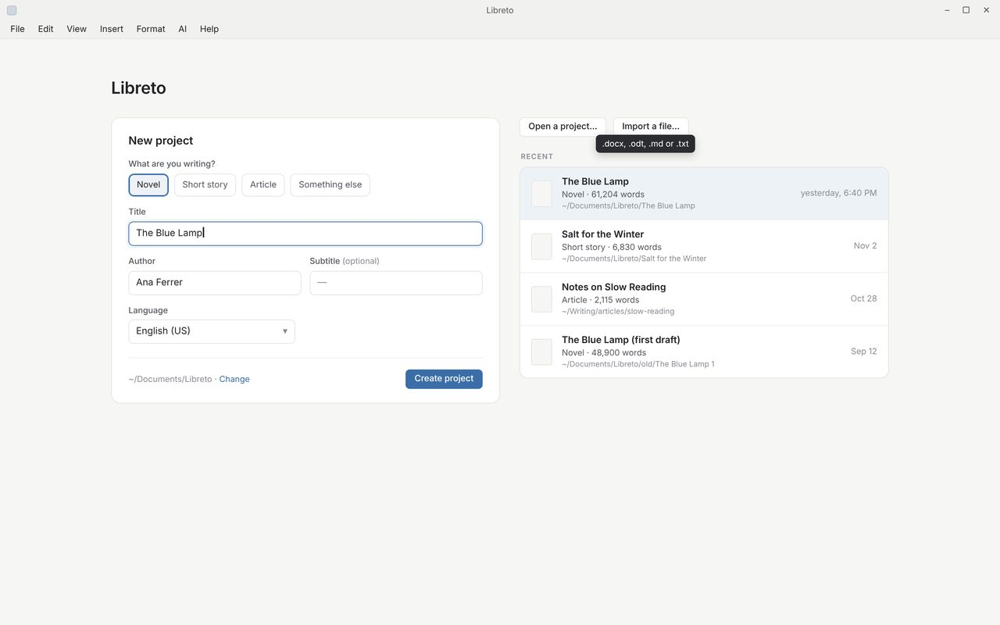

> [!NOTE]
> **Review note** · S00 · Start
>
> The directory should make clear a new directory or workspace will be created into that directory, so no need to create one with the title of the book. Or we should understand if the user already added it and do not create one inside the other one. Or "Documents/ (Recommended)". It's like git clone, I never know if the folder will be created or not. Some software that has got it the right way?
> Should top menus be contextual for each mode?

## S32 · What are you doing now?

Coming back after some hours, Libreto says where you left off and offers the five modes, each with what is waiting there: the chapter you were writing, cards not yet placed, clippings to sort, notes to review. One click gets the window ready for that job; `Enter` simply continues writing. It can be turned off.

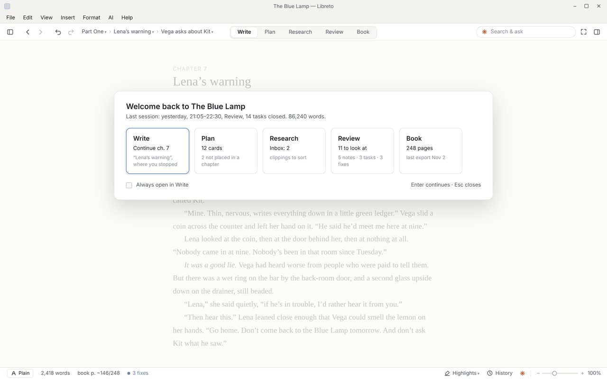

> [!NOTE]
> **Review note** · S32 · What are you doing now?
>
> Does "Always open in Write" changes if another one is selected? "Always open in Plan"? Or this is a default because it is logical? It's not clear if clicking with mouse will start immediately or if you have to pres Intro or what. If you need to hit Intro, then a button "Start" should be shown in case someone uses the mouse. Otherwise, it can be confusing. Don't put the Intro/Es message. Another option would be "Don't show it again", but then what's default? Or simply start where it was closed and the user will know if they want to switch modes.
> In your current view, if another mode is selected, the dimmed background changes too?
> When this dialog is open, toolbar should be greyed off as the text behind, right?
> Es would let you at currently selected mode? Is that mode the last one used?

## S01 · Write, the first minute

Write mode with nothing open: the page, a top strip and a status bar. The strip has the column toggles at its ends, Back, Forward, Undo and Redo, where you are in the book, the five modes in the middle, and Search & ask. The status bar shows the style at the cursor, words, the page this would be in the printed book, and small fixes Libreto made (a typo, a missing comma), each leaving one quiet mark you can undo.

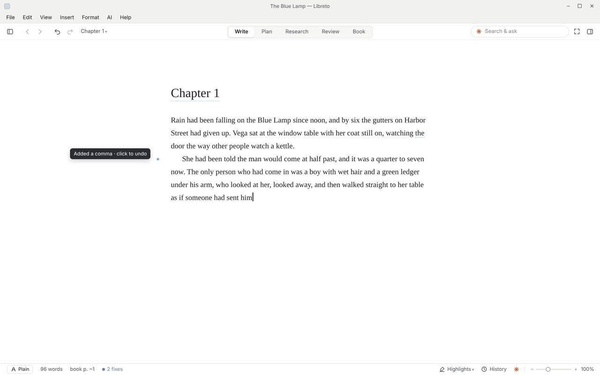

> [!NOTE]
> **Review note** · S01 · Write, the first minute
>
> I'd like dots to be at the right. And in the correct line if possible, not just the paragraph.   And if a comma was added, a minimum color or underline or whatever should be shown at the right place. If there are more than one comma, you can't know what was added.
> Maybe we could have three underline colors: red for orthography, blue for grammar/semantics and green for AI/Libreto corrections. Well  corrections are a whole category by themselves, which is good. Just show them similar to other corrections or warnings (Word's up and down underline).

## S02 · Scene breaks

Typing `***` on its own line makes a scene break. When the time or place jumps without one, Libreto suggests a break with a fainter line; nothing changes until you accept.

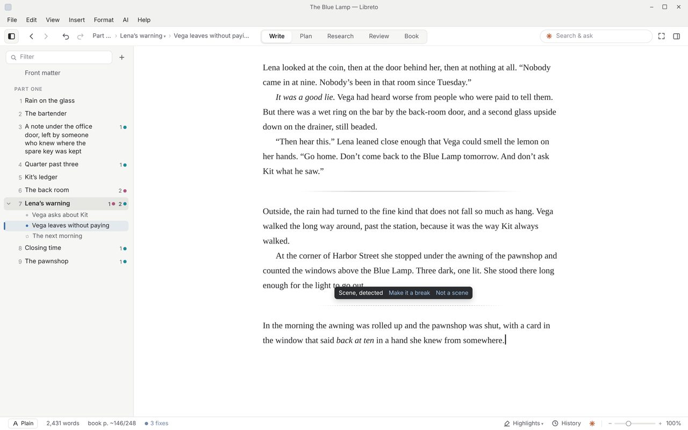

> [!NOTE]
> **Review note** · S02 · Scene breaks
>
> I like it. I can see "The next morning" is already a scene, when it is not yet confirmed. Is this auto-addition coherent with other fixes, like detected chapters? I mean, all auto-corrections should be shown the same to be a celtes or not, being it a bigger don't for a chapter or a line that just appeared, user should identify they are the same pattern. Here I see a message with two buttons. I don't remember, but I think a new detected chapter was shown as a dot or soft underline.
> What about deleting a scene separator? Is it as easy as hitting backspace or delete? Can it be done with the mouse? Will there be a way to undo it (apart from undo) if done by accident? Or a note saying how to add a separator for chapters. Does it have a place in Insert menu? How is the title created when auto-added? What happens to the left panel when deleted? A blink and a "Scene deleted" message for some seconds or simply it disappears?
>
> About both panels hiding and showing buttons, they are the same. It is coherent, but maybe they could be more clear about what they do or what they are. Maybe an icon of a list for the left and something else for the right? But they must show they are for opening and close something. I like how they are now, but they are so close to next icons that they look just like some other tool.

## S11 · Styles

Styles say what a piece of text is (a thought, a letter, a sign on a door), not how it looks; the look is chosen later per book or export. The chip at the bottom left always shows the style at the cursor; click it, or `Ctrl+T`, for the palette.

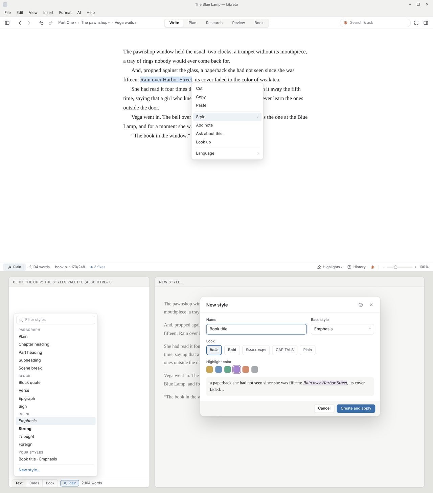

> [!NOTE]
> **Review note** · S11 · Styles
>
> Good! But how is scene separator a style?
> Is highlight color always shown or it is only when styles are enabled? I mean, a book title is not even shown in italics if styles are not turned on as highlights? Or it is in italics but not in color? We must make style VERY clear, that the user doesn't need to think to understand them, it must be absolutely natural to select and use.
> Is the style palette shown the same in right click menu than in status bar palette?
> Should we even call them styles like in Word or something that shows that they give texts a function?

## S07 · Hold Alt

Holding `Alt` shows everything Libreto knows about the page at once: characters, places, things, notes, tasks. Release it and the page is clean again. The Highlights menu in the status bar keeps some of them on permanently.

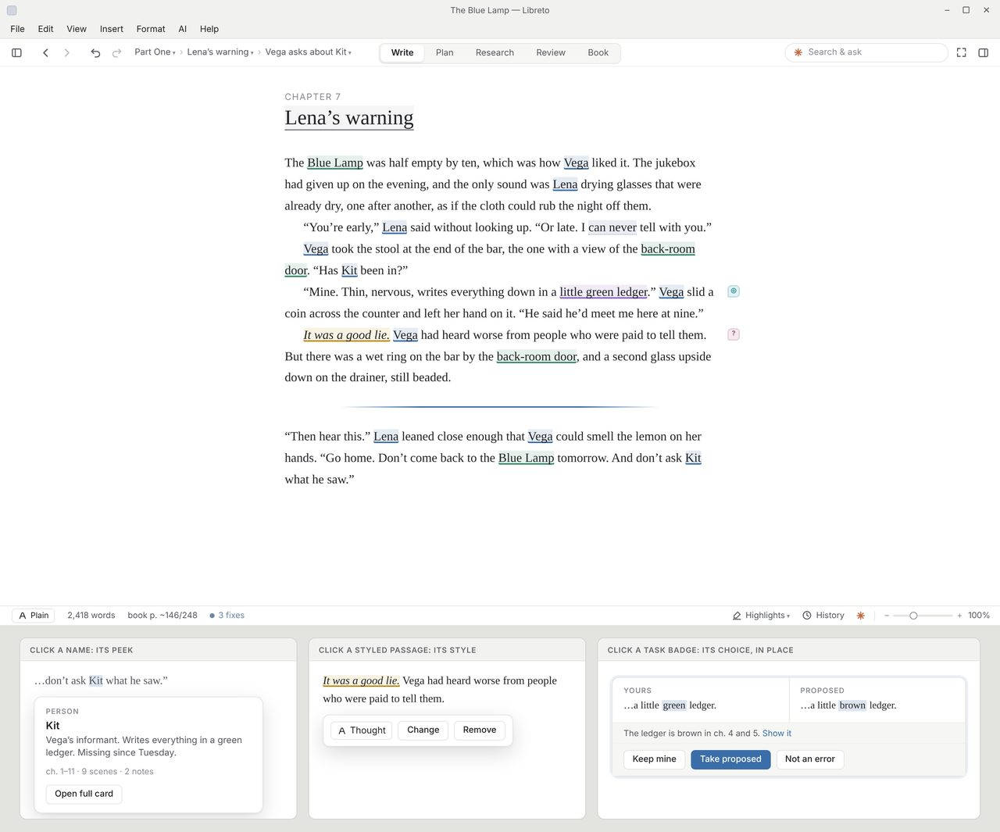

> [!NOTE]
> **Review note** · S07 · Hold Alt
>
> What is exactly what Libreto knows? I mean, it also knows things like "Lena threw a coin twice, ch. 2 and ch. 8". Should we talk only about entities?
> What if many notes are in the same line? They show one next to the other? What's the maximum? Are they then folded somehow?
> Good peak for persons,. I don't get the Change" button in style. Clicking the style name should open the styles panel.
> I like the Alt key for this, but it is also used in Windows for menus. And we also thought about possible features like multiple selections, which usually use Alt (we won't probably add that one, but...).

## S03 · Chapters, on the left

The left column in Write lists parts, chapters and scenes, with small counts of notes and tasks. One click peeks at a chapter without leaving your place; a double click goes there. Open it with the icon at the top left or `Ctrl+[`.

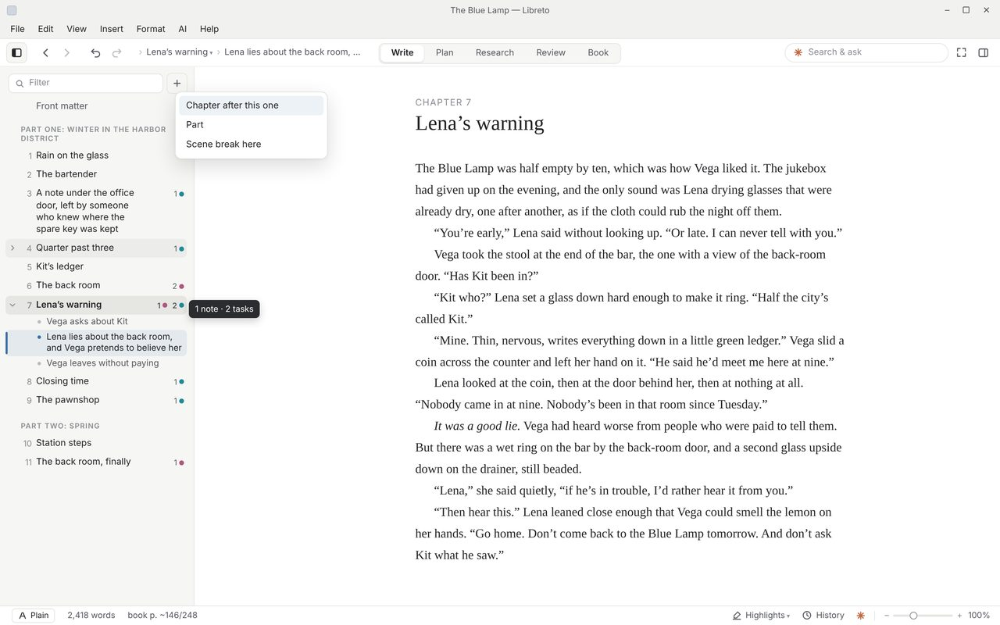

> [!NOTE]
> **Review note** · S03 · Chapters, on the left
>
> I don't like scenes are shown with a dot like a bullet list. Dots are confused with notes and fixes dots just to the right.
> Can't scenes have notes? Are all of them shown in chapters only? What if numbers grow? "1247 [red dot]"? Or we use 99+ or 10+?
> The "+" menu is not as clear as expected. Let's imagine someone that only uses write mode. Adding new chapters, parts or sections should be easier. Is a chapter added with Ctrl+Intro? What happens then? A new blank page, with or without "Chapter X"? How can a user how to add a scene if not told? A brief tutorial? How to add a chapter or a part before or after another one?
> I would not like buttons to create new paragraphs, chapters or scenes after each paragraph as a Jupiter Notebook, it would be dirty. But some easier way apart from the shortcuts would help. Maybe right click? And "Insert...". Or the Insert menu.
> Filter is only by chapter or scene titles, right? What about an extended search that looks into text? For example, "Lena" shows every chapter where she is mentioned.
> Are notes and tasks dot colors consistent in all the app? Could we try replacing them by icons? Maybe colored I ones to differentiate better, but a paper for notes, a tool or similar for tasks...
> I see breadcrumbs don't include part here. They will never have enough room. Maybe we must find another way...

## S08 · Search & ask

One box for everything: find a word, jump to "chapter 9", run a command ("export PDF"), or ask the AI a question about the book. Results open in place under the box and close with `Esc`.

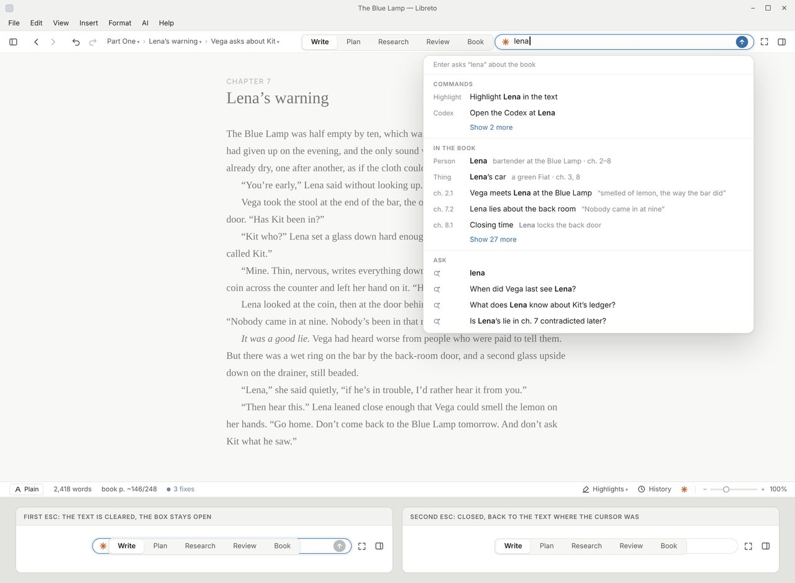

> [!NOTE]
> **Review note** · S08 · Search & ask
>
> I like it. But we need to be careful about spacing, it gets too close to the modes. And in your small screenshots it overlaps with them.
> One question: Which commands do exist? How to know them all? Are they useful at all? Or are they just an API for the AI? Can commands be called like something like "/", like with Claude? Will they be actual Class commands? Will users use them?
> Another thing: should selected style be shown in the bottom bar as styled text? I mean, the current "A" in italics, for example.

## S23 · Find and Replace

The classic `Ctrl+F` and `Ctrl+H`, in a strip at the top of the page, with "Rename everywhere" for characters so that "Lena" becomes "Lina" in the text and the Codex together.

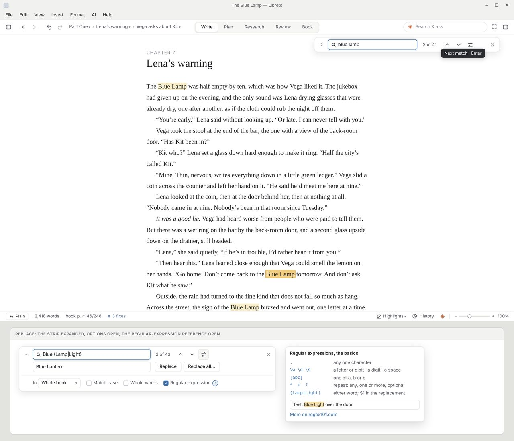

> [!NOTE]
> **Review note** · S23 · Find and Replace
>
> Replace all should open something interesting like a list of all with a "Just replace all" button or similar. What if what is being replaced is an entity or part of an entity from Codex? How is it handled internally?
> Could we have Claude to help with regular expressions?
> How do you choose the Test text example?
> Do search and replace panels have the same width? Here Find looks shorter and replace longer, which is weird if you click on the expanding arrow.
> What are the rest of the options of "While book"? "This chapter" and "This scene"? A way to check individual chapters? Too complex, no one will use that and will be confusing. But what if you are in the chapter view? Search will go jumping through chapters? How to come back to the initial place then? With the back arrow, I guess. How sensitive are back and forward arrows to cursor moving? Where even is the whole book view? I don't mean the book mode, I mean a way to read the whole book just like you can read a single chapter now, just by scrolling down. And how Chapter titles spacing is shown then?

## S05 · Peek and the Codex

Hover a name and a small card says who that is. "Open full card" opens the Side panel on the Codex: everything the book says about Lena, with quotes and the chapters she is in. The Codex fills itself from your text; you only correct it. "Open in Research" goes to the same entry in Research mode, with room for your material.

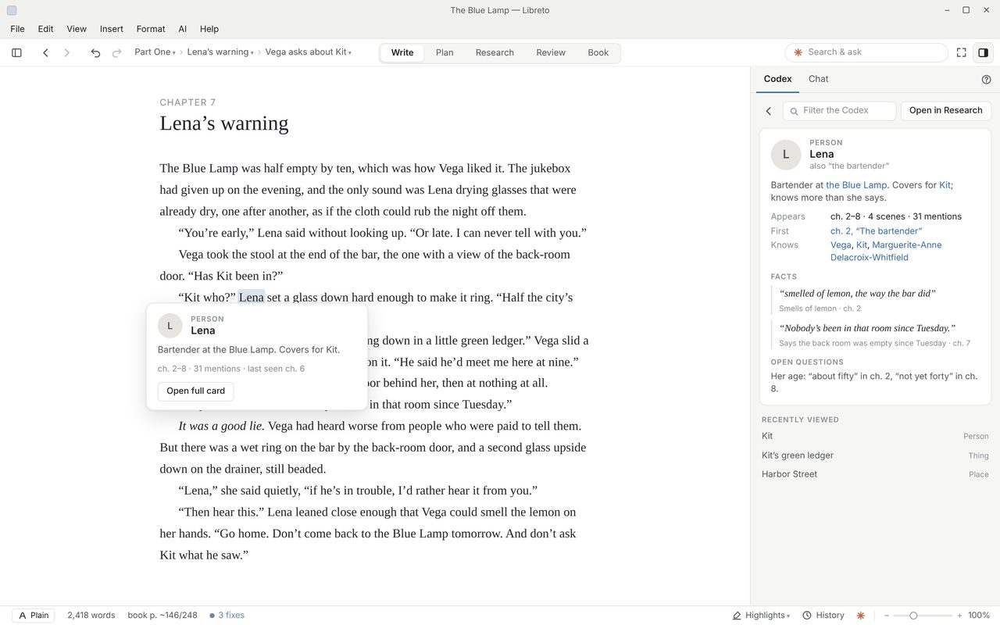

> [!NOTE]
> **Review note** · S05 · Peek and the Codex
>
> How sensitive is hovering? Most if the words will be known entities, and that can make moving the mouse around a hell.
> Good to have peek and card, but card is still short in info. I guess when I arrive the Research part I'll see it. I'm not yet sure Codex and research must be the same thing. For me they are very different things. Let's see.
> Also, first appearance of Chat. I think chat should be EVERYWHERE, always at hand, but I'll see it in next screenshot.
> Not sure what "Filter the codex" dies or if I tro in that field is the same as "Open in research" or how Back button (why not forward too) works here. Is it a simple codex explorer and you can click elements? What if I click on "ch. 2"? Does this panel disappears and it takes me to the place in text panel? Or something opens in that right panel?
> What's the question mark and how does it work? Is it help? I guess I'll see it later.

## S09 · Chat

The Side panel's second tab. You talk about the open scene; the AI marks the paragraphs it means and links to other chapters. It never types into your text: proposals arrive as a choice you apply or ignore. Drag a tab down to see the Codex and the Chat together.

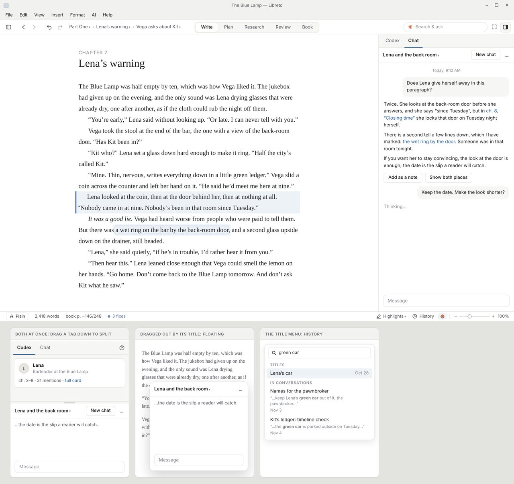

> [!NOTE]
> **Review note** · S09 · Chat
>
> Chat must be omnipresent, it is THE TOOL in this app. It must help everywhere, from asking about a character to finding a menu item to help with reflexes in the Find box. We need a place for it that can be hidden or collapsed but that allows for other elements to be seen. Maybe like a floating circle with a chat icon, as if it was a website technical help chat? Not sure, because Claude is much more complex than that and it needs some room. Here it also can show buttons to make a tions or links to websites or text parts (All it's abilities must be defined. I got Claude to show buttons that open Word at a given place in literary-critic, which is an extension of Claude Desktop, I hope we'll be able to do something similar here, where we control all the UI).
> I don't like two tabs while they are stacked, that does not make sense. I prefer chat floating over everything if needed, but it should be able to modify chapters (and the left panel), things in the right panel, text in the text panel, cards in the board... It must have a lot of power over the app through our API or whatever.
> I don't get what the title me u history is. Chat should show old chats when the user wants (similar to AI chats apps, that show them when clicking a list button.
> About models, is it possible to use small, local models for small tasks? What is a small task? Use Claude Opus to create the codex and then use local models from that moment on except for explicit chat? I don't think so.
> Another thing: I see that central text is moved to left or right depending on the panels open. That should not be like that. Text should always be in the middle of the screen and space taken from panels must be empty if not used.

## S25 · Write with everything open

The most Write can show, on a 1680 px screen: chapters on the left, characters, places and styles highlighted, note marks beside paragraphs, the Codex and the Chat sharing the Side panel. Shown to judge the load; no writer needs this all day.

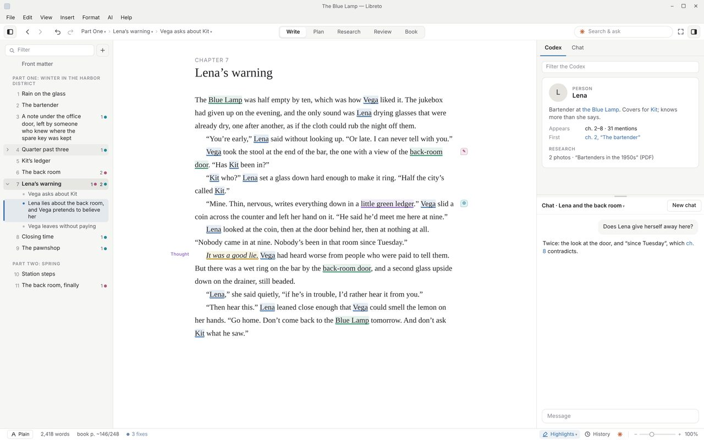

> [!NOTE]
> **Review note** · S25 · Write with everything open
>
> Good. As I just told you, text must always be centered.
> Search & ask and Chat are still confusing. Why using "ask" if you can directly chat? We need to make that clear. As I said, AI must be accessible from everywhere. Right now we have Chat, Search & ask and Find that overlap. We need to rethink that. Maybe Search & ask and chat should be the same, just Ctrl+K or similar and something is open at the right place. Let's think it more. And the Claude icon at the bottom bar can look redundant too. Maybe a floating Claude big button at the bottom right, equivalent to Ctrl+K, is the only chat help. It can be greyed out when there is no connection.
> As always, SIMPLIFYING.

## S26 · One key back to the page

Same moment, after `Ctrl+\`: both columns closed, highlights quiet. The same key brings back exactly what was open.

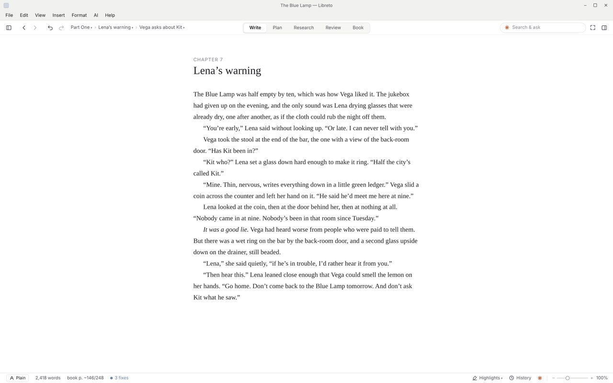

> [!NOTE]
> **Review note** · S26 · One key back to the page
>
> Yes, good. Just how many time are hidden panels remembered? I mean, what if you clise them with the keyboard shortcut and then you open right panel again and navigate, search, etc. What happens. Then you hide the panel with the side button. Then you click the restore button. What does it show?
> By the way, a backslash is hard to get in a Spanish keyboard. I'd prefer shortcuts are the same in all languages, so let's try to find some that always work. Ctrl+backspace to hide e everything? For example.
> Highlight button was highlighted in last screenshot and regular state in this one. How is it shown if only some highlights are enabled?

## S17 · Focus

The page alone, with no strip or status bar; moving the mouse shows "Exit focus". `Ctrl+Shift+Enter` or `Esc`.

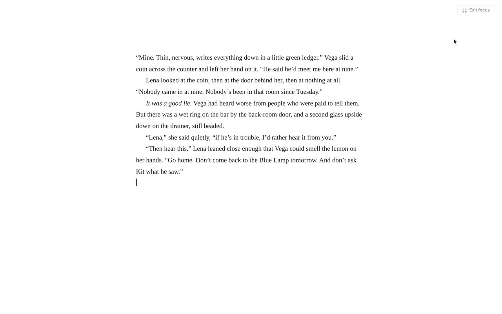

> [!NOTE]
> **Review note** · S17 · Focus
>
> Perfect. Is there a key to go back, in case there is no mouse or it stops working? Oh, ok, I see which.
> Another question: How does tabulation, first line indented and all that will work here? I want something standard for everyone, but I don't want to limit some formatting from the user.

## S24 · Plan

The book as cards, one per scene, in groups (chapters, or your own). Drag a card to reorder; before dropping, Libreto warns if the move breaks continuity ("Vega reads the ledger before Kit finds it"). Nothing changes in the text until "Apply order". It is a mode because cards need the full width.

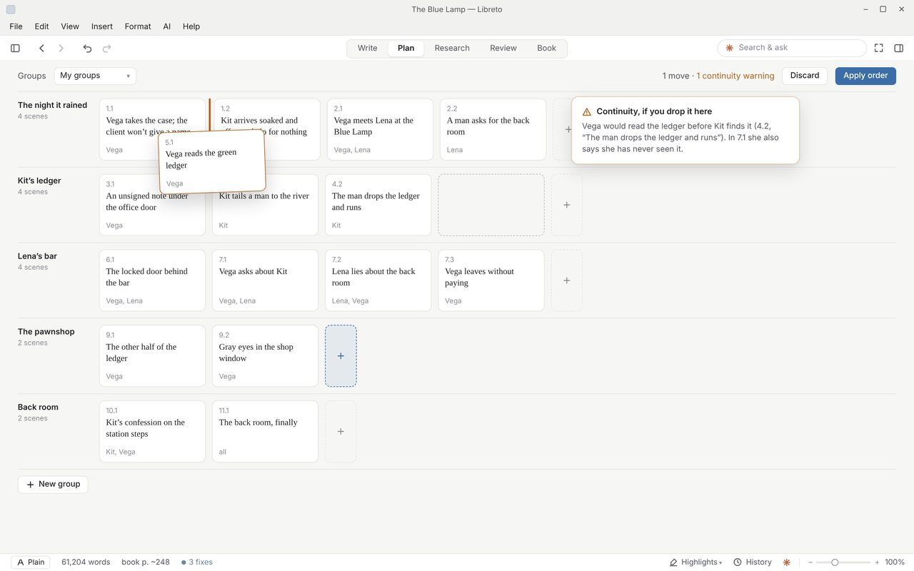

> [!NOTE]
> **Review note** · S24 · Plan
>
> How and when and where do AI reads the text to extract scenes if the writer didn't add them? In general, when does it do this kind of things? In the background? And when does it communicate to the user? Does it generate tasks when not asked? Should this behavior be enabled or disabled?
> What if someone changes a card to a new place and doesn't confirm it and tries to move away? A warning should be shown.
> Can groups be moved? What if you delete a group that has scenes? Can scenes be out of a chapter/act? How are they shown in the chapters list in writer mode?
> I had seen in another screenshot something like a notice "Don't worry, you can still move it, things will be fixed later" or "tasks will be created to fix inconsistencies", similar to GitHub when creating a PR and branch is not updated or similar.
> Should some more info be shown (when hovering or clicking or something) to have a better idea of what happens in the scene? Or an item list with the most important facts. I mean, small cards are okay, it's the best way, but maybe we need something more.
> Also, I think in Save the cat there were colors as something important. Can it be? Look for how people uses them to take more ideas. But don't for e them, simple is better.

## S29 · Research

The Codex at full size, with your material. Left: the library (an Inbox for unsorted clippings, then people, places, things and topics). Center: the material itself, large: photos, PDFs, web clips. Right: your notes, facts pinned from the material or from the text, links, and where it appears in the book. You bring material in by dragging files or links onto an entry, with Insert ▸ Research, or by telling the Chat "keep this". It is stored inside the project, in `research/`, so it travels and backs up with the book, and it is never part of the text or its word count.

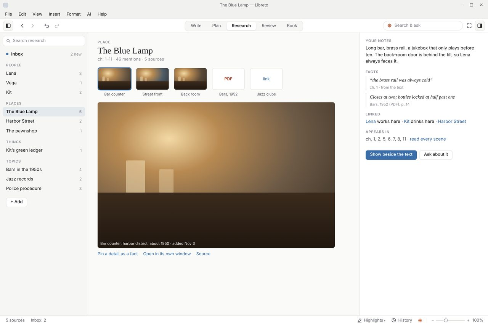

> [!NOTE]
> **Review note** · S29 · Research
>
> How to link things or ideas? Are those links from Codex or from research ideas?
> I don't see that codex and research are the same, although of course they are related. But maybe a time is being researched (e.g. s.XIX), and this is not an element in codex. And other things in codex (a character) may not have a linked research. We need to rethink this part too.
> Linking is the hard part here.
> How is research done? Something similar to text mode? With styles, titles, etc. and images. By the way, a book should also be able to include images (or links, etc.).
> How info is structured in the main screen and in right panel? I see notes in the right panel, but the text should have been written by the author. Then there are attached files (PDF...). Who and how are they attached or added to the research.
> AI Chats must be here too. For example, the user gets some pictures and AI generates the definitive one from them.
> About Codex, it would be nice to add pictures to the element (character photo or drawing, place picture...).
> AI should be able to help organize info here, although anything AI can do, the user must be able to do it too (through what I call our API, that can be used through AI actions or UI buttons, menus or links). For example, improving the research or the research documents (they should be very similar to chapters), linking things, etc. And, of course, AI must be able to generate questions, issues, comments, etc. that help with research and that questions the Codex.
> The right panel I see here has notes about chapters. I understand they are linked after the book chapter is written, although research can also take things from the book so that research can be completed. And both get feedback from each other.
> What are the numbers on the left panel? The number of resources?
> We need to define what a research topic is structured or how it looks like. I don't say that we should not allow unstructured info there, that is good too, but it must be able to be organized (AI can help there).
> I expected to see in the left panel something similar to a folder and file box, but I like to create topics, give them a title (how to edit it in the screenshot) and contents, edit, split, merge and delete them.
> Let's rethink codex and research and how they are linked.

## S30 · Research beside the text

While writing, you often need one thing in view: the photo of the bar, two facts. "Show beside the text" pins that entry in the Side panel in Write; "Own window" sends it to a second monitor. Gathering and sorting happen in Research; using happens beside the text.

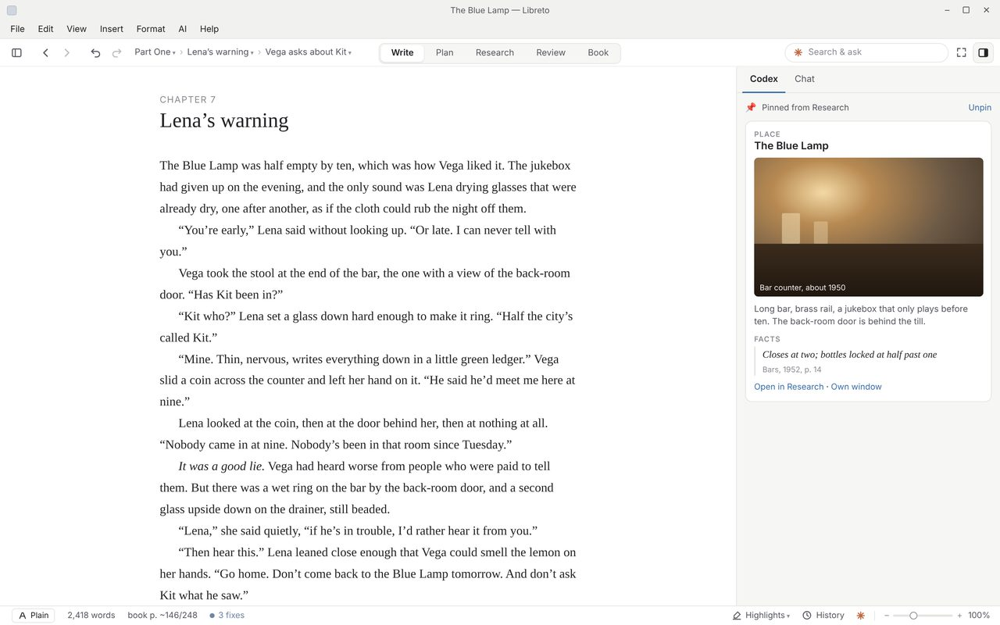

> [!NOTE]
> **Review note** · S30 · Research beside the text
>
> I don't still get your "pinned" thing. What is the codex view if there's nothing pinned? I think of the codex as something complex that maybe can't be shown to the user )too much info and too many links), but of it could be shown, it should be in the main screen, while the right panel in Write mode should be a way to query it and show things, so a search box is needed. But again, we have many search boxes. Should we use AI in this one or not? We need to rethink codex. And research. And how to show them and how to query them and how to link their info to text and who does that link.
> I don't understand what you mean by second monitor. We can't expect the user to have more than one monitor.
> I see it this way: what may the user need at some point? He is writing and he wants to di some research about something unrelated: he opens research mode. He wants to read the research he did about a topic (Blue Lamp): he clicks somehow Blue Lamp in the text and selects Research and he sees it in the right panel. If he wants to continue with it, he opens the research mode from there.
> I agree that codex is info about book elements, but codex is what is already built (a connected database) and research is not necessarily accepted material. Moving info between them must be worked to be easy, but they are not the same.

## S31 · Review

The second pass. Left: everything waiting to be looked at (your notes, your editor's, the AI's checks, the small fixes), by chapter. Center: the text. Right: each note beside its paragraph. "Review all" walks the list one by one; "AI: review this chapter" adds its findings to the list, never to the text.

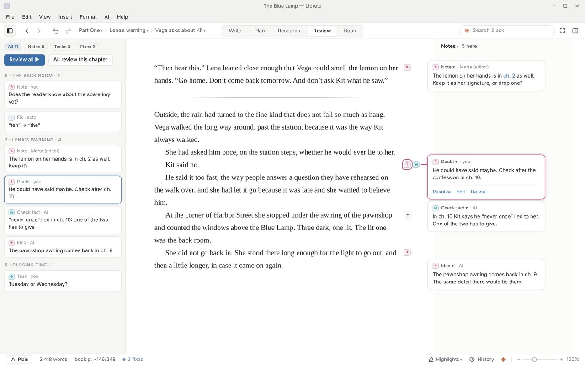

> [!NOTE]
> **Review note** · S31 · Review
>
> Quite good flow. Difference between note, task, fox...?
> How to know Marta is editor? Is there a list of collaborators?
> Do some types of comment have buttons? Accept, reject, mark as resolved, delete... Why not all, with AI help? Others show both versions, one current and the other one fixed. If I change the comment type, what happens to buttons?
> I'd like to see lines for all comments, from their icon to the right bubble. With angle, probably. And the double scroll. And icons not only in the correct paragraph but in the right line. And the affected text marked when possible if the comment is selected.
> It's weird to have a list of items to the left and the items also to the right. I know left are from the whole book.

## S04 · Notes in the margin

A closer look at the margin in Review. Notes have kinds (note, doubt, fact to check, idea) and say who wrote them; Resolve keeps them in History. In Write the same notes are only small marks beside the paragraph.

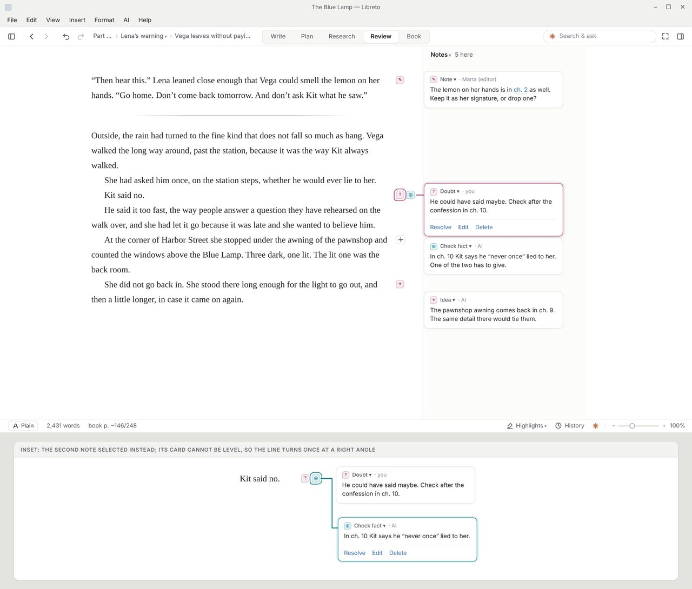

> [!NOTE]
> **Review note** · S04 · Notes in the margin
>
> Ok, now I see lines. Maybe better, only selected one has the line. Would it be a good idea to move the active one next to the actual text line? It's that or adding the double scroll with lines between all them.
> About dots in writer mode, what happens when clicking, it moves to review mode or it just shows the note? Maybe we need to rethink modes, sometimes when writing the writer wants to fix a small issue. It's not just writing or just fixing, it's usually both.

## S21 · An editor's copy

You send the book to an editor as a Word file and get it back annotated. Libreto reads their comments as notes and their changes as proposals, and shows both in Review.

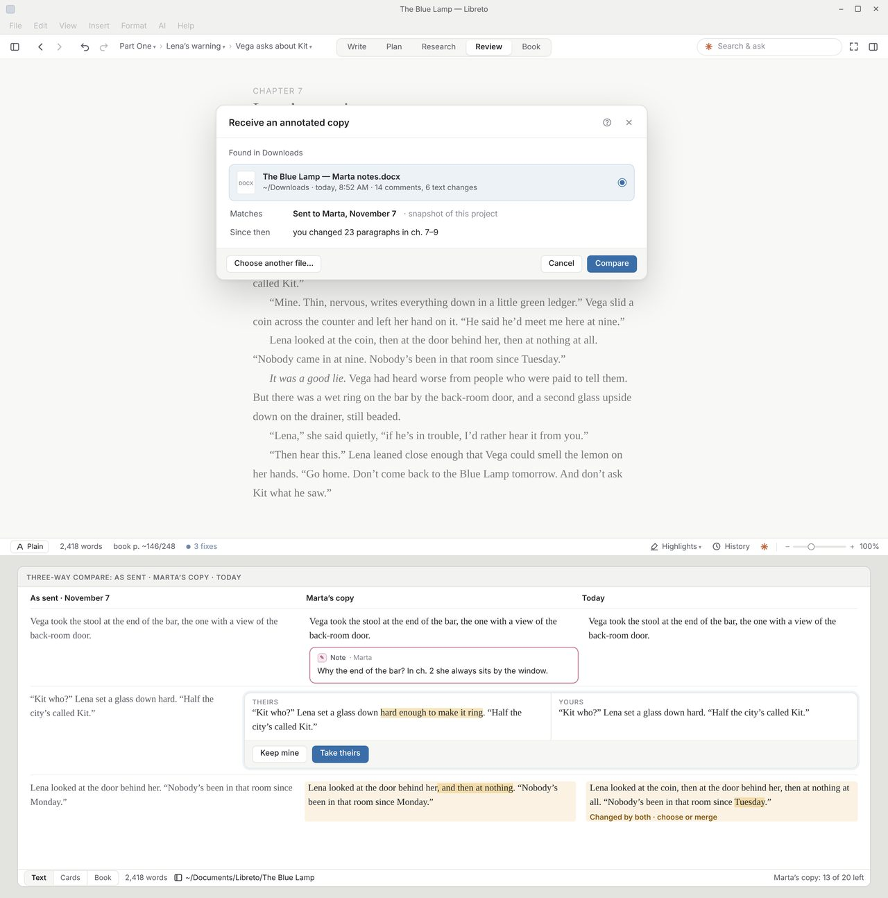

> [!NOTE]
> **Review note** · S21 · An editor's copy
>
> Good! This is a complex flow  so it must be done easy to use and understand. Should each version be copied from Downloads to the project directory, inside versions/ or reviews) or similar? Will that be added to history?
> Three way compare is also a very complex diff thing. It must be done easy, with buttons to keep a version or another or to just edit that part. Maybe AI proposed solutions. One or two options mixing two versions, that take into account editor and writer's changes. This must take all the screen, so it could be a mode by itself. We need to think a lot about it. I don't like too many modes.

## S15 · Compare an old version

Any earlier state of a chapter beside today's, paragraph by paragraph; take back one paragraph or the whole chapter.

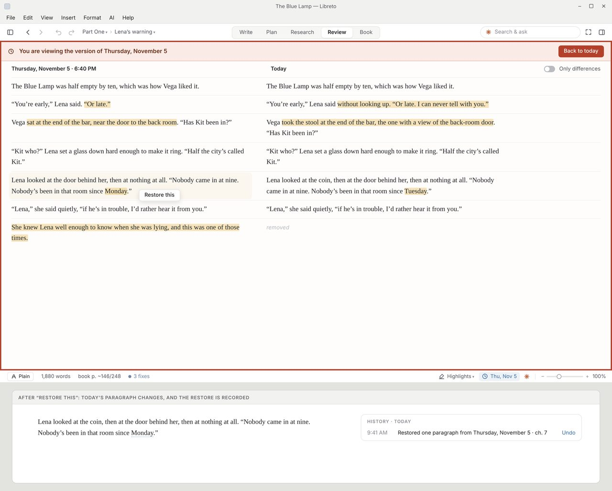

> [!NOTE]
> **Review note** · S15 · Compare an old version
>
> Diff can be hard to implement.
> Does showing only an older version without diff make sense?
> How to keep, restore or edit a text fragment? If it can be done with buttons or showing how it would look, that would be great!
> In which mode are we supposed to be? How to manage sent and received versions? How can AI help here by reading or sending emails, moving files from Downloads and email to the project dir?
> What if the whole project is shared? We need to compare Libreto's projects or import a copy to compare. Only text and comments or also changes to codex, research...

## S14 · History

Every writing session is kept with its time, words and changes. The status bar's History opens the list; you can ask it "when did I write about Lena's car?".

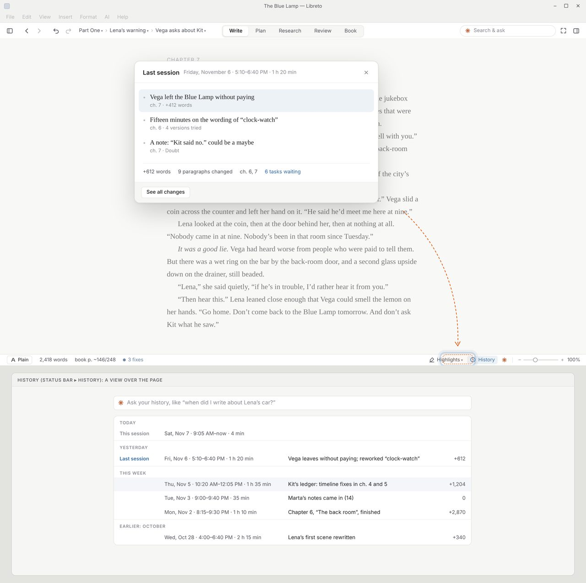

> [!NOTE]
> **Review note** · S14 · History
>
> What is seen when clicking on one line? Last screenshot showed how a single change was added to the history. Is compared dual view linked from here?
> Should it be a new mode?
> Again, how to include AI here? Only search or also chat?

## S16 · Book

The book as it will be printed: choose the page size, fonts, chapter openings and running heads, then read it as turning spreads. Export (PDF, Word, ePub) is here.

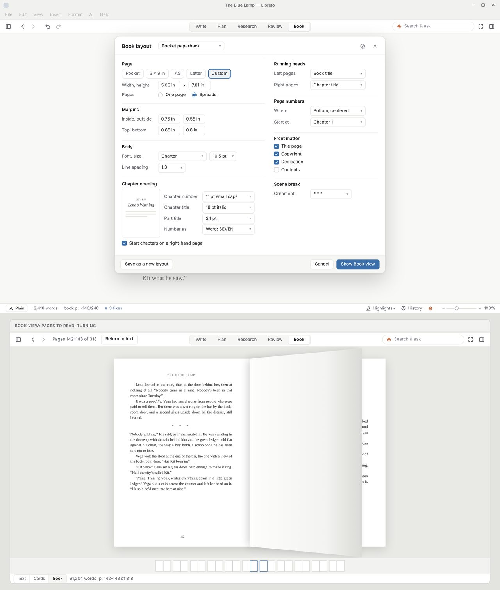

> [!NOTE]
> **Review note** · S16 · Book
>
> Accept cm too.
> What if the author doesn't want chapter titles or neither "Chapter X"? Maybe he wrote a title for convenience when working, but he only wants a new page and space.
> We need usual templates.
> How fast can compiling be?
> Also, are we limited to MD elements? Or which kind of format we finally decided?
> Keyboard shortcuts to move through the book (arrows, etc.).

## S22 · The AI, connected or not

The orange star at the right of the status bar is the AI: in color when connected, gray when not. Click it for the level of help, the cost this month and what the AI has written. Libreto works fully without it.

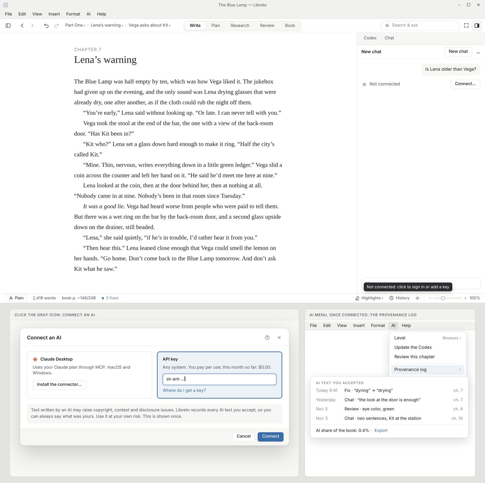

> [!NOTE]
> **Review note** · S22 · The AI, connected or not
>
> Disclosure should be always shown at that screen. And more visible, with some warning sign.
> The rest must be tested, but looks good.
> All icons in the app must follow the same style!

## S18 · Settings

One window, grouped by topic, each group with a "?" that opens its help. Most writers never need it.

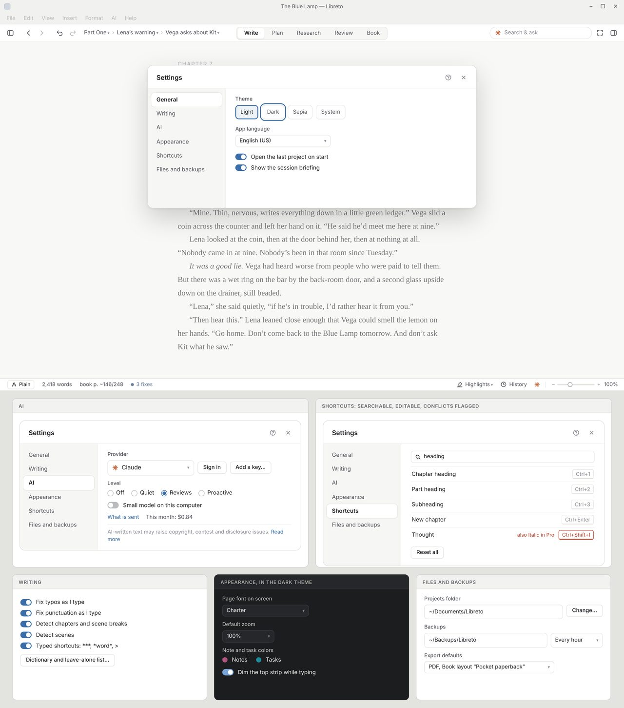

> [!NOTE]
> **Review note** · S18 · Settings
>
> Nice!

## S19 · Help

`F1` opens help about what you are looking at, in the Side panel, beside the work. Tutorials are small projects you edit while reading them.

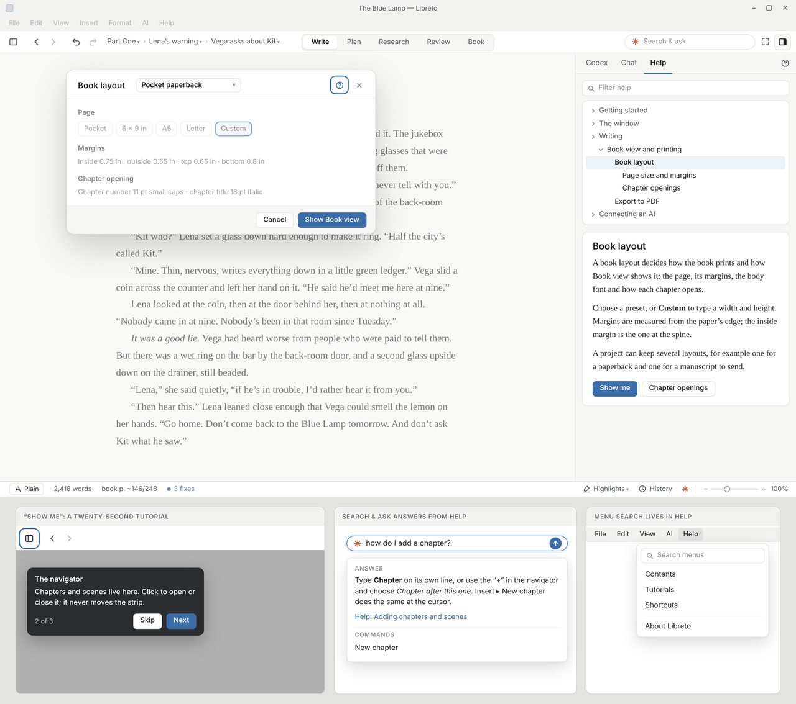

> [!NOTE]
> **Review note** · S19 · Help
>
> This looks very good. Again, I'm not sure about showing another tab in the right panel. How many tabs can it hold? Can they be closed? When do they appear?
> We must design all tutorials and which buttons do they have. Are they needed to be followed all the steps? Must they be finished?

## S20 · Statistics

Words per day and per chapter, sessions, goals. Kept out of the way: from the word count in the status bar, or View ▸ Statistics.

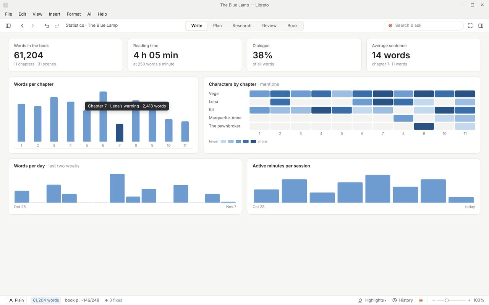

> [!NOTE]
> **Review note** · S20 · Statistics
>
> Nice! To be refined and thought.
> An X to close this view? Sub views with more details?

## S27 · Everything in the status bar

Not a real moment: every menu of the bottom bar opened together, to see at a glance what lives there.

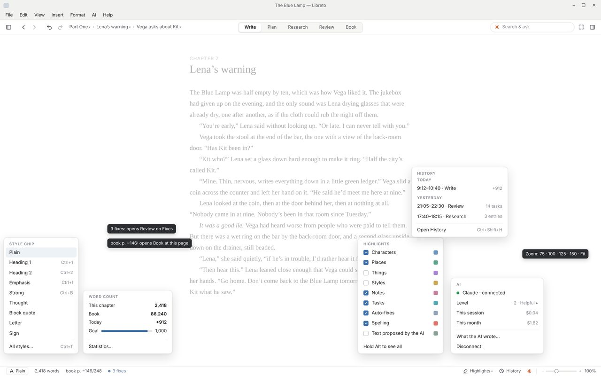

> [!NOTE]
> **Review note** · S27 · Everything in the status bar
>
> Can styles be filtered in the list?
> Objects in highlights?
> Fit in zoom is also on the slider?
> History rows can be clicked?

## S28 · Everything in the menus

The seven menus opened together. Every item is also a command in Search & ask and shows its key.

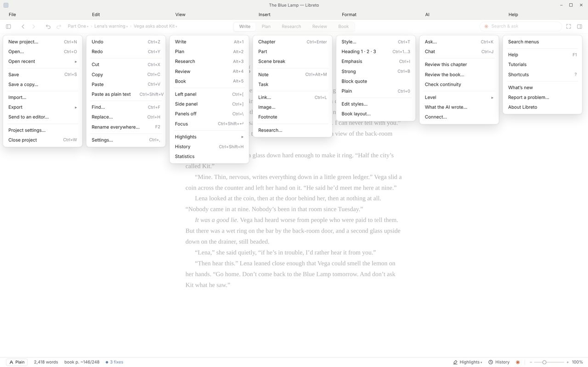

> [!NOTE]
> **Review note** · S28 · Everything in the menus
>
> Send to an editor ..? Or just send?
> Ctrl+0 for plain... It could be reset zoom.

## What changed in draft 3, and why

- **Modes replace views and workspaces.** Draft 2 had four axes (view, workspace, focus, highlights) and asked the writer to combine them. Draft 3 has one visible choice at the top, named by the job, as photo and video editors do with their task pages. Text, Cards and Book views became Write, Plan and Book; Research and Review are new full modes.
- **One rule for the columns.** Left lists, center works, right helps, in every mode.
- **Research is a mode, plus a pin.** Sorting material needs room, so it gets the whole window; using it while writing needs one item, so it pins beside the text or goes to a second window. Writers who split one screen between draft and research call it clutter; this avoids the split.
- **Codex and Research are one.** The Codex window is gone: a full Codex entry is the Research mode.
- **Tasks left the Side panel.** The Side panel has two tabs, Codex and Chat. Tasks, notes and fixes live in Review; in Write they are small marks.
- **Smaller status bar.** No view switcher, workspace or chat button; modes are at the top.
- **Keys.** `Alt+1…5` modes, `Ctrl+[` left column, `Ctrl+]` Side panel, `Ctrl+\` both, `Ctrl+J` chat.

> [!NOTE]
> **Review note** · What changed in draft 3, and why
>
> Some of those shortcuts are hard to do in a Spanish keyboard.
> A place to tweak keyboard shortcuts?

## Questions

1. Five modes named Write, Plan, Research, Review, Book: right names, right number?
2. Codex and Research as one thing (the Codex at full size is Research): yes?
3. The Side panel with only Codex and Chat, and tasks living in Review: yes?
4. Should the AI search the web for research (costs, needs a capable provider), or only read what you bring?

> [!NOTE]
> **Review note** · Questions
>
> Everything is mostly answered. About researching the web, of course!
