# Libreto — Specification

> Reviewed copy of `libreto-screens-d4-v1-2026-11-11-0005-reviewed.html`: the document as it was annotated, with 9 notes by the owner under the sections they are about. The HTML file is the annotatable version; open it in a browser to read the notes beside the text.

## Preamble & scope

**Revision**: 1

Status: **for annotation.** One document, in the order a writer who has never seen Libreto would meet things. Before each screen, a short paragraph says how you get there, what it is for and what it lets you do; then the picture. Not a guide and not a specification. The pictures are in `concepts-d4/`; the review page puts a note field under each one.

Draft 4 answers the draft 3 notes by taking things away. The list of what changed, and why, is at the end, with the open questions.

## Libreto in one minute

Libreto is a writing app for books. Its window is a **page in the middle**, with two columns that can open beside it and never move it: on the **left**, a list of what you are working on (the chapters; in Research, your material); on the **right**, the **Reference panel**, which shows one thing at a time: a person, a place, a research topic. Along the top, five **modes** name the job you are doing: **Write, Plan, Research, Review, Book**. Choosing one dresses the same window for that job; it never takes you somewhere you cannot come back from with one key.

The AI has **one door**: the round **Ask** button at the bottom right of the window, or `Ctrl+K`. The same box finds a chapter, looks up a name, runs a command ("export PDF") and asks a question about the book; when the question needs the AI, the box becomes a conversation. The AI can do anything you can do in Libreto, but it never changes your text, your chapters or your cards without a button you click first. When no AI is connected, the button is gray and the box still finds, looks up and runs commands.

Five rules hold everywhere:

1. **The page never moves.** Columns open in the margins; the text stays centered.
2. **One family of marks.** Red, blue and green underlines on the exact characters; small icons in the right gutter at the exact line; the same icons count in the chapter list, in the Review list and in the Highlights menu.
3. **One way back.** `Esc` closes whatever just opened and returns the cursor to the text; `Back` (`Alt+←`) returns from any jump, across modes too; `Ctrl+Shift+H` hides both columns and brings them back.
4. **Nothing replaces your words unasked.** Fixes while you type are small, green and undoable; everything else arrives as a proposal with buttons.
5. **Keys that exist on every keyboard.** Letters, digits, F-keys and Enter with `Ctrl`, `Shift` and `Alt`; no brackets, slashes or backslashes.

| Mode | Left | Center | Right | What it is for |
| --- | --- | --- | --- | --- |
| Write | chapters (optional) | the text | Reference (optional) | writing; the default |
| Plan | chapters (optional) | cards, full width | Reference (optional) | seeing and reordering scenes |
| Research | your library: the Codex and your topics | a topic or a Codex entry, large | what it links to | gathering and sorting material |
| Review | chapters with counts and filters | the text, margin open | notes beside their lines | the second pass |
| Book | page thumbnails | spreads | layout settings | printing and exporting |

History, Compare, Statistics and Help are not modes: they open **over** the window as a sheet with "Back to the text" at the top left, and `Esc` closes them.

> [!NOTE]
> **Review note** · Libreto in one minute
>
> I see you stay with Codex = Research. Let's see how you did it.
> Plan may not need left and right panels. Maybe all room must be for cards.

## S01 · Start

When Libreto opens with no book, it asks for the least it can: a title and where to keep the book. The point of the screen is the sentence under the location: it names the **exact folder Libreto will create**, so there is no doubt whether a folder is made inside the one you chose. It always is: one folder per book, named after the title, inside the location; everything about the book (text, notes, research, history) lives in it. "Documents/Libreto" is the default and is marked recommended (on a Spanish system it reads "Documentos/Libreto"); "Change…" picks another place and the sentence updates. Recent books open with one click; "Import a Word file" turns a manuscript's headings into chapters.

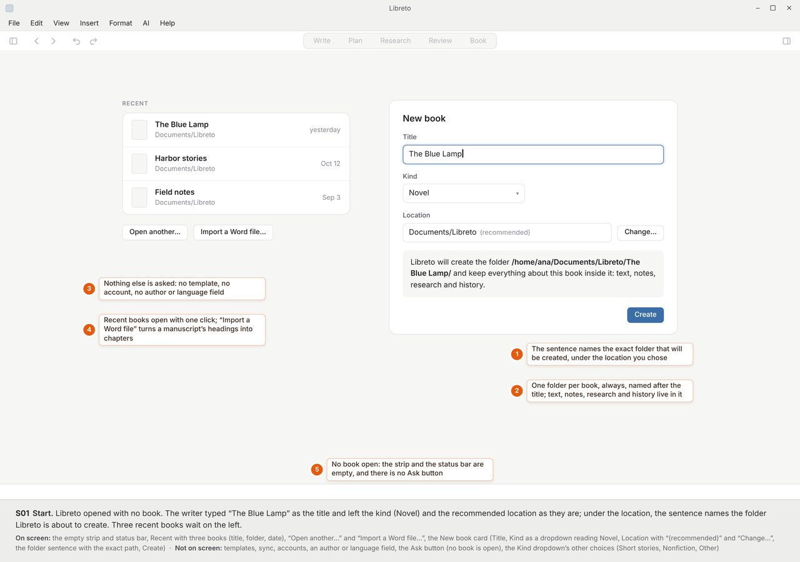

> [!NOTE]
> **Review note** · S01 · Start
>
> Let's make it even clearer. Just under the chosen directory it must show something like "Final directory" or "It will be stored in:". And the final directory in one line, growing when the user types. It must remove or replace invalid characters. The note about where everything is stored, below it, always present.
> What about creating an image for each project? Maybe created by AI (just a small icon) or at least a placeholder image or letter or a color. I think that could be motivating when the writer starts working on something.

## S02 · Write, the first minute

A new book opens on an empty page in Write mode, both columns closed. The top strip has the column toggles at its two ends, Back, Forward, Undo and Redo, where you are in the book, and the five modes in the middle. The status bar shows the style at the cursor (in its own look), the words, the page this would be in the printed book, and how many small fixes Libreto made. The round **Ask** button at the bottom right is the AI's door; its tooltip says `Ctrl+K`.

The marks are the thing to look at. Three underline colors, always on the exact characters: **red** dotted for a spelling suggestion ("recieved"), **blue** dotted for grammar or punctuation Libreto is not sure about, **green** dotted for a change it already made ("teh" became "the"; a comma was added, and the underline sits under the comma itself, two characters wide so you can find it). Hovering a green mark says what was there; a click undoes it. In the right gutter, a small green tick sits at the line of each fix. Nothing else is on the screen: no toolbar, no panel, no hint text.

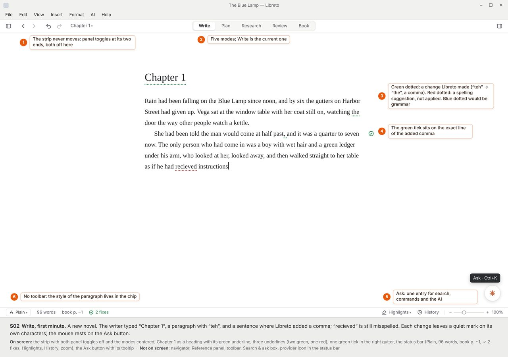

> [!NOTE]
> **Review note** · S02 · Write, the first minute
>
> Good. I'd like to see what happens when hovering. I'd expect a small block with what was, what is and a check mark or an x. Just easy to understand and quick to solve. Maybe with the title "Changed" or "Fixed"... In a review work (we'll see later) they should be present too.
> Why it replaces "the" and not "received"? What's the difference about what's sure and what is not?
> Some light animation should be shown when fixing something.
> In your image there are more than one green underline but only one green check next to the line, I think it's only as an example.
> About top bar, I like modes centered, bu I also know breadcrumbs won't usually fit. What about moving modes to the right, now there isn't search box? I don't like it, but the other option is using two lines, and I want to save vertical space for very horizontal laptop screens with bigger fonts.
> About items in bottom bar, maybe they should look more like buttons or something that will show more info. They look like simple text now, but most of them will show things when clicked. A hint is good, but not enough.
> How will grammar be managed? A long blue line under all the affected text? I've recently seen in Gmail two underlined elements to fix the same error (for example, rewording a sentence. It's nice, but maybe one only line covering all is clearer and can be fixed similarly to what I explained about hovering and accept or reject. How to show the hovering hint when you only use keyboard?
> What if grammar and fix or typo are in the same word? Two underlined? Is it possible?

## S03 · The marks, up close

Not a moment in the app: the family of marks at twice the size, so the rules can be checked once. Underlines: red = spelling, blue = grammar, green = done by Libreto; a **dashed gray** underline or rule = something Libreto proposes but has not done (a detected chapter heading, a detected scene). Gutter icons at the exact line: an amber **note**, a blue **task**, a green **fix**; several on one line stack sideways, three at most and then "+2". The same icons, with numbers, count notes and tasks beside each chapter on the left, label the filter chips in Review, and sit beside the checkboxes of the Highlights menu. The rule to remember: **dotted green is done, dashed gray is proposed, icons in the gutter are things to look at.**

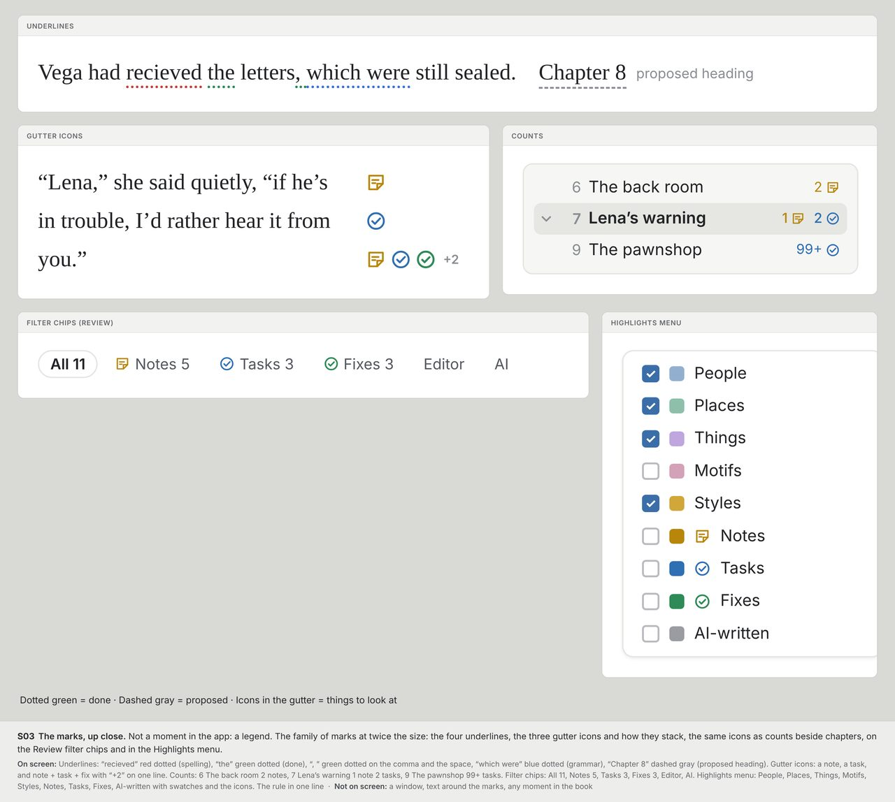

> [!NOTE]
> **Review note** · S03 · The marks, up close
>
> In the proposed chapter line, does it mean a new file has been created or not until the user accepts it?
> I talked before about writing by chapters or do it in a continuous all-book view. You didn't get me a solution for that yet. Should it exist? It must be another view (maybe something similar to the classic full text, one page, two pages view in PDF viewers, but for continuous or chapter views), it could be centered in the bottom bar, for example. The left panel titles should be there anyway and move to the place when double clicked.
> It can be useful for some people to work kike this or for a moment in which the writer wants to see how a chapter ends and the next begins.
> A way to go to the next one in chapter view? Shortcuts. I mean, how to go from one end of a chapter to the other end of the closest one. Down arrow? Next page? Or next page moves down as expected and another next page when at the end moves to the next chapter? Maybe even a preview? "Next: Chapter 7: Lena's warning" greyed at the end? And clicking it or moving the cursor and intro. Think if a solution, because the same method should be used at the top of a chapter to go to the previous one (go to the end of it?).
> Back to the screenshot, what happens when clicking on 2+ or 99+?
> Should red underlines have their own icon too? And appear in review?
> About Editor, it should be more generic, we don't have a way to identify implied people. Maybe AI could do some magic: "Martha", "Jules", given the origin of the source.

## S04 · Coming back

Libreto reopens exactly as you left it: same mode, same chapter, same columns, the cursor where it was. No dialog asks what you want to do. Instead, a line at the bottom of the window says for a few seconds where things stand: when you last wrote, what is waiting (cards not placed, clippings in the Inbox, notes to review). Clicking it opens Ask with the same summary and a button for each item; ignoring it costs nothing. It can be turned off in Settings.

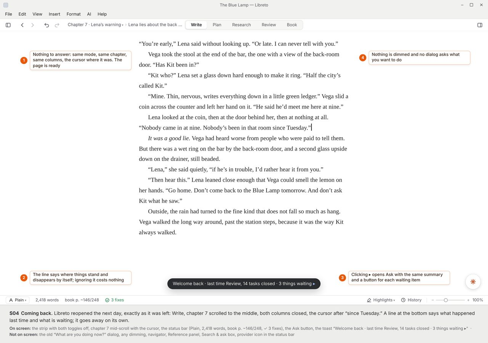

> [!NOTE]
> **Review note** · S04 · Coming back
>
> Good, but I don't like things that show for some seconds and that you can't recover if you see them late. Maybe make it last longer? Maybe an option into Ask for "Summary from last session"? Blinking it at the beginning? An animation moving into Ask so that you learn about it? In that case, it should be in a visible way, maybe a black line at the bottom is not enough.

## S05 · Chapters, on the left

Open the left column with the icon at the top left or `Ctrl+Shift+L`. It lists parts, chapters and scenes. Scenes are indented under their chapter with a thin guide line and lighter text, **no bullets**, so nothing on this list looks like a mark. Beside each chapter, the same gutter icons count what is waiting there ("2 notes · 1 task"), capped at 99+. One click peeks at a chapter without leaving your place; a double click goes there; `Back` returns. The filter box at the top matches **titles and text**, so "lena" shows every chapter where she appears, with a count. The breadcrumb in the strip names the chapter and the scene, each a menu of its siblings; parts live only in this list.

Adding is meant to need no key: the **"+ New chapter"** button at the bottom of the list (after the current chapter, with the cursor in its heading), a right click on any row ("New chapter before / after", "New part", "Rename", "Delete chapter…"), the **Insert** menu, or simply typing "Chapter 8" on its own line. `Ctrl+Enter` does the same from the keyboard: a heading "Chapter 8" appears at the cursor, waiting for a title; the text after the cursor becomes the new chapter's first paragraph, and Undo puts it back.

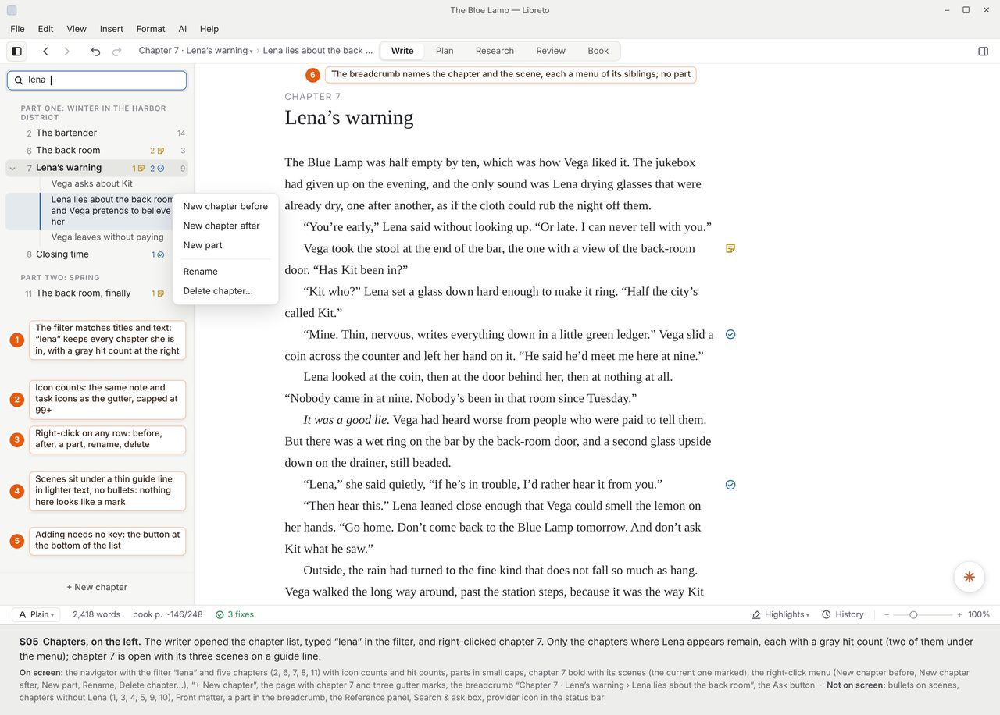

> [!NOTE]
> **Review note** · S05 · Chapters, on the left
>
> When filtering, the word Lena in the title "Lena's warning" should be highlighted.
> Would it be useful an ad danced search or not at this place?
> Is the word counter also capped at 99+?
> Chapter before and after is ok. What about part before and after? Or new scenes before and after? Is there a warning when deleting something? "You are deleting this scene. It contains 1300 words (about x pages). Are you sure?". What about deleting the part, chapter or scene MARK? So not deleting content but making it more continuous? What if I add a part between 2 scenes? A new part and new chapter are automatically added? Can a writer just ignore chapters and scenes and just write? For example, a short story or simply the way he works.
> If I click New chapter  button at the bottom, where is it added? Can we move chapters around in the panel? Or a message tells you to go to plan mode? I'd prefer that, it detects you trying to move something but it shows a prohibition sign and a message or something pointing to Plan mode (maybe by aggressively dim everything else so that Plan button is the only visible). "Use Plan mode to move things around". What if someone cuts a text from one chapter (maybe including the scene mark, that should be selectable) and pastes it into another chapter? That's licit, but should notices like "This break coherence" be shown? Or just a small icon and task are created discreetly?
> What if someone doesn't want to work with parts or chapters but with acts and scenes? Or it is another type of document with its own left panel items and plan cards and lanes? I just wouldn't like making everyone use our style, although fixing some rules for document types can be good for all. But are really parts for everyone? Someone could use chapters only. Then, is a part one automatically added? How will it behave when printing? Can we set "don't print parts, don't print chapters", etc.? Or it begins by not adding them?
> How a new book is started? Auto chapter 1? What about quotes or dedicatory? How and where are they set up?

## S06 · Scene breaks, typed and detected

Typing `***` on its own line makes a scene break, drawn as a soft gray rule. When the time or place jumps without one, Libreto proposes a break with a **dashed** rule, the same dashed look as any other proposal: nothing changes until you click it and choose "Keep" or "Not a scene". A detected chapter heading looks the same way: dashed underline, two choices. The chapter list shows detected scenes in lighter text until they are kept.

Removing a break is as plain as removing a character: `Backspace` or `Delete` with the cursor next to it, or a click on the rule and "Remove". The two scenes merge, the row fades out of the list, and a line at the bottom says "Scene break removed · Undo" for a few seconds. Insert ▸ Scene break (`Ctrl+Shift+Enter`) and right-click ▸ "Scene break here" add one without typing.

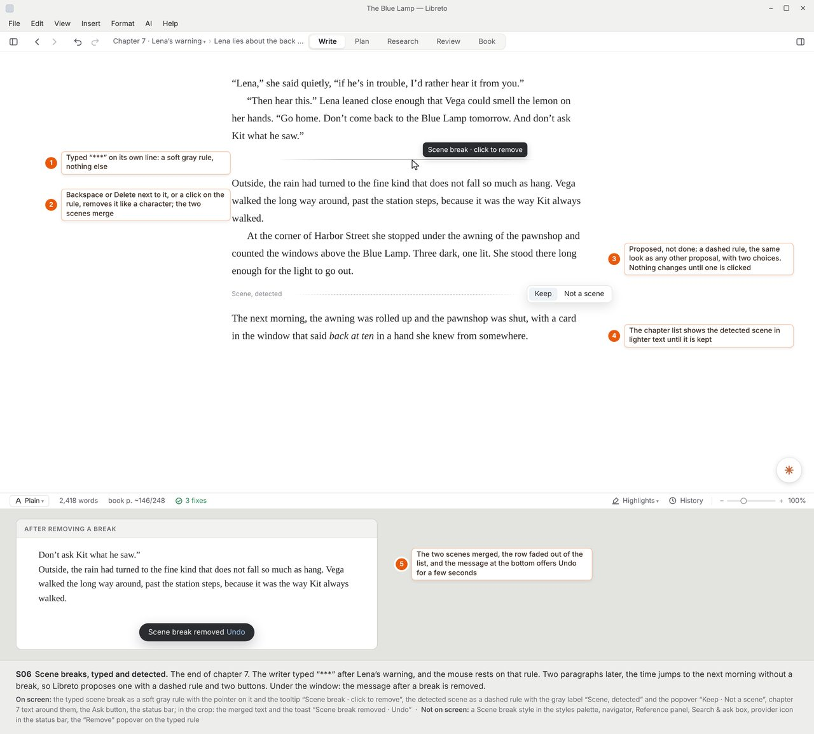

> [!NOTE]
> **Review note** · S06 · Scene breaks, typed and detected
>
> Ok about detected scenes and chapters in the list. That answers one of my previous questions.
> We should accept other characters. For example, "*****" (or any length), "---", "*", "-"... With an undo in case the author just wanted that character in a single line there.
> What if you click Insert scene break in the middle of a sentence?
> Just clicking on the ruler deletes the scene break? Maybe double click, or click and show a very small menu or button to delete it. Not so easy.
> Can scene break lines be selected? For copy, cut and paste, I mean. Are they selectable with the same selection background as for text? We need to define them. I still don't know the language under our texts (MD, XML...?).
> I understand auto detected scenes shown in the list have an auto text unless no AI enabled, where it should just say "Scene" or similar.
> It is an auto addition, but it doesn't look like other notes or additions, just the two visible buttons. Is this what we want? I like it, but for coherence, shouldn't it have an icon to the right of the line, like for green auto-fixed things? Or the are only blocks (chapter, scene break and few more) and can be treated this other way?
> Ok about the scene deleted notice. Where does it appear? At its previous place? At the bottom as you proposed for Last session summary?
> These "Undo" things should be equal through all the app, don't start adding exceptions, so they must be well-thought. Think about all possible cases and let's find a clear, intuitive way to do it for all.
> We must expect the user knows at least how to undo things or show them the undo button if it looks he doesn't use or find it. I don't want to be intrusive, but what about some tips here and there? How to learn from user's needs?

## S07 · Styles

A style says **what** a piece of text is (a thought, a letter, a sign on a door, a chapter heading), not how it looks. The look is chosen later, per book, in Book; on the page every style still shows a plain working look so you can see it: a thought is italic, a sign is small caps. Highlights can add a tint and a name in the margin on top of that, but a book title is in italics whether highlights are on or off.

The chip at the bottom left always shows the style at the cursor, written in that style's look. Click it, press `Ctrl+T`, or right-click ▸ "Style as" for the palette: a short list with a filter box, headed "What is this text?". The same list in all three places. A scene break is not a style: it is structure, and lives in Insert with chapters and parts.

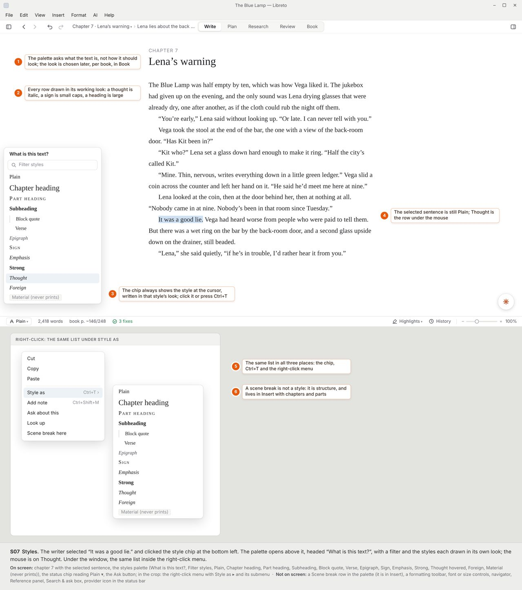

> [!NOTE]
> **Review note** · S07 · Styles
>
> Hmm... Ok  so a Chapter is not the same as a chapter heading... We need to make things clear. How does a chapter looks without Chapter heading, for example in what I call full view or continuous view (all the book at all, in contrast with the chapter view).
> What about the button to add a  ew style?
> You say Scene break lives in Insert, but the right click shows it. That's ok, but why only scenes and not chapters or parts?
> We need to think very well all right-click menus, everywhere in the app. The most used things should be present. Others, through menus.
> What about applying a style before writing text, instead of only selecting it? Be careful with blocks. For example, cursor in any point of a text and you click on Chapter title and all line (or paragraph) is converted into a title. That is expected. Undo, otherwise, or AI can detect it.
> How does AI to do a book pass to detect things like this one? How does it add a list of issues?
> Of course, moving through .menus must be very intuitive, with cursor and intro or just start typing to search where there is that option. Also, maybe icons could be added if not too intrusive or confusing.
> The menu with so different fonts can be confusing. Some of them could look like subtitles that separate menu parts. Some way to make them look a varied list? Maybe dots like an item list or the name in regular font and an example with its expected font? Not sure, font size won't help making it coherent.

## S08 · Ask: type and go

`Ctrl+K`, or a click on the round button, opens **Ask** at the bottom right: one box for everything. As you type, results appear above the box in five short groups: **Go to** (a chapter or scene), **Look up** (a person, place, thing or research topic, opened in the Reference panel), **Do** (a command, such as "Export PDF" or "Highlight characters"), **In the text** (hits for the typed words, with "Open Find" to walk through them), and **Ask** (the typed text as a question, plus one or two questions Libreto builds from the book). The best match is preselected, so `Enter` on "chapter 9" simply goes there and `Back` returns; `Tab` moves down the list; `Esc` closes the box and puts the cursor back in the text. Commands are the app's own menu items and actions, found by their words; there is nothing to learn and no slash. Without an AI, the Ask group is gray and says so; everything else works.

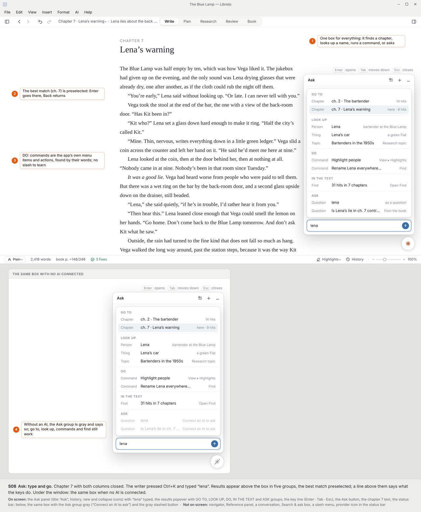

> [!NOTE]
> **Review note** · S08 · Ask: type and go
>
> Who selects the best match while typing? How things like "Rename Lena" or "Highlight names" are inferred? How can it work without AI? Do we have a small model for these things? How fast can it be? What if there are more results of one type?
> By the way, who fills and keeps updated the codex? I wonder what of all the tooling we are adding can be done without an AI and what actually needs it.
> About questions in the bottom of the list, I guess they will be selected if typed text is long. What about related questions? Can they be precomputed?
> Will a small model help with that? How efficiently? How much disk space it can take? And computing power? How reliable it is? If it needs to start using tools, filling the list may become very slow.

## S09 · Ask: a conversation

When the typed text is a question, or you choose the Ask row, the same panel becomes the conversation. It floats over the right side of the window, never over the page, and can be moved, resized, or collapsed back into the button with `–` or `Esc`; a dot on the button says an answer is waiting. The AI reads the whole book through the Codex and the open scene, and answers with links: a chapter name jumps the page there (and `Back` returns), a person's name opens the Reference panel. Its answers carry **buttons** when there is something to do: "Add as a note", "Show both places", "Open in Research", and for any change to the text a before-and-after block with "Apply" and "Skip". Nothing in the book changes until a button is clicked, and every applied change is one Undo away.

The AI has the whole app in reach, through the same commands you use: it can open a chapter, reorder cards, create a task, link a topic to a place, hide a column, start a review. The clock icon lists earlier conversations, with a search; "+" starts a new one; conversations are named by their first exchange. Right-click ▸ "Ask about this" on a selection opens the panel with the selection quoted.

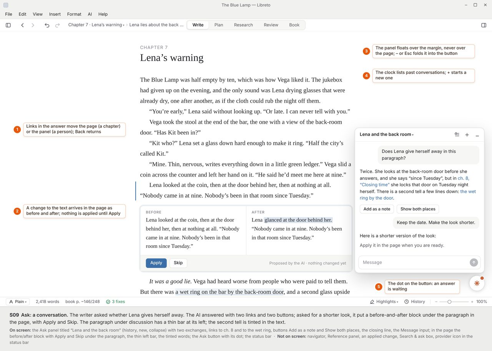

## S10 · Hold Alt

Hold `Alt` for half a second and the page shows everything Libreto knows about it: people, places and things tinted by kind, styled passages labeled in the margin, notes, tasks and fixes in the gutter. Release it and the page is clean. `Alt`+click on a name opens its peek. If `Alt` is awkward (it also opens menus on Windows, which Libreto suppresses for a held key), `Ctrl+Shift+A` toggles the same reveal and the Highlights menu keeps any kind on permanently. Hovering does nothing by itself: no card ever pops up because the mouse passed over a word.

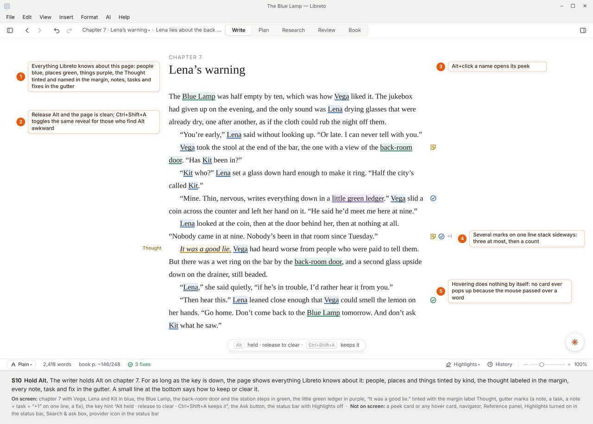

## S11 · Peek and the Reference panel

`Alt`+click a name, or right-click ▸ "Look up", and a small card says who that is, with the chapters she is in and a picture if she has one. "Open the card" opens the **Reference panel** on the right: the Codex entry for Lena. The Codex is what the book itself says, built from your text and corrected by you: a line about her, where she appears, who she knows, **facts** quoted from the text with their chapter, facts taken from your research with their source, open questions ("about fifty" in ch. 2, "not yet forty" in ch. 8), and the **research topics** linked to her. A picture can be dropped on the card.

Two rules keep the panel from becoming a maze. **A link to the text moves the page** (and `Back` returns); **a link to another entry moves the panel** (and the panel's own `‹` returns). The panel has no tabs and no search box: to look up something else, click its name in the text or press `Ctrl+K` and type it. "Open in Research" opens the same entry at full size, in Research mode.

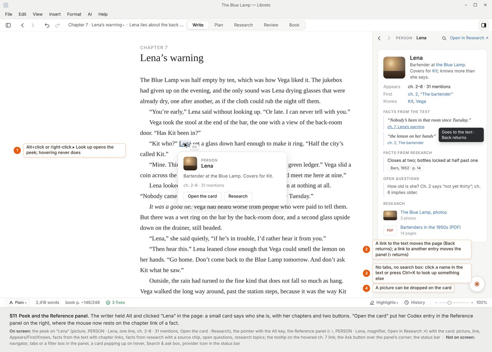

## S12 · Everything open, the text in the middle

The most Write can show on a 1440 px laptop: chapters on the left, Lena's card on the right, highlights on, two marks in the gutter, the Ask button over the panel's corner. The page is where it always is: centered on the window, 620 px wide at 100 %. The columns took the margins, not the text. Shown to judge the load; nobody needs this all day.

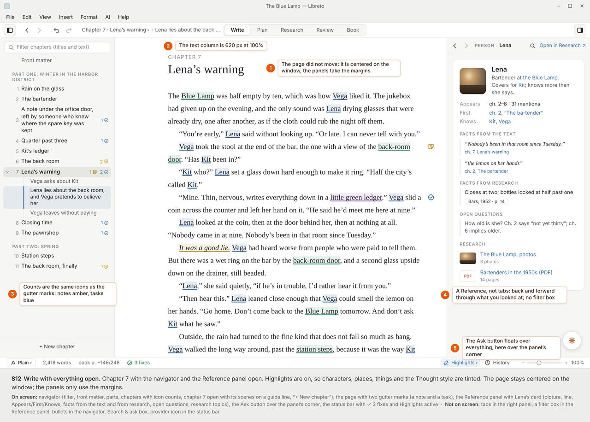

## S13 · One key back to the page, and Focus

`Ctrl+Shift+H` closes both columns and quiets the highlights; the same key brings back what was open. The rule is simple: the key restores the layout as it was when you hid it; if you open a column by hand in between, the key just hides again. `F11` goes further: **Focus** leaves only the page, without strip, status bar or Ask button; the mouse brings back a small "Exit focus" at the top, and `F11` or `Esc` leaves. The Focus page keeps the book's paragraph spacing and first-line indent as set in Book; nothing is reformatted.

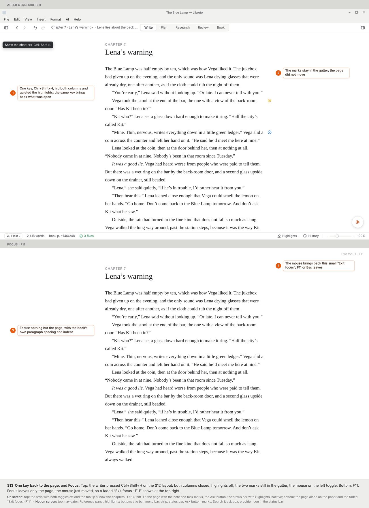

## S14 · A note, without leaving Write

Writing and fixing are the same hour, so notes do not wait for a mode. Right-click ▸ "Add note", `Ctrl+Shift+M`, or the small "+" that appears at the right of the line under the mouse: a card opens beside the line, you type, `Esc` returns to the sentence. The card folds to an amber icon in the gutter at that line; clicking the icon opens it again right there, with a short **line from the icon to the card** and the anchored words tinted, so there is never a doubt which words it is about. Several notes on one line stack sideways.

Three things live in the gutter, and the difference is what they ask of you. A **note** is a remark, yours, a reader's or the AI's, and asks nothing. A **task** asks for a decision: a doubt to settle, a fact to check, a proposed change to accept or reject. A **fix** is a change Libreto already made, there to be undone if wrong. Every card has the same buttons: Reply, Ask (the AI explains or proposes a fix), Done, Delete; **Accept** and **Reject** appear only when a change is attached. Changing a note's kind never changes its buttons.

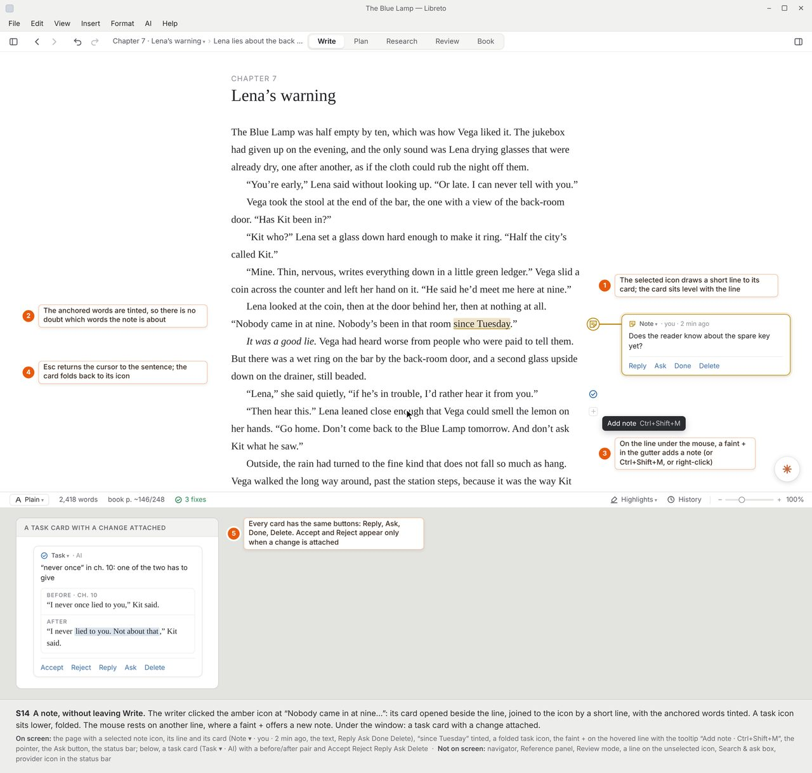

## S15 · Review

Review is the same page with the margin open. Choose it when the second pass starts: your own notes, the editor's, the AI's checks and the small fixes, all at once. The left column is the chapter list with counts, plus filter chips (All · Notes · Tasks · Fixes · Editor · AI) so "what did Marta say?" is one click. In the margin, every card sits level with its line and its words carry a faint tint; the selected one moves level with its line, draws its line to the text and tints its words strongly, the others stay quiet and push away when they collide, and several on one line fold into one stack with a count. **Review all** walks the book one card at a time: `Enter` accepts or marks done, `Tab` skips. "AI: review this chapter" adds its findings to the margin as tasks, never to the text. Switching back to Write keeps the same scroll and cursor; the cards fold to icons.

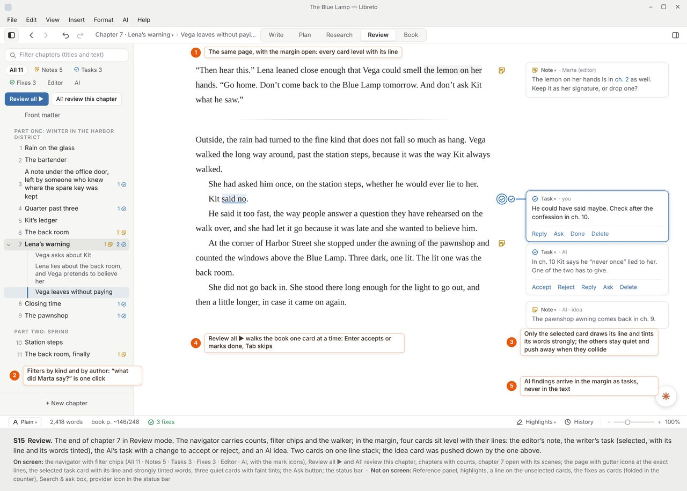

## S16 · Plan

Plan shows the book as cards, one per scene, in groups (chapters, or groups you name). Drag a card to move it; before you drop, Libreto warns when the move breaks continuity ("Vega reads the ledger before Kit finds it"). Moves are collected in a bar at the top, "3 moves · Apply · Discard"; nothing changes in the text until Apply, and leaving the mode with moves pending asks once. Groups move as a whole by their header; deleting a group with scenes sends the scenes to **Unplaced**, never away, and Unplaced shows at the end of the chapter list in Write.

A click on a card opens its detail beside it: the scene's line, who is in it, where, the facts it relies on, its words. "Details" shows a second line on every card. Cards carry labels (point of view, status, storyline, timeline, and one of your own), and **"Color by"** chooses which of them paints the cards; the legend at the bottom shows the current one. Point of view and place fill themselves from the Codex; status and storyline are yours. Scenes come from your breaks and from detection; the AI only summarizes them, in the background after a pause, and never creates a task without being asked unless the AI level says so.

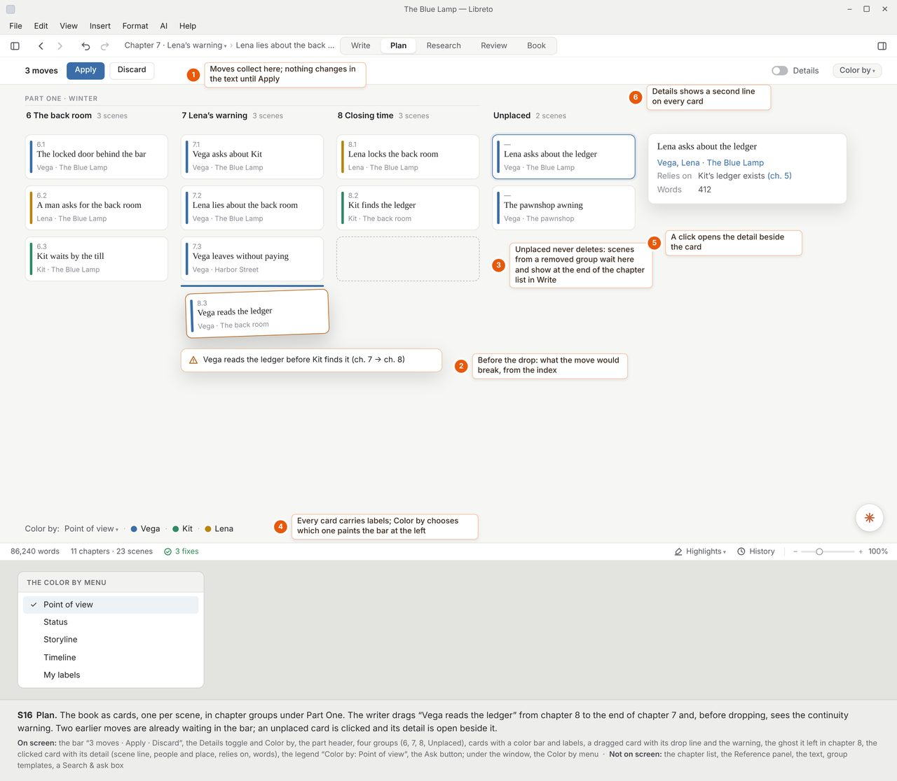

## S17 · Research

Research is where material lives before it is true. The left column is your **library** in two sections that are different things: **Codex**, what the book says (people, places, things, motifs, built from the text), and **Research**, what you gather (an **Inbox** for anything dropped in, then **topics**). A topic is a document like a chapter: a title, text with the same styles, pictures inline, files attached (PDFs, images, links), and a row of what it is linked to. "Bars in the 1950s" need not be in the Codex; Lena need not have a topic. In the center, the topic itself, large. On the right, the Reference panel shows what the topic links to: Codex entries and the chapters that mention them.

Linking is mostly free. Names from the Codex typed in a topic are recognized the way they are in the manuscript, so the topic and the entry know each other at once. The writer adds the rest with "Link to…" or by dragging a topic onto a name in the text. Moving knowledge from research to the Codex is one gesture: select a passage in a topic and "Pin as fact of…"; the fact shows on the entry with its source. The AI helps both ways from Ask: it summarizes a PDF, proposes facts and links as tasks, asks what the Codex still lacks ("Lena's age is contradicted; nothing in research settles it"), and proposes to split or merge topics; the writer can do all of it by hand. Topics are renamed by clicking the title, split with "Move to a new topic", merged by dropping one on another, and deleted to the Inbox.

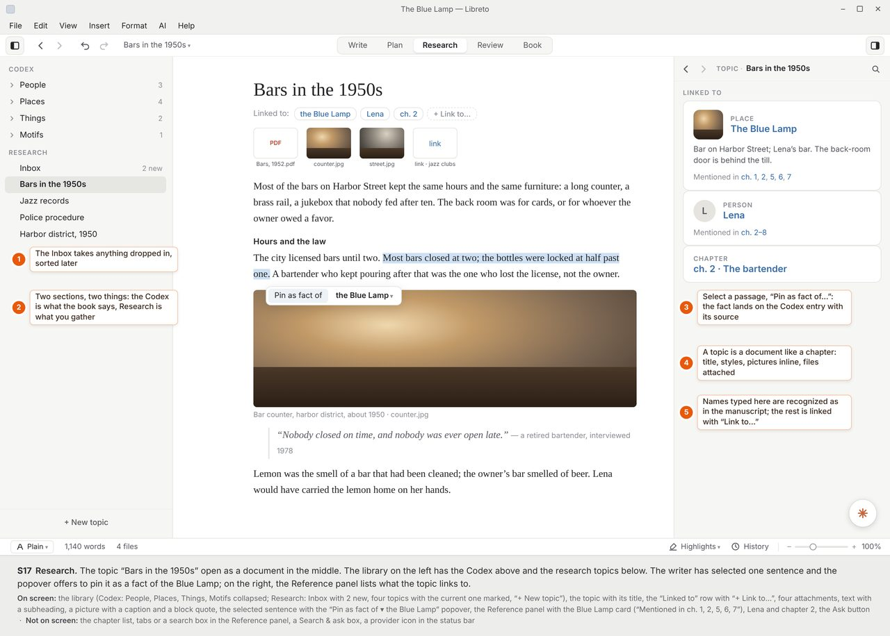

## S18 · A Codex entry at full size

Clicking a Codex name in the library opens the entry in the center, with room: the picture, the line, the facts from the text and the facts from research told apart by their source, who she knows, where she appears scene by scene, the open questions, and the research topics about her. Everything can be edited here, including the name (which renames her in the text and in the topics through "Rename everywhere"). This is the whole Codex, one entry at a time, and the only place it is shown at full size.

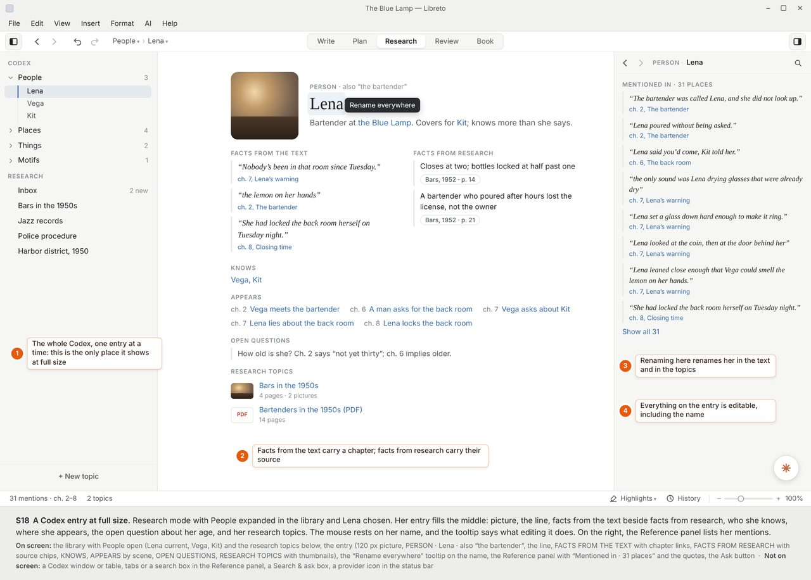

## S19 · Research beside the text

While writing, you want one thing: the photo of the bar, two facts. `Alt`+click "Blue Lamp", choose "Research" on the peek, and the Reference panel shows the topic, readable and scrollable, with its pictures. Enough to check and go on. "Edit in Research" opens the topic in the mode, and `Back` returns to the sentence. Gathering happens in Research; using happens beside the text.

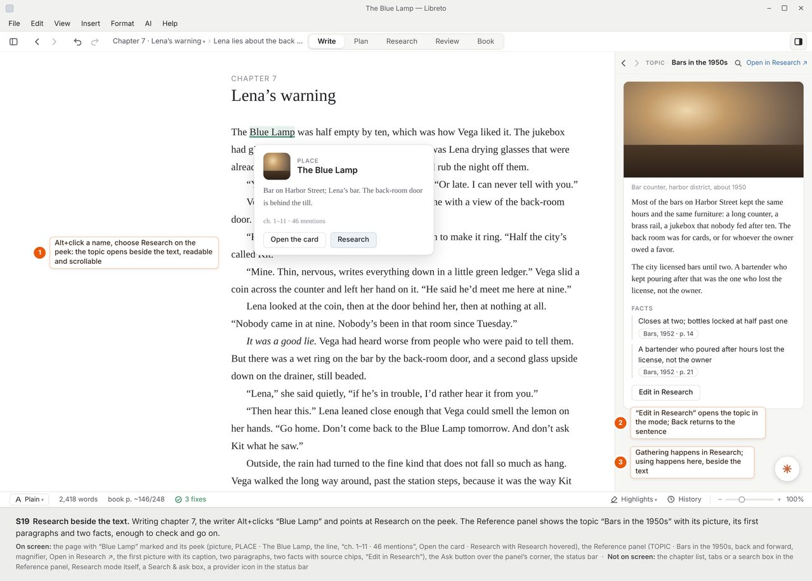

## S20 · Find and Replace

`Ctrl+F` opens a strip at the top of the page; `Ctrl+H` adds the Replace row, the same width. "Whole book" or "This chapter", nothing finer. In the whole book, hits walk across chapters and `Back` returns to where the cursor was. **Replace all** never replaces blindly: it opens a list of every hit in context, each with a checkbox, and a "Replace 27" button. When the found text is a Codex name, the strip offers **Rename everywhere** instead, which changes the text, the Codex and the topics together. "Pattern" turns on regular expressions; the "?" opens a tester with the current paragraph as sample text, and "Ask for help" hands the pattern to the AI.

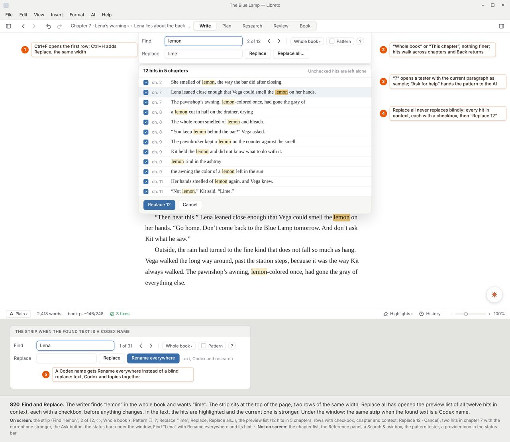

## S21 · Sharing with a reader

File ▸ Share… is one dialog with two halves. **Send** makes a named snapshot ("Sent to Marta, November 7"), exports a Word file whose paragraphs carry their ids, and lists the readers of this book. **Receive** looks in Downloads, or where you point, for a copy that belongs to this book, copies it into the book's folder (never opened as the working text) and records it in History. With an email tool connected, the AI drafts the message and later finds the reply; otherwise the two steps are written on the dialog.

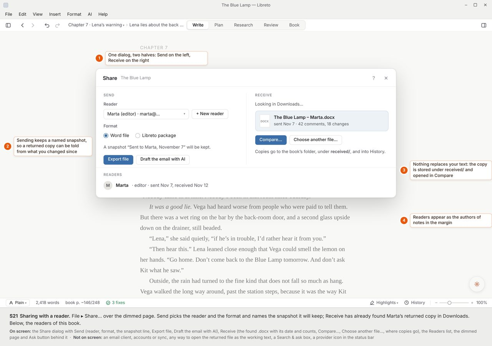

## S22 · A reader's copy, compared

Receiving opens **Compare** as a sheet over the window. It shows your manuscript as it is today, one column, and only the paragraphs that differ get a block under them; "Only differences" folds the rest. The version you sent is used underneath to tell who changed what, and is never shown: the sides are named by person, **Marta's** and **yours since sending**, never "theirs" and "mine". A paragraph only Marta changed shows her version with the changed words marked and **Take** and **Keep mine**; "Take all of Marta's changes in paragraphs you did not touch" does those in one go. A paragraph changed by both shows two compact cards and four buttons: **Keep mine**, **Take Marta's**, **Keep both**, **Merge for me**, the last a proposal from the AI that takes both into account; whatever is chosen becomes the paragraph, editable, with a small mark saying where it came from. Her comments bypass the merge and become notes in the margin with her name. The header counts "4 of 18 decided"; "Done" applies the decisions and nothing enters the text before it; "Back to the text" leaves the sheet at any time.

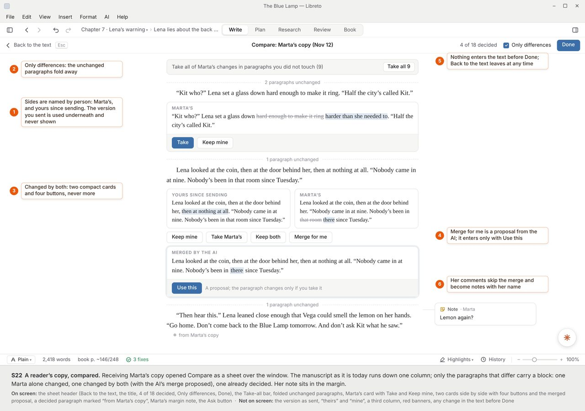

## S23 · History

History is a sheet: every writing session on one line, grouped by day, with hours, words and a one-line summary. Clicking a line opens it in place: what changed, where, each a link. "View as it was" reads that day's version without differences; "Compare with today" puts the old version on the left and today on the right, scrolled together, with **Restore** on any old paragraph or on the whole chapter. Reading an old version is for remembering; deciding paragraph by paragraph is the received-copy screen. Questions in words ("when did I write about Lena's car?") go to Ask.

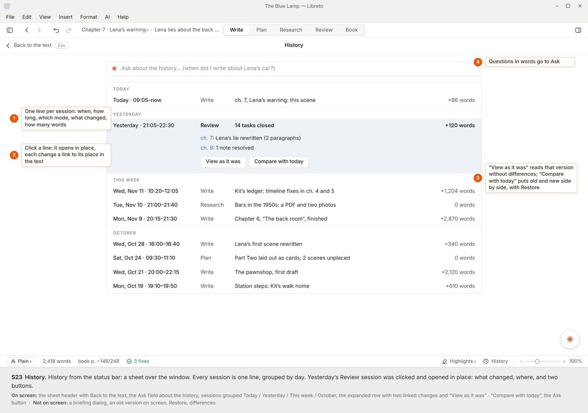

## S24 · Book

Book shows the book as it will print. The left column has page thumbnails; the right has the layout: a template to start from (paperback 5.5 × 8.5 in, trade 6 × 9 in, A5, manuscript, reading PDF), page size in cm or in, margins, fonts, and how chapters open: number and title, title only, number only, or **nothing** but a new page and space, for writers whose titles were only for working. Pictures in the text are laid out as figures. Arrows and Page Up/Down turn pages; the layout of a whole novel takes seconds and updates while you adjust. Export (PDF, Word, EPUB) is here.

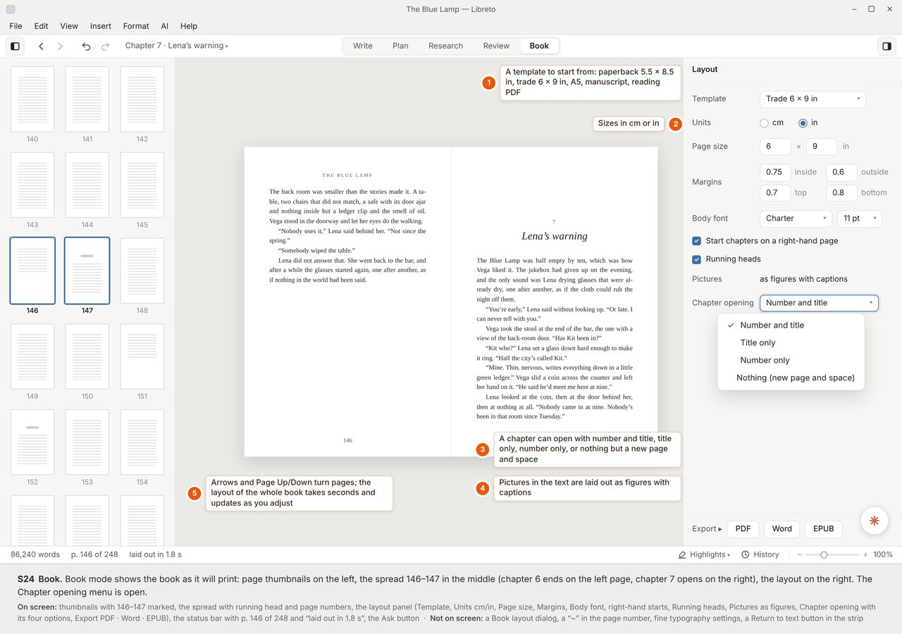

## S25 · The AI, connected or not

AI ▸ Connect, or the gray Ask button, opens this. The **disclosure** is always on this screen, with a warning sign, not behind a link: AI text may raise copyright, contest and disclosure problems; Libreto records what the AI wrote and can report it. Below: how to connect (Claude by key; through Claude Desktop where allowed), the level of help (Off · Quiet · Reviews · Proactive) with what each means, which model does the big work and which the small tasks (naming scenes, merging aliases, sorting notes: short judgments a small model gives reliably, and a local one may give later; finding names in the text is not a model's job at all, the index does it), what is sent and the log, and the cost this month. Libreto works fully without any of it.

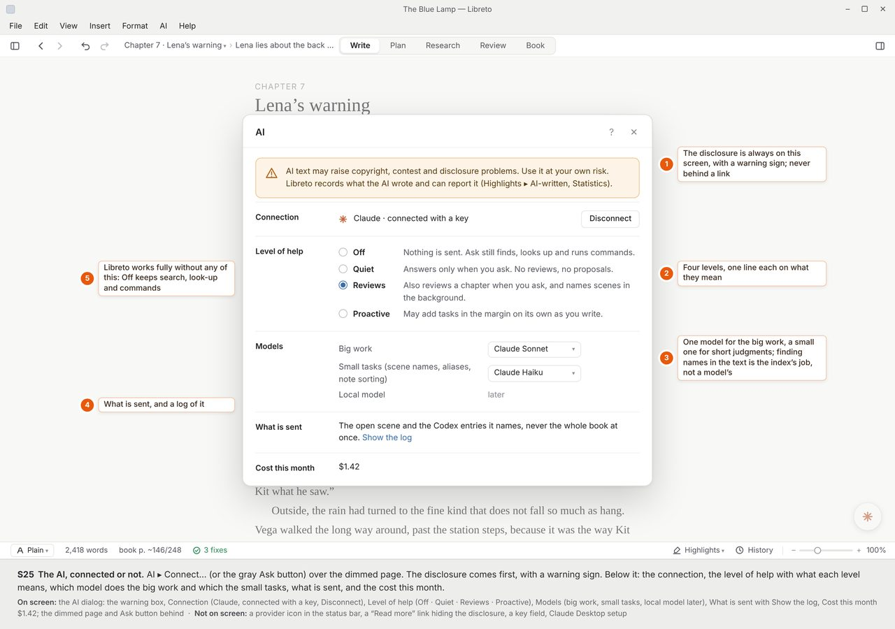

## S26 · Settings

One dialog, six groups, each with a "?" that opens its help. **Shortcuts** is the group to show: every key, searchable and editable, and a check against the current keyboard layout that flags any shortcut needing a dead key or AltGr.

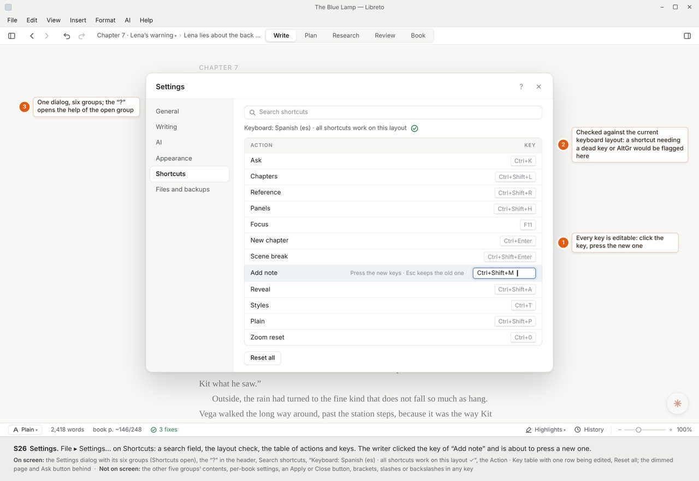

## S27 · Help

Help is not a column. `F1` opens the **Help window** at the topic of what has focus; the Help menu opens its contents; "how do I add a chapter?" typed in Ask answers from the same help with a link. Tutorials are short, one per feature, offered once when the feature first matters; each runs in your own book with a bubble pointing at the control, can be left at any step with `Esc`, and is never required.

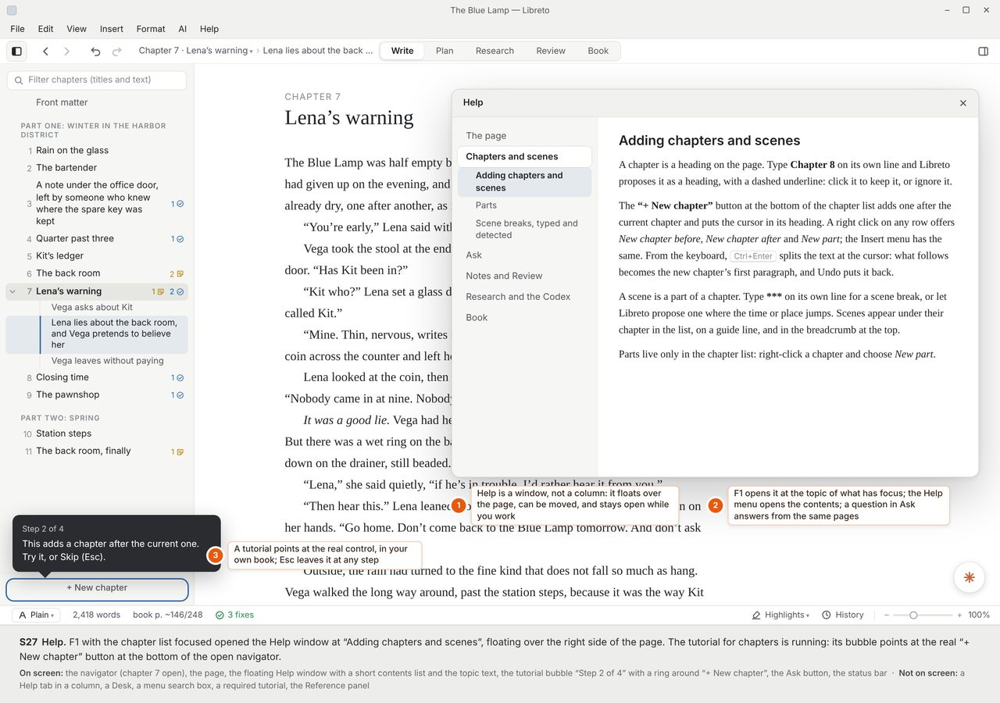

## S28 · Statistics

A sheet from the word count in the status bar or View ▸ Statistics: words per chapter and per day, sessions and time, a grid of who appears where, reading time; tabs for the detail, "Back to the text" to leave.

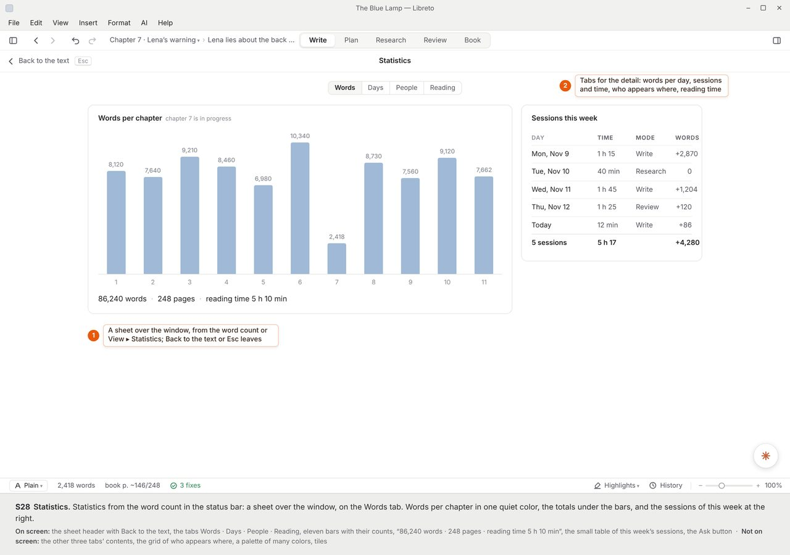

## S29 · Everything in the status bar and the menus

Not a moment: the status bar menus and the seven menus opened together, to see what lives where after the changes. The style palette has a filter; Highlights lists people, places, things, motifs, styles, notes, tasks, fixes and AI-written text; the zoom menu has "Fit width"; History rows are links. File has Share…; View has Focus (`F11`), Panels (`Ctrl+Shift+H`) and Statistics; `Ctrl+0` resets zoom.

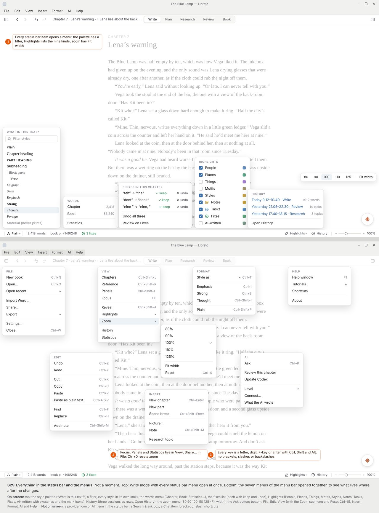

## S30 · Three window sizes

How the window adapts. At **1440 px** and above, both columns fit in the margins. Between **1200 and 1440**, one column at a time; opening the other closes the first. Below **1200**, the open column lies over the margin and the edge of the page, and the page stays put; below about 900 the page itself narrows. The Ask panel keeps its width and shortens.

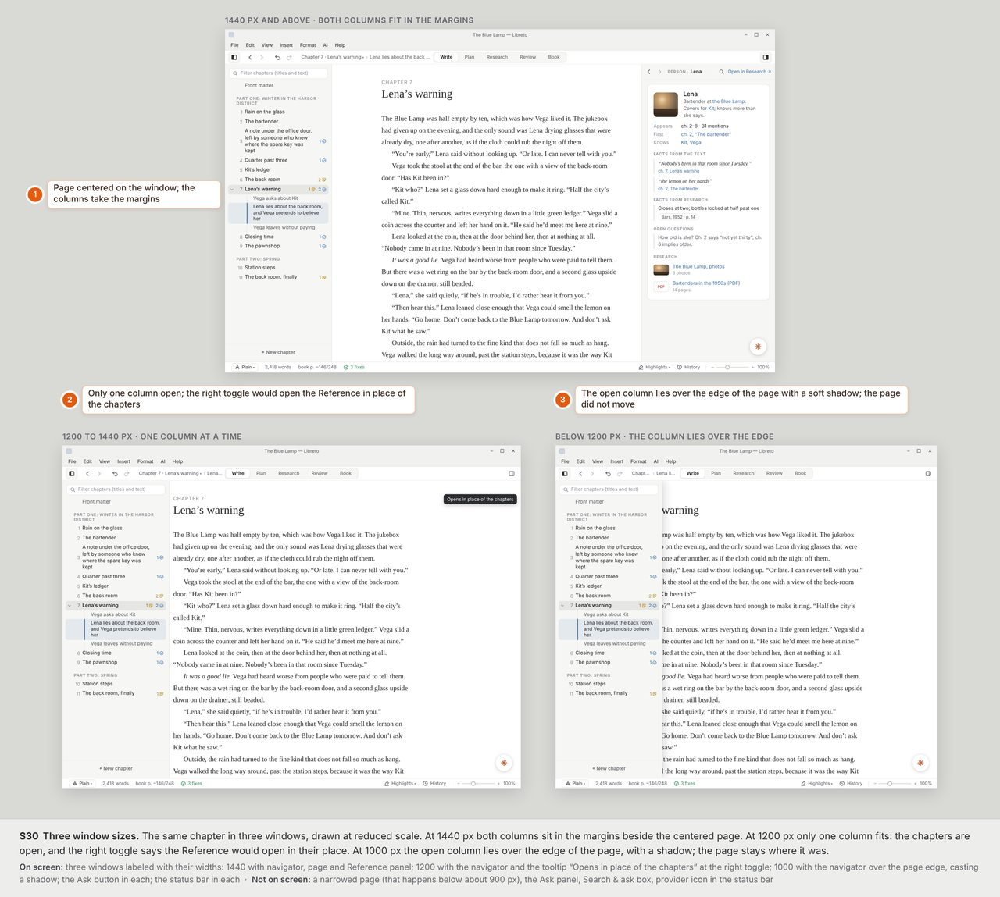

## What changed in draft 4, and why

- **One door for the AI.** Search & ask, the Chat tab and the status-bar icon were three faces of one thing. They are now **Ask**: `Ctrl+K` or the round button; results while you type, a conversation when you ask. The button is the AI's status too: gray when not connected, pulsing when working, a dot when an answer waits.
- **The page never moves.** Columns open in the margins; the text stays centered on the window at any width that allows it.
- **The Reference panel instead of tabs.** The right column shows one thing with its own `‹ ›`: a Codex card or a research topic. No tabs, no second search box; `Ctrl+K` looks things up.
- **Codex and Research are two things in one library.** The Codex is what the book says; Research is what you gather. They sit as two sections of the Research mode, link to each other mostly by themselves (names are recognized in topics as in the text), and knowledge moves between them with "Pin as fact" and "Open in Research".
- **Review is Write with the margin open.** Notes are made and fixed in Write, beside the line; Review adds the counts, the filters and the walker. History, Compare, Statistics and Help are **sheets** over the window, not modes, so there are still five modes and nothing more.
- **One family of marks.** Underlines on the exact characters in three colors; icons, not dots, in the gutter at the exact line, with the same icons as counts on the left; dotted green = done, dashed gray = proposed. Scenes lost their bullets.
- **Lines to the text.** A selected note draws a short line from its gutter icon to its card and tints its words; unselected cards stay quiet.
- **Adding chapters without keys.** A "New chapter" button at the bottom of the list, a right-click menu on every row, the Insert menu; `Ctrl+Enter` for those who want it.
- **The "what now" dialog is gone.** Libreto reopens as you left it; a line at the bottom says what is waiting.
- **The start dialog names the folder.** The sentence under the location shows the exact path that will be created.
- **Keys on every keyboard.** `Ctrl+Shift+H` panels, `Ctrl+Shift+L` / `Ctrl+Shift+R` each column, `F11` Focus, `Ctrl+Enter` chapter, `Ctrl+Shift+Enter` scene break, `Ctrl+Shift+M` note, `Ctrl+Shift+A` reveal, `Ctrl+0` zoom reset, `Alt+1…5` modes, `Alt+←/→` back and forward. Every key is editable in Settings and checked against the layout.
- **Replace all shows the list first.** And a Codex name offers "Rename everywhere" instead of a blind replace.
- **Cards can take a color** with a legend you name; "Color by" fills them from the Codex.
- **Pictures** on Codex entries, in research topics and in the book itself.
- **The disclosure is always visible** on the AI screen, with a warning sign.

## Questions

1. "Ask" as the name of the single door (button and `Ctrl+K`)? Alternatives: Assistant, Chat, the provider's name.
2. Keep Review as a mode (same page, margin open), or make it a switch inside Write?
3. The Reference panel without tabs and without its own search box: yes?
4. Research mode as the library with two sections, Codex and Research: right split, right names?
5. Keys: `Ctrl+Shift+H` panels, `F11` Focus, `Ctrl+Enter` chapter, `Ctrl+Shift+Enter` scene break, `Ctrl+Shift+P` Plain: fine?
6. Marks: red/blue/green underlines and note/task/fix icons as drawn: fine?
7. No "what now" dialog, a line at the bottom instead: yes?
8. "Styles" as the word, with "What is this text?" as the palette's title, or another word?
9. Hold `Alt` kept, with `Ctrl+Shift+A` as the alternative?
10. One color per card plus "Color by": enough for planning?
11. The chat floating only, docking later: yes?
12. Pictures in the manuscript (figures) in v1?
