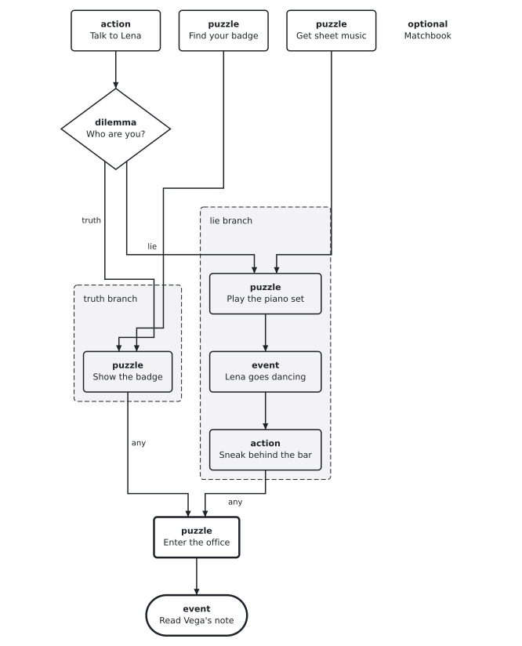
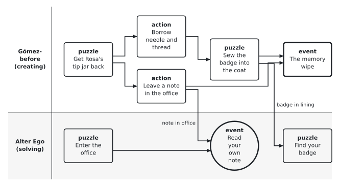
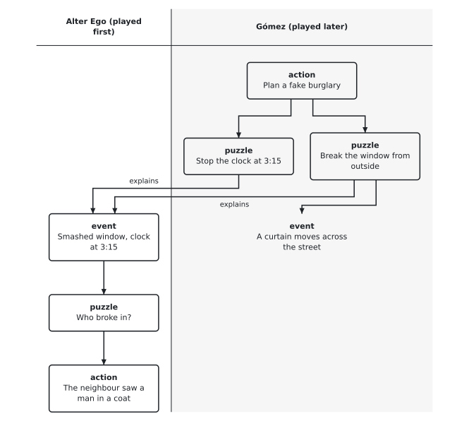
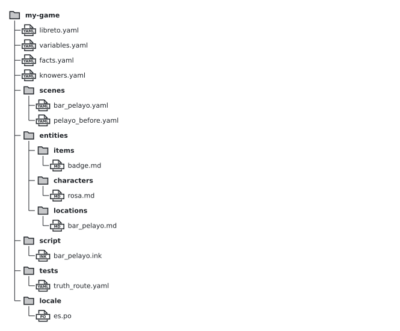

# Libreto — node and data model (draft 0)

Topic 1 of the Libreto design agenda. Status: **for discussion**; nothing here is built yet. ALAIF ideas are hypotheses, not settled rules: each one is kept only if the test scenes show it works.
Inputs: `docs/research/requirements.md` (§2 C, L, M, N, O), the ALAIF design document, and ALAIF's software notes (event class attributes, link restrictions, decision graph).

## 1. The idea in five lines

1. A story is **world state** (variables, inventory, what each knower knows) plus a **graph of nodes**.
2. A node is an **event that happens at most once**: a puzzle solved, an action taken, something the world does.
3. A node becomes **available** when everything in `requires` has happened **and** its `when` condition is true.
4. When it happens, it applies its `effects` to the state.
5. Branching is **state, not deletion**: a dilemma option sets a variable; nodes of one branch carry a `when` on it. Pruning (ALAIF p.75–77) is *computed* from that, not stored.

## 2. Node types

Six types, each a row of ALAIF's legend or a merge of several. Hints and reactions are fields, not nodes.

| Type | Who makes it happen | ALAIF equivalent | Example |
|---|---|---|---|
| `puzzle` | Player; a real goal, named with a verb | Puzzle | Get into the back office |
| `action` | Player; a step that is not a goal | Action | Talk to Rosa |
| `event` | The world, by itself. `timing: at_once` (ALAIF trigger) or a window such as `timing: {after: 2-5 min}` or `timing: {when: idle}` (ALAIF interrupt) | Interrupt, Trigger | The phone rings |
| `dilemma` | Player picks an option now (`mode: immediate`), or a condition picks it later (`mode: deferred`) | Immediate/Delayed dilemma + Voluntary/Default/Involuntary decision | "Who are you?" — truth or lie |
| `ending` | Reached; the game ends | (end node) | Case closed |
| `set` | A container: its nodes act as one and, if `exclusive`, lock everything else until done | Indivisible set | The piano set |

Flags any node can carry instead of more types:

- `optional: true` — not needed to finish (side quest, optional interrupt).
- `until: <condition>` — availability window; with `optional` this is ALAIF's **collectible**.
- `hints:` — up to 3 levels (+ comic 4th) on `puzzle`/`action` only (R-78).
- `reactions:` — line, sound, music cue, animation id, filled in later by the game (R-79). Split into `on_done` and `on_wrong` (a wrong attempt), as ALAIF's right/wrong audio triggers.
- `evidence:` — the in-world facts/items that make the solution fair; checked against the ancestor set (R-92). Not to be confused with hints: ALAIF's *Clue* and *Hint* are the same thing, a `hints:` entry here.

## 3. Fields

| Field | Meaning |
|---|---|
| `id` | Stable, unique in the project (`snake_case`). |
| `type` | One of §2. |
| `title` | Designer's name for the node (not player-facing). |
| `requires` | Nodes or dilemma options that must have happened. **AND** by default; `any: [...]` for OR. |
| `when` | Condition over state; must be true to become available. |
| `effects` | State changes when it happens. |
| `actor` | Who can do it (`alter_ego`, `gomez_before`…), for DOTT-style protagonists (R-24). |
| `at` | Location id (R-84). |
| `timeline` | `solving` / `creating` … (R-28). |
| `options` | `dilemma` only: list of `{id, title, effects, when}`; `default` names the option taken if the player never chooses. |
| `estimate` | Expected play time (ALAIF `expectedLength`), for pacing and play-time estimates (R-32). |
| `difficulty` | 1–5 (ALAIF `level`), for tuning and the stuck-point checks (R-94). |
| `characters` | Characters present or involved; feeds the character × location × time grid (R-33). |
| `variants` | Same node, different content by state (see §6.1). |

A dilemma option is referenced as `<dilemma>.<option>`, e.g. `who_are_you.truth`.

**Scope.** Ids are project-wide. A scene file is only where a node is written: any node may require a node in another scene or timeline, and `has(badge)` works anywhere. Items, characters and locations are entities with their own files (`items/badge.md`) and a state that changes (who holds it, where it is), so an object picked up in chapter 1 and used in chapter 9 needs nothing special (R-85).

**Interrupt vs trigger (ALAIF re-check).** ALAIF defines both as non-player events; the only difference is timing. A trigger fires right after its dependencies (mostly to start music or sound); an interrupt is a plot twist ("the phone rings") that fires at a moment the player does not expect, chosen by the game master. ALAIF itself says they could be one type. In a video game there is no game master, so the moment becomes a rule: `timing`. Most decorative triggers become plain `reactions` on the node before them.

**Allowed links.** Not every type may require every other (ALAIF's *Restricciones eventos* matrix): e.g. a dilemma is followed only by its own options, and nothing requires an `ending`. The schema enforces this table (R-7).

**Runtime status** of a node, derived, never stored: `locked` → `available` → `done`, or `unreachable` (its `when` can no longer hold; ALAIF's *anulado*). Optional nodes show as `available` until their `until` closes them.

## 4. State and conditions

Declared once per project (`variables.yaml`):

```yaml
approach:   { type: enum, values: [unknown, truth, lie], initial: unknown }
rosa_trust: { type: int, initial: 0, range: [-3, 3] }
```

Built in, no declaration needed: inventory, knowledge, history.

| In a condition | In an effect |
|---|---|
| `rosa_trust >= 1`, `approach == truth` | `rosa_trust += 1`, `approach = truth` |
| `has(badge)` | `give badge`, `take badge` |
| `knows(note_from_myself)` (the player) / `knows(rosa, ...)` | `learn note_from_myself` |
| `done(play_piano)`, `chose(who_are_you.lie)` | — |

Syntax follows ink's expressions (`and`, `or`, `not`, `==`, `>=`), so dialogue conditions and graph conditions read the same.

## 5. Worked example — "Bar Pelayo, 1 a.m."

Invented test scene, solving timeline. Alter Ego (Gómez after the memory wipe) wants into the back office of a jazz bar, where his former self left something. Rosa, the bartender, asks who he is. Truth or lie gives two routes that **merge** at the office door.

 <!-- drawspec-render -->

<details><summary>Diagram source</summary>

```drawspec
{"version": 1, "kind": "flow",
 "title": "Bar Pelayo: split and merge",
 "nodes": [
  {"id": "talk", "text": "action\nTalk to Rosa"},
  {"id": "dil", "text": "dilemma\nWho are you?", "role": "decision"},
  {"id": "badge", "text": "puzzle\nFind your badge"},
  {"id": "show", "text": "puzzle\nShow the badge"},
  {"id": "music", "text": "puzzle\nGet sheet music"},
  {"id": "piano", "text": "puzzle\nPlay the piano set"},
  {"id": "dance", "text": "event\nRosa goes dancing"},
  {"id": "sneak", "text": "action\nSneak behind the bar"},
  {"id": "office", "text": "puzzle\nEnter the office", "role": "emphasis"},
  {"id": "note", "text": "event\nRead your own note", "role": "terminal"},
  {"id": "match", "text": "optional\nMatchbook", "role": "note"}
 ],
 "edges": [
  {"from": "talk", "to": "dil"},
  {"from": "dil", "to": "show", "label": "truth"},
  {"from": "badge", "to": "show"},
  {"from": "dil", "to": "piano", "label": "lie"},
  {"from": "music", "to": "piano"},
  {"from": "piano", "to": "dance"},
  {"from": "dance", "to": "sneak"},
  {"from": "show", "to": "office", "label": "any"},
  {"from": "sneak", "to": "office", "label": "any"},
  {"from": "office", "to": "note"}
 ],
 "groups": [
  {"id": "g_truth", "text": "truth branch", "members": ["show"]},
  {"id": "g_lie", "text": "lie branch", "members": ["piano", "dance", "sneak"]}
 ]}
```

</details>

The data (one YAML file for the scene graph; long text lives in Markdown/ink files by id):

```yaml
scene: bar_pelayo
timeline: solving
at: bar_pelayo
actor: alter_ego        # default for every node below

nodes:
  - id: talk_rosa
    type: action
    title: Talk to Rosa

  - id: who_are_you
    type: dilemma
    mode: immediate
    title: Rosa asks who you are
    requires: [talk_rosa]
    default: lie            # walking away counts as lying
    options:
      - id: truth
        title: "I'm a detective"
        effects: [approach = truth, rosa_trust += 1]
      - id: lie
        title: "I'm the new pianist"
        effects: [approach = lie]

  # --- truth branch ---
  - id: find_badge
    type: puzzle
    title: Find your badge
    evidence: [coat_heavy_on_one_side]
    effects: [give badge]
    hints:
      - Your coat hangs oddly.
      - Something is sewn into the lining.
      - Tear the lining open.

  - id: show_badge
    type: puzzle
    title: Convince Rosa you're a cop
    requires: [who_are_you.truth]
    when: has(badge)

  # --- lie branch ---
  - id: get_sheet_music
    type: puzzle
    title: Get sheet music from the busker
    at: street_outside

  - id: play_piano
    type: puzzle
    title: Play the piano set
    requires: [who_are_you.lie, get_sheet_music]

  - id: rosa_dances
    type: event
    title: Rosa leaves the bar to dance
    requires: [play_piano]
    delay: 1 turn

  - id: sneak_in
    type: action
    title: Sneak behind the bar
    requires: [rosa_dances]

  # --- merge ---
  - id: enter_office
    type: puzzle
    title: Get into the back office
    requires:
      any: [show_badge, sneak_in]

  - id: read_note
    type: event
    title: A note in your own handwriting
    requires: [enter_office]
    effects: [learn note_from_myself]

  - id: matchbook
    type: action
    title: Pick up the old matchbook
    optional: true
    until: not done(enter_office)
    effects: [give matchbook]
```

Later, a **deferred** dilemma uses the state the scene left behind:

```yaml
  - id: police_at_the_bar
    type: dilemma
    mode: deferred
    requires: [read_note]
    options:
      - { id: rosa_covers, when: rosa_trust >= 1 }
      - { id: rosa_tells,  when: rosa_trust < 1 }
```

### 5.1 How the branch works here

- **Split.** `who_are_you` sets `approach`. `show_badge` requires `who_are_you.truth`; `play_piano` requires `who_are_you.lie`. Only one can ever happen.
- **Merge.** `enter_office` requires `any` of the two branch ends. No special node type.
- **Pruning is derived.** After choosing `lie`, Libreto can show that `show_badge` can no longer become available, so it greys it out (branch preview, R-98). Nothing is deleted.
- **Shared nodes survive by themselves.** `find_badge` has no branch condition, so it stays in both branches. In the lie branch Libreto flags the badge as **useless here** (red herring check, R-81) — the designer decides if that is fine.
- **No weak edges needed.** ALAIF needs weak edges so the cascade stops in the right place. Here each node states its own condition, so "is this still reachable?" is answered by evaluating the graph, not by the shape of the deletion.

### 5.2 Two scripted playthroughs (preview of R-89)

```yaml
- name: truth route
  steps: [talk_rosa, who_are_you.truth, find_badge, show_badge, enter_office]
  expect: { rosa_trust: 1, knows: [note_from_myself], has: [badge] }

- name: lie route
  steps: [talk_rosa, who_are_you.lie, get_sheet_music, play_piano, sneak_in, enter_office]
  expect: { rosa_trust: 0, unreachable: [show_badge] }
```

`rosa_dances` and `read_note` are events: the runtime fires them; the test does not list them.

## 5b. Worked example — "One week earlier" (cross-timeline)

Same bar, creating timeline. Gómez-before prepares his own mystery: he hides the badge and leaves himself a note, then erases his memory. The solving scene of §5 now depends on it.

 <!-- drawspec-render -->

<details><summary>Diagram source</summary>

```drawspec
{"version": 1, "kind": "lanes",
 "title": "Two timelines, one graph",
 "nodes": [
  {"id": "favour", "text": "puzzle\nGet Rosa's tip jar back", "actor": "Gómez-before (creating)"},
  {"id": "needle", "text": "action\nBorrow needle and thread", "actor": "Gómez-before (creating)"},
  {"id": "hide", "text": "puzzle\nSew the badge into the coat", "actor": "Gómez-before (creating)"},
  {"id": "leave", "text": "action\nLeave a note in the office", "actor": "Gómez-before (creating)"},
  {"id": "wipe", "text": "event\nThe memory wipe", "actor": "Gómez-before (creating)", "role": "emphasis"},
  {"id": "find", "text": "puzzle\nFind your badge", "actor": "Alter Ego (solving)"},
  {"id": "office", "text": "puzzle\nEnter the office", "actor": "Alter Ego (solving)"},
  {"id": "read", "text": "event\nRead your own note", "actor": "Alter Ego (solving)", "role": "terminal"}
 ],
 "edges": [
  {"from": "favour", "to": "needle"},
  {"from": "favour", "to": "leave"},
  {"from": "needle", "to": "hide"},
  {"from": "hide", "to": "wipe"},
  {"from": "leave", "to": "wipe"},
  {"from": "hide", "to": "find", "label": "badge in lining"},
  {"from": "office", "to": "read"},
  {"from": "leave", "to": "read", "label": "note in office"}
 ]}
```

</details>

```yaml
scene: pelayo_before
timeline: creating
story_time: -7 days        # relative to the solving timeline's day 0
at: bar_pelayo
actor: gomez_before

nodes:
  - id: rosa_tip_jar
    type: puzzle
    title: Get Rosa's stolen tip jar back
    effects: [rosa_trust += 1]          # still true a week later

  - id: borrow_needle
    type: action
    title: Borrow needle and thread
    requires: [rosa_tip_jar]
    effects: [give needle_thread]

  - id: hide_badge
    type: puzzle
    title: Sew the badge into the coat lining
    requires: [borrow_needle]
    when: has(badge)
    effects: [take badge, put badge in coat_lining, learn badge_in_coat]

  - id: leave_note
    type: action
    title: Leave a note in the back office
    requires: [rosa_tip_jar]             # Rosa lets him in
    effects: [put note in back_office]

  - id: memory_wipe
    type: event
    timing: at_once
    requires: [hide_badge, leave_note]
```

In §5, two nodes gain a cross-timeline requirement:

```yaml
  - id: find_badge
    requires: [hide_badge]       # pelayo_before, other timeline
  - id: read_note
    requires: [enter_office, leave_note]
```

### 5b.1 What this example tests

- **Two knowers, one body (R-39).** `learn badge_in_coat` runs with `actor: gomez_before`, so only Gómez-before knows it. Alter Ego starts empty; the player may know it if the flashback was played first, which is the fun of the design and also what the fair-puzzle check (R-92) must take into account.
- **State crosses time through the world, not through the inventory.** The badge goes into `coat_lining`; Alter Ego does not "have" it until `find_badge`. `rosa_trust` set a week earlier still holds.
- **Story time vs play order (R-29).** `story_time` orders events in the world; play order is whatever the graph allows. Libreto checks every cross-timeline edge: if the cause comes *later* in story time than its effect, it is a paradox and is flagged, unless marked `paradox: intended`.
- **Play order is a design choice.** If the flashback is a chapter played *after* the bar scene, `find_badge` cannot be solved in the bar, and Libreto reports it as a dead end for that chapter order. If the player can switch timelines freely (DOTT style), it is solvable. The same data shows both.

### 5b.2 Time rules (under discussion)

Two ways to read the creating timeline; the model supports both, and a chapter states which one it uses (`past: fixed` or `past: open`).

| | `past: fixed` (memories) | `past: open` (DOTT) |
|---|---|---|
| What playing the past does | Reveals what Gómez *did*; the outcome already exists in the present | Changes the present ("put the card in his pocket") |
| Fits the premise | Yes: Gómez built the mystery before the wipe | Only with a reason in the fiction |
| Check Libreto runs | Nothing the player already *saw* in the present may change when the past is played later | Every change must reach the present by a plausible path |

**Player knowledge vs character knowledge.** Facts are tracked per knower: `player`, `gomez_before`, `alter_ego`. A node can require `knows(alter_ego, x)` (the character must find it in-world) or just `knows(player, x)`. When the player knows something Alter Ego does not, the design either gates on the character's knowledge or makes the world change in between (the object fell under the sand, a bird took it): an `event` in the solving timeline that moves the item.

## 5c. Example — "Blue Rain" (plan known first, Columbo route)

Gómez learns where to hide things from someone who helps him; the player watches the plan being made. Later, the player knows the answer and Alter Ego does not, and the world has moved on.

```yaml
# creating timeline, actor: gomez_before
- id: hide_key_in_record
  type: puzzle
  title: Hide your flat key in the "Blue Rain" sleeve at Nuria's shop
  effects:
    - put flat_key in record_blue_rain
    - learn key_in_record via helper      # Nuria suggests it (twist: she helps Alter Ego later)
- id: write_on_matchbook
  type: action
  title: Write "Blue Rain, side B" on a matchbook
  effects: [put matchbook in bar_pelayo]

# solving timeline, actor: alter_ego
- id: record_sold
  type: event
  timing: {when: done(enter_office)}      # the world moves on
  effects: [put record_blue_rain in buyer_flat]
- id: read_matchbook
  type: action
  requires: [matchbook]                   # §5, optional collectible
  effects: [learn alter_ego key_in_record via note_to_self]
- id: ask_nuria_for_record
  type: puzzle
  when: knows(alter_ego, key_in_record)   # gated on the character, not the player
- id: find_the_buyer
  type: puzzle
  requires: [ask_nuria_for_record, record_sold]
```

What it tests:

- **The player knows, Alter Ego does not.** `ask_nuria_for_record` waits for `knows(alter_ego, …)`, so the player cannot skip ahead just by remembering the flashback.
- **The route changes, not the answer.** `record_sold` sends the player after the buyer: Columbo, not a quiz.
- **A collectible becomes a bridge.** The matchbook is optional in §5. If the player missed it, Libreto reports `ask_nuria_for_record` as unreachable, so either it becomes required or a second source is added. No loose end goes unnoticed.
- **Techniques are data.** `via: helper` and `via: note_to_self` record how knowledge travels. Libreto counts them per chapter, so "don't overuse the helper" (I-33) is a check, not a memory.

## 5d. Example — "Quarter past three" (effect first, cause later)

Alter Ego wakes up to a smashed window and a clock stopped at 3:15. Much later, the player plays the night Gómez staged it. The past is fixed: Gómez must produce exactly what Alter Ego already saw.

 <!-- drawspec-render -->

<details><summary>Diagram source</summary>

```drawspec
{"version": 1, "kind": "lanes",
 "title": "The cause is played after its effect",
 "nodes": [
  {"id": "see", "text": "event\nSmashed window, clock at 3:15", "actor": "Alter Ego (played first)"},
  {"id": "ask", "text": "puzzle\nWho broke in?", "actor": "Alter Ego (played first)"},
  {"id": "neighbour", "text": "action\nThe neighbour saw a man in a coat", "actor": "Alter Ego (played first)"},
  {"id": "plan", "text": "action\nPlan a fake burglary", "actor": "Gómez (played later)"},
  {"id": "clock", "text": "puzzle\nStop the clock at 3:15", "actor": "Gómez (played later)"},
  {"id": "glass", "text": "puzzle\nBreak the window from outside", "actor": "Gómez (played later)"},
  {"id": "curtain", "text": "event\nA curtain moves across the street", "actor": "Gómez (played later)", "role": "note"}
 ],
 "edges": [
  {"from": "see", "to": "ask"},
  {"from": "ask", "to": "neighbour"},
  {"from": "plan", "to": "clock"},
  {"from": "plan", "to": "glass"},
  {"from": "clock", "to": "see", "label": "explains"},
  {"from": "glass", "to": "see", "label": "explains"},
  {"from": "glass", "to": "curtain"}
 ]}
```

</details>

```yaml
# facts.yaml: a fact the player sees before knowing why
clock_stopped_315: { kind: mystery, explained_by: [stop_clock, break_window] }

- id: plan_burglary
  type: action
  actor: gomez_before
  title: Plan a fake burglary
  effects: [learn player goal_fake_burglary via goal_statement]   # Gómez says it out loud

- id: stop_clock
  type: puzzle
  actor: gomez_before
  title: Stop the clock at 3:15
  must_match: clock_time == "3:15"   # fixed past: what Alter Ego saw
  reactions: { on_wrong: gomez_not_that_time }   # a joke, not a dead end

- id: curtain_moves
  type: event
  timing: at_once
  requires: [break_window]
  effects: [learn player neighbour_saw_gomez]    # only the player: Gómez never notices
```

What it tests:

- **Payoff before setup.** `kind: mystery` plus `explained_by` ties the effect to its cause. Check: every mystery is explained on every route, and every explaining node is reachable (I-36, no loose ends).
- **The plan reaches the player through the goal.** `plan_burglary` states what Gómez wants ("Alter Ego must believe someone broke in"), so the player is not "waiting to realize they must put an object here" (I-32).
- **`must_match` keeps the fixed past consistent.** The player cannot stop the clock at 4:00; a wrong attempt gets a line, not a paradox.
- **Dramatic irony is data.** `learn player …` without Gómez: Libreto can list every moment where the player knows more than the character on screen (I-37), and the reverse.

## 5e. What the four examples add to the model

| Addition | Where | Why |
|---|---|---|
| `learn <knower> <fact> via <technique>` | effects | Per-knower facts; techniques counted (I-33, I-34) |
| `knows(<knower>, <fact>)` | conditions | Gate on the character, not the player |
| `facts.yaml` with `kind: mystery`, `explained_by` | project file | Payoff before setup; no loose ends |
| `must_match` | node | Fixed past reproduces what was already seen |
| Knowledge diff view | Libreto view | Who knows more than whom at each play-order point |

## 6. One graph or two levels?

ALAIF draws a decision graph whose nodes contain puzzle graphs. Proposal: **one graph**, with `set` and scene files as the collapsible levels (R-21). The decision-level view is then a *filter* (show only dilemmas, endings and sets), not a second structure to keep in sync. To be validated on a larger example with two timelines.

### 6.1 Variants instead of copies

ALAIF's *Graf de decisions* draws Room 6 twelve times (3 × 2 × 2 choices: `Axa`, `Axb`…). Copying rooms per branch explodes and drifts apart. Here a room or node exists **once** and carries variants:

```yaml
- id: room_6
  type: event
  title: Final room
  variants:
    - when: saved_gm and route == A
      script: room_6_a_saved
    - when: not saved_gm
      script: room_6_infected      # covers A, B and C
```

Only what really differs gets a variant; the rest is shared. Libreto can still draw the twelve combinations as a view.

## 6b. Schema, field by field (v0)

### Project layout

 <!-- drawspec-render -->

<details><summary>Diagram source</summary>

```drawspec
{"version": 1, "kind": "files", "root": "my-game", "entries": [{"path": "libreto.yaml"}, {"path": "variables.yaml"}, {"path": "facts.yaml"}, {"path": "knowers.yaml"}, {"path": "scenes/bar_pelayo.yaml"}, {"path": "scenes/pelayo_before.yaml"}, {"path": "entities/items/badge.md"}, {"path": "entities/characters/rosa.md"}, {"path": "entities/locations/bar_pelayo.md"}, {"path": "script/bar_pelayo.ink"}, {"path": "tests/truth_route.yaml"}, {"path": "locale/es.po"}]}
```

</details>

| File | Holds |
|---|---|
| `libreto.yaml` | Project name, languages, timelines (`id`, `title`, `past: fixed/open`), schema version |
| `variables.yaml` | Story variables (§4) |
| `facts.yaml` | Facts that can be known: `id`, `title`, optional `kind: mystery` + `explained_by` |
| `knowers.yaml` | `player` (built in) and each character mind (`gomez_before`, `alter_ego`…); a body can hold several minds |
| `scenes/*.yaml` | Scene header + its nodes (one graph file per scene) |
| `entities/**.md` | YAML front matter (id, type, initial state) + free Markdown (description, notes) |
| `script/*.ink` | Dialogue and player-facing lines, referenced by node and line id |
| `tests/*.yaml` | Scripted playthroughs (§5.2) |
| `locale/*.po` | Translations by line id |

### Scene header

| Field | Req. | Type | Notes |
|---|---|---|---|
| `scene` | yes | id | Unique |
| `timeline` | yes | id | From `libreto.yaml` |
| `story_time` | no | time / relative | When it happens in the world |
| `at`, `actor` | no | id | Defaults for every node in the file |
| `nodes` | yes | list | Below |

### Node

| Field | Req. | Type | Applies to | Notes |
|---|---|---|---|---|
| `id` | yes | id | all | Project-wide |
| `type` | yes | enum | all | `puzzle action event dilemma ending set` |
| `title` | yes | text | all | Designer's name |
| `requires` | no | list or `{any: [...]}` | all | Node or `dilemma.option` ids |
| `when` | no | condition | all | §4 syntax |
| `effects` | no | list of statements | all | `x = v`, `x += n`, `give/take item`, `put item in place`, `learn [knower] fact [via technique]` |
| `actor`, `at`, `timeline` | no | id | all | Override scene defaults |
| `optional`, `until` | no | bool, condition | all but `ending` | Collectibles, side quests |
| `evidence` | no | list of fact/item ids | puzzle | Fair-puzzle check |
| `hints` | no | list (≤ 3 + comic) | puzzle, action | |
| `reactions` | no | `{on_done, on_wrong}` | all | Ids of lines, sounds, animations |
| `estimate`, `difficulty` | no | duration, 1–5 | puzzle, action | |
| `characters` | no | list of ids | all | |
| `variants` | no | list of `{when, script}` | all | §6.1 |
| `must_match` | no | condition | nodes in a `past: fixed` timeline | §5d |
| `timing` | event only | `at_once` / `{after}` / `{when}` | event | |
| `mode`, `options`, `default` | dilemma only | | dilemma | Option: `{id, title, when, effects}` |
| `members`, `exclusive` | set only | list, bool | set | |

### Checks Libreto runs on this data

Schema errors point at the field (R-7). On top: cycles, unreachable nodes and dead ends (R-20); allowed links (§3); facts used before being learned, per knower (R-37); evidence not in the ancestor set (R-92); mysteries without an explanation on every route; `must_match` conflicts; paradoxes across timelines; technique overuse per chapter; collectibles that are secretly required.

## 7. Decisions and open questions

Decided (Ivan, 2026-11-03):

1. Branching by state; no weak edges.
2. `event` merges interrupt and trigger, with `timing` (ALAIF re-checked, §3).
3. Decisions are options inside the dilemma.
4. One YAML file per scene; ids are project-wide, so objects and dependencies cross scenes freely (§3 Scope).
5. Cross-timeline test scene added (§5b).
6. Clue = Hint, confirmed: ALAIF's English *Clue* (events list) and *Hint* (class sheet) both translate *Pista*; in-world facts are `evidence` here.

Open:

9. **Schema v0 (§6b).** Anything missing before we close the doc?

7. **Play order and time rules.** Open per chapter; see §5b.2. Default `past: fixed` proposed.
8. **Player vs character knowledge.** Model in §5b.2; how often to use each trick is a story decision, not a data-model one.
