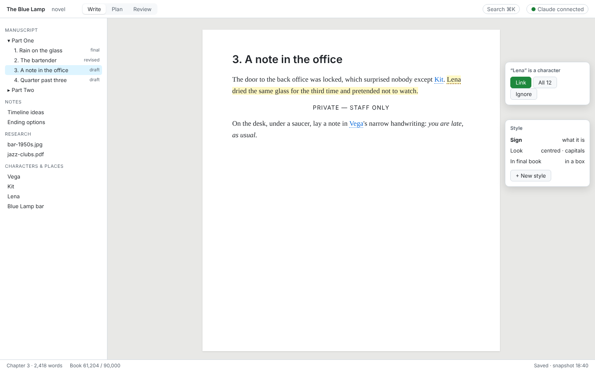
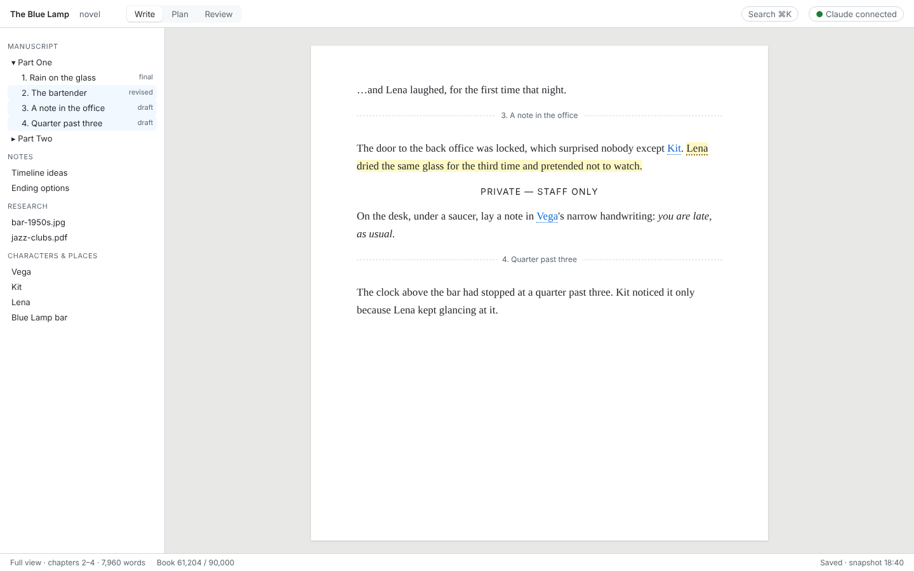
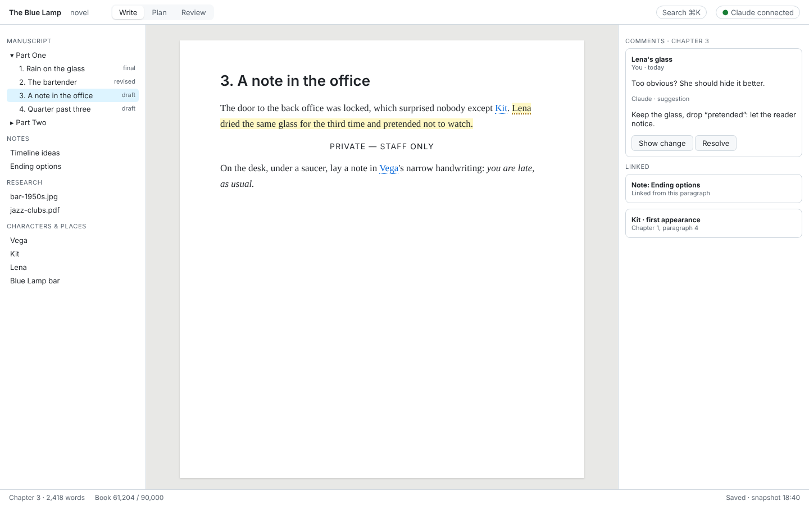
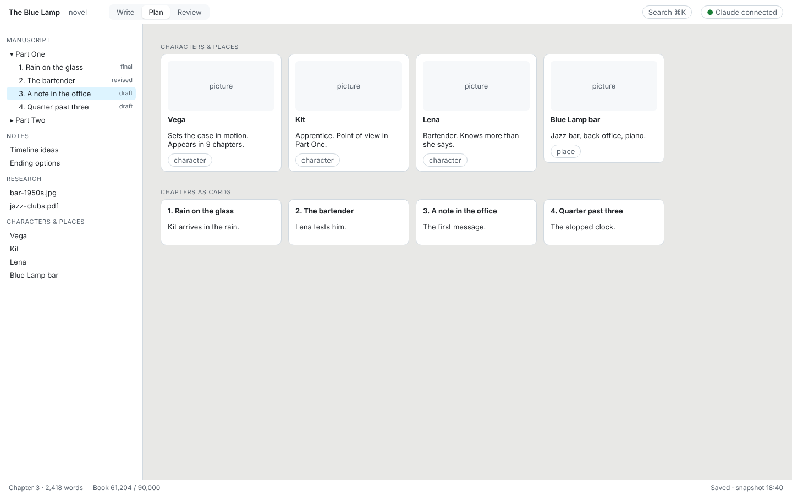
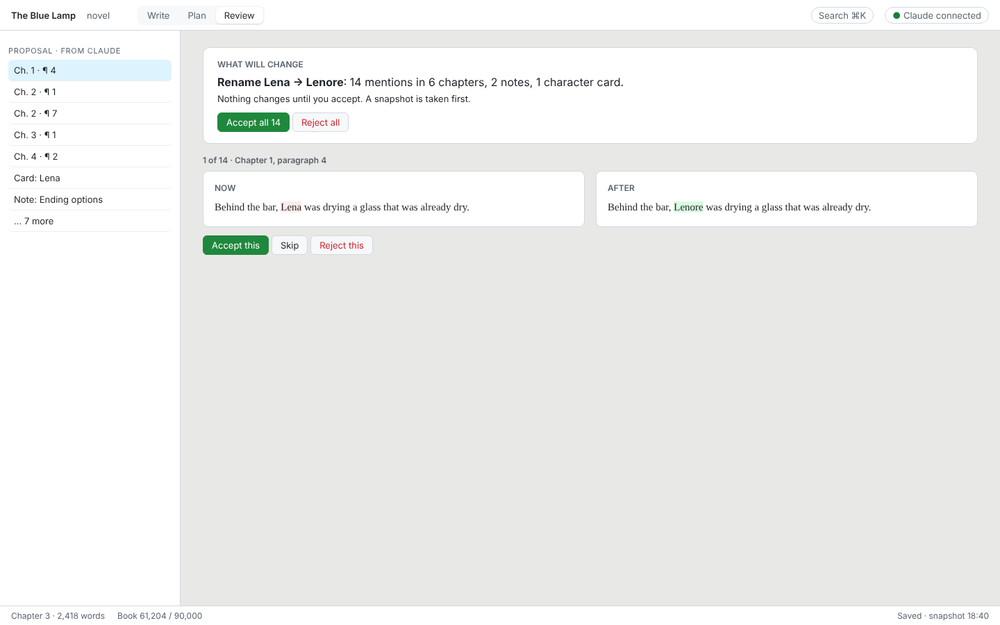

# Libreto — UI wireframes (draft 0)

Part "UI design" of the approved spec (`status/specification.md` §2). Status: **for discussion**. Wireframes, not visual design: they fix what is on screen and where, not colours or fonts. Source: `wireframes/wireframes.html` (open it in a browser; `?s=write|full|comments|plan|review`).

## 1. Rules

1. **The text is the centre.** A page of paper in the middle; everything else sits at the edges and can be hidden.
2. **Little chrome.** One top bar (project, workspace switch, search, Claude status) and one status line (words, saved, last snapshot). No ribbons, no toolbars of icons. Like nacho-viewer, a test counts the chrome so it cannot grow unnoticed.
3. **Everything where expected.** Left: what the project contains (binder, notes, research, cards). Right: what is about the current text (comments, links, styles, details). Top: where you are and how to switch.
4. **Workspaces are presets** (app-type §4): *Write*, *Plan*, *Review*; modules add their own (the Game module adds *Puzzles*). Any panel can be opened in any workspace.
5. **Readable.** A serif text face for the writing, a sans face for the interface; light and dark themes; the page width follows the font size, not the window.

## 2. Write

- Binder on the left: parts, chapters with their status, notes, research, characters and places.
- The **style card** (right) shows what a style *is* ("Sign"), how it looks now and how it will look in the final book; "+ New style" creates one in three steps.
- **Names typed without @** are underlined in dots; one click links this one or all twelve, or ignores the name.

## 3. Full view

- Selecting several chapters (or the book) shows them as one continuous text with thin chapter dividers; edits go back to each chapter. The binder highlights the range shown.

## 4. Comments and links

- The commented words are highlighted; the thread sits in the right panel, with replies from people and Claude. A Claude reply can carry a suggested change ("Show change" opens it in Review).
- Below the comments, what this paragraph links to and what links here (a note, a character's first appearance).

## 5. Plan

- Character and place cards (picture, one-line description, where they appear) and the chapters as cards with their synopsis. Dragging chapter cards reorders the binder.

## 6. Review

- What Claude proposes, said in one plain line first, with *Accept all* and *Reject all*.
- Every place on the left; the selected one as **now | after**, whole paragraphs side by side, changed words marked. Accept, skip or reject each place.
- Nothing changes until accepted; a snapshot is taken before.

## 7. Reused from nacho-viewer

Read 2026-11-04 (same author, MIT): its Markdown rendering pipeline (markdown-it + plugins, DOMPurify sanitising, heading anchors, outline), its theme variables (light/dark, print stylesheet), its string catalog (`strings.ts`, for translating the app) and its chrome budget test. Libreto's editor is ProseMirror, so the renderer is reused for the read-only views (full view preview, export preview, research Markdown), not for editing.

## 8. Open questions

1. **Layout**: binder left, current-text panel right, as drawn? Or both on the left, keeping the right side free for the text?
2. **Workspace switch**: three words at the top (as drawn), or icons in a narrow strip at the far left (as in many editors)?
3. **Anything missing from a first screen** you would expect when you open a book?
